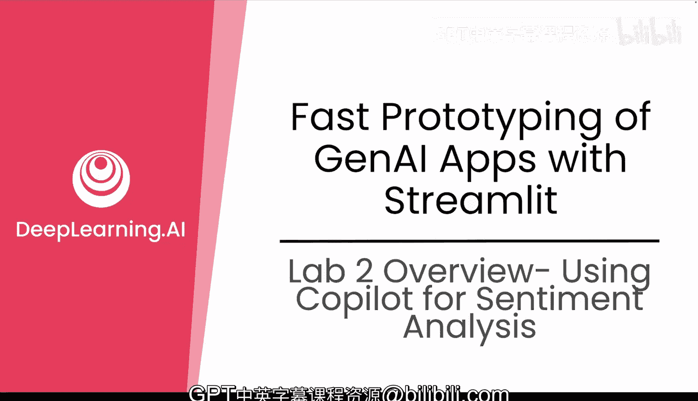
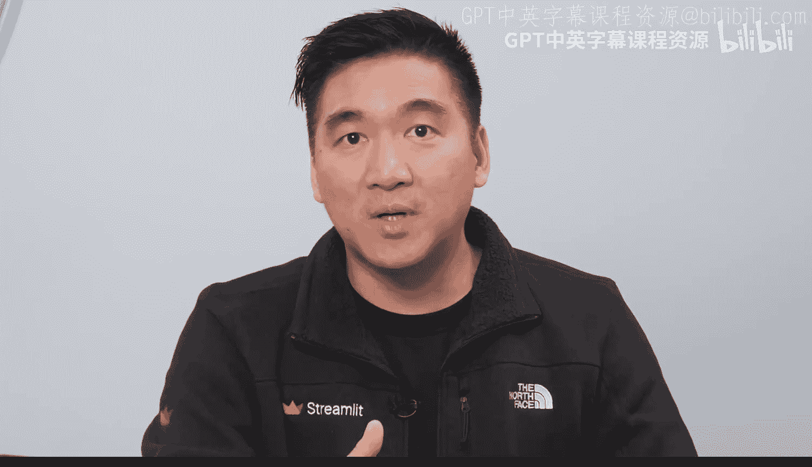
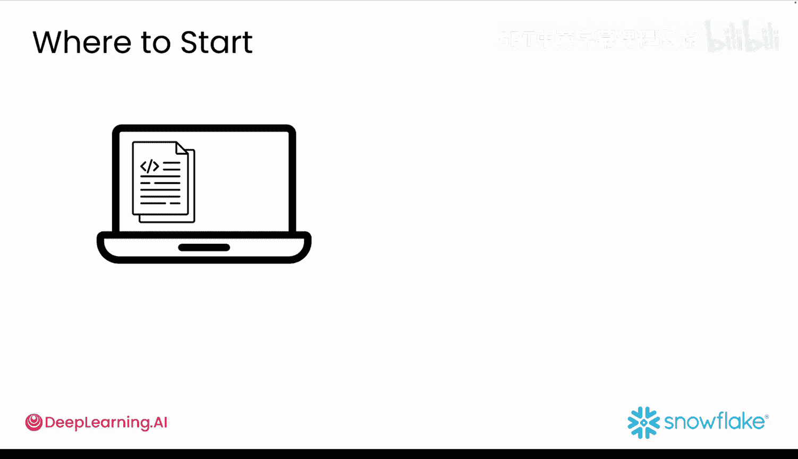

# 吴恩达《用 Streamlit 快速原型开发生成式 AI 应用｜Fast Prototyping of GenAI Apps with Streamlit》 - P31：31_02_06_实验2：GenAI舆情分析系统概览.zh_en - GPT中英字幕课程资源 - BV1QmYrzMEu1

Welcome to your final lab for module2。 This is where all your learning comes together。

 You've explored data with GenAI。 you've done sentiment analysis with cortex。

 You' built visualizations and even added the chatbot Now you will apply those skills in a brand new way your mission is to build a product intelligence dashboard for Avalanche's product team a tool they can use to explore customer sentiment across time and regions。

 visualized trends in shipping delays and delivery performance ask natural language questions Unlike the last lesson。

 you won't just be repeating what you've done This time you'll new visualizations by combining sentiment and shipping data build a filter table that shows product issues by geography add a chatbot assistant and you'll rely heavily on GenI throughout the process。

 Start by connecting snowflake and loading the data Use your existing combined customer reviews you can ask GenI write。

Python code to connect snowflake and load the reviews with sentiment table into appenddas data frame Now you could create a new streament app。

 start a new notebook and ask Jeni to create a basic streament app that loads my data and includes a sidebar with product filters add a title sidebar filters and a data preview to your app then add a graph to visualize sentiment by region you could prompt Geni to plot average sentiment score by region using Matplotlib and streamlet your plot should help answer the question which regions have the most negative feedback you should also highlight delivery issues create a table that shows something like this then ask Jeni to filter for reviews with negative sentiment and delivery issues show a table group by region and product I Don't forget to add a custom LM power chat you can prompt Jeni to add a chatbot to my streamlet app using cortex complete and last but not。

Deploy or share your app you can ask JenI， how do I deploy this streamlet app in Snowflake。

 follow GenI steps to either share the app inside Snow site or export it for use outside snowflake to get the most out of creating a GenI prototype use GenI for every step from creating the app infrastructure to debugging visualizations keep your app simple and focused you don't need to include every feature just show a strong MVP add comments to your code so your future self or future reviewers can understand your logic all the starter code connection setup and prompt examples are in the Github repo under the following path。

This lab isn't just a summary， it's a launch pan， you're putting your skills to the test in a realistic high impact way。

 once you finish you have something you can show off a GenI power dashboard that combines real data with interactive insights。

