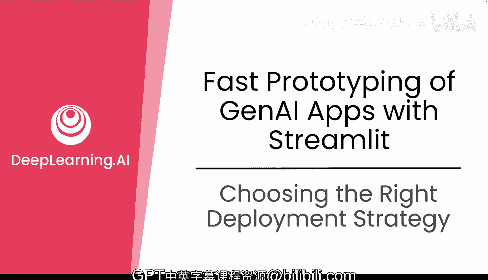
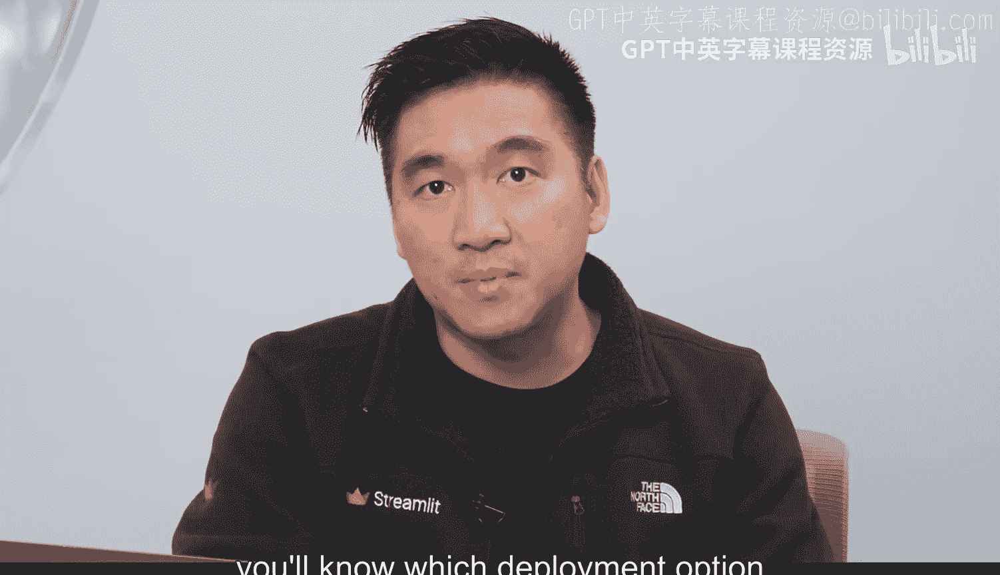
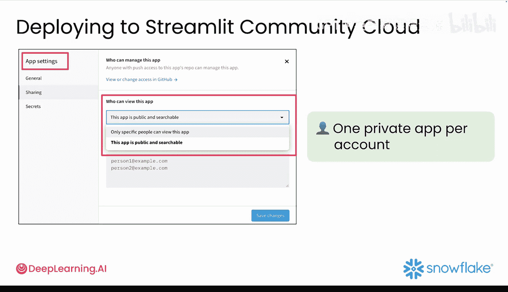
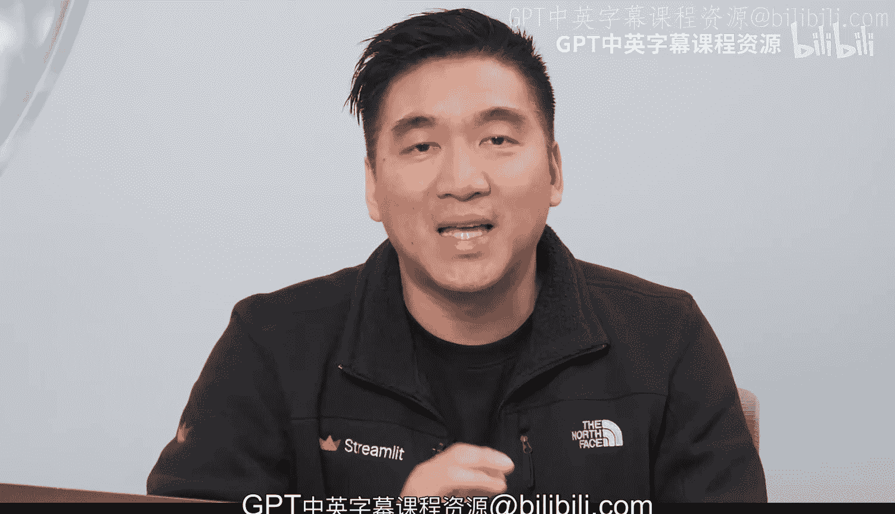

# 吴恩达《用 Streamlit 快速原型开发生成式 AI 应用｜Fast Prototyping of GenAI Apps with Streamlit》 - P32：32_03_01_选择部署策略.zh_en - GPT中英字幕课程资源 - BV1QmYrzMEu1

In this video， you'll learn how to choose the right deployment strategy for your streamla app。

 The key is understanding your audience。 Are you building for internal teammates。

 external partners or the general public Once you know who will use your app。

 you can pick the deployment option that gives you the right balance of accessibility。

 security and performance By the end of this video。

 you know which deployment option matches the needs of your audience。 Congratulations。

 you made it through most of the steps in your MVP build plan on Snowflake。

 Now there's just one final step deployment。 This means getting your app out there where others can actually use it and give you feedback when you build Stlet apps with snowflake。

 you have two main deployment choices。 option one， Stled community cloud。

 you have already used this in module1。 But what is even better is that you can directly connect it to snowflake。

 You Stamlet community cloud when you want to share your app publicly。

You're building a portfolio piece or a demo site with community cloud。

 you can get a public URL that anyone can visit option2 Stlit and snowflake use streamlit and Snowflake when your app needs to stay private this is perfect when you're working with sensitive data or need to control who can access your app when you deploy on snowflake your app runs securely inside your snowflake account。

 giving you complete control over access。 Yes， there are other ways to deploy streamlit apps for example Relet and versll are great tools for creating free web apps but we recommend sticking with streamlet community cloud or streamlit and snowflake for security and ease of use in Snowflake you get native support for Python apps and security options are built specifically for snowflake integration so you can keep sensitive data private and control access with use roles So while there are a lot of other tools that will do the trick when you're building a Geni prototype that connects to live。

Data snowflake and streamlit cloud just makes more sense。

 When you deploy your app on streamla Community cloud， your code can stay private。

 but the app itself works a little differently。 There's an app setting menu where you can choose whether your app is private or public。

 you walk through both options in the upcoming videos but here's the important thing to know right now。

 You can only have one private app per account。 So choose carefully if you're going the private route in this video。

 you explore different ways to deploy your streamla app on Snowflake。

 you learn when to keep your app internal and secure and when it makes sense to go public。

 Now that you understand the landscape。 you can pick the right option based on your app's audience and how it will be used Now you're ready to move forward and focus on building an app that's both powerful and easy to share。

😊。

