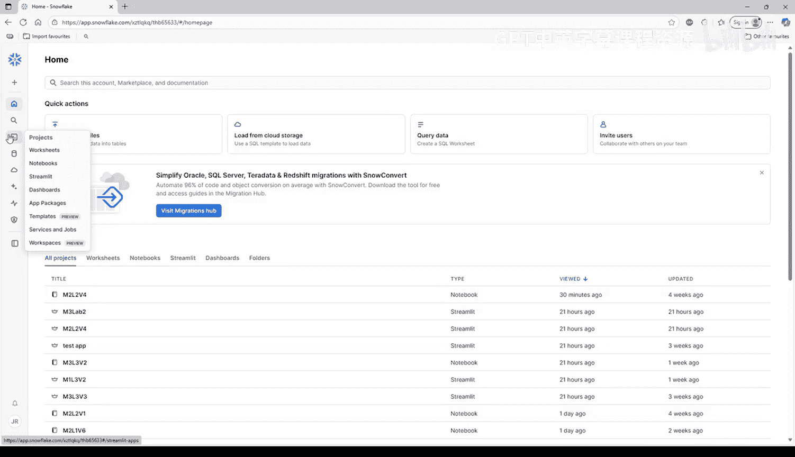
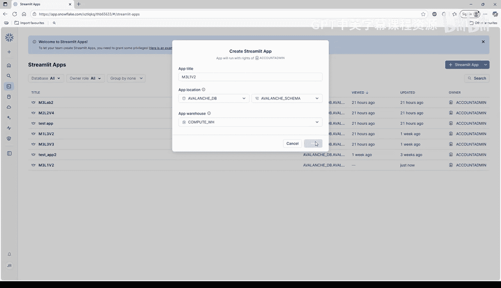
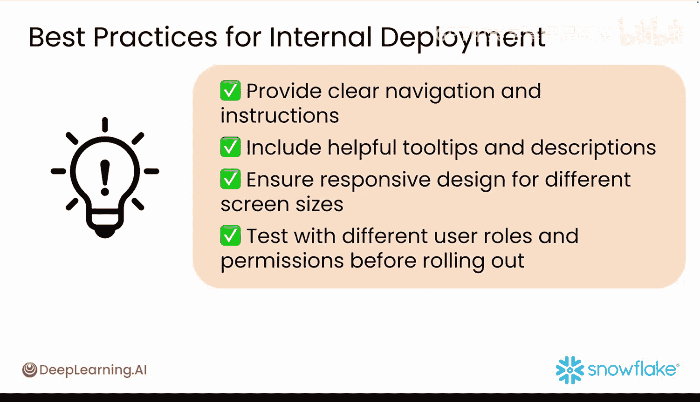

# 吴恩达《用 Streamlit 快速原型开发生成式 AI 应用｜Fast Prototyping of GenAI Apps with Streamlit》 - P33：33_03_02_Streamlit内部部署原型.zh_en - GPT中英字幕课程资源 - BV1QmYrzMEu1

In this video， you'll deploy your completed avalanche prototype directly inside Snowflake。

 where your coworkers can access it securely and provide feedback before you make it public by the end of this lesson you'll have your complete dashboard deployed in Snowflake as an internal app that your colleagues can access based on their rows Let's get started by deploying your finished app you've already made a streamlet app that runs directly inside Snowflake notebook。

 you can find the code for that app in the Github repo at the following link download the streamlet app Py file that contains your sentiment analysis dashboard code。

 Now lock into your Snowflake account to deploy your app internally using snows in the left navigation bar select projects then streamlet in the upper right hand corner。

 click the blue plus streamlet app button the create streamlet app window will open up in the create Stlet app pop up window give your app a name in the app location drop。

select the avalanche Db database and avalanche schema that you've created in the previous video。

 Choose the default compute warehouse。 Click create to initialize the new streamlet app you'll be taken to the streamid editor with a side by side view of the code and the app in the streamlet editor you'll see some default hello world code De all of the existing code in the editor。

 copy all the code from your downloaded streamid app p file and paste it into the editor before you run the app you need to add the necessary packages。

 This scriptib uses mapplotlib and stoneflake Ml python。

 so select packages in the top left type mapplotlib and stoneflake Ml python and select it click the run button in the editor to deploy your app The app preview will appear in the right pane of the editor after your app finishes loading。

 it will be live running insidemflake the side by side editor and preview screen allows you to see change。

In real time as you modify your code， your running app should look something like this when running a streamlet app and snowflake changes to your code appear immediately in the preview pane。

 your app uses snowflakes built in connection methods。

 So this automatically handles the following authentication through your current snowflake session rowbased access control or Aac for data security and automatic session management and connection pooling for its equalQL queries。

 if you're not familiar with these terms， don't worry will explain them in a bit more detail later on。

 But since you're working in snowflake it would just take care of these things for you your app is now deployed internally and ready to share with colleagues to share your app。

 click on the share button in the top right hand corner of your streamlet app you'll be given a web link that colleagues on the snowflake platform can use to access to your app share your app with other users in your snowflake account through rowbased access control。

back this means that access is controlled by existing snowflake permissions and roles users will need access to the underlying database and schema to view data The app remains secure within your snowflake environment for the avalanche app this means that users with access to avalanche Db and avalanche schema can view the app anyone with an ad mineral can modify app settings and permissions and data access will follow existing snowflake security policies When you deploy a streamlet app in snowflake。

 it consumes compute resources through virtual warehouses your app needs a warehouse to execute SQL queries against your data the warehouse remains active while users are actively using your app and each user sessions can trigger multiple queries through data loading filtering aggregations etc because of this your warehouse。

Size directly impacts both performance and cost to monitor performance。

 There are a few key metrics to keep an eye on， such as how much of your warehouse capacity is being used。

 how long individual queries take to complete The cost of running your warehouse over time。

 How many people are using your app simultaneously。

 Snowflake provides several tools to track your app's performance from within snow site to check query history go to activity。

 then query history。 This will show you every SQL query your instrument app executes and can help you monitor query duration。

 execution time， warehouse and compute used credits consumed and the execution plan to check warehouse usage from snow site go to admin than warehouses。

 The warehouses tool shows both realtime and historical warehouse performance。

 helping to give you a better picture of。In idle time Q D average execution time and credit usage over time。

 The aminmin panel also has a tool called resource monitors that will show you cost control and usage alerts。

 This can help you savespending limits on warehouses get alerts when thresholds are reached and automatically suspend warehouses to control costs if your prototypes turn out to be the amazing ideas that we all hope they are。

 It's a good idea to come up with a weekly review process to monitor your app usage on a weekly basis is a good idea to check query history to identify slow or expensive queries analyze patterns to look for repeated operations that you can cache for efficiency review warehouse usage to ensure appropriate sizing for actual load test optimizations by implementing small changes and measuring their impact and monitor results to track improvements in performance met。

This monitoring approach helps you maintain a cost effectiveffive high performanceance streamlet app while ensuring good user experiences for your colleagues accessing the internal dashboard。

 Here's a few tips for improving user experience when deploying your prototypes。

 provide clear navigation and instructions。 include helpful two tips and descriptions。

 ensuresure responsive design for different screen sizes。

 Test with different user roles and permissions before rolling out。 And there you have it。

 your app is live on Snowflake。 Congratulations you successfully deploy your sentiment analysis dashboard using Stwood in Snowflake。

 your internal deployment in Snowflake provides the perfect testing ground to refine your dashboard and ensuresure is' ready for broader public access。

