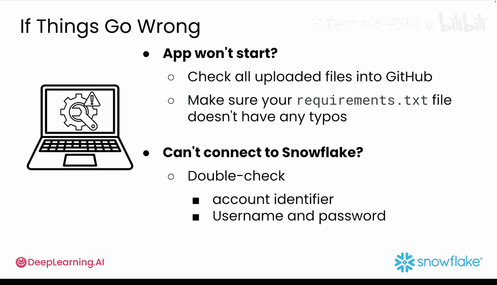

# 吴恩达《用 Streamlit 快速原型开发生成式 AI 应用｜Fast Prototyping of GenAI Apps with Streamlit》 - P34：34_03_03_部署至Streamlit社区云.zh_en - GPT中英字幕课程资源 - BV1QmYrzMEu1

In this video， you'll learn how to take your avalanche data dashboard prototype from Snowflake and deploy it to Stamlit Community Cloud。

 This will allow you to share your project with others just by sending them a link。

 you have already done this for your prototype in module 1 Now you will do the same thing but this time you will also need to set up the secrets file Secrs R credentials and parameters that streamlet will use to connect to your snowflake account If you haven't done so already。

 it's time to create your streamlate community cloud account and lock into it using Github you can find detailed instructions in module 1 in Github make a new Github repo specifically for your deployed app just like you did in module 1 Choose a new distinct name for your repo in your new Github repo click on upload an existing file then upload the entire lesson folder your new repo should now contain streamlit app Py and also requirements TxT When the upload is done。

 click on commitit changes。

Your files are now ready for deployment next， log into streamlit。 o cloud。

 click on create app or new app in the top right corner。

 select deploy a public app from Github and select your Github username and the repo title as repository leave the branch as main and make sure it's pointing to your streamlet app file called Stlit app do Py Choose a unique subdomain or use the autogenerated web address for your prototype。

 They click on deploy。 Stamlet will now start building your app which can take a couple of minutes because you want to pull the data from snowflake。

 your app will need to configure access to the avalanche snowflake database。

 you can do this by going to your deployed app clicking manage app in the bottom right corner then clicking on the three dots and then settings Next in the sidebar click on secrets in the secrets box that appears add your snowflake credentials like this make sure to update all of these information。

With your own credentials such as your username and password。

 your account identifier is part of the web address you see in your browser when you log into Snowflake if you are having trouble finding your account ID check out the snowflake documentation Once your changes are saved。

 the Apple automatically refresh and now uses live data from your snowflake database If your app isn't working here are some of the most common fixes the app won't start check that all your files are uploaded to Github properly and make sure your requirements Txt file doesn't have any typos can connect the snowflake doubleche your account identifier username and password in the sacred section Also verify that your warehouse and database names are spelled correctly Next up is your turn to give it a try。

