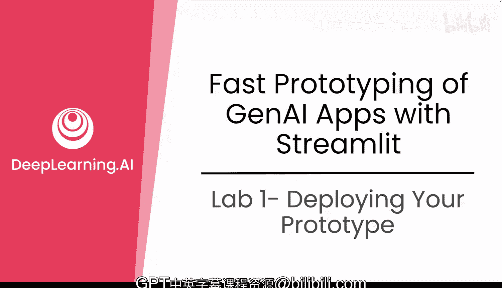
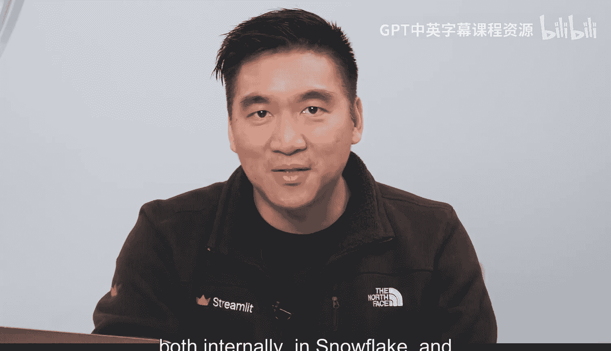
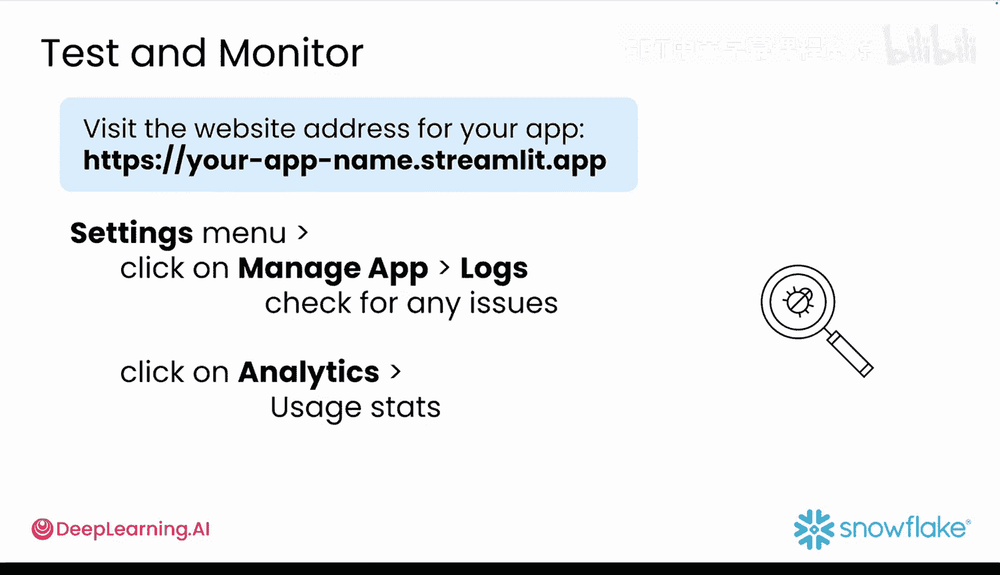

# 吴恩达《用 Streamlit 快速原型开发生成式 AI 应用｜Fast Prototyping of GenAI Apps with Streamlit》 - P35：35_03_06_实验1：原型部署实践.zh_en - GPT中英字幕课程资源 - BV1QmYrzMEu1

In this lab you're going to combine everything you've learned Pro engineering， data connections。

 UI and JennyI to deploy your app， both internally in Snowflake and publicly on Stlit community cloud you'll also learn how to monitor stats control access and use GenI tools to better collaborate Now it's time to deploy your complete avalanche prototype securely inside snowflake。

 open snowflake and head to the projects dense streamlit section。

 click the blue plus streamlit app button on the top right。

 name your app something like Avalanche prototype， select your avalanche Db and avalanche schema。

 click create in the editor， delete the default hellello world code。

 then copy everything from your streamlet apppyy and paste it in make sure your code connects using STdot connection or get active session remember these functions handle authentication and access automatically when you deploy inside snowflake click run to launch your prototype。

Your app is now live and viewable in size Noflake。 Next。

 click share to get a link you can share to teammates with apps。

 Let make sure your deployed app is running smoothly by checking the query history to see how much time queries are taking and whats be run monitor warehouse usage to track costs。

 loading and idle time then set resource monitors to get alerts and manage spending Pro tipip do a weekly review to look for slow queries。

 redundant operations that you can cache and high cost compute spikes。

 If you want to go above and beyond use a Geni app to help you draft documentation suggest code improvements。

 generate onboarding guides and fixed performance issues。 Now。

 let's make your app available to the world create a new public Github repo upload the following files。

 streamlet apppyy requirements Txt streamletconfigel and any relevant data folders or。😊。

Via terminal first， log into streamumla do io cloud and choose the option to log in with Github。

 then click create app。 choose the repo you want to deploy and point it to Strnet app py and now you can click on deploy Once your app is up and running you can access your app management menu by clicking on the three dots in the top right corner of your app from the app management menu select manage app from the dropdown on the sidebar that appears click on settings。

 This will open up your app settings panel Now you can click on secrets to add your snowflake lockin credentials so that Strlink can always access your data paste in the following block of code。

 but of course， make sure to update this with your own login information When you're done。

 click on save your app will automatically reload with the new credentials to test and monitor your app on Strlin Community cloud visit the URL for your deployed app This is usually something like。

This is always a good idea to test the app yourself before sending your prototype to other people。

 Give it a quick check to make sure each tab in widget works。

 then go to your settings menu and click on manage app then logs to check for any issues。

 the same menu is where you will later be able to see usage stats under analytics。

 Now that your app is deployed。 you'll be able to quickly iterate on it and make it better。

 Nice work。 you've deployed your avalanche prototype both securely inside snowflake and publicly for the world to see you can now share the link with your team Add it to your portfolio post it on LinkedIn or X and most importantly start collecting feedback to iterate on in the next lab you will learn how to gather and prioritize feedback to make your app even better。

 but for now， enjoy the win。 You've taken your idea and made it real。😊。

