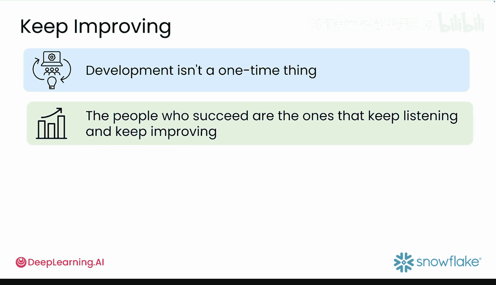

# 吴恩达《用 Streamlit 快速原型开发生成式 AI 应用｜Fast Prototyping of GenAI Apps with Streamlit》 - P36：36_03_01_快速迭代方法论.zh_en - GPT中英字幕课程资源 - BV1QmYrzMEu1

You put in a lot of effort to build and deploy your avalanche prototype when iteratively improving a prototype。

 It helps to embrace the spirit of rapid experimentation。

 AI has made it incredibly fast to build things。 you can write a prompt and deploy it in days or maybe even hours。

 This means that you can try a lot of ideas， throw away the bad ones and keep the good ones。

 Here's the amazing thing about AI。 You can build things faster than ever before。

 If you only have an hour。 narrow your scope down to something that you can build in an hour。

 You'd be surprised what's possible， even in short bursts。 getting something working。

 even if it's rough is better than having nothing at all。 Don't spend weeks planning。

 just build something that works。 Then see what breaks。

 This probably goes against traditional programming best practices， but with Gen AI。

 it gets you to market faster because you uncover problems by doing not by thinking。 For example。

 if you're building a chatbot for。

Customers don't spend months designing the perfect flow of conversation。

 Just build a basic version that can answer the five common questions your company receives and see where your users get confused or frustrated。

 Think of it like cooking taste as you go Don't wait until the entire meal is done to see if it needs more salt。

 You're not building the final product yet。 You're building something simple to test your ideas。

 This is your minimum viable product。 The simplest version that lets you learn what you need to know。

 This list us to a key question。 When is your prototype good enough。 done is better than perfect。

 your prototype just needs to work well enough to test your main ideas and get feedback。

 focus on delivering 80% of the core functionality efficiently。

 Then let that feedback guide the rest。 close to loop with users。

 This is crucial but often forgotten。 Tell people what you've changed based on their feedback。

 sendend them updates write release notes or show them in the app。

Bils trust and makes them want to keep helping you Make sure your whole team knows what you discovered。

 put it somewhere。 Everyone could access it so you don't make the same mistakes twice。

 post it on social media platforms， codingting websites anywhere you can get eyes on it and gain additional insight。

 Development isn't a onetime thing。 The people who succeed are the ones that keep listening and keep improving。

 Your competitors are getting better。 too。 So you need to stay ahead Today。

 the key to success is speed。 build fast， get feedback fast and improve fast instead of aiming for perfection。

Aim for progress each cycle of feedback and improvement gets you closer to something people truly want the developers that master this cycle are the ones that would thrive。

 so start small， move quickly and always keep your users at the center of everything that you do。

