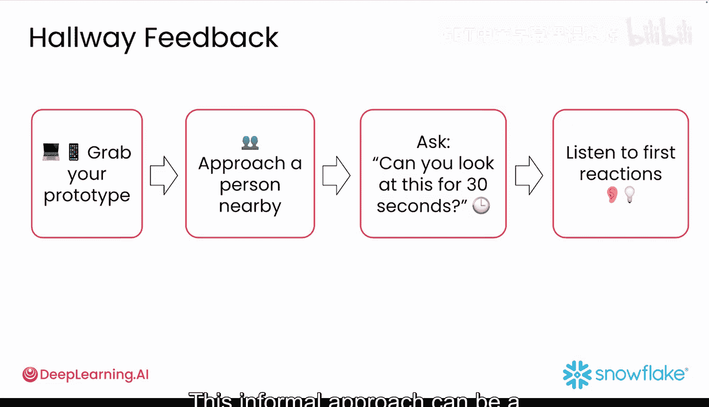
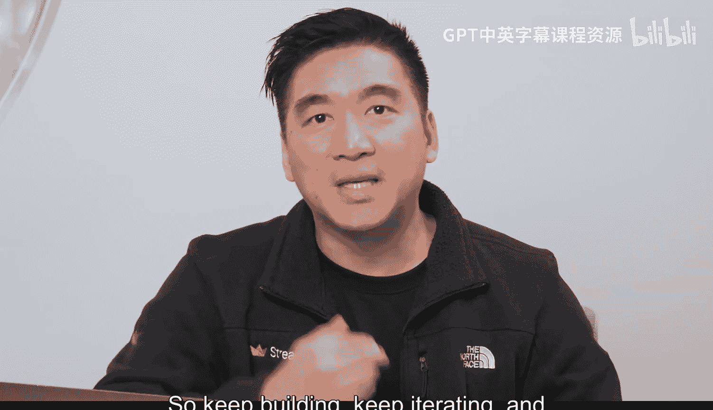

# 吴恩达《用 Streamlit 快速原型开发生成式 AI 应用｜Fast Prototyping of GenAI Apps with Streamlit》 - P37：37_03_02_即时反馈机制.zh_en - GPT中英字幕课程资源 - BV1QmYrzMEu1

There is a saying done is better than perfect。 And one of the best ways to do that is getting feedback quickly。

 But when you can build something that fast， waiting days to get feedback seems painfully slow。

 The faster you can get feedback and act on it。 The quicker you'll build something that people actually want to use。

 it's time to move fast and learn things。 Now， the most important part is to get real user feedback。

 earlyy tactics for getting feedback typically focus more on qualitative feedback。

 which is valuable for sparking new ideas， and understanding user pain points。

 not all feedback is create equal。 So let's take a look at some simple ways to collect feedback efficiently and strategically begin with a small group of people preferably who are in your target user group。

 you can find testers through social media， professional networks。

 or even from your existing customer base。 before you even explain what your app does。

 show them the interface for5 seconds。 then ask them。😊。

What they remember and what they think the app is supposed to do。

 This can review if your most important features are prominent and memorable。

 catch people right after they've used your feature when they've just made a purchase。

 finish the tutorial or try something new their experience is fresh So their feedback will be more specific and useful。

 identify the single most important user journey in your app and test only that path。 For example。

 in your avalanche prototype， the single most important thing your app needs to do is perform a sentiment analysis on an input data。

 So ask your testers to select a date range and set a products then review the results。

 It's that simple。 ignore everything else until the core workflow is instead of asking broad general questions like what do you think try to ask questions that give you information about specific features like but this button easy to find or how did this feature help you solve your problem Open-edit questions encourage。

Testers to give you detailed insights， but try to throw in some rating scales for easier analysis。

 Oberve your users in their natural habitat as they navigate your app。

 Take note of what order are they doing things in。 Where do they get stuck。

 Do they have to do anything outside of the app to get it to work， it's a big eyeoper。

 If your user has to do a lot of editing on a file before they even upload it into your app。

 as people are trying out your app， try asking them to narrate their thoughts out loud。

 This is a great way to uncover things like I'm looking for the submit button is not where I thought it would be。

 if you can remember all of the feedback。 Great， but it's also okay to ask them if you can take notes。

 if traditional methods are taking too long， use this shortcut。

 It's as simple as grabbing your laptop finding colleagues。

 friends or even strangers in a coffee shop and asking， hey。

 can you look at this for 30 seconds and tell me what you think。

This informal approach can be a valuable source of actionable feedback when done right。

 So keep building， keep iterating and keep getting that valuable feedback。

 Foow me to the next video on how you can act on feedback。

