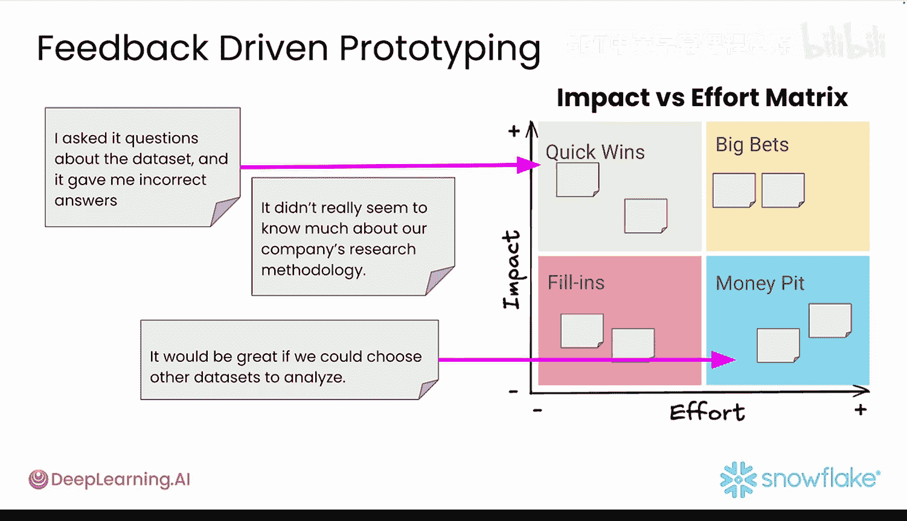

# 吴恩达《用 Streamlit 快速原型开发生成式 AI 应用｜Fast Prototyping of GenAI Apps with Streamlit》 - P38：38_03_03_反馈响应策略.zh_en - GPT中英字幕课程资源 - BV1QmYrzMEu1

There are a lot of quick and simple ways to effectively collect feedback for a prototype。

 but not all feedback is going to be useful， like feedback where someone doesn't like your color scheme or wants to add features that aren't useful to a broader audience in this video will walk through strategies for prioritizing and acting on feedback start by sorting feedback into buckets like bugs feature requests or usability issues This will help you figure out not just what people are asking for but why they are asking for it When users say your app is slow or this feature doesn't work。

 don't just guess what's wrong。 Think like a detective investigate systematically to find a real problem instead of panicking trying to fix everything at once become methodical break your problem into smaller slices Ask yourself iss just slow for new users or returning users instead factory mobile users more than desktop users by breaking it down this way you can pin。

Poin exactly what's causing the problem for fast prototype being your measurement approach should be just as fast as you' building。

 Try these quick validation methods。 Watch a handful of users test your updated prototype Even five users can review major issues send a short survey to recent users asking one specific question about the change you made check your basic analytics to see if user behavior shifted in the direction you want set up simple AB tests where half your users see the old version and have see the new version then compare their actions。

 The goal isnt statistical perfection is getting a clear signal about whether you're moving in the right direction。

 we've now reached the point where feedback doesn't have to come only from human users let AI help you code tools like Github Copit and cursor can write code for you help you debug problems and automate boring tasks get good at prompting that better you are at telling。

AI what you want， the better help you get。 This is a skill worth developing because it can dramatically speed up your work。

 and it's something you'll learn more about in the next video。

 Try agent workflows for complex problems， break them down into steps and let AI handle each piece。

 This approach can give you much better results then trying to solve everything all at once。

 track feedback systematically use tools that help you collect and organize user feedback automatically。

 This gives you the data you need to make smart decisions quickly。 Now。

 let's take a look at some of the feedback you got from some of your colleagues at avalanche。

 I asked questions about the data。 and it give me incorrect answers。

 It didn't really seem to know much about our company's product line。

 it would be great if we could choose other datasets to analyze I didn't even see an upload button。

 How do you decide which if any of these comments need to be acted on before rolling out your prototype。

 The key is finding。😊，Easy to implement features that can be added quickly。 Remember。

 the must have Nice to have decision framework you use when building your MVP。

 you can use a similar process to prioritize feedback， using an impact versus effort matrix。

 This framework helps you focus on high impact low effort changes first， which are your quick wins。

 you can use to impact effort matrix to prioritize the avalanche feedback。 For instance。

 providing correct answers to questions about the data is a high impact low effort。

 quick win for your prototype。 whereas adding the ability to choose other data sets might be low impact for a prototype and require more effort So it can be skipped for now。

 the cycle that you just work through feedback， prioritize。

 build and validate is the engine that powers successful products。

 the faster you can spin this wheel。 the faster you'll create something that truly resonates with your audience。

 remember every。

P of feedback is a gift， but not every gift needs to be unwrapped right away。 Stay focused。

 stay fast， and keep building。

