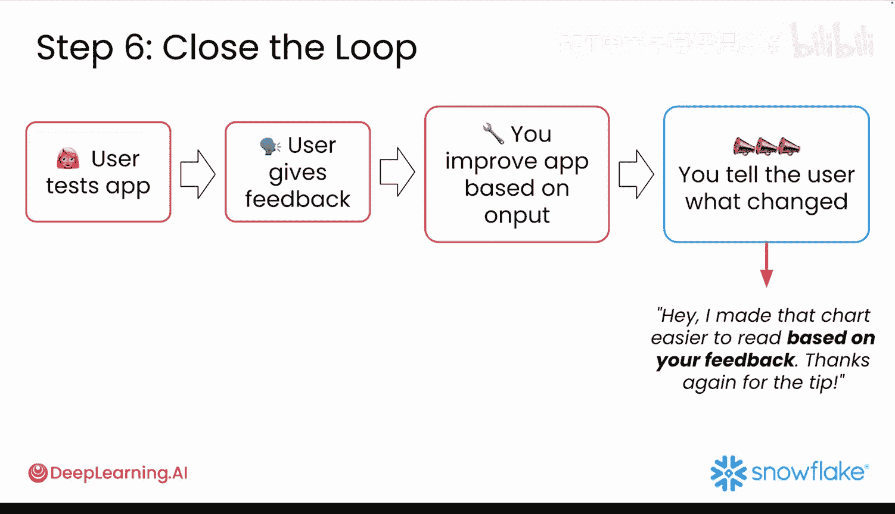
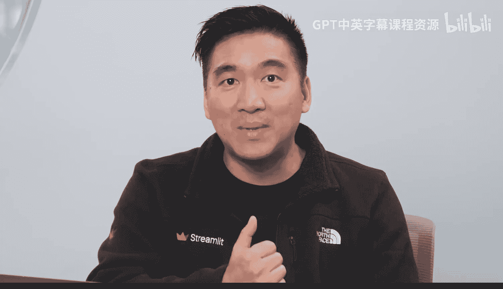

# 吴恩达《用 Streamlit 快速原型开发生成式 AI 应用｜Fast Prototyping of GenAI Apps with Streamlit》 - P39：39_03_04_雪崩应用的迭代优化循环.zh_en - GPT中英字幕课程资源 - BV1QmYrzMEu1

Welcome back。 Your prototype is live。 Useers are trying it out and the feedback is rolling in。

 Now what？ Most prototypes fail， not because they're broken。

 but because builders don't know how to turn user feedback into meaningful improvements。

 They either ignore feedback entirely， or they try to fix everything all at once and end up fixing nothing at all。

 In this lesson， you'll learn the systematic approach that separates successful prototypes from abandoned ones。

 by the end of this lesson， you will be able to test your app from a user's perspective。

 collect actionable feedback quickly。 Proitize improvements based on impact and effort and use AI tools to accelerate your iteration process。

 First， open your deployed avalanche app。 you can access it through snowflakes streamlet interface or streamlit cloud。

 If you deploy it there， put yourself in the shoes of a brand manager at Avalanche。

 Your goal is to answer this business。😊。

Question what do customers think about winter product line navigate through your app with fresh eyes and evaluate。

 can you quickly locate the sentiment analysis feature are the results presented in an easy to understand format with someone unfamiliar with your data know what to click next this perspective shift helps you identify usability issues before real users encounter them show your app to someone for five seconds then immediately ask them what do you think this app does what stood out to you the most were you able to figure out what to do next This test evaluates first impressions your key features should be immediately obvious not hidden or confusing if you're working alone take a screenshot of your app and send it to a friend via text or slack ask them to spend just five seconds looking at it and answer the same questions identify the single most important user journey in your app load the dashboard run sentiment analysis。

Interpret the results。 Walk through this flow while timing yourself。

 Pay attention to where you slow down or hesitatesitate， Ask yourself。

 is anything confusing or awkward in this flow or instructions clear and actionable that's the layout support this main task effectively。

 remember， you're not testing everything Fo on this one critical workflow to keep your testing fast and focused。

 Open a noteta app or grab a piece of paper and create these three buckets， bugs。

 anything that's broken or not working， usability issues。

 Fe that work but few clunky or confusing Fe ideas nice to have additions for future development for each item you identify。

 ask what's high impact but low effort to fix What can I improve right now in other 30 minutes。

 These are your quick whims。 focus on tackling one or two of these immediately If you identify issues that need fixing leverage AI tools。

To help for content issues， use Gitthubcopit， chat TT or cloud to rephrase confusing labels or two tips ask AI to rewrite prompt templates for better clarity。

 and request help cleaning up code blocks for user experience Use your JdiI assistance tab in snowflake to test new ways of answering user questions as AI to suggest alternative chart types or data visualizations。

 You're not building a new app， you're polishing and reffining what you already created。

 If anyone provided feedback during your testing process。 let them know what you changed。

 a simple message like， hey， I made that chart easier to read based on your feedback。

 Thanks again for the tip。 this approach can turn casual testers into ongoing users and advocates for your app。

 The difference between a prototype that gets used and one that gets forgotten often comes down to what happens after launch。

 Let's make sure yours is the one。

People keep coming back to in the next video， we explore how to improve your GenI results even faster using better prompt design techniques。

