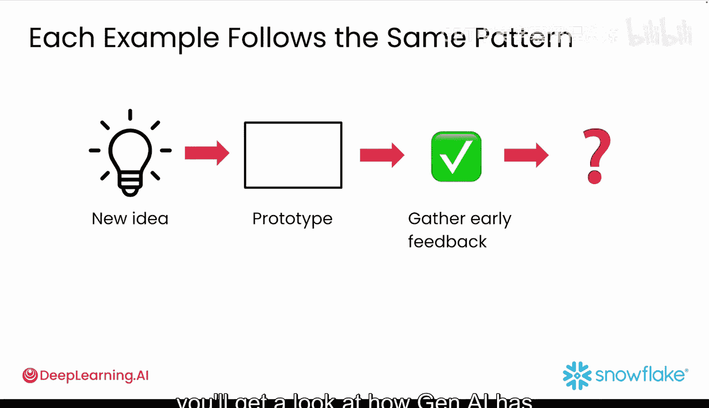
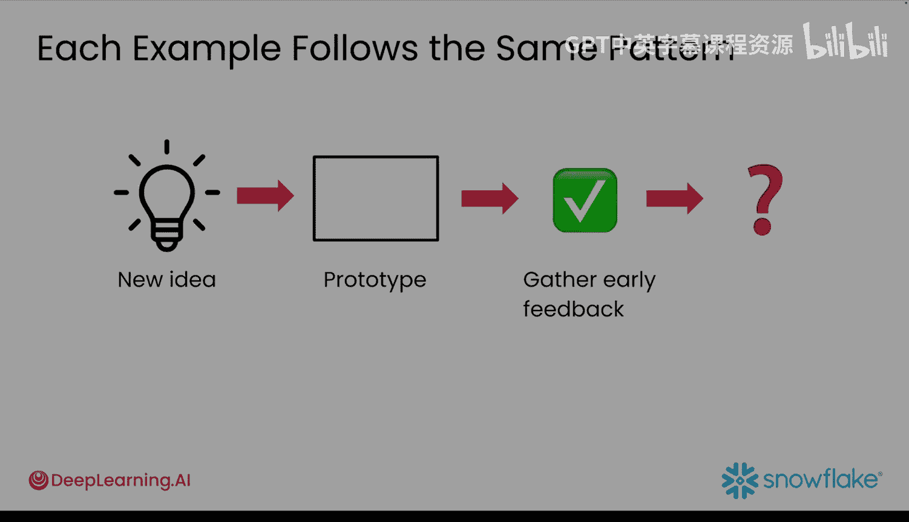

# 吴恩达《用 Streamlit 快速原型开发生成式 AI 应用｜Fast Prototyping of GenAI Apps with Streamlit》 - P3：03_01_03_原型设计的优势.zh_en - GPT中英字幕课程资源 - BV1QmYrzMEu1

Think about this for a moment when you ask Jt GBT the same question twice。

 Do you get exactly the same answer， Usually not， right， This is why building AI products is tricky。

 You will never know how users will react to your GenI app until they actually use it。

You can't guess what questions they asked。 You can't predict when Geni will give a confusing answer。

 This uncertainty means that you will need to test your ideas much earlier and much more often than you do with regular software That's where prototyping is key a prototype is a quick lightweight and tangible version of an idea。

 It's not perfect and it's not supposed to be。 Protos are built fast so you can test something learn from it and iterate。

 Protos are not meant to be polished or complete。 They are meant for testing not for production and they usually get discarded or heavily modified along the way。

 In this course you' concentrate specifically on prototypetotyping for a Geni app when developing Geni apps showing your vision with a prototype beat just telling people about your idea every single time making a prototype is essential when you want to get feedback early before investing weeks into development test risky ideas without building a full product and validate your assumptions you。

Real data and real users prototypes are great for early stage experiments。

 instead of creating detailed specs that can be easily misinterpreted。

 just quickly build a prototype that shows exactly how your app works。

 This less people experience your vision rather than having to imagine it Forbe list failure to prototype as one of the top 1 reasons software projects fail。

 A good example of this is my colleague Alex。 His name has been changed to save him some embarrassment。

 Alex had a brilliant idea for an AI chatbot that could detect frustrated customers and automatically escalate them to human agents。

 He got so excited that he did what revolve' done and skip prototyping and jumped straight into writing specs。

 Alex figured he could explain his vision through written requirements and rough sketches。 After all。

 he had it mapped out clearly in his head。 a conversational interface where the AI would respond with empathy while detecting emotional cues。

 Without a prototype Alex。😊，Could clearly communicate his vision when he said conversational interface。

 his developers built dropdown menus and forms when he mentioned sentiment analysis to build a keyword detector that flagged messages like I need help as angry customers over the sixwe development cycle the disconnect got worse。

 Alex would say things like make it more intuitive but without a concrete prototype2 reference。

 Each team member failed in the gaps with their own assumptions。

 the final product buried his great idea under a clunky interface。

Custom had to navigate multiple dropdown menus before typing their input and the AI responses felt robotic exactly the opposite of what Alex intended when he presented to leadership。

 one executive said this feels like a step backward from our current support system The project was quietly shelved after six weeks of development loo a generally innovative idea that could have transformed their customer experience if Alex had spent。

Just one week building a simple prototype his team might have been able to build what he envisioned。

  building a prototype isn't just theory。 It's a proven strategy that many successful businesses have used to launch and grow their products。

 Proto can take many different forms and shouldn't be complicated。

 a prototype can be as simple as a landing page for collecting email addresses a basic app for testing your core idea or even a video for explaining the concept to gauge interests。

 Let's look at some examples。 The founders of Airbnb first tested their idea by renting out their own apartment during a design conference。

 This basic prototype helped improve the concept and gather crucial early feedback before expanding into the global travel platform that we know of today Uber started with a simple vision connecting highend riders with luxury drivers in San Francisco their prototype was a basic app that connected one type of rider with one type of car in just one city。

This limited rollout let them test core functionality and gather user feedback before expanding to other cities and vehicle types Instagram's first prototype focused only on photo sharing with basic filters after the platform grew user feedback and engagement drove the development of today's features like video sharing direct messaging and stories Spotifys prototype focused on delivering smooth streaming with a vast music library Use feedback and market demand led to new features like social sharing and playlists which are now central features to the platform GPT0 built by a Princeton student was designed to detect if text was written by ChaGBT or a human launched using streamless free community cloud it exploded within days 7 million views massive media coverage and global attention all powered by a lightweight stream app that makes it easy to build deploy and scale instantly notice how each example follows the。

Pattern， start with an idea， create a focused prototype。

 then iterate and improve base on customer feedback and all of these companies had to do things the hard way。

 but you have the advantage of using GennyI to make prototyping really fast and easy in the next video。

 you'll get a look at how Gen AI has revolutionized the prototyping process。 See you there。

