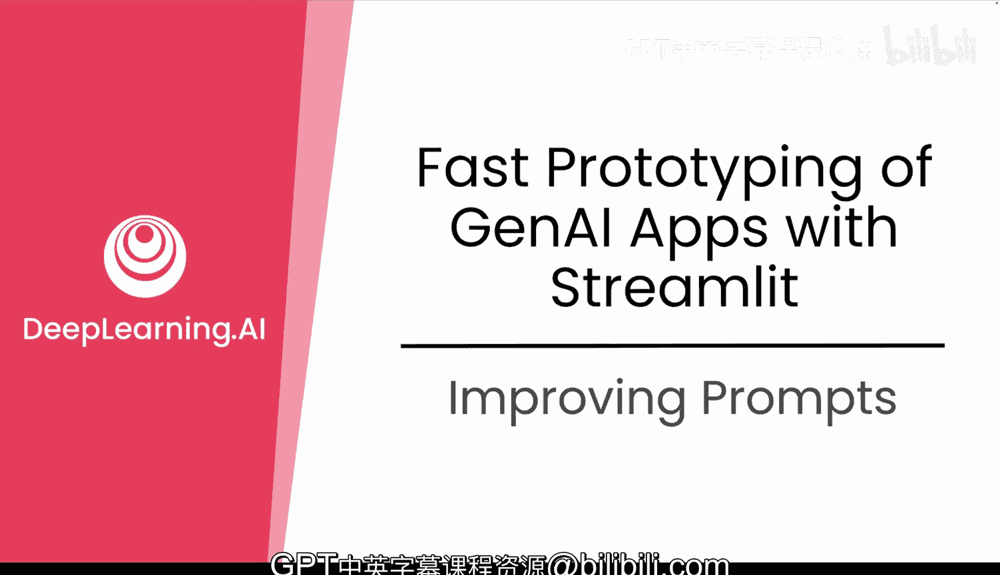
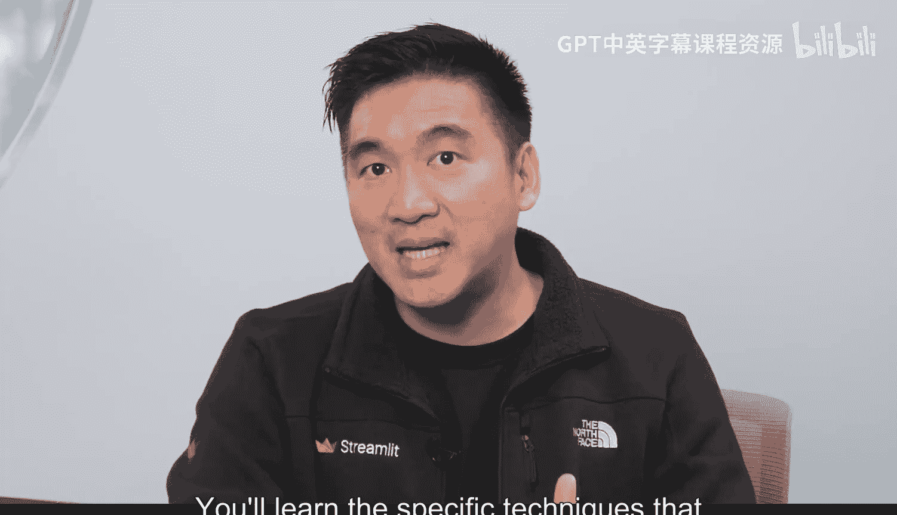
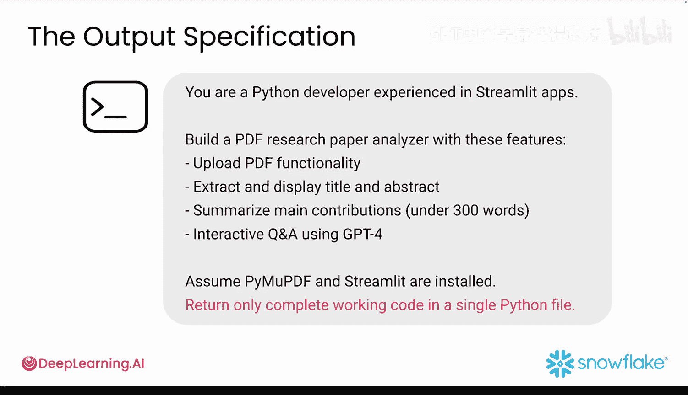
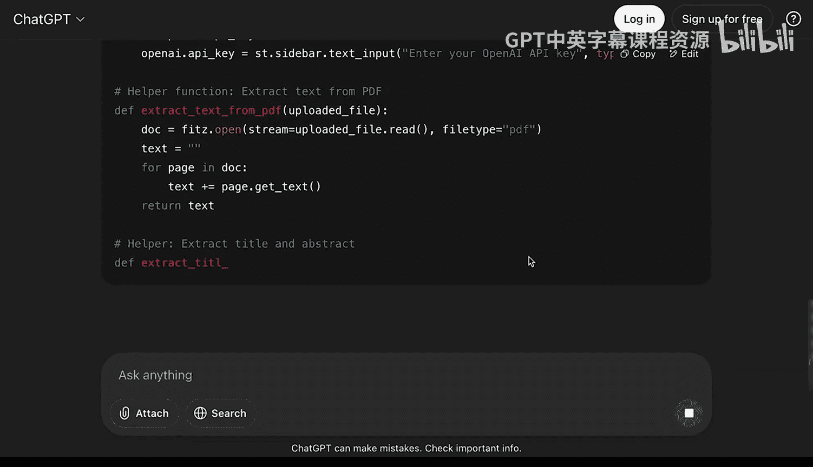
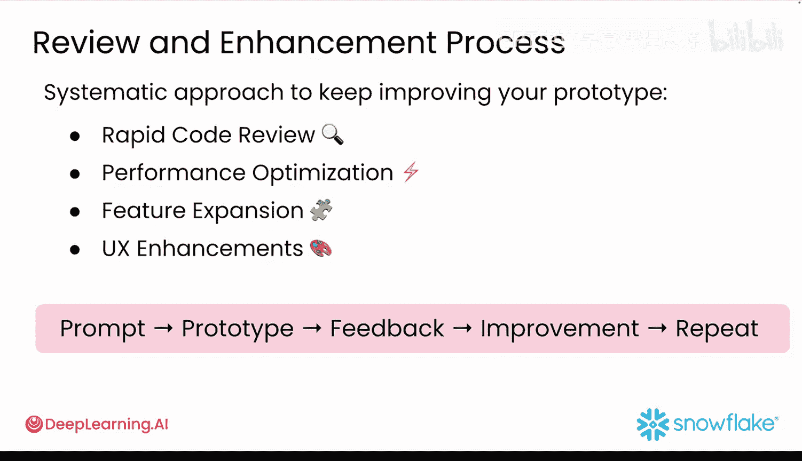

# 吴恩达《用 Streamlit 快速原型开发生成式 AI 应用｜Fast Prototyping of GenAI Apps with Streamlit》 - P40：40_03_01_提示词优化技巧.zh_en - GPT中英字幕课程资源 - BV1QmYrzMEu1

In the modern development cycle， speed is everything。

 You need to get from idea to testable prototype as quickly as possible。

 then gather user feedback and iterate based on what you learn in this video will dive deeper into AI power development and show you how to craft prompts that can 1ex your prototyping speed。

 You'll learn the specific techniques that can turn hours of coding into minutes of smart prompting。

 before diving into the technical details。 Let's understand why prompt engineering is crucial for prototyping quickly in fast prototy being your racing against time。

 Remember， you need to build a working prototype quickly。 Test it with real users， gather feedback。

 implement changes fast and repeat the cycle。 Po prompts create bottlenecks at every step。

 a vague prompt might give you code thus 80% right。

 But that last 20% could take hours to fix a well- crafted prompt gets you 95% of the way there。

 letting you focus on user feedback instead of。😊。

Debugging when users give you feedback like the chart is confusing or I can't find the export button。

 you need to turn that feedback into code changes quickly。

 effectiveect prompts let you translate user feedback directly into specific technical instructions for your AI assistant。

 for example， instead of struggling with user feedback like make it more intuitive。

 you can craft a prompt like you are a UX focused Python developer。

 The user said the chart is confusing。 rewrite this chart code to include bullet point clear access labels。

 bullet point， a legend that explains what each line represents bullet point hover two tips showing exact values and also bullet point。

 a title that explains what the chart shows。 This transforms vague feedback into actionable code changes in minutes。

 Every strong prompt contains up to four building blocks。

 understanding these components is essential for rapid prototyping。

each one serves a specific purpose in getting you from idea to working code faster。

 big instructions waste time。 You get generic code that doesn't solve your specific problem First in you to spend hours modifying it instead of make an app。

 you could try build a streamlit app that analyze its P research papers and answer questions about them specific instructions get you to working code faster when you need to incorporate user feedback you could be equally specific add a download button for the analysis results instead of make it more useful context prevents the AI from making assumptions that slow you down without proper context。

 you might get re code when you need streamlit or Python 2 syntax when you're using Python 3 context includes two key elements role setting give the AI a professional identity and expertise level for example。

 you are a Python developer。Experienced instrument apps。

 This eliminates basic explanations and gives you production ready code constraints and requirements helps to define the rules of the game for your project。

 specify Python versions， deployment platforms or technical limitations and include company guidelines or compliance requirements like your app must run on mobile devices or use only Python 3。

9。 This way， when users report issues on specific platforms。

 you can quickly add those constraints to your prompts providing concrete input data gets you working code immediately instead of generic examples。

 you get code that works with your actual data。 you can do this by providing the specific content。

 the AI will work with like specific code snippets。

 you want to modify or extend data formats with examples add sample files or data sets。

 if users report that your。Cashs with certain file types。

 you can include that problematic file format in your prompt to get a solution that handles it the right way。

 Think of this as the difference between giving someone cooking instructions versus giving them both instructions and the specific ingredients to cook with output indicators are crucial for speed without them。

 you waste time parsing through explanations when you need code or getting tutorials when you need immediate solutions be explicit about how you want the response structured。

 For example， return only working Python code format as JSson or provide a single Python file when you're incorporating user feedback quickly。

 you can specify exactly what you need return only the modified function。

 not the entire file or show me just a CSsS changes needed。

 Here are some strategies specifically designed to accelerate prototype development。

And the feedback incorporation process start simple。

 then iterate this mirrors the rapid prototyping philosophy。

 get something working quickly then improve it based on user feedback。

 Don't try to build everything at once create a basic version first then refine it step by step This approach gives you better control over the development process。

 more reliable results that you can iterate on and faster feedback cycles free complex task into smaller prompts when users give you feedback。

 you often need to change multiple parts of your app smaller focused prompts。

 let you make these changes quickly and safely So instead of one massive prompt create a sequence of focused requests your first prompt should describe basic app structure your second prompt can be used to add specific features。

 the third prompt is a good place to implement error handling and your fourth prompt can be used to optimize performance。

As an example， if users report the app is low and the charts are confusing。

 you can tackle these with separate prompts。 Pro1， optimize this data loading code for better performance。

 prompt 2。 improve these charts visualizations for better clarity。

 you don't have to follow this exact layout， but prompting in the logical order that you normally code can be helpful to get the results you want as you iterate based on feedback。

 guardrails keep your code consistent and maintainable keep your AI responses on track with these guardrails。

 tell the AI what to avoid this prevents the AI from introducing unwanted complexity or dependencies that could break your existing prototype。

 As for reasoning when needed to help you understand why changes are being made。

 which is crucial when you're iterating rapidly and need to maintain control。

 Use consistent terminology to ensure your codebased stays coherent as you make multiple。

Changes based on different pieces of feedback， maintain your coding standards it's helpful to keep your code readable and maintainable。

 even as you're making rapid changes， these guardrails are especially important in rapid prototyping because you're making changes quickly and need to assure each iteration built on the previous one without introducing inconsistencies or technical depth Let's examine a well- structured prompt to see why is' so effective。

 starting with a raw definition helps to set the level of technical expertise helps to focus responses on streamlet specific solutions and helps to eliminate more basic programming instructions with these principles in mind yourre laying out detailed step by step instructions which lead to each bullet becoming a specific function This approach helps to provide the LOM with step bystep instructions where each bullet point becomes a specific function It also clearly specifies the restraint。

Of a 300 word limit in this prompt， you are letting the Geni app know that it should start with the assumption that the packages you're using are already installed。

 This prevents it from including installation instructions so the response focuses on implementation instead of setup It also helps make sure the AI uses the right libraries by specifying that you want output returned as a single Python file。

 you get runable code instead of tutorials or explanations This structured prompt generates a complete working streamlet app with all four features implemented and ready to run Compare this to a vague prompt like help me build a PDF app where you just get generic advice instead of functional code Here's where prompt engineering becomes incredibly powerful for rapid prototyping It doesn't just help you build your initial app It also transforms how quickly you can incorporate user feedback。

With effective prompts， you can turn user feedback into working code updates in minutes when you get vague feedback like the dashboard is too cluttered。

 and I can't find the export button。 you can use the prompt like the following to get specific code updates that directly address user feedback that can be deployed in minutes。

 Once you have a grasp on quickly turning feedback into prompts。

 you can use a systematic approach to keep improving your prototype rapid code review。

 Ask your geni to review your prototypes code and suggest enhancements based on user feedback performance optimization quickly identify and fix performance issues reported by users。

 feature expansion generate multi-sution approaches for new features that users request user experience improvements transform subjective feedback into concrete Ui and UX enhancements turn comments like it feels。

Cunkkey into specific interface modifications。 This systematic approach create is a powerful。

 accelerated development cycle， Pro prototype， feedback， improvement and repeat。

 As you saw in this video， Well crafted prompts give you back hours of development time that you can spend on user research testing and iteration Even with perfectly structured prompts。

 Sometimes you'll need to give AI additional context to help navigate complex prototyping challenges in the next lesson will explore prompt augmentation techniques that extend your AI's capabilities even further。

