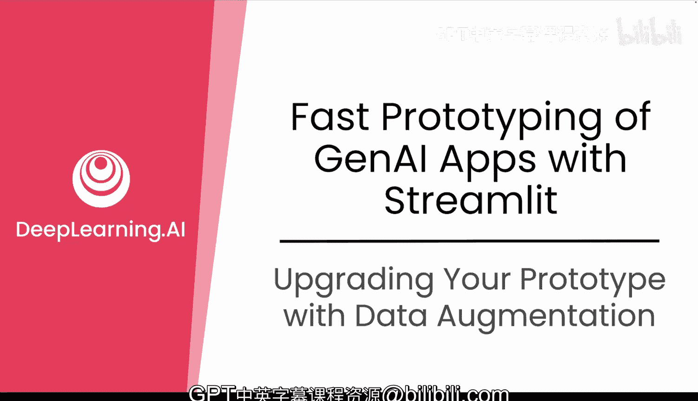
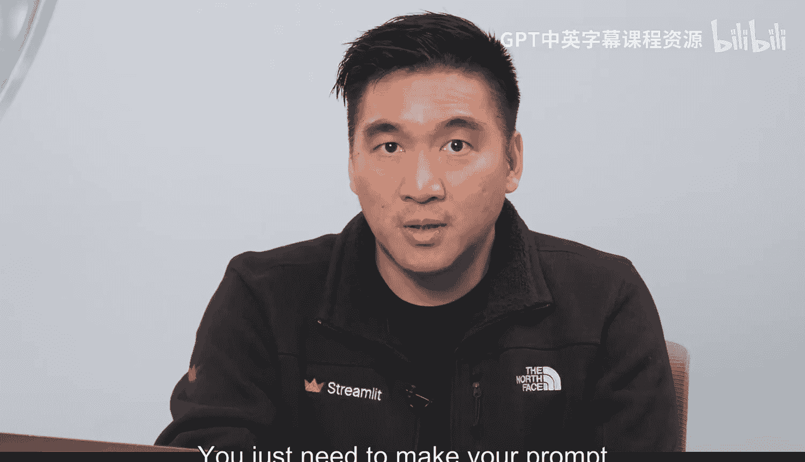
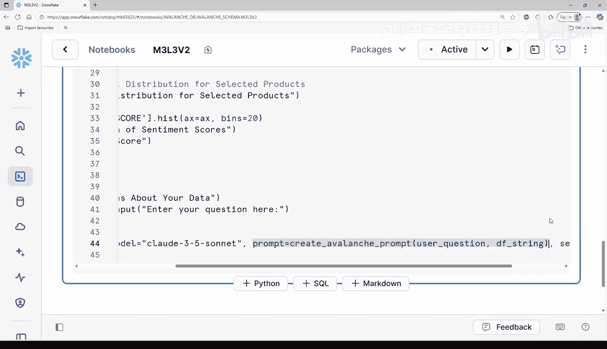

# 吴恩达《用 Streamlit 快速原型开发生成式 AI 应用｜Fast Prototyping of GenAI Apps with Streamlit》 - P41：41_03_03_通过数据增强升级原型.zh_en - GPT中英字幕课程资源 - BV1QmYrzMEu1

Remember the customer feedback you got saying I asked it questions about the dataset。

 and it gave me incorrect answers。 Also， it didn't really seem to know much about our company's product line。

 Your first instinct might be to think you need a better AI model or need to retrain something。

 but you don't need to do any of that。 you just need to make your prompt smarter using prompt augmentation。

 Think of prompt augmentation as giving your prototype at cheat sheet。

 instead of asking your AI chatbot to ask your questions with just generic knowledge。

 you're going to ask specific information about your data right into the prompt。

 It just like the difference between asking someone to guess what's in your refrigerator versus opening the fridge door and letting them look inside right now。

 the Gennyi chatbot in your prototype doesn't actually know anything about the avalanche data。

 If someone ask what products are in the avalanche data。 your chatbot might say something generic。

 Like I don't have access to specific product information。

Its like asking someone to comment on a movie they've never seen。

 instead of hoping your prototype will magically know about the avalanche dataset set。

 you're going to feed that data directly into every prompt for this video。

 you start with your already built avalanche app。 Let's walk through the code。

 You will continue working on the code that you have from the previous module and that you have already deployed in lesson one of this module。

 You can find a notebook with the starting code for this video Also in the course repo at the file path shown on screen。

 The code has been split into two cells for easier orientation。 In the first cell。

 you import the necessary stuff and you load the data set。 just like you did before。

 In the second cell， you have the backbone of your stream app。

 Some titles and text tables plots and in the end， the chat bo。 Now。

 your next task is to upgrade your chat bo。 So it has a necessary information。

About the dataset because large language models can't read spreadsheets or databases directly。

 You need to turn your data frame into something your AI can understand。

 You could do that with Df2 string method which takes your pandas data frame and converts it into a string that looks like a formatted table Now you could use this string to pass it directly into the prompt context for your chatbot to understand your data and here's where you upgrade your basic chatbot。

 You're going to include the aval data every time someone enters a promptPrevious。

 your prompt for the chatbot with simply the text input。

 Now you will create a function that combines this text input with a prompt template as well as the text version of the data that you have just created Think of the create avalche prompt function as your AIs briefing room Every time someone asked a question you're giving your GenI chatbot。

Is job description， all the relevant information it needs and a specific question it needs to answer。

 First， the job description sets the AIs role as an expert in the avalanche data This makes the Geni chatbot focus on providing answers related to the data here is where avalanche data gets replaced with your actual data in text format and the question section gets replaced with whatever the user just entered into the prompt。

 Now you need to pass this full prompt to the model and so every time you call it it will have the full dataframe content in the prompt so it will know what data you have and it will be able to answer questions about it you can now run the cell and test how it works you just transform your prototype from something that apologizes for not having an answer into something that confidently answers questions about your avalanche data in the next video。

You'll explore what happens when your data gets too big for this approach by learning how to use ragG or retrieval augmented generation。

