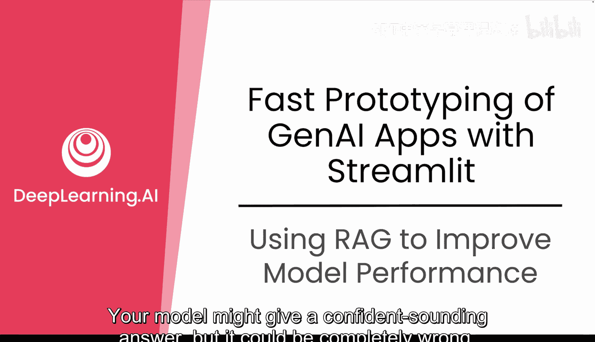
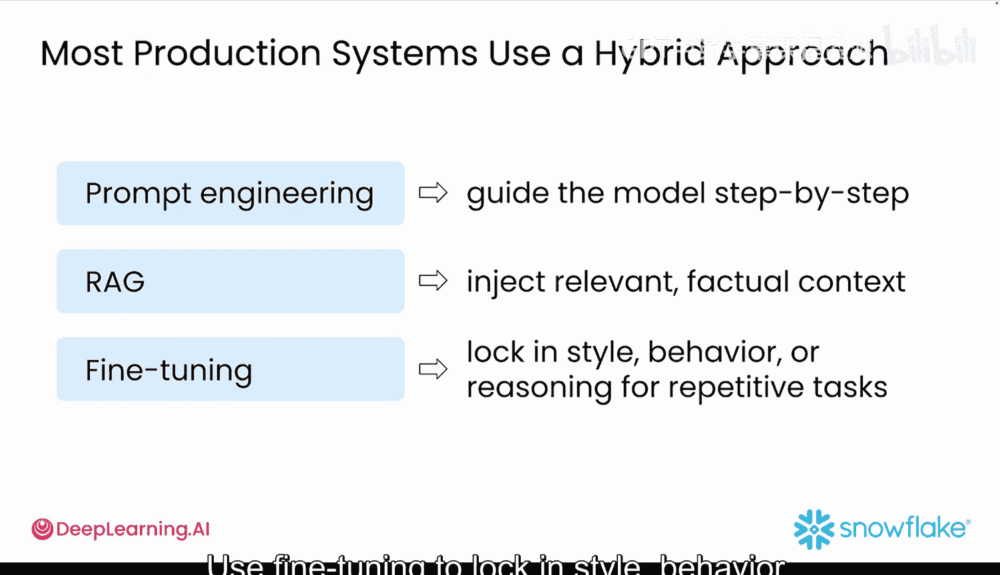
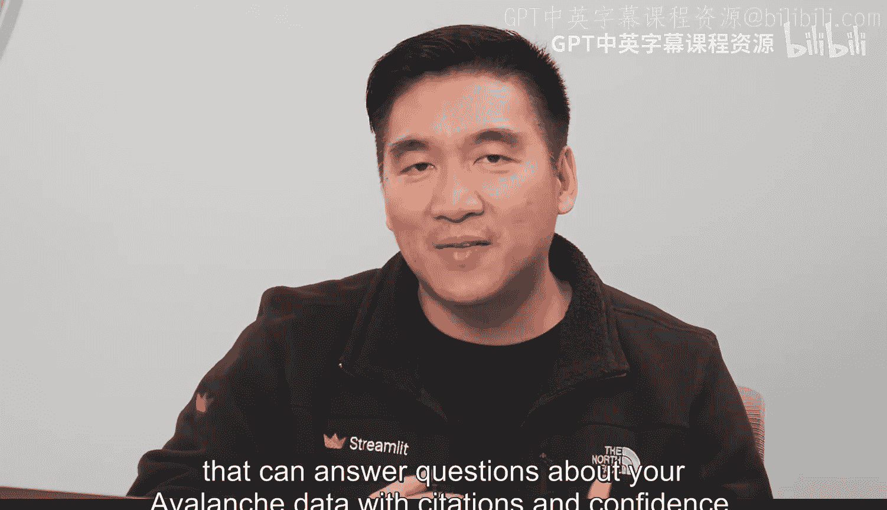

# 吴恩达《用 Streamlit 快速原型开发生成式 AI 应用｜Fast Prototyping of GenAI Apps with Streamlit》 - P42：42_03_04_使用RAG提升模型性能.zh_en - GPT中英字幕课程资源 - BV1QmYrzMEu1

You build L&M apps that can analyze data and generate insights But what happens when users ask questions your model can't answer from its training data alone Maybe they want to know about last week's customer complaints or company policies that changed yesterday your model might give a confident sounding answer but it could be completely wrong This is where retrieval augmented generation or RaG comes in It transform your LLM from a smart gestureer into a research assistant that looks up facts before responding in this lesson you'll discover how RaG works when to use it and what is becoming essential for building trustworthy LM applications you'll see exactly how it would work with your avalleche data set and understand why RaG isn't just nice to have It's critical for production apps ready to turn your LM into a fact- checking powerhouse Let's dive in RaG is a technique that helps in LM provide better answers by retrieving。

Relevant information from external sources before generating a response。

 which is like giving your model an intern that fetches useful facts for you。 Rag has two main steps。

 First， retrieval。 It searches your knowledge base。

 such as a set of documents or database to find the most relevant information。

 This can include lexical keywordbased search or semantic search using vector embeddings。 Next。

 generation， it takes the information it finds and infuses it to a large language model to write a more accurate response。

 This combination makes your model factual， relevant and less likely to hallucinate Lms are powerful。

 but they don't know everything。 especially not about your latest product data。

 internal policies or niche domains like medicine or law。 with Ra。

 you don't need to retrain your model to make it smart。 Instead， you let it put in facts at runtime。

 This is ideal when accuracy。Transparency and trust really matter Like with medical research or contract law as a bonus。

 it also makes your app cheaper and faster by reducing prompt size and avoiding a necessary model retrain Use rag when your knowledge base is too big to fit in a prompt。

 your content changes frequently and you need real-time answers。

 you want source attribution for compliance or trust。

 you're working in a specialized field like healthcare where accuracy is critical。

 you want to personalized answers using userspec data or you want to optimize token usage for cost savings。

 coming back to the avalanche data set， say a user ask what our customer saying about our return policy this month。

 If you only use a prompt， the model would guess based on its general training with Ra it searches your recent avalanche reviews finds the most relevant ones。

And gives an answer based on real customer feedback。 Here's how that works behind the scenes。

 The model gets the user question。 Your system braces the reviews into small chunks。

 So they fit in the prompt。 A retrieval engine finds the most relevant chunks。

 The L M combines that context with the question to generate a grounded answer。 is snowflake。

 This entire process can be handled using cortex search。

 which does the vector search reranking and retrieval for you。

 You can read more about it in the snowflake documentation。

 and the latest at the bottom of your screen。 Rag fetches new context at query time。

 fine tuning them based behavior into the model itself。

 fine tuning is best when you need a specific writing style or tone。

 or doing the same task over and over like contract summarization。

 Need consistent logic or reasoning。 Don't want to manage external documents or storage how。However。

 is slower to set up requires labeled training data and is harder to adapt if your data changes。

 Here's the winning formula used by many top teams use prompt engineering to guide the model step by step。

 Use Ra to inject relevant factual context。 Use fine tuning to lock in style behavior or reasoning for repetitive task。

 You now understand why Ra has become the backbone of production Lm applications。

 It's the difference between a clever demo and something teams actually trust。

 The key insight Don't make your LM memorize everything。 teach it how to research。 Next up。

 will implement a rag system using snowflake and streamlit that can answer questions about your avalanche data with citations and confidence。

 Time to see rag in action。

