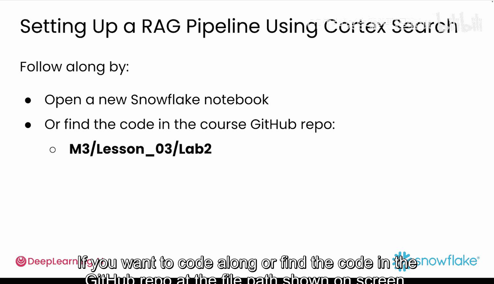
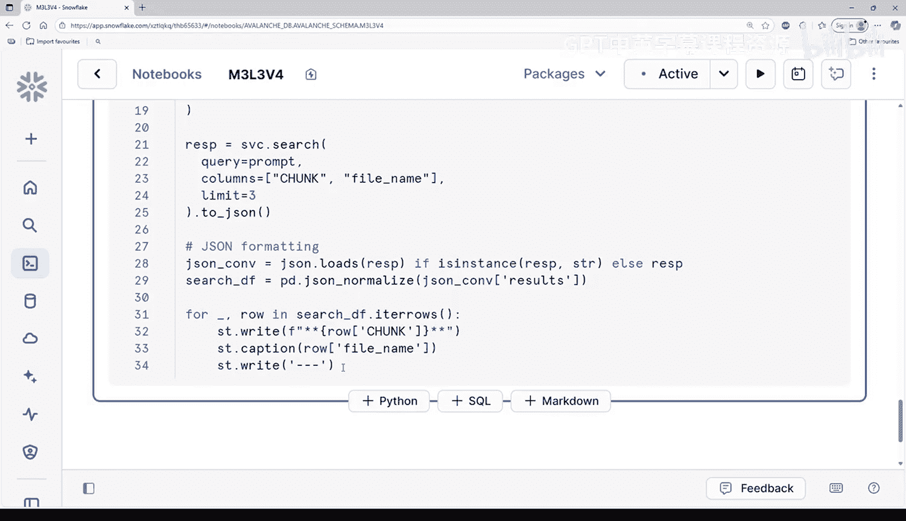

# 吴恩达《用 Streamlit 快速原型开发生成式 AI 应用｜Fast Prototyping of GenAI Apps with Streamlit》 - P43：43_03_05_基于Cortex Search构建RAG管道.zh_en - GPT中英字幕课程资源 - BV1QmYrzMEu1

In the last video， you learned how RA can improve the retrieval of information。

 This video will walk you through how to put that into practice。

 It's time to complete the final piece of your prototype。

 Let's go Cortex search is snowflakes manage search service for AI applications It automatically creates indexes and embeddings from your data。

 then provides simple As so you could build rag or retrieval augmented generation apps without managing the complex infrastructure yourself。

 open a new notebook and snowflake if you want to code along or find the code in the Github repo at the file path shown on screen start by previewing the contents of the parsed reviews table to check the existing data structure and contents before proceeding with the new operations。

 Now you're going to create a new table named chunk content You can create or replace table statement After creating the table。

Use an insert statement along with snowflake dot cortex do split text recursive character。

 which is a powerful text analysis function that splits the customer review text into multiple chunks for easier processing。

 And that's it。 your data is now chunked and loaded into chunked content。

 Take a quick look at the new table by selecting the first few rows to make sure that the chunking process has been correctly implemented and that the data is now prepared for subsequent analysis。

 Now it's time to set up avalanche search service using create or replace cortex search service。

 Add this code block。 This code block creates a search engine that works on your chunked data。

 So you can rapidly query specific information such as product reviews housed within the text。 Now。

 for the fun part， Test your search。 run a SQL query on the chunk content table to find specific content like。

😊，All reviews about goggles， something like this。 You could do this by passing your search terms to the search preview function and getting matching results like this。

 The best part， you could also use Python。 Here's the code you need to search for goggles reviews using your newly built search engine。

 As always， you need to set up a snowflix section。 and you could write a simple prompt。

 Then you need to create the query service and you can search it by using your prompt and specifying which columns to search through。

 You can format it as Json and extract information from it。

 Then simply display it in your stream app。

