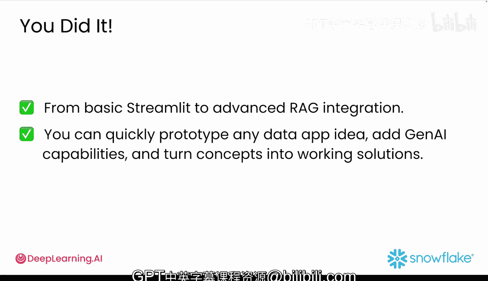

# 吴恩达《用 Streamlit 快速原型开发生成式 AI 应用｜Fast Prototyping of GenAI Apps with Streamlit》 - P44：44_03_07_实验2：集成RAG的聊天机器人.zh_en - GPT中英字幕课程资源 - BV1QmYrzMEu1

You've mastered snowflake analytics and RA search separately Now you're going to combine them into one killer app that can analyze customer data and instantly search through reviews let's build something spectacular your app can already do a lot load data with one click filter customer information display meaningful charts and chat about your data you've created a real analytics tool you've learned rag and built a complete pipeline Now for the exciting part。

 adding rack power to your chatbot imagine your users asking about specific products and getting instant accurate answers from real customer reviews Time for the grant finale Take the rag code from your notebook from the previous lesson and add it to your streamlet app your chatbot is about to get seriously smart。

 In fact， the last cell in your notebook from the previous lesson is already a working streamlet app that uses the rack service。

 The only thing it is missing for you。😊。

To create an input window so you could type in whatever prompt you want rather than using the hardcoded prompt in your app and you already know how to do this to make it interactive then you can add this code to the bottom of your existing app some titles and tags or tweak it in your preferred way Ask your app is getting larger maybe you need to organize it further remember how you were using columns to put buttons side by side creating tabs is almost exactly the same you first create the tabs and then you use the w statement to specify what you want in each of the tabs As always you have the complete freedom to implement it your way if you need any help you have a few helper files and the full app solution code in the M3 lesson3 lab two folder you could put those pieces together to build your final app want an additional challenge right now your chatbot has the memory of a goldfish It forgets everything after each question try adding chat history using。

Session state variables so user can have real conversations One way is to modify the prompt to take not only the data and the question。

 but also chat history and you will need to keep track of this chat history by storing it as a session state variable just like where you are saving the data set the solution is in the same folder if you get stuck you did it from basic streamlet to advanced rag integration you've mastered the full stack Now you could quickly prototype any data app idea at AI capabilities and turn concepts into working solutions in our final video together。

 let's talk about what you built what you've learned and most importantly what exciting projects you can tackle next。

