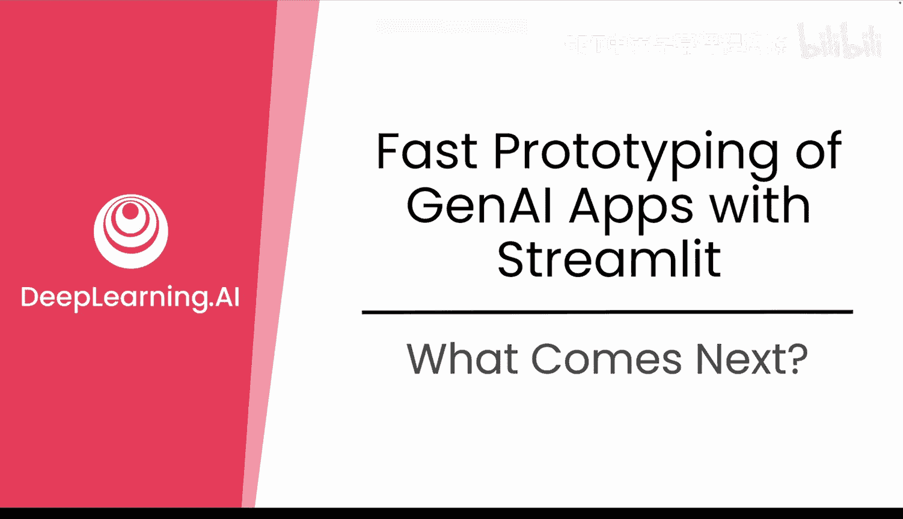
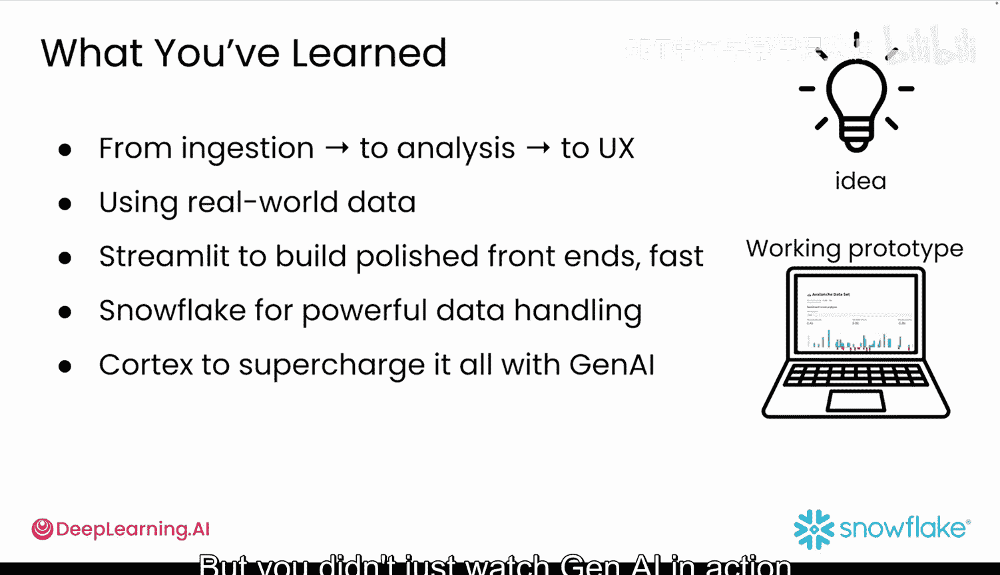
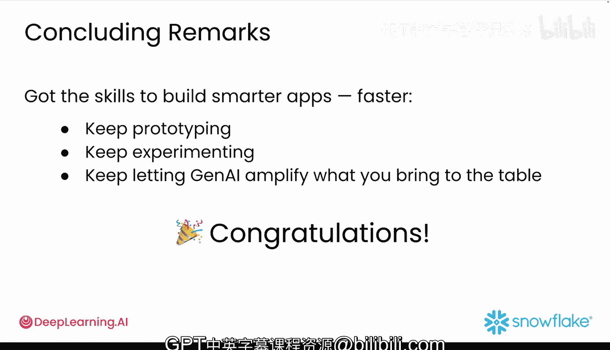

# 吴恩达《用 Streamlit 快速原型开发生成式 AI 应用｜Fast Prototyping of GenAI Apps with Streamlit》 - P45：45_03_08_后续发展路径.zh_en - GPT中英字幕课程资源 - BV1QmYrzMEu1

Congratulations， you made it to the finish line and not just the finish line of this course。

 but the starting line of whatever you decide to prototype next。

 Let's take a moment to look at what you've accomplished。

 You took an idea and turned it into a full prototype from ingestion to analysis to user experience。

 using real worldl data every step of the way。 you used Drlet to build polished front ends fast。

 you used snowflake for powerful data handling， and you used cortex to supercharge it all with Geni。

 you practiced agile development with AI as your copit writing debugging and improving your app at record speed。

 but you didn't just watch Geni in action。 you made it part of your workflow。

 So now that your a Geni prototyping native。 What comes next。

 here's a few ideas to get you thinking idea number one built a multimodal app。 right now。

 Lms can accept text images and。😊。

Even audio as input， Some even support video。 Imagine this。

 you record a screencast of your app in use。 Then you feed it to a model and ask for UX feedback documentation or next step features all automatically idea number two。

 Pro with AI agents。 We' now in the era of agent Gen AI。

 you can create custom agents that behave like junior developers give them a persona。

 some goals and a development style and let them features， test code or evaluate app performance。

 with the mindset you built here， which is the MVP first approach。

 you're in a great position to start working in this space。 idea number 3。

 turn your prototype into a product。 whether you built something for work。

 a side project or just for fun。 you've learn how to turn an idea into a working GenI app。

 want to go from prototype to product。 Here's how add authentication and permissions to support real。

Users integrate with external APIs to pull in live data or trigger real world actions。

 turn insights into features， dashboards， alerts or custom tools based on your analysis De and monetize your app collect user feedback and start charging for access or insights with what you've built here your already halfway there。

 The next step make it useful make it real make it yours AI will keep evolving fast the tools will change the interfaces will change the models will change but your mindset。

 the prototyping cycle you've built is what will keep you ahead。 I build， evaluate， iterate， improve。

 repeat This is how modern software， especially Geni apps are being developed and now is how you developed So what's next that's up to you。

 you've got the skills to build。Smarter apps faster。 So keep prototyping。

 keep experimenting and keep letting Jennyi amplify what you bring to the table。

 This was just the first build。 Now， go make it better。 Congratulations again。

 You're officially a Gennyi protoper。

