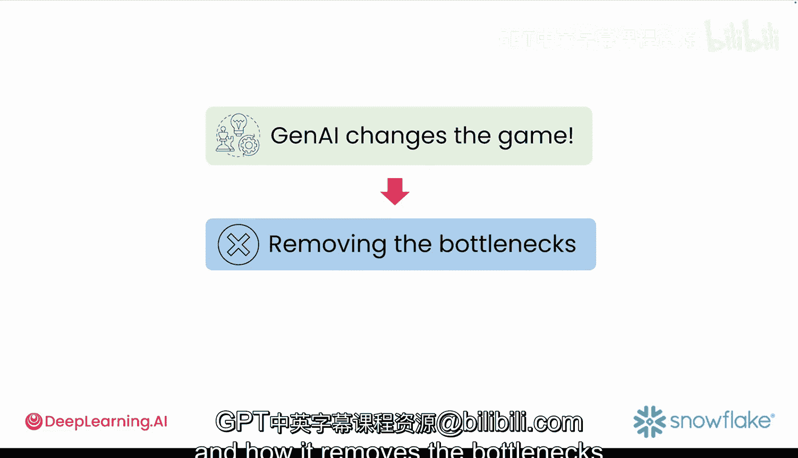

# 吴恩达《用 Streamlit 快速原型开发生成式 AI 应用｜Fast Prototyping of GenAI Apps with Streamlit》 - P4：04_01_04_GenAI如何革新原型设计.zh_en - GPT中英字幕课程资源 - BV1QmYrzMEu1

Before gen AI， prototyping apps， especially data apps and AI power tools， was really time consuming。

 even if you had a great idea， it took hours or days just to build something basic that worked。

 You'd have to write the same setup code again and again， things like loading libraries。

 creating input forms， formatting the page layout。 None of it was specific to your idea but you still have to build it by hand before you could even test anything。

 GenI remove the bottleneck。 You no longer have to write every function wire every dependency or even plan out your entire pipeline before testing。

 In this video， you'll learn more about how Jennyi speeds up every part of the prototyping process。

 Imagine you had an idea to create an app that analyzes the sentiment of customer product reviews。

 without GenI， you need to first design the interface。

 maybe with a text box to paste reviews a button to run the analysis。

 and a display area for the results。 then write code。😊。

Connect that input to your backend logic next， import libraries for sentiment analysis。

 clean and load your data and build out the logic step by step after that。

 write code to display the results maybe as a chart or table and finally test it fix errors and refactor parts that didn't work right even an app as simple as this could take several days to build。

 and if it doesn't work the way that you expected， you have to go back and change it manually piece by piece Now let's try the same idea using Geni you type a prompt into a Geni app asking it to create a streamla app that less users paste in reviews。

 run a sentiment analysis and show the results as a pie chart within seconds。 the AI writes to code。

 it imports the libraries sets up the interface， runs the analysis and creates the chart。

 you click run and you're already testing your idea。 This is what makes Geni so powerful it removes。

Most of the repetitive setup unless you focus on testing what matters。

 but it's not just about writing less code， it's about changing the way you think in traditional software development。

 your mental model is structured around planning firstBuild second you think in terms of architecture data models and dependencies then you write the code with GenI that flips you don't start with the structure you start with intent you describe what you want to happen and the GenI model gives you something to react to so instead of thinking how do I build this you're now thinking what's the fastest way to test if this idea even makes sense that's a totally different mindset shifting you from solution first to exploration first and that shift is revolutionary GenI turns software development into a conversation between you and the LOM between the prototype and the user between the problem and the possibilities one of the most exciting things about GenI is how it opens up software development。

To more people before if you couldn't code your idea usually stay stuck in your head or maybe in a slide deck。

 Now， people like teachers， doctors， researchers and organizers can build working apps that solve real problems without needing to become full time developers。

 But if you do know how to code coding skills are not a threat。 there are superpower。

 You can move even faster， build more flexible tools and guide the AI to produce exactly what you need。

 Your skills are still essential。 Gen AI just helps you skip the repetitive parts and focus on the parts than mattermost。

 with Geni， you can go from idea to working code in seconds with less setup fewer technical barriers more time to work on building and testing what matters in the next video。

 you'll see why Jenny I changes the game and how it removes the bottlenecks that used to slow everything down。

😊。

