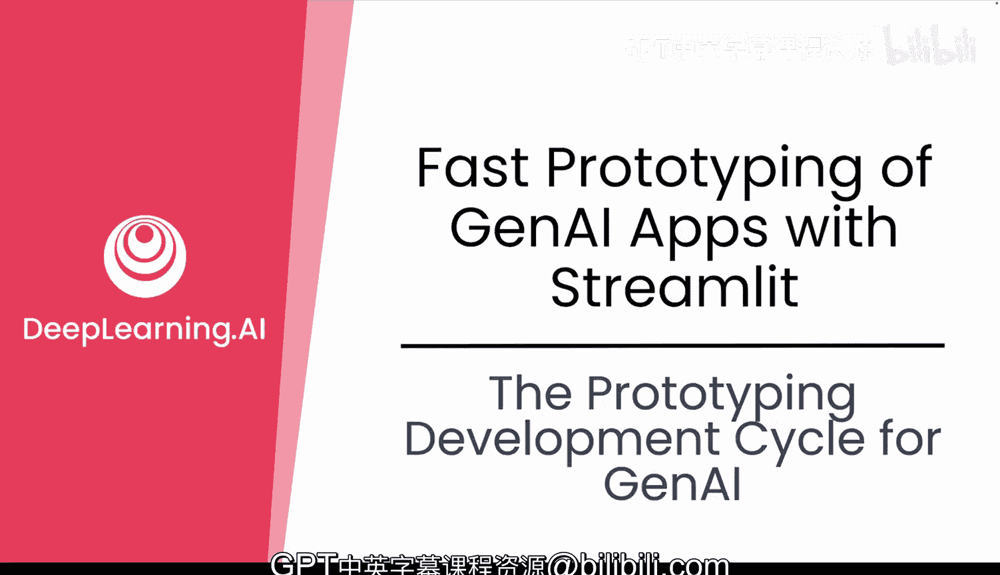
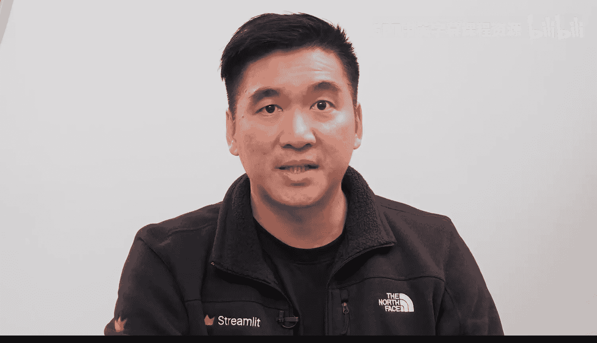
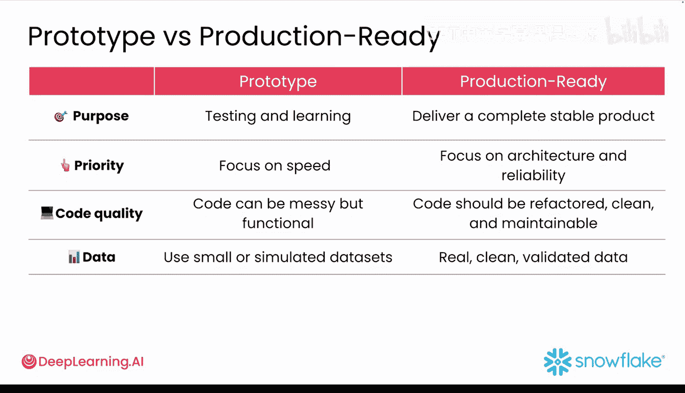

# 吴恩达《用 Streamlit 快速原型开发生成式 AI 应用｜Fast Prototyping of GenAI Apps with Streamlit》 - P5：05_01_05_GenAI原型开发周期.zh_en - GPT中英字幕课程资源 - BV1QmYrzMEu1

Before you start building， it's helpful to zoom out and see where prototyping fits in the bigger picture。

 In a traditional development cycle， you start with a detailed plan。 Design a full system。

 write the code， test it and finally deploy it。 That works fine for projects with clear。

 fixed requirements。 but it's way too slow for experimenting with Geni。 with Geni apps。

 The process is different。 You don't always know what the output will be。

 The Geni model might surprise you。 your prompt might break。

 Caing unexpected behavior errors or poor results。 your users might behave in ways you didn't expect。

 So instead of following a strict plan， you need to build fast， test often and adjust it quickly。

 That's where prototyping fits in Prototyping comes right after you've got an idea。

 And right before you commit to full development。 It's where you quickly test out your idea with real inputs。

 real outputs and real feedback。 especially when you're building with Geni， prototyping isn't just。

ful， it's essential。 Prototyping helps you explore how the model behaves and how small changes can make big differences。

 Even the slight variation in the way you prompt can be the difference between solid gold and meaningless gibberish prototyping also lest you test your app with real users to see how they think click and sometimes completely missed the obvious。

 your'll catch edge cases early when your model confidently answers a question you didn't even ask and you'll learn fast whether your idea is solid。

 surprising or needs a pivot before you sync weeks into it。

 you'll come back to prototyping many times and each time you have a new feature to test or a new problem to solve。

 And in this course， you'll treat prototyping after your default development mode。

 that means always building something。 something you can test， share or iterate on。

Even if it's just a very rough draft， every basic Geni app has four key pieces。 First。

 you need a user interface。 This is how people will use and interact with your app。

 It could be in the form of a simple stream app， a chatbot or even just running code in a notebook。

 Second， you need to add the logic。 This is the heart of your app。

 It makes a userss input questions or data and send it off to the AI for a response。

 which leads to the third component。 you need data。

 start your prototype with something easy like a CSv file or a Sa document。

 This gives you real information to work with during testing。

 but thus it require a lot of fussing over complex data sets。 Finally。

 you need to connect to an AI service like G4 or cloud the AI service does the smart thinking。

 Why are your app handles everything else around it。 Think of it like this。

 The interface lets people talk to your app。 The logic figures out what to do。

 The data gives you something to work with and the。I does the heavy lifting。

 put these four pieces together。 and you have a working prototype。

 Here's an example of what your gen development cycle will look like。

 You start by coming up with an idea。 Then build a quick prototype using Python and streamlit。 Next。

 you test a prototype with a smaller set of realistic data。

 and share the prototype to get feedback from your users。 Finally， you improve the prompt。

 to code or the interface based on what you learned and decide if it's worth turning into a full featured app。

 what used to take weeks can now be done in minutes。 That's the power of prototypetyping quickly。

 It's important to know the difference between a prototype and a full production app。 That way。

 you can set the right goals。 A prototype helps you explore ideas。 It helps you answer questions。

 a production app on the other hand needs to be reliable and secure。 Here's how they compare purpose。

 a prototype is for testing and learning。 A production app is for delivering a complete stable product priority。

😊，Prototypes focus on speed。 Production apps focus on architecture and reliability。 Code quality。

 Productto code can be messy but functional。 Product code should be refactored。

 clean and maintainable data。 Protos can use small or simulated data sets。

 Product apps require real clean and validated data。 You build something small。

 Get it in front of real data or real people and see how it host up because with Gennyi。

 the fastest way to learn is to build early Test often and adjust in real time。 In the next video。

 you'll learn more about the biggest mistakes I see developers make when they rush into Geni prototyping。

 and the simple text that can save you hours of frustration。 Let's dive in。

