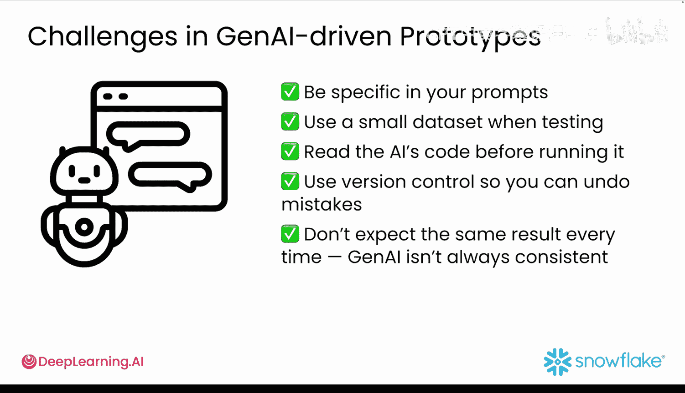
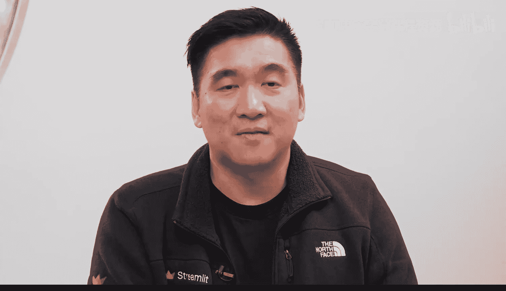

# 吴恩达《用 Streamlit 快速原型开发生成式 AI 应用｜Fast Prototyping of GenAI Apps with Streamlit》 - P6：06_01_06_避免常见陷阱.zh_en - GPT中英字幕课程资源 - BV1QmYrzMEu1

GI speed things up， but it also brings some new challenges。

 the same prompt may not produce the same results every time small changes in wording can lead to unexpected results also when you don't write every line of code yourself。

 it's harder to debug， but JenI can help you move fast if you're not careful。

 it can also lead you straight into a mess。

We've all made this mistake when building with AI overengineer our prototypes。

 It's really easy to get excited about what Jenny I can do and ask it to build everything at once。

 The Ui， the back end， the database Ana charts all in one giant prompt。

 All this does is force a model to give you way too much code。 The pieces might not fit together。

 debugging can become a nightmare。 You spend hours untangling the results and forget what you are even trying to build。

 The solution is pretty straightforward。 Keep it simple。 Try one idea at a time。

 Instead of asking for a full app all at once。 start with something small。

 like a single function or a simple Ui component。 This gives you more control and makes it easier to spot where things go wrong。

 Jenny I works best when the task is clearly defined Another common trap is trying to perfect everything before getting feedback。

 You can easily spend way too much time tweaking prompts。 redesigning chart。😊。

Or debating button colors before anyone's even use the app。 Try this instead。

 get it 80% of the way there。 then get feedback。 Your prototype doesn't need to be beautiful。

 It needs to be useful。 That means showing it to real people learning what works than making it better。

 say you're building a Geni app that givesification ideas。

 you might worry about token limits or caching。 But before you do first ask。

 do people even like the recommendations， ask a simpler question， the users find this helpful。

 or did they actually take action。 built just enough to test that one go。 The polish will come later。

 Let's say your prototype works。 And now your team is excited to build it。 That's great。

 But here's the catch The code you got from the AI may not be easy to follow。

 especially when you're not the one that wrote it。 That's normal。 You were moving fast。

 And that was the right choice。 Now that it's time to share your work。

 Here's how to make life easier for your team at。😊，Comments to explain which parts were AI generated。

 stick to simple file names and folder structures。 Use tools your team already knows and use JenI to help you write some quick test cases。

 A little cleanup now will save a lot of pain later。 Don't just hit run and hope for the best。

 Test their prompts by starting simple and look carefully at what it returns。 Try rewording prompts。

 making them simpler， giving more clear instructions。

 small tweaks can dramatically change the results。 Check the output。

 Run a few edge cases like an empty input or something weird。

 Check if the AI output actually makes sense。 and isn't hallucinating。 Ask someone else。 You try it。

 Watch where they get confused。 Lock your inputs and output so you could debug later。

 F what's broken。 then test again。 You're not doing full Q A。

 You're just trying to answer one question。 Is this idea worth building。

 Here are a few simple habits that make prototyping smooth。When building with AI。

 be specific in your prompts， use a small data set when testing， read the AIs code before running it。

 use version control so you can undo mistakes and don't expect the same result every time GenI isn't always consistent。

Let me wrap this up with the most important point。 Your prototype is meant to be disposable。

 You're building it to learn if it helps people and the AI handles the task， great。

 you can build more。 if it doesn't good news， you just save yourself a lot of time。

 The next video will introduce you to the course project and data set so that you know what you'll be building for the rest of the course。

 Let's take a look。😊。

