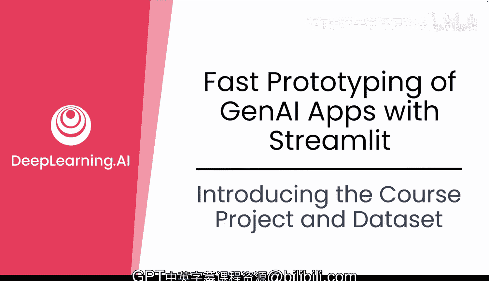
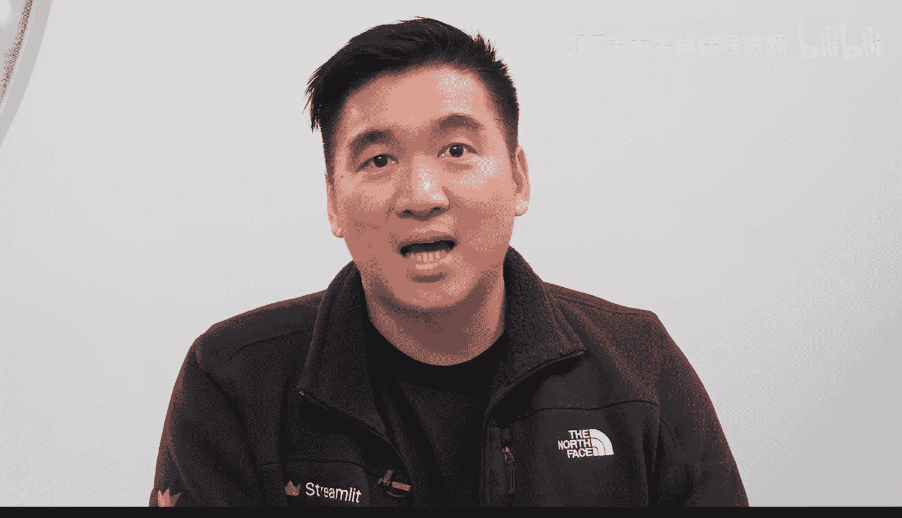
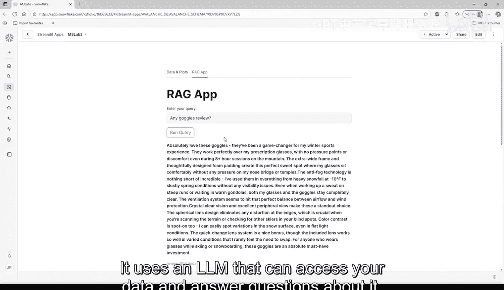

# 吴恩达《用 Streamlit 快速原型开发生成式 AI 应用｜Fast Prototyping of GenAI Apps with Streamlit》 - P7：07_01_07_课程项目与数据集介绍.zh_en - GPT中英字幕课程资源 - BV1QmYrzMEu1

For the rest of this course， you are stepping into the role of a data scientist at an outdoor gear company called Avalanche。

 Your boss just handed you a task that's all too familiar。

 Can you figure out which winter products are doing well and which ones customer hate you've done sentiment analysis on the same avalanche customer review data set many times before。

 too many times。 But this time you're going to build an AI prototype to automate the entire workflow。

 This is the kind of real worldord task that Jeni is perfect for。 It's repetitive。

 It has clear success metrics。 and your boss once answers fast。 throughout this course。

 you build a real working app powered by Geni that plus the average sentiment scores by product and delivery status analyzes customer sentiment。

 le user ask natural language questions about the data。

 you start small with a simple streamline interface。

 Then you'll level up into a full dashboard and geni assistant。 By the end of the course。😊。

You have a working prototype that answerss the question。

 can JenAI help our team understand customer feedback faster in Ph one。

 you'll use Jolet and open AI to load and clean your data with pandas build a simple interactive interface visualize results with charts and filters and publish your first prototype online and you'll use JenI to help you write the code then in phase2 you'll move to the snowflake platform to upload rawtex files ingest and store them in a structured format use snowflakes built in AI tools to analyze them。

 then deploy your fully functional app complete with a chatbo then in phase3 you'll connect your chatbot to the data and prompt engineering and rag to improve responses learn techniques for getting feedback fast This is a guided project but you'll have plenty of room to customize an experiment along the way Want to try Lankcha or another GenI API go for it。

You work with the avalanche dataset set， a fictional dataset that I've built just for this course。

 Let's explore the customer reviews file， which is MCcsv format In this file。

 each row represents one customer review that includes the product name the date of the review the review text and a sentiment score between minus1 very negative and plus one very positive。

 you start with a pre cleananed csv file called customer review csv。

 Later in the course you'll learn how to build and clean the avalanche customer review data yourself step by step Want to go deeper you've also included docx versions of the raw review files so you can test the file ingestion later in module2 Now you're going to see a preview of your final stream app at the top youll have two tabs。

 the first tab shows a chart of the sentiment score by product and then a preview of the。Data table。

 you can filter the table by product， and you can look at the sentiment score by delivery status for each of the products。

 The second tab has a text input box that allows you to ask natural language questions about the data。

 It uses an LM that can access your data and answer questions about it Now that you've seen what your final project will look like。

 We're ready to dive in in the next video， you'll learn how to apply a simple framework for building prototypes that will help you figure out what to build and which features are the most important。

 Let's build something smart and make your life a whole lot easier。

