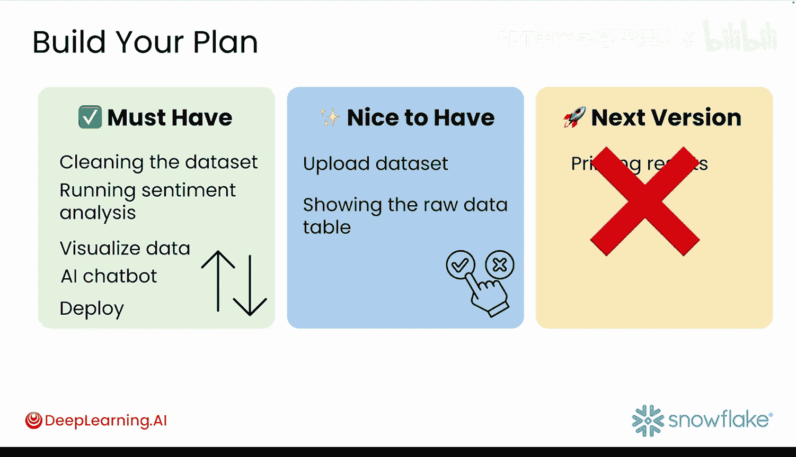
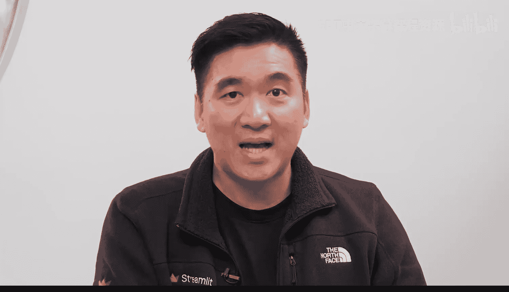

# 吴恩达《用 Streamlit 快速原型开发生成式 AI 应用｜Fast Prototyping of GenAI Apps with Streamlit》 - P8：08_01_09_确定MVP范围.zh_en - GPT中英字幕课程资源 - BV1QmYrzMEu1

Before you start building， you need to decide what to build。 The answer is not the whole thing。

 Just the minimum viable product。 The smallest version of your idea that still solved the real problem。

 This is where most AI developers go off track。 They get excited。 They overbuild and they burn out。

 Let's not do that。 The minimum viable product or MVP is the framework that helps you build smarter。

 not harder。 Eric reads popular arrive this concept in his book lean startup and is proven invaluable for development teams。

 because it focuses on learning quickly。 We use this framework to help you plan and build prototypes efficiently。

 The faster you can build something that is testable。 The faster you can get feedback and improve。

 This create is a practical cycle of continuous improvement。 plan， build tests， learn。

 improve and repeat。 Think about it this way。 It's so much more useful to build something in a day。

 get feedback and repeat the cycle 10 times。 Then it is to take 10 days to build something and。😊。

Get feedback once Here's how you can break it down to define your MVP use a simple framework。

 and yet another acronym called mapap mission audienceience and prioritiesorities mission。

 meaning what's your end goal audience is who you are building for。

 and priorities are the things you need to do first。

 everything else can wait defining your mission means starting with a basic question。

 What problems are you trying to solve start by identifying a specific pain point or inefficiency that your app will address。

 get specific， instead of saying I want to build an AI chat bot say customer service agent spend 20 minutes per call looking up product information and I want to reduce that to two minutes。

 your end goal should be concrete and measurable it will be your north star for every decision you make during development。

 The second question you should ask is how you know if your app solved the problem to solve a real problem。

 You need a way to know when it solved。 That's what metrics are for。

 They tell you whether your solution is actually working。For example。

 if your problem is that data scientists spend too much time repeating the same workflow。

 your success metric might be reducing setup time from five hours to 30 minutes understanding your audience shapes everything from the complexity of your interface to the coding language you use you can't build for everyone So identify your primary user group Here are some key questions to help define your target audience Are they technical experts or complete beginners。

 What's their biggest frustration with existing solutions What workarounds do they currently use how do they measure success in their role Finally moving on to P for a priority This is where you figure out what features are absolutely necessary for your prototype and what can wait you're trying to get something working quickly So keep the focus on one core workflow Ask yourself if I could only build one feature to show the value of this app what would it be。

Now， let's bring everything back to the Avalanche project。

 Start by asking the most important question。 What problem are you solving and how will you know that is solved right now your team keeps rebuilding the same sentiment analysis workflows they're also spending way too much time manually digging through customer reviews to answer simple questions。

 So your job is to solve that problem。 your goal is to automate the setup so that no one has to keep redoing it make it easy to get quick answers directly from the data。

 and how will you know that it's working start small。

 just ask to users did this save you time if the answer is yes， you're on right track。

 You can always get fancy with more metrics later。 but for now。

 simple feedback is enough to move forward with confidence。

 your avalanche app has two main users first your manager who just wants quick answers without waiting second your teammates the data scientists who run sentiment analysis again and again right now。

share the same pain。 Every time they do this work， they have to rebuildilt the process from scratch。

 That means collecting data， cleaning it， analyzing sentiment， building charts。

 and answering the same followup questions over and over。

 If you understand where they're losing time you can decide your app to fix those exact points。

 that's how you build something people will actually use here's the hard question。

 If you could only build one feature， what feature would be the most critical to test if your idea works。

 that can be tough to answer。 So start by sketching the big picture。

 Nothing fancy just a quick layout in Google Slides or on paper。

 Imagine the final dashboard with four tabs。 one tab called time that lets the user look at sentiment for a specific time period。

 a tab called product shows the average sentiment score for a selected products。

 The tab called data shows the raw data set in an interactive table and the last one called chat Le users ask the AI questions about the data。

Even if you only build the first one， that's enough to show this app saves time and delivers real insights。

 Now， let's turn that feature list into an actual build plan。 First。

 cross out everything in the next version column。 You're not building those yet。 Next。

 take your must have features and put them in the order that you'll built them in。

 This becomes your development roadmap。 Finally， pick one or two nice to have features and set them aside as stretch goals。

 only build them if you finish early or they're easy to add。 You just learn how to set a clear goal。

 understand your users， Def success and prioritize what to build。

 This is especially important when working with Geni。

 because it's easy to get distracted by flashing features that don't actually solve the core problem。

 by keeping things simple and focusing on what really matters。

 You can build a working prototype faster。 then test it and improve it based on real feedback in the next video。

 you will see how to access the core。😊。

Mater and start working with your project files in the course Gitthub repo。

