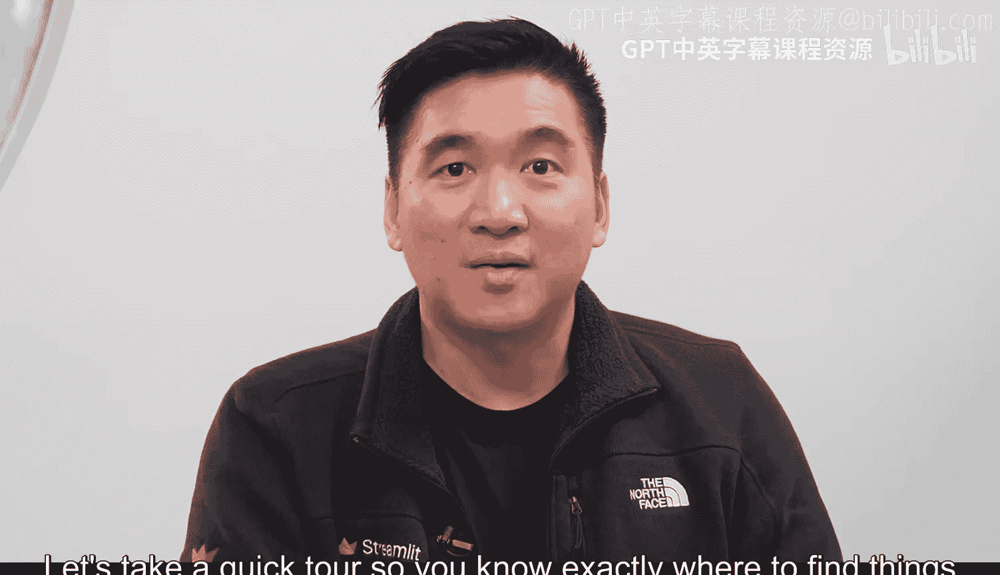
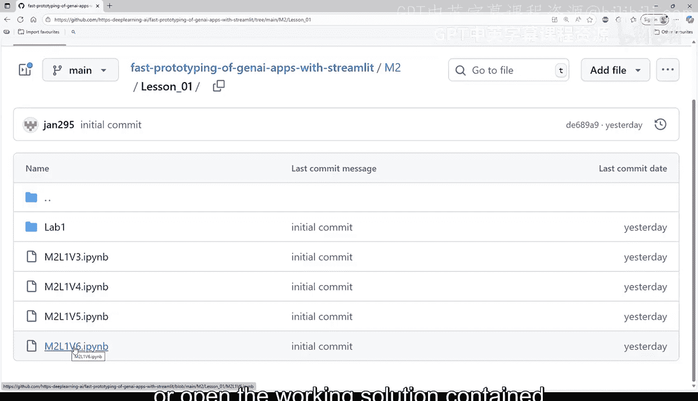
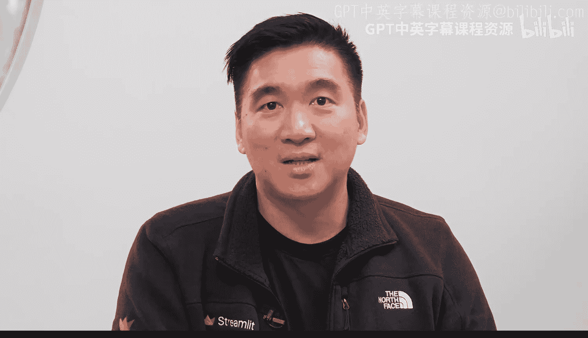

# 吴恩达《用 Streamlit 快速原型开发生成式 AI 应用｜Fast Prototyping of GenAI Apps with Streamlit》 - P9：09_01_11_课程GitHub仓库概览.zh_en - GPT中英字幕课程资源 - BV1QmYrzMEu1

Okay you've got your project plan and now you're ready to build Let's take a quick tour so you know exactly where to find things and how things are organized All the files you will need are in the course Gitthub repo。

 which you can find at the link shown at the bottom of your screen Once you open the Github link you see a variety of folders First you have the data folder where the aval data is stored then you have one folder for each module inside the module folders you will find all the code that you need to follow along with the videos All the code is further split by lessons and each lesson folder includes Python files or notebooks that are used in the videos as well as a lab folder which contains all the items necessary to do the lab where necessary you will also have a requirements TxT file This will help you install all the dependencies you need for that specific part of the project For example you have one in the module One folder that you can use。

install everything you need for module1 In addition。

 you will find a few files like do env do example， which is a sample environment file。

 Youll need to duplicate this by renaming it to do Ev and add your openaiI API key readmem which is a short guide to help you get started if you are already familiar with cloning a repo feel free to skip this video the easiest way to get all of the course files is to clone the repository to your own computer this lets you make changes to the code as you work through the course to clone the repo site into your Github account。

 go to the main repo page using the link at the top of your screen find the green code button near the top right copy the address it should start with Gi If you have Git installed on your computer from your command line type Git clone followed by the address you just copied if you don't have Git installed on the command line。

Could use the Github desktop Ui by clicking on file then clone repository after clonening make sure your cloned version of the repo is set to public。

 This makes it easier to deploy on snowflake later the course Github repo gives you a clean。

 simple project structure preloaded with the avalanche dataset and your starter files In you will find a series of files in the repo1 for each video where you work with any code for easier orientation。

 the files will always be named something like M1 L11 which stands for module 1 lesson1 video1 you could use the repo files to follow along or start from scratch and write your own code as you watch the videos typically the videos built on top of each other so you can continue with the code you have already created or open the working solution contained in every applicable repo folder you now have access to。

code， data and tools you need to build your prototype。 The course Github repo gives you a clean。

 simple project structure freeloaded with the avalanche data set and your starter files from here。

 you'll be editing the stream app Py file in each module folder to build your geni app one feature at a time in the next lesson you will take planning a step further by co-creating your MVP plan with Geni youll learn how to use prompts to help you think through scope logic and implementation steps so you can move faster and stay focused Let's put geni to work not just for writing code。

 but for helping you design sign smarter。

