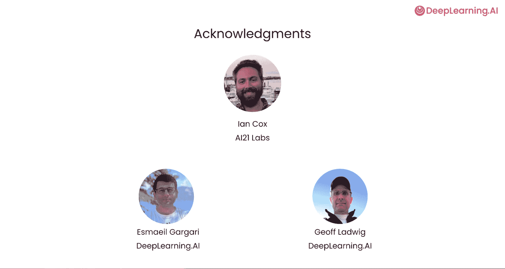

# 吴恩达《用Jamba构建长上下文AI应用｜Build Long-Context AI Apps with Jamba》中英字幕（deepseek - P1：1.intro.zh_en - GPT中英字幕课程资源 - BV18wfqYVEBs

Welcome toBuild long Con AI appsbs with Jamva， built and partnership with AI 21 Labs。

The transform architecture is the foundation of most large language models。

 but they're not efficient at processing long context lengths。

There's an alternative to transform is called member that could process very long input context by reading an arbitrary long context and compressing it to fixed size representation。

A lot of people have been excited about member as a possible alternative or successor to the transformer。

But researchers found that the pure member architecture underperforms when the context is very long。

 since the compression mechanism causes it to lose information。

 attorney1 developed a novel Jamer model that combines the traditional transformer work member to take advantage of member efficiency and also the transformers's attention mechanism to help retrieve the right piece of information at the right time。

In detail， one of the strengths of the transformer is that it compares every pair of input tokens to see how related they are to each other。

 This is the attention mechanism that does a decide say when processing one word or other words in the sentence they should be paying attention to。

But this is quadratic cost in the input length。 and while there are various techniques to bring down this course。

 it has still been expensive。 They can transform us to handle very long input context length。

Then the paper， member linear time sequence modeling with selected state spaces by Algou and Tri out describe a modern state space model that performs well and can be efficiently implemented on GPUs。

But member was not as good as a transformer and long distance relationships and in context learning。

Then the Jamva model， which is a hybrid transformer member architecture。

 tries to capture the best above works。I'm delighted our instructors for this course are Chen Wang。

 who is a lead solution architect and Ken Alphago， who is Alm tech lead from AI 21 labs。

 both expertss in memberm and Ja and Transformers。We're excited to be here and teach a course on Jamba in the course。

 we will explore the underlying structure of the Jamba model， including transformers。

 but focusing on the less wellknown databasebased aspects of the model and understand why this hybrid architecture is beneficial。

 you will also learn about strategies for expanding the context length of language models review key aspects in evaluating loan context models and understand the advantages of Jamba in these settings。

 you will also get hands on experience using Jamba with labs on prompting， processing documents。

 tool calling and rack applications always with a focus on the advantage of long contacts window of the jumbo model to improve performance。

Many people have worked ci this course。 I'd like to thank Ian Cox from AI 21 Labs and from Deep Bo AI。

 Ashshmo Gagari and Jeff Lutwig。 The first lesson will be an overview of the jumbo model。😊。

That sounds great。 Let's go on to the next video and learn about Ja。

