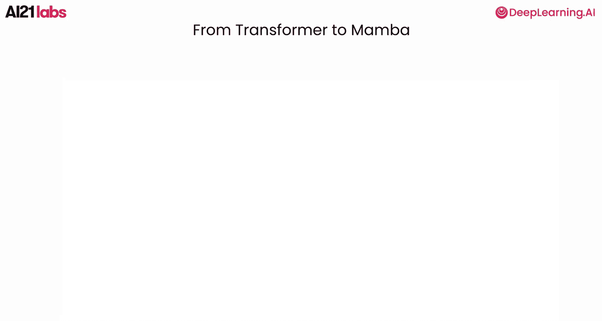
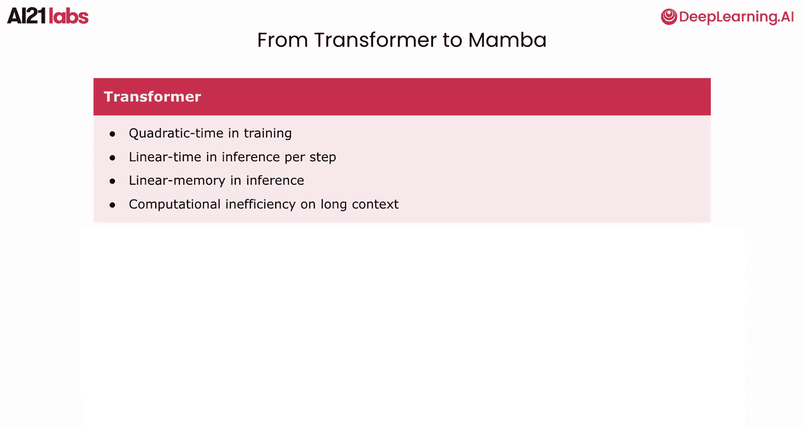
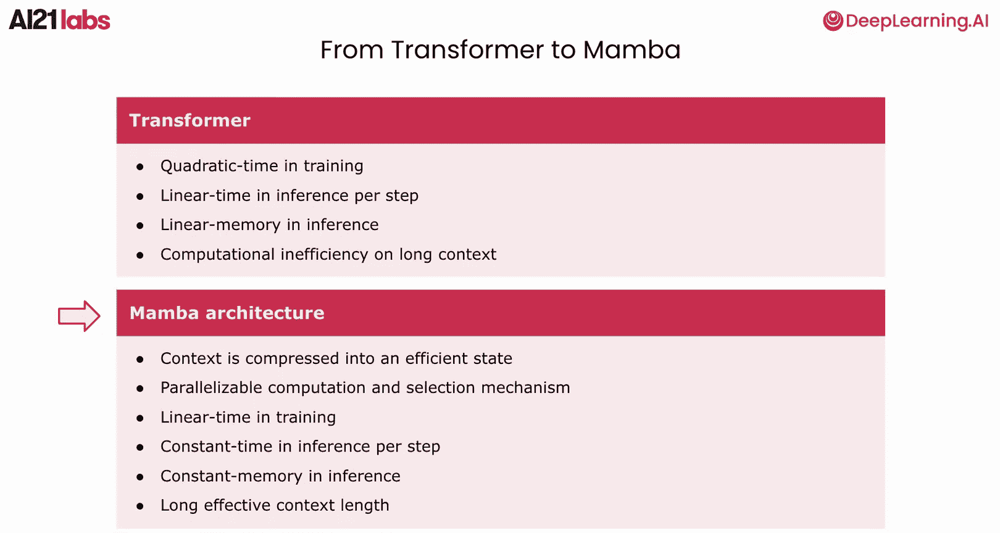
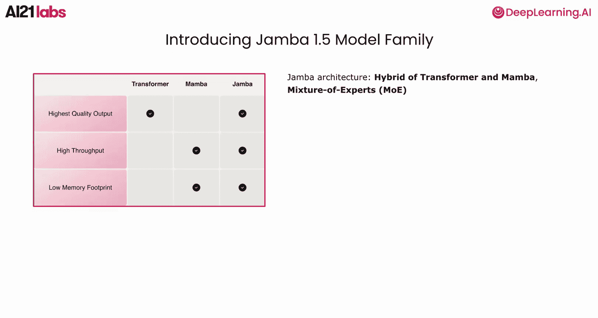
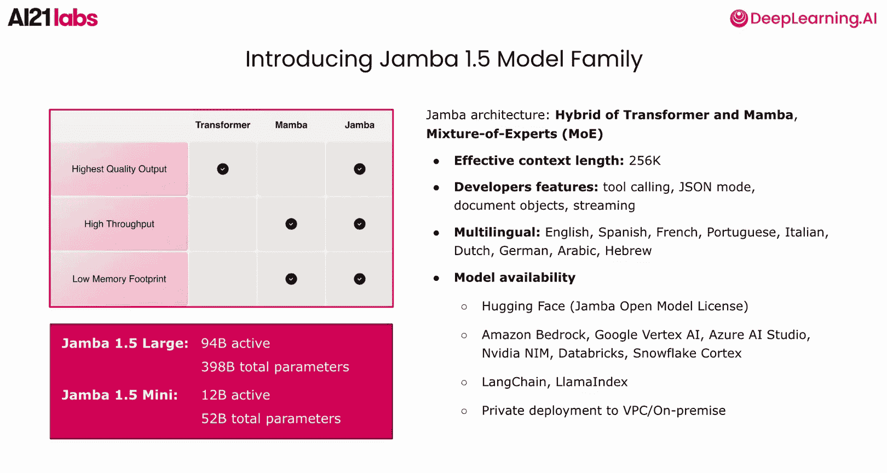
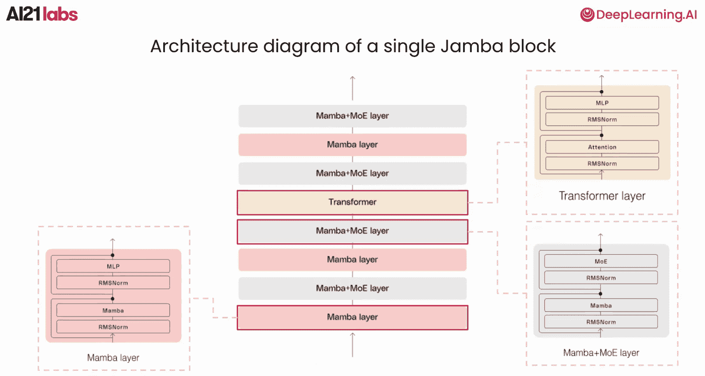
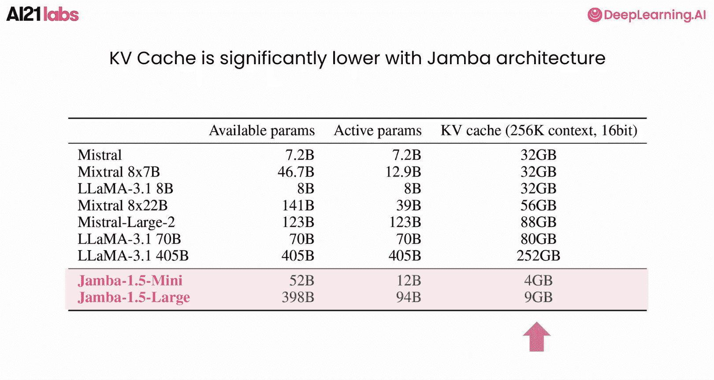
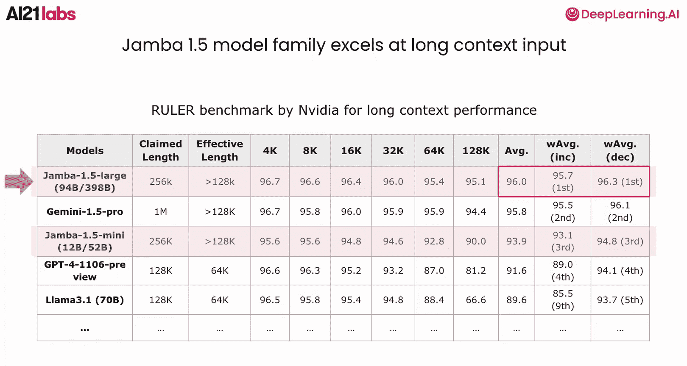

# 吴恩达《用Jamba构建长上下文AI应用｜Build Long-Context AI Apps with Jamba》中英字幕（deepseek - P2：2.overview.zh_en - GPT中英字幕课程资源 - BV18wfqYVEBs

In this lesson， you will learn key information about the jumbo models。

 its unique architecture and advantages that comes with it。 Let's dive into it。

The main motivation to develop the jumbo model is to improve the efficiency of large language models without compromising their output quality。

 Transformer architecture is used for almost all of the mainstream hour lamps today。

It keeps all the contacts information using attention mechanism。The training time grows quadraically。

 with contact length。The inference time grows linearly with the contact lens per step with KV cache。

 and the inference memory grows linearly too。The computation inefficiency takes a heavy toll。

 especially when you have a lung context， and it puts limitation on a context lens。

The Ma architecture was published in December 2023 to address the computational inefficiency issue of transformers。

By compressing the contact into an efficient state， similar to a recurrent neural network。

While also running computation in parallel with a selection mechanism。

A more detailed discussion will come in the next lesson。

Mong architecture enables linear training time growth with contact lens。

In comparison to quadratic growth for transformer。Inference time is constant per step compared to linear time growth for transformer。

And inference memory stays constant compared to linear memory growth for transformer。

 The much improved computational efficiency enables the mom architecture to better process long contact length natively。

😊，The downside of pure modern architecture model is that the model robustness and output quality suffers a large scale。

To take the best of both words， we optimized a hybrid of transformer and man architecture to create the jumba model to achieve high output quality。

 as well as high computation efficiency for high throughput and low memory footprint。

Mixture of experts were also used for the jumba model to further improve the model throughput。

 efficiency and quality。

The latest itition of the jumbo model is the jumbo 1。5 model family。Which consists of two models。

Chmbo 1。5 large and Cham 1。5 mini。The Jamba 1。5 large model has 94 billion active parameters and 398 billion total parameters。

And the Jambo 1。5 mini model has 12 billion active parameters and 52 billion total parameters。

Both model have a very long， effective contact length of 256 k tokens。

The Javava models are also equipped with key features for developers to build enterprise GenI applications such as tool calling。

 structure JO output， document as an input object and streaming。Jama models are also multilingual。

 supporting nine different languages。Including English， Spanish， French， Portuguese， Italian， Dutch。

 German， Arabic and Hebrew。Tma models are released as an open weight models on hacking phase。

And also widely available across different platforms and frameworks。Including AWS， GCP， Azure。

 Imedia namem。Data breaks， snowflake， La chain， Lama index and more。

You can also deploy the Javamva models into your private cloud or unprem environment。

If it looked under the hood。A single jumba block consists of8 layers。

 including one transformal layer。3 maba layers and four Mba plus M O E layers。

This is composition that optimizes both model output quality and the model efficiency。

 The improved efficiency of the jumbo model is quite clear when comparing KV cache memory footprint at long context because of the compressed context and all of the mum layers。

Java Model's KVc is only a fraction of other transformer based LLMs at similar or even smaller number of model parameters。

While being a lot more efficient。The jumgle model also excel at long context evaluation benchmarks。

Ruler is a recent benchmark developed by Imedia specifically to evaluate large language models performance and lung context。

Ruler evaluates LOM for different task categories。Including multiple needles in the haystack retrieval。

 multiop tracing， word extraction and question answering at different contact lengths。

Both Java models do very well across different context lengths。With Zh 1。5 tops leaderboard。Great。

 so now you have learned all the key information about the jumba model Next。

 you will learn an evolution journey that leads to the development of the jumba model and the science behind its efficiency gain。

See you in the next lesson。

