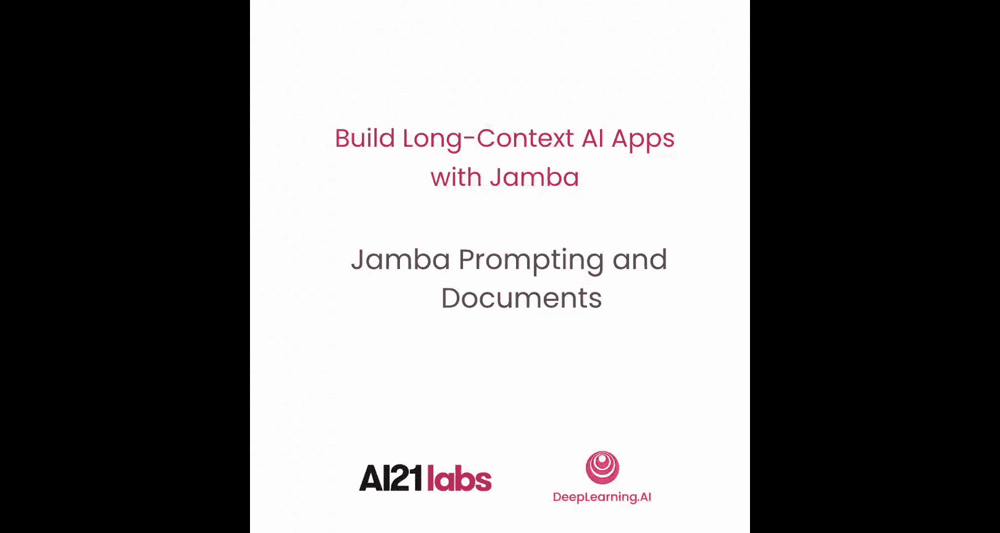
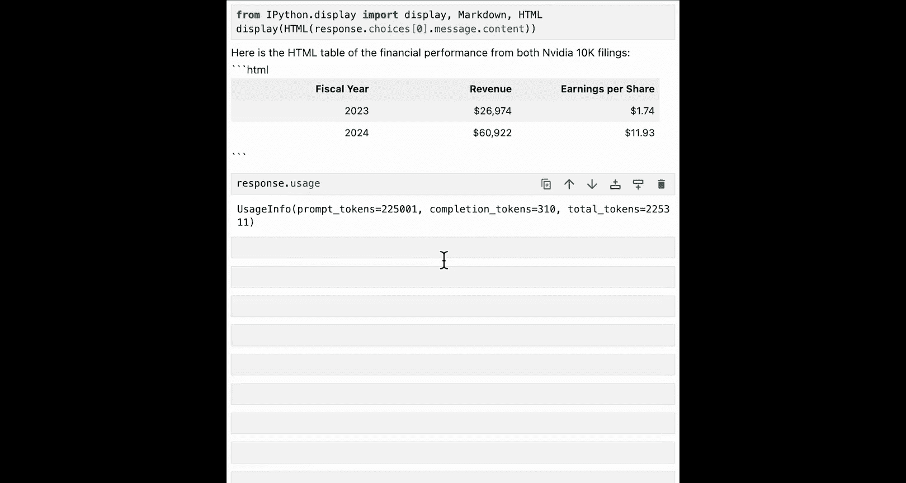

# 吴恩达《用Jamba构建长上下文AI应用｜Build Long-Context AI Apps with Jamba》中英字幕（deepseek - P3：3.transformer-mamba-hybrid-llm-architecture.zh_en - GPT中英字幕课程资源 - BV18wfqYVEBs

In this lesson， you will learn to use AI 21 SD D K。

 especially using the documents parameter to work with long documents。Allright， let's have some fun。

Similar to other LO M APIs， Jumba model API requires two input parameters。First， easy chat messages。

Including system message， user message， and assistant message to form a chat history。

Second is a model name。You can choose to use Jamba 1。5 large or Jamba 1。5 mini。To balance a quality。

 latency and cost based on your use case requirements。

There are also a set of optional parameters to help you to build and customize complex Gen applications。

Documents is a unique parameter available for you to attach long documents as a input object in your API call directly。

You can also enforce the model response in JSO format。

 use tools parameter for external function and tool calling。Maximum output token counts， temperature。

 toppy are also tuneable for you。Stop sequence can be very helpful in few shots or many shots in context learning。

You can also choose to generate multiple responses in one API call and also stream the response one token at a time instead of waiting for the entire response to be completed。

Throughout the course， you will use Invidia 10 K annual report from the last two years as your example data set。

Each of the report is around 100000 tokens， or roughly 200 pages。

You can really use the full potential of the jumba model's long contacts window to process these SEC filing reports。

If you are not familiar with STC findings， don't worry。

 you will find out the answer by yourself in just a few moments。Now。

 let's go to the notebook and start to build with Jamba。

Let's have these two lines to ignore unnecessary warnings。Now， let's import our libraries。

 Here you will load the AI 21 Python client。And also chat messages and document schema from the Python client。

 you will also need the API key in this lesson， but don't worry。

 the API key has already been loaded for you， and here you can create an AI 21 client as well。Now。

 youre ready to use the jumbo model。Here you have an example of chat messages as input to the jumbo model。

 you can give your guidance to the jumbo model in the system message。

You can explain the task you want the job model to do in the user message。

And you can attach any previous response from the jum model in the assistant message。Here。

 giving word， just starting the interaction with the Java model， we can remove the assistant message。

Alright， now in this first request to the Java model。

 let's ask the Java model to explain the SeEC filings in one short sentence to us。Now。

 let's send the messages to the jumbo model here。 you can also customize different optional parameters。

Here we choose to use the JamA 1。5 large model， but you can also choose to use Jamba 1。

5 mini as a smaller and faster choice。And you can customize maximum output token。The temperature。

 which is default at 04。And Tao pii。And also， stop sequence， it can also customize the stop sequence。

 The stop sequence can be a list of strings。The response will end when any other stop sequence string is generated and the stop sequence will not be included in the generated response。

 For example， including the separator string from your many shots prompt in the stop sequence can help the model stop at the appropriate position。

 and you can also specify the number of responses in a single call to the jumbo model。

 Now you can run this cell to see the response from the jumbo model。

A few important things to note in the response。 First。

 the main response is in the assistant message content section。

So let's have a look with the ju model response， we can now learn information about SEC filings。

 so SEC filings are formal documents that publicly traded companies in the United States must submit to the Securities and Exchange Commission SEC。

 providing detailed financial and operational information to ensure transparency and protect investors。

There you go。 Now you know the precise definition of SCC filing documents。

Another important thing to note is the number of tokens in the usage info section。

So here we used 26 hokis in the prompt。36 tokens in the completion and total of 62 tokens。

 You can track your token consumption with each call to the jun model to show the content of the response message。

 you can use response star choices，0 message dot content。To only get the response string。

 a jumbo model can also generate response in a specified Json format。

Now let's ask a Java model to give us some information for the top five most common types of FCC filing in Json format。

Including the form name and description。 Now， let's send the request to the jumbo model。

With additional response format parameter to specified output should be a Json object。

 and to ensure the output consistency， we can also specify the temperature to be 0 for a consistent output。

 Now， you can print the model output in a nice Json layout。The 10 K form， which is annual report。

 will be use across this course。Also other popular SEC fighting types。

 also including the10 Q Qd report and 8K and S1 and others。

 having the jumbo model providing consistent JSO format can be very critical for the robustness of your G application As we have discussed earlier。

 one key advantage of the jumbo model is their ability to handle lung context。

AI 21 SDK also provides a convenient way to attach long documents in the API call to Jumbo model。

For the Javam model will follow your request or answer your question based on the provided documents to do so you can first loading two invidia 10 k files。

You may also download immediate Tkey files to our from the Nasdaq website， the low date text files。

Can be constructed in a list of document objects using the document schema from AI 21 SDK。

 content is the text of your file。And you may also add the metadata to further help the Java model to use the document intelligently。

As example。You may add company name。The type of documents。And also。

 the year of the 10 K filings in the metadata。With entire two years of 10 K documents。

 you can ask the Jama model to generate an HMl table short information from both years of 10 K findings。

 Remember that now the entire two years of 10 K documents are included。

That jumbo model is processing about 200000 tokens。 So this step might take a while。 Great。

 now we can visualize it with the i Python display module。

 Now we have this nice table for you to easily see the financial results from both years，10 K filing。

And lastly， in the response usage， you can actually see that the Java model just helped you to process over 200000 tokens。

From the two years of 10 K files。Great， in the next lesson。

 you will learn about tool calling with the Jamba model。 Alright， see you there。

