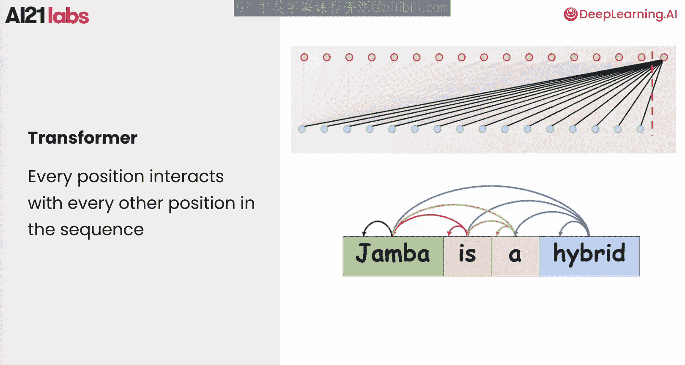
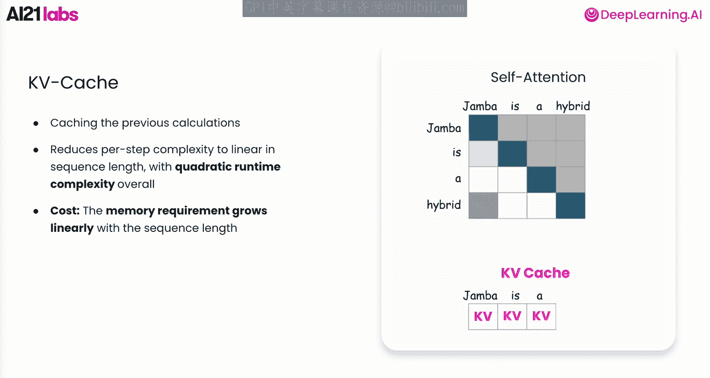
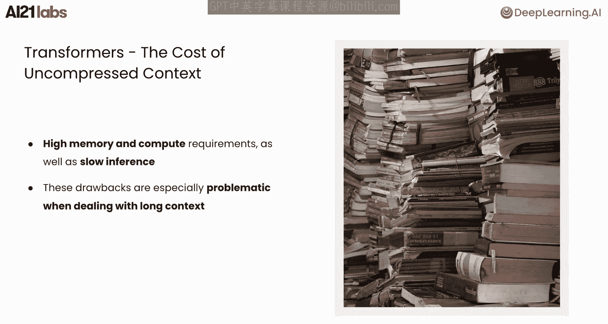
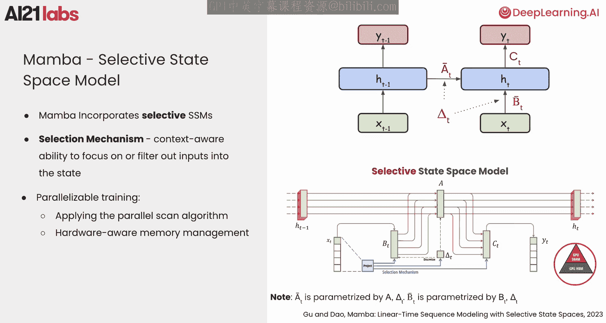
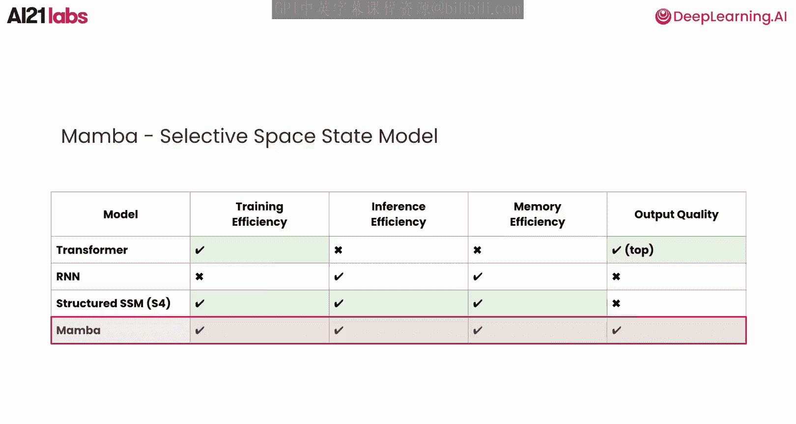
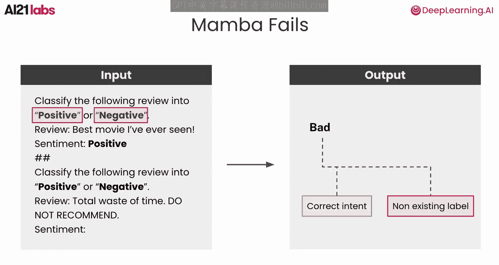
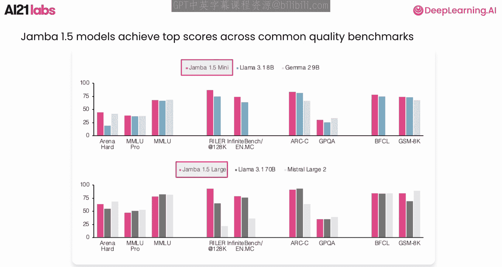
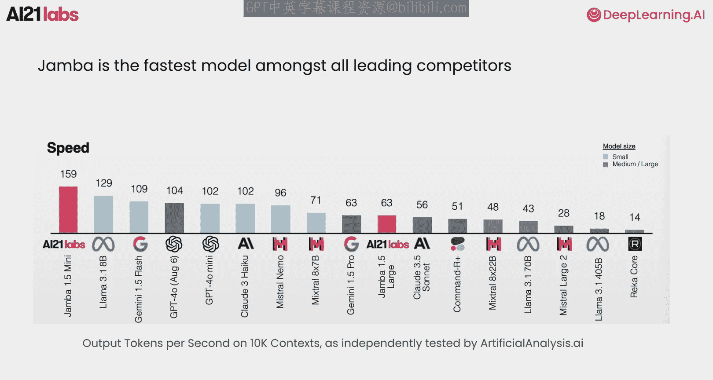

# 吴恩达《用Jamba构建长上下文AI应用｜Build Long-Context AI Apps with Jamba》中英字幕（deepseek - P4：4.jamba-prompting-and-documents.zh_en - GPT中英字幕课程资源 - BV18wfqYVEBs

Now that you have a high level view， Let's dive into the details of transformers。

 state space models and how they have evolved。😊，Understanding these foundations will highlight how Jamba builds on them and solves key challenges in LLM architectures。

Alright， let's go。 The transform former architecture is predominant architecture for language models。

This architecture is based on the attention mechanism。

 where each token interact with every other token in the sequence。

 enabling the model to capture complex relationships between tokens。

 It create a matrix comparing each token with every token that came before。

The weights in the metrics are determined by how relevant the token pairs are to one another。

So the complexity is quadratic due to the perverse interactions between all tokens in the sequence。

 Now， let's look at how inference works in a transformer。As each token is generated。

 the model calculates attention across all past tokens in the sequence。

 each token that is generated is then included in the input。

 and the process is repeated for each token。To avoid rate calculating attention for all previous tokens at each generation step。

 we use a cable cache。The K cache store the vector representations of previous tokens that were used in the calculation of attention。

Allowing us to focus on culating intention for the new token。With KVc。

 each step has linear time complexity in sequence length with quadratic complexity overall。However。

 this approach come with the cost that the memory requirement grows linearly with the sequence length。

 revisiting the entire context comes with significant memory and compute demands and leads to s inference that is challenging to skeg。

For long sequences， these demands can create major limitations to overcome this。

 We are exploring an alternative approach that manages context more efficiently to explore this approach。

 Let's start by defining the concept of state。 state represent the internal memory that stores relevant past information。

 helping the model make accurate predictions about future tokens。

Different models handle this memory in different ways， depending on their architecture。

Transformers create a form of state through their attention mechanism。

 They actually remember every detail in the history。

 and we can interpret the Kvy Ke as the transformers state。This approach， however。

 is highly inefficient。An alternative approach to transformers is to employ a fixed state representation。

 These models compress past information into a fixed and manageable size date that is applieded at each step。

For example， whether the context is 200 tokens or 200，000 tokens。

 it is compressed into the same state size。We will refer these models as a state based models。

During inference， state based models only need to process the previous state H T minus-1 and the current input Ptoken x T to update the state into H D and then generate the next output yt。

It then repeats the same process to generate the future outputs。

 This approach reduces the computational requirements drastically。

It scales efficiently with the input length， avoiding quadratic growth in computation。Specifically。

 this approach requires constant time in France per step with a constant memory complexity that doesn't scale with a sequence length。

This is much more efficient than the time and the memory complexity of attention based architectures。

 If this concept looks familiar， it's because it lies at the core of our。

 a traditional architecture that implements the concept of effect fixed size date。

The core component of an RN is the recurrent unit， which includes a hidden state that acts as the model's internal memory。

Let's look at inferences using Rn to generate the token after ease。

The model uses the token jumba as input to update the hidden state and then generate the output token。

This hidden state carries forward the compressed information about all previous tokens to help generate the next tokens。

This means the memory requirements are constant， regardless of the sequence length。

That the time complexity grows linearly with the sequence length， which is much more efficient。

 however， because information is summarized into a fixed size。

 RNNs can lose the ability to capture dependencies across long distances。

 making them less effective than transformers。In addition。

 they are costly to train because the dependencies between time steps prevent parallelization。

 limiting training efficiency。 Here， we can see a comparison between transformers and ours。

OurNNs are more computationally efficient， but offer lower quality and struggle to scale during training。

The interesting fact is that As were introduced before transformers， but due to their drawbacks。

 they didn't fully realize the potential of state models。Structured state space models。

 also known as S4， provide a more efficient way to manage state。

 Iosing a certain structure on the model's parameters and processing the state linear operations。

Here is a diagram showing how inference France happens with SMs。A bar。

 B bar and C are the model's parameters used at every step to generate an output token。

 given an input token XD， the model updates its state by linearly combining the previous state and the current input using respectively A bar and B bar A bar helps identify what to forget and want to remember from the state over time and B bar helps identify what to remember from the new input。

After updating the state， the model uses C to map the current state to the output。

C helps identify how to use the updated state to generate the next token。

The forms of A bar and B bar met rely on parameter labeled data。Which represents the step size。

It essentially controls the balance between how much to rely on the previous state versus the current input。

 One notable characteristic of Sms is their dual representation。

 They can function as a linear recurrence or as the one dimensional convolution。Using convolution Ss。

 we introduced the possibility of training LLMs at scale while maintaining the efficient influence of ourN。

Let's return to our in comparison。 SMs are efficient， both at inference and at training。

 which is their key advantage over RnN。 However， the quality still lags behind that of transformers。

 The main reason for this is that the state in Sms is independent of the input。 Let's check again。

 the diagram of structured Sms。 A bar， B bar C and Delta are all learned constants。

This means that at every step， the model processes every single input in the same way。 Consider。

 again， this phrase。Jmba is hybrid。With structured SSM。

 all of these tokens equally contribute to the state that the model will use to generate the next token。

However， tokens， Jamba and hybrid are more relevant to generate the next token。

Selective SM addresses this issue by making all the parameters dependent on the input。

 This concept of selectivity enables the model to focus on or filter out inputs based on their relevance to the task。

So with selection， the state becomes more expressive。

 focusing only on the most important details when remaining concise。

Mumbba is a state space model that incorporates selective SSM into a recurrent architecture that selectively processes information based on the current input。

 This selection mechanism makes membermba context aware。

 allowing it to adaptively determine which information should be stored in the state for future predictions。

By combining structured state space modeling with a selective filtering process。

 MaMba achieves a balance between efficient state management and targeted information retention。Now。

 if you check the memberba paper， you will see this diagram that shows more details than the top simplified diagram you saw so far。

 for instance， A bar T does not only depend on Delta T， as we've previously discussed。

 but also on another metric parameter， which is a。In this lesson。

 we won't go into the details of what A actually represents。

 but if you'd like to learn more about how Delta T and A are related to A Barti。

 I encourage you to check the Maba's paper by goingendda。

Note how the selection mechanism is specifically applied to Delta T。

 which indirectly affects a birdie also。B Bti depends on two parameters， Bea and deelta。

Note how this selection mechanism is applied to Delta T and B， T。And finally。

 the two seals are equivalent。😊，Note how the selection mechanism is all applied to Siic。However。

 the selection mechanism disrupts the ability to compute the convolution。

 which is what enabled parallelization in structured SSN training。

 Another important contribution of MAMba is its ability to maintain parallelization during training。

This is achieved by applying the power scan algorithm and applying hardware aware memory management。

Again， I encourage you to check the member's paper for more details。As a result。

 we end up with a robust architecture that excels in training efficiency。

 inference speed and memory footprint， while also delivering high quality performance。

 this is why Mamba succeeds when transformformer falls short。

Particularly in handling loan contexts and real road production workloads。 But unfortunately。

 Mamba does have its drawbacks。 Mamba fall short when careful handling of specific tokens is required for some operations。

 the compact representation of hidden state isn't enough。

And an imppatient mechanism is required。One example is copying with specific words or sentences from the context。

 As shown in this paper， Mamba is less successful in predicting a repetitive sequence of words。

 Here is an example of where copying from input is important。

 and Mamba would do worse than transformer。The model is required to classify movie reviews as either positive or negative。

And here is a sample output。The transformer will excel in such tasks and not only will succeed in identify the intent of the review。

 but also output the right label。However， even when Membermba succeeds to identify the correct intent。

 it often outputs a non existing label。As it doesn't attend to exact label options found in the context。

In order to have the advantages of these architectures while mitigating their drawbacks。

 we implemented our own novel architecture called Jumba。Jamba。

 which stands for Jo attention and mamba， combines both attention layers and mamba layers。

On top of the combination between Transformer and Mamba。

 we also use an additional technology called mixtureture of experts。

 which allows us to use only a portion of the model weights on each token as chosen by a router。

Each such portion is called an expert。 This way we can improve quality without sacrificing speed or cha。

 We call the combination of transformer mamba and M O E， a jumbo block。

 which creates a strong and flexible architecture， This flexibility allows Jamba to balance the sometimes conflicting objectives of low memory usage。

 high throughput and high quality outputs。 So there is a trade of fear。

 addinging more transformer layers helps address the issues we discussed with Mamba。

 but it also increases complexity。 The key was finding the optimal number。😊。

In the application we conducted， as detailed in the paper。

 we found that a ratio of 7 membermber layers and one attention layer had the best quality while being much more efficient in footprint and memory footprint。

 coming back to our table， we sit at Jumba achieves top performance as performers。

 while also maintaining high efficiency in all aspects。Backing this up with benchmarks。

 we can see that Jumba 1。5 models achieved top scores across common quality benchmarks。

Moving on， Jamba is the fastest model among all leading competitors。

 setting a new standard for efficiency without compromising on performance。Al right。

 in this lesson you learned that Jumer's hybrid structure of transformer membermba and mixture of expert components enables it to adaptively manage resources while maintaining performance。

 making it a powerful choice for scalable language modeling。

