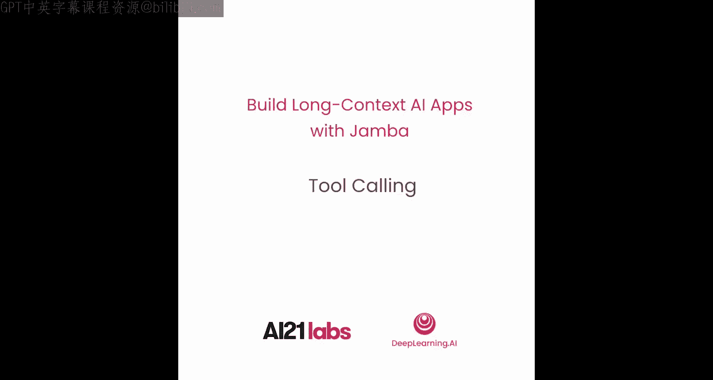
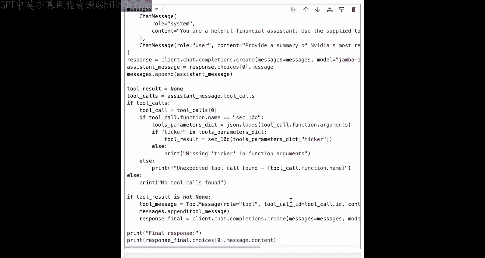

# 吴恩达《用Jamba构建长上下文AI应用｜Build Long-Context AI Apps with Jamba》中英字幕（deepseek - P5：5.tool-calling.zh_en - GPT中英字幕课程资源 - BV18wfqYVEBs

This lesson is all about tool calling。 You will learn both the conceptual steps and hands on examples for tool calling with a jumba model。

 Let's go。 Jumbo models have built tool calling functionality to support your agent workflow with external functions and tools。

The tools can be external APIs to access real time data such as stock market， news。

 or your CRM system data。You may also define your custom function， for example。

 arithmetic functions to serve as calculators for the LOM。First。

 let's go through the workflow diagram of usinging tool calling with the general model。

When you send a user query to the jumba model。A Java model will decide if any available tool should be used to provide the best answer for your query。

If no tool is triggered， the Javamba model will simply generate a response。If a tool should be used。

 the jumbo model will extract the proper parameters for the right tool based on the user query。

The parameters will then be used to call the tool and two results will be sent back to the jumbo model to generate the final response。

Let's go to the code。 These two lines of code is used here to ignore any unnecessary warnings。 First。

 you will import everything you need from the AI 21 library， similar to the previous lab。

 you just need to load AI 21 API key and create the AI 21 client The API keys has been set up here already for you so you don't have to worry about it。

Now let's get to the first tool calling example。You probably know that the large models are not the best tool for arithmetic calculation。

And some even say God didn't put all land Mars to do arithmetics。

You don't want to multiply billions of numbers in order to multiply two numbers。

 So let's give the general model to arithmetic functions。

 multiplication and addition for it to use at the right time。

Pretty simple each function takes in two numbers and perform a simple arithmetic calculation but how does the Java model know that these two functions are available to it。

 you can use the tool definition we imported earlier from AI 21 SDK to describe the available function and pass it to the Java model via the tool or parameter。

You can do it1，2 at time。Into a definition， you specify type ofs function。

 provide the name and description of the function， matched semantic meaning of the function。

And also supply the parameters for the function you want to call later。

 Also describe the type and description of those parameters。

And both numbers are required for the multiplication function。  Similarlyly。

 you can define the addition function as well。 Now you can put the two tools together in a list for the jumbo model to easily understand the jumbo response。

 Let's ask what is the capital of。 Now you pass the messages and tools to the jumbo model to a response。

In the response， you can see that the tool calls in a system message is none。

Which means none all the tools we defined were used for this question。Which makes sense。

 we don't need multiplication or additionion to know the capital of friends。 Now。

 it is time for you to ask rather than question for our tools。 For example。

 to multiply two numbers together。You can also add a system message to provide further guidance for the Java model。

Now pass a message and tools to the JamA 1。5 large model again。

 now you can see the tool calling information is in the assistant message tool call section with a tool call ID function name。

Multulplication here。And also， the arguments。Because in a query。

 you ask the Javamva model to multiply two numbers。

 and the Javamva model correctly identifies the multiplication is the right function for the job。

 You can passse the function arguments from the jumbo response and use them to call the multiplication function defined earlier to do this calculation for you。

 The results from the multiplication function can be wrapped in a tool message object。

Make sure you add a craft tool call I D。And the results from your multiplication function added as content。

 The final step is to combine the initial assistant message and tool a message in the chat history and send them together to the jumonad to give you the final response。

 We all have multiple functions。 You can use this code block to select the right function to call。

With the same example， you can add a two arithmetic function in a dictionary。

 T the function name and the parameters from the jumbo model response and color right function。

Now let's look at another tool calling example to run some analysis on SCC10ki filing documents。

 which is public company's quarterly reports。 you will first import the SCC1que function from the OTs。

This function goes to the SEC website。Use the company's stock takeer symbol to pull the full text of the most recent tin you report。

 The only one parameter it needs is a stockter symbol。

 you start by defining the tool for the Javaba model like we did in the previous example with a function tool。

 description and parameters。 Then you can add it to a tools list。

 Now let's say you want to get a summary of immediatemedia most recent tin you report。

 you can write your system message。And user message and pass it to the jumbo model。

 along with the tool list。 Let's take a look at the jumbo model response。

The drama model correctly identifies。The SECCC Thank you tool is required here。

And return the immediate ticker MBD as a parameter to the function。 Let's call the Se1que function。

 Now you can get the full text of the immediate most recent1 code report。

 which is a very long file here for the convenience Let's clear the cell output append the initial jumbo model response and a tool message including the1que file as content to the chat history the jumva model can now complete your initial request and here the final response。

 which is a summary for the most recent in1que file in a few lines of code the Jamva model was able to point to the right function and pull the right document from the Se site and generate this summary for you。

 you can now stitch together the entire process using this code block It checks if a particular tool is called and generates the final response accordingly。

Alright， in this lesson， you have learned how to use the Javamba model for tool calling。

 which is critical for building a AI applications。In the next lesson。

 you will learn how to expand the contact window size for a large language model。 See there。

