# 吴恩达《用Jamba构建长上下文AI应用｜Build Long-Context AI Apps with Jamba》中英字幕（deepseek - P6：6.expand-the-context-window-size.zh_en - GPT中英字幕课程资源 - BV18wfqYVEBs

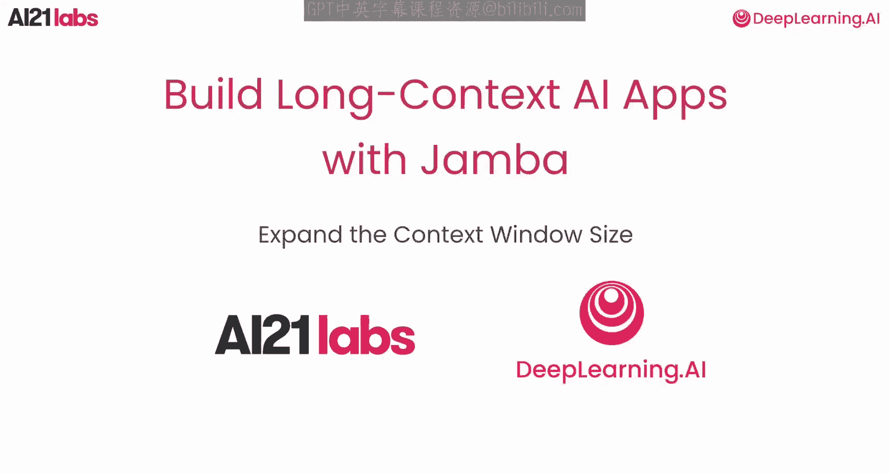

This lesson is going to focus on long context。 What it takes to support it， train it and utilize it。

You'll also learn about performance metrics for evaluating loan context models。

 Let's dive in loan context capabilities unlock the full potential of large language models。

 enabling them to excel at a range of complex tasks。😊，First。

 they work really well in processing and reasoning over documents like financial agreements or legal contracts while preserving key context and details throughout。

In retrieval augmented generation pipelines， lung context models enhance the integration of retrievettriieving information。

 increasing the chance of finding an answer that is both accurate and contextually coherent。

These models can also retain multi term interactions history。

 ensuring consistent and natural conversations。Many short learning is another critical use case。

 Instead of fine tu， we can embed thousands of example directly into the context。

 This approach is cost effective and flexible， enabling quick adaptation to new tasks without retraining。

Finally， long context models are essential for agent needs and advanced reasoning tasks such as chain of thought and chain of to。

They can support extensive token choicess required for decision making and complex problem solving。

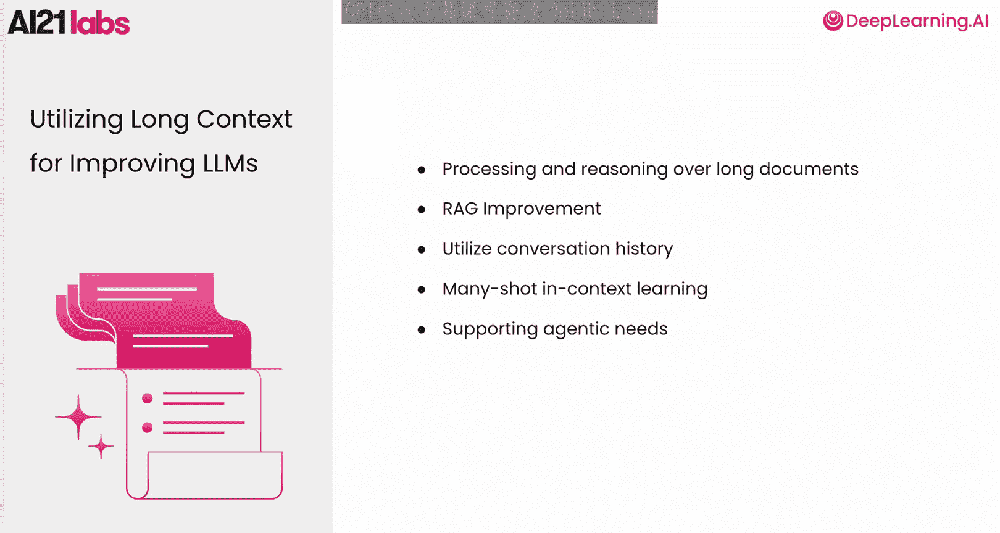

However， training a alone context model presents a range of significant challenges。First。

 there is massive computational costs。 The longer sequences dramatically increase training time and training models exclusively on long context quickly becomes extremely expensive。

Adding to this to transformer architectures， the backbone of most LLMs face inherent limitation when scaling to long context。

These issues are compounded by computational bottlenecks。

 Hy memory imposes strict limits on the context lines models can handle。Next is the data challenge。

 There is simply not enough naturally occurring lung context data available for effective training。

In addition， balancing long and short contact during training is another critical hurdle。

Over emphasizing loan context may a great performance on short context tasks。

 while leaning too heavily on short context data limits a model's ability generalized to longer sequences。

 Finally， evaluating long context models is particularly challenging。

Standard evaluation methods often don't capture the full complexity of how these models perform in railroad scenarios。

 A model's ability to process loan context doesn't necessarily equate to its ability to utilize them effectively in practice。

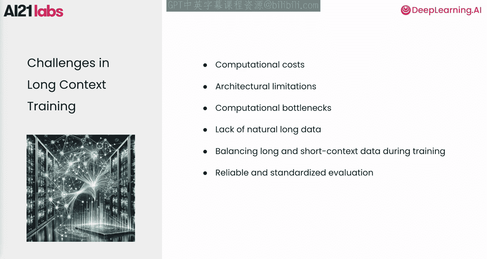

Evering these challenges demand innovations in architecture， data strategies， training。

 infrastructure and methods， as well as evaluation methods。😊。

We should approach it from every aspect to fully unlock the potential of lawn context。

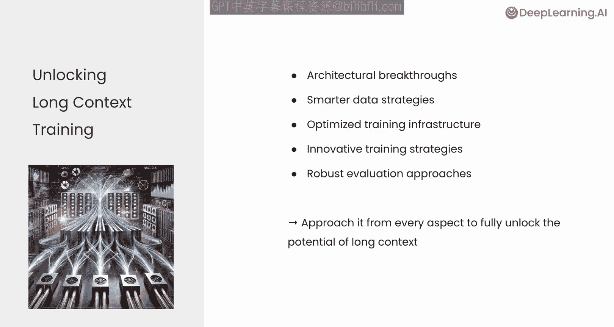

As we look at architectural considerations for long conve L L Ms。

 it's important to understand the challenges and innovations driving progress。 First。

 first former only architectures face significant hurdles when scaling to long context。

They demand substantial memory and computational resources。

 which limits their ability to scale efficiently while techniques like sparse attention and sliding windows can extend the context。

 they often come with a cost of degraded quality， to overcome these limitations return to innovative architectures。

 Ma architecture is highly efficient not only due to its support for parallelism。

 but also because its state based design significantly reduces computational and memory complexity。

 This combination enables faster training and lower resource usage。

 making it particularly well suited for handling blown context。However。

 Mumbai loan doesn't consistently match the top quality output of transformers。

 a potential use case involves providing a model with loan document and asking a question that requires integrating information from across the entire context。

Such cases can be challenging for Mumbai loan， as it may struggle to compress all the necessary information effectively。

The hybrid jam architecture integrates Manmba with transformer layers。

 leveraging Mamba's efficiency and extended contact capabilities alongside the transformer's ability to deliver high quality responses。

This energy ensures production great performance while keeping training computationally efficient and resource fair。

Returning to the lung context example， attention can be seen as performing retrieval phone number。

 recovering import information that may have been lost during compression。

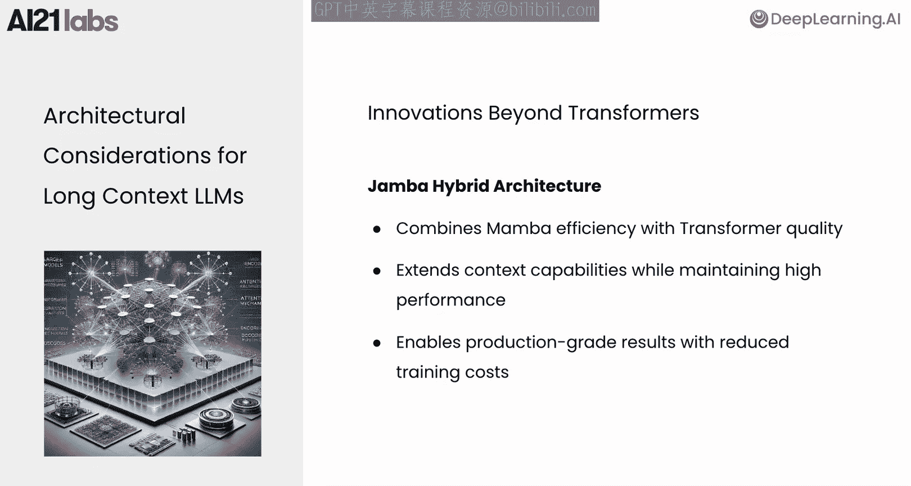

To handle the growing computational demand of flow context training。

 adapting the infrastructure to support advanced parallelism is crucial。

Several techniques play a key role here， including fully shed data parallel， tenzil parallelism。

 sequence parallelism and expert parallelism。Sequence parallelism， in particular。

 is vital for loan context training。It works by distributing the computation and activation memory across GPUs along the sequence dimension of transformer layers。

This approach not only reduces the memory footprint。

 but also enhance performance by optimizing parts of the transformer that were previously untouched by parallelization。

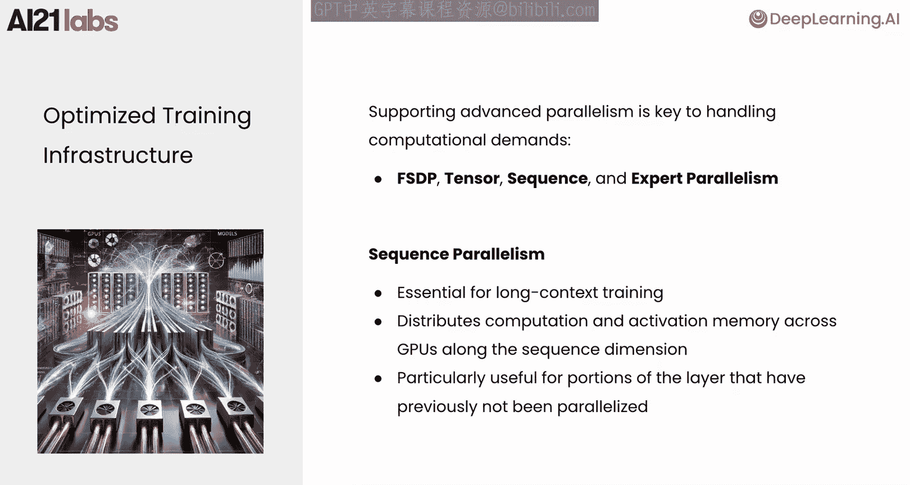

Moving on to data collection and generation。The quality of the data directly influences the effectiveness of loan context models。

There are two key types of sources we focus on for training lung contact models。

We begin with collection of natural long documents， such as books and code bases。

These sources provide rich， continuous contact that aligns well with the need of loan contact models。

 offering depth and complexity。Additionally， synthetic data generation plays a crucial role in supplementing natural data by generating diverse and relevant data。

 we can fill gaps and further train the model at scale。

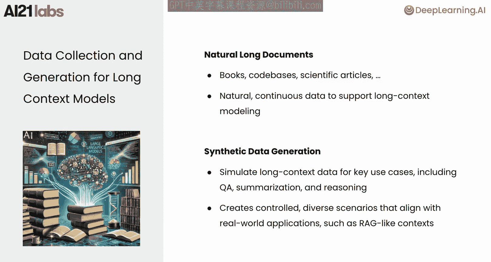

With architecture selected， the infrastructure optimized and the data prepared we now ready to dive into the training process。

 Let's begin by examining the essential stages of training along context LLM。

These stages can be broadly divided into pre training， meat training， and post training。Bre training。

 the model learns to predict the next token in a sequence。

 which allows it to acquire a deep understanding of language and general knowledge。

When training a long context model， an intermediate short face is introduced between pretraining and post training。

During this phase， pre training continues with high portion of loan documents to emphasize the model's long range capabilities。

At the end of this phase， we have a long base a M。Next。

 post string aligns the base model with supervised fine tu or SF T on instruction tuning data。

 In some cases， preference units is also applied to further improve the performance。😊。

For this lesson， we will focus only on SFT training during the past training phase。

The goal of post training is to achieve two objectives simultaneously。 First。

 provide the model with skills and conversational capabilities。😊。

The second goal is to retain the capabilities from pre training。

 particularly the long contact abilities developed during meat training By the end of this stage。

 we have a long instruct LLM that can follow instructions across varied contact length。

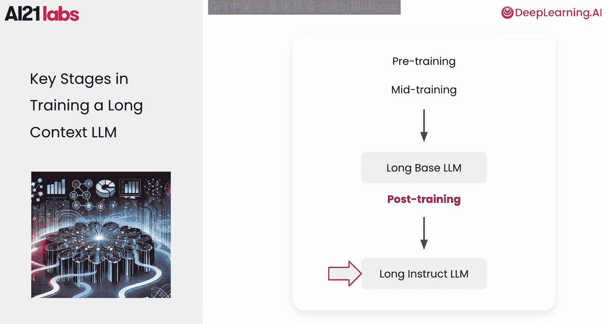

Balancing short and long context data is key to optimizing long context language models during midrananging and post training。

In Min training， a higher portion of loan documents builds from loan contact capabilities。

 but incorporating short context data ensures the model retain versatility for short tasks in post training。

 predominantly short context data sets， pose challenges。

 solely fine unit on short context data with degrading loan context performance。

Careful data mixing and performance monitoring are essential to maintaining balance。 Now。

 let's explore another training strategy， length curriculum。😊。

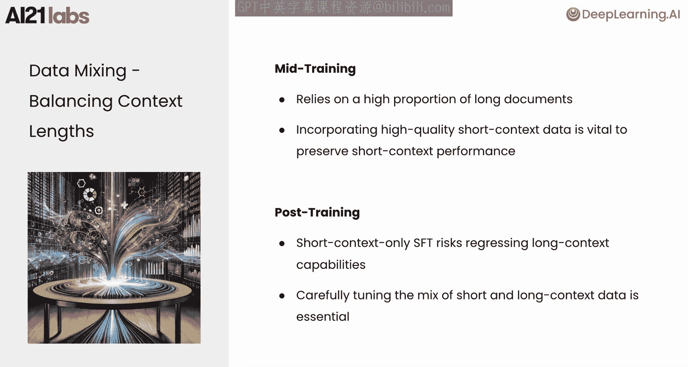

A technique used to progress way increase the contact length during model training。

The idea behind L's curriculum is to gradually expand the model's ability to handle longer context。

For instance， static 32K contact window then moved to 64K。128K and so on。

This gradual increase helps the model adapt to handling longer sequences of data while preserving its understanding of shorter context。

For example， in case of Lama pre training， the context window started at 8 k and was gradually increased in six stages。

 ultimately reaching 128 k by following this approach。

 the model is able to build long context proficiency in a controlled manner ensuring stability and consistent performance across different context length。

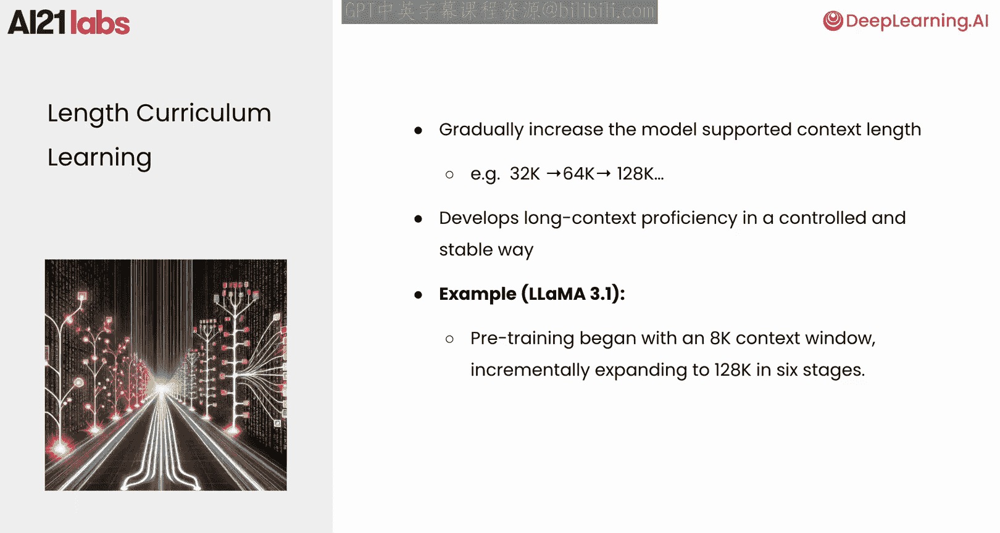

After reviewing their training aspects， we now turn to the evaluation of long context models。

A comprehensive evaluation in the middle both effectiveness and efficiency。

The model must leverage the full context to produce high quality outputs。

 utilizing and integrating relevant information appropriately。On the other hand。

 the model must also be critical in real world use。

 This means it should not be too slow in generating the answers and should not be too closely in terms of resources。

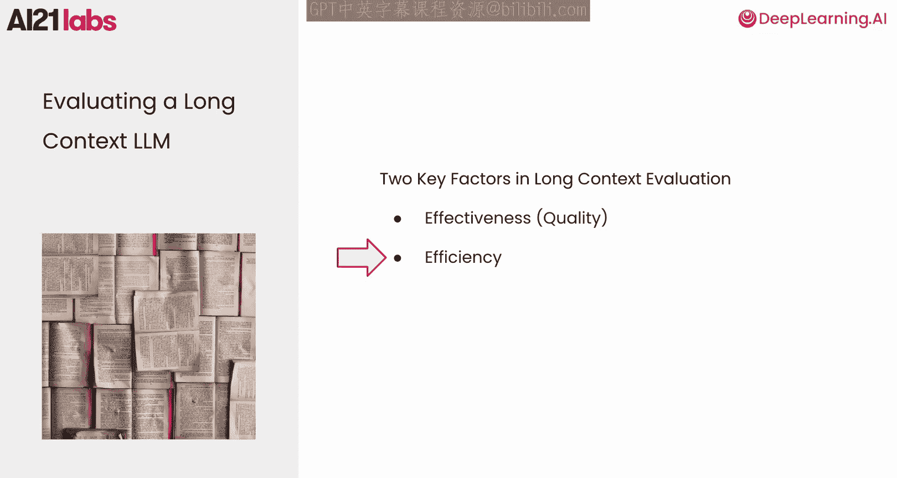

We now get to an important distinction in evaluating lo context quality。

 claim context length versus effective context length。

Claed contact length refers to the maximum input length the model can technically process without error。

 the model's input limit。Effective contact length， however。

 is the maximum input length at which the model can still perform tasks accurately and effectively。

Integrating relevant information into its output， understanding this distinction is important because long contact capabilities are not only about processing larger inputs。

 but also about the model's ability to leverage the information in those inputs for high quality results。

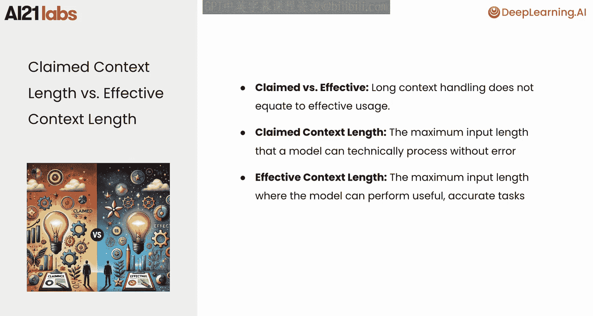

To ensure we are evaluatingalating loan contact models effectively。

 it's important to choose a comprehensive benchmark that truly capture the models' capabilities in real world tasks。

The Italy Hastack benchmark is a traditional loan context evaluation。

It focuses on testing synthetic retrieval tasks for specific position in a long context。

 but it may not fully capture the complexities of real world applications。

 making it less comprehensive for practical use cases。

A more robust option is the ruler benchmark from Anviia。

This benchmark evaluates long context model across four key areas critical for real world performance。

Retrieval， multi hop racing， aggregation and question answering。

 the rule of benchmark also highlights the distinction between claimed and effective context length。

It defines effective contact length at the longest contact window where the model achieves greater than or equal to 85% accuracy。

 offering a more meaningful and practical measure of a model's true capabilities here we can see that not all claim contact length are truly effective。

 However， Jambo consistently delivers on its promised contact length。

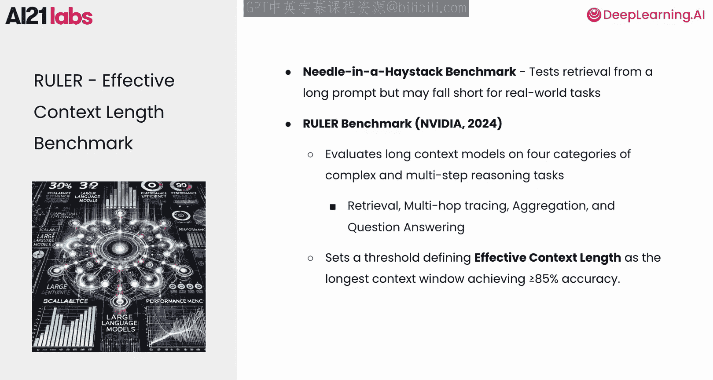

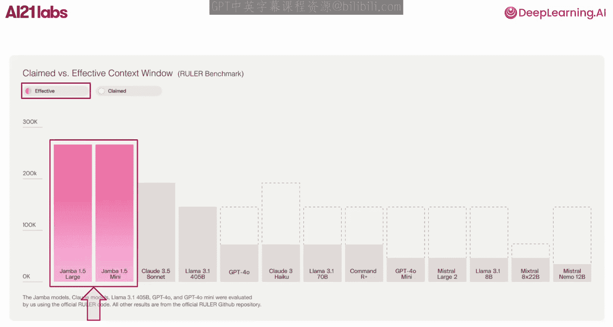

Now， let's move on to efficiency measurements for long context models。When evaluating efficiency。

 we focus on two key aspects。Latency， the time taken for an LLM to generate a response after receiving a query。

S foot。The number of queries and LLM can handle in a given time frame。

 Opimizing both latency and throughput is crucial to ensure that the model remains responsive and efficient。

 even under heavy workloads， in term of latency。As the context length grow。

 Jumba outperformed comprs， demonstrating significant improvements。

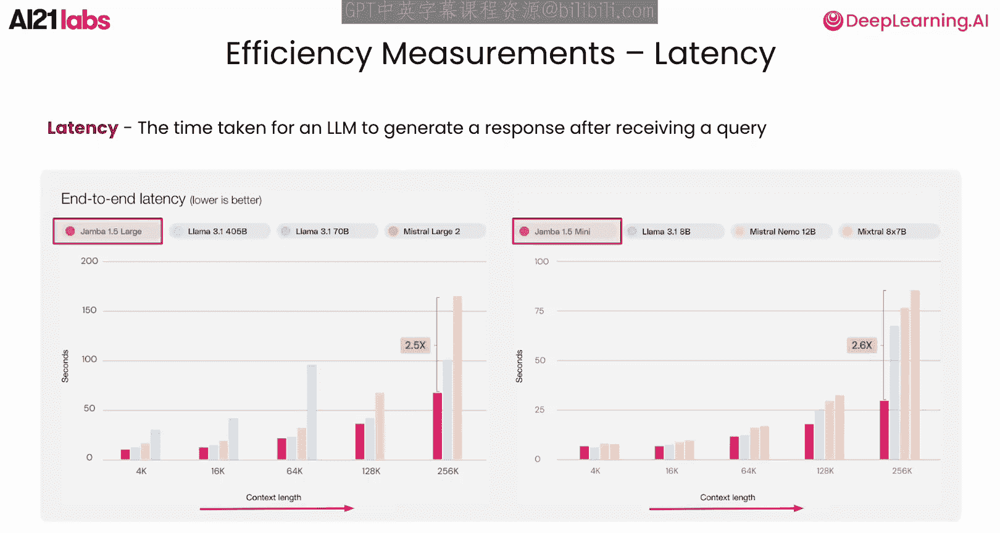

For footput， Jamba also leads and interestingly， as context length increases。

 the performance gap between Jamba and other models widens to wrap up expanding context windows in LLMs unlocks new applications and enhances performance across complex lengthy inputs。

 we examine the key challenges involved in extending the context length and went through the critical components required to successfully train and evaluate these models。

By optimizing architecture， data， training and evaluation。

 we are pushing LLMs toward broader high performance applications。

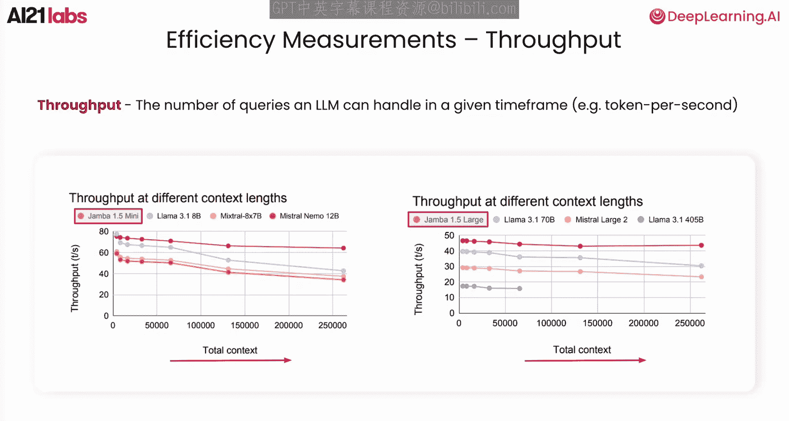