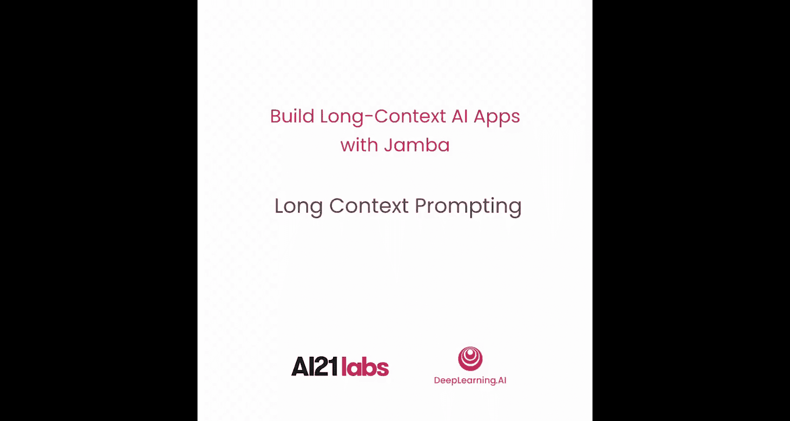
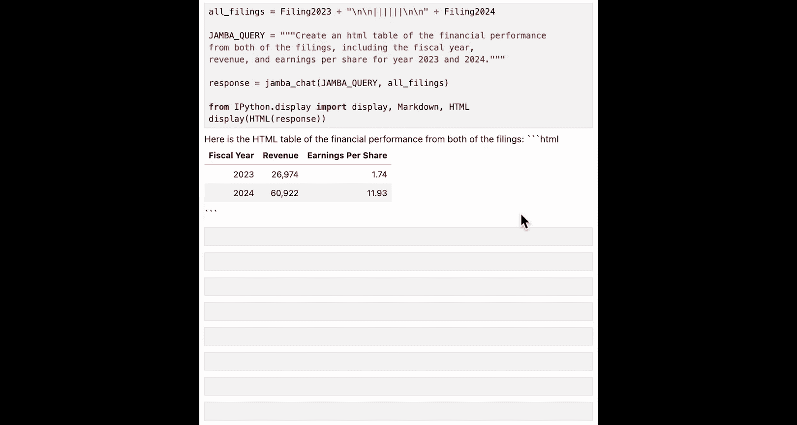

# 吴恩达《用Jamba构建长上下文AI应用｜Build Long-Context AI Apps with Jamba》中英字幕（deepseek - P7：7.long-context-prompting.zh_en - GPT中英字幕课程资源 - BV18wfqYVEBs

In this lesson， you will use simple prompting to leverage the lung context capabilities of the jumba model。

 Let's have some fun。 Now you have learned how the contact window was expanded for the jumba model。😊。

In the previous lab， you use document parameter to process loan documents。In this lesson。

 you will take a different approach to work with loan documents。

 which is to include a full text in the prompt。And leverage the lung context capability of the jumba model。

 This approach had a very similar effect as you use the document parameter。

 Here are several scenarios you could consider to include lung context in the prompt or in the document parameter to the jumba model。

For example， we want to summarize a full long document to extract insight from comparing multiple documents。

We you want to analyze long chat history or call transcript。

Where the relevant information could be scattered across entire content。A multih reasoning。

And in a systems。When you have a long chat history。

 including multiple rounds of tool calling messages。

 like the example we used in Se1 you function calling and also other steps such as planning。

 reflection validation and more Now it's your turn to work on some examples again。

 two quick lines to ignore any unnecessary warnings now import the same libraries you have used in the previous labs and load the API key that already been set for you and create AI 21 client to get started。

 you can load the Invidia 10k files which we have did in the previous lab now you can ask the Java model to help you process the Invidia 10k files in 2024。

 which the very long file with a simple system message and prompt without need to do any chunking。

To make things even easier， you can create a simple function to chat with your document directly。

In this Jamba chat function， the Jamba model is tasked to answer your question based on the provided document in the prompt and the main driver here is the data center systems and products in your ja workflow Chason format is often necessary for structured output from a large model。

Similar to the Jamba chat function， you can create this Jamba Json function。

 providing your instruction in the system message and prompt and specify Json object in response format parameter in the Jamba model call。

 Now it iss time to write your query to ask a Jamba model to create a Json output for you。

 So in this example， we ask a Jamba model to generate Json output。

 including fiscal year end date revenue new。Gast profits。Ne income per share。

 revenue by segment and revenue by georegion， they can send a query and a documents to the Jma JSson function。

 and now the Javamma model has the answer for you in JSO format， as we discussed in earlier lessons。

With a long contact window， you can in multiple long documents。

And ask the Javava model to provide the answer across all the documents provided。For example。

 we can combine the 10K filing from year 2023 and 2024。And pass to the Jaa chat function。

With you request to create an HM L table， including the following financial information。

 you can then use the iPad on display module to realize H TM L table。In this lesson。

 you have used the Jamba with some simple prompting to process long documents。In the next lesson。

 you will work with rack tools。

That's real good there。