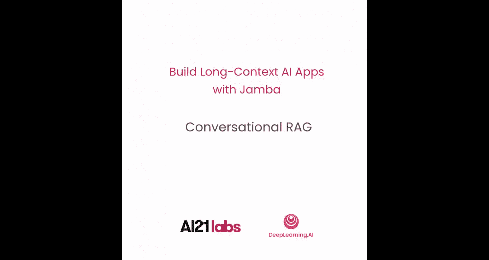
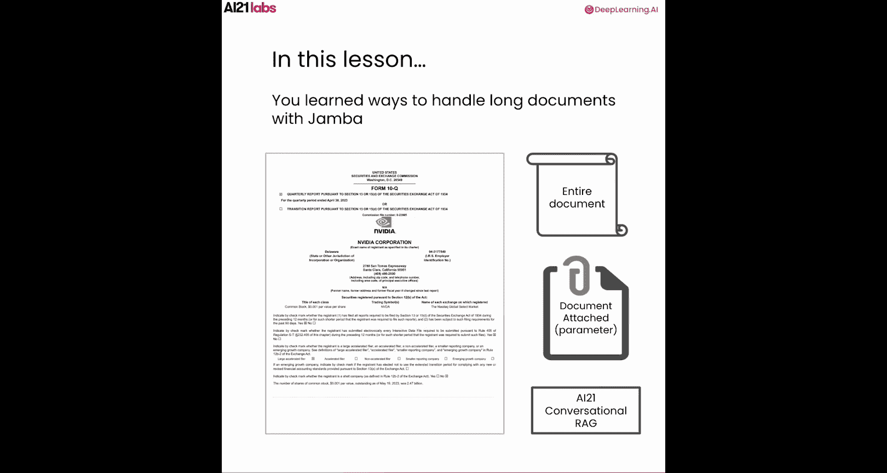

# 吴恩达《用Jamba构建长上下文AI应用｜Build Long-Context AI Apps with Jamba》中英字幕（deepseek - P8：8.conversational-rag.zh_en - GPT中英字幕课程资源 - BV18wfqYVEBs

In this lesson， you will use AI 21 conversational rack tool and also build your own rack pipeline。

 Let's get to it In the previous lab， you have used Jamba to process long documents。

 using the document parameter and also in a single prompt。

But we cannot end our lesson without the machine of rack， can't we。Depends on your use case data。

 you may want to consider using Jamba with a rack pipeline to balance the response quality， latency。

 cost and other important metrics for your use case。

 A long contact window of the jumba model can help to improve the performance of your rack pipeline。

Here are a few potential ways to do so。 We can include a higher number of most relevant retrieved segments。

You can use longer segments。You can have long multi turn chat history included。

 and you can leverage retrieval strategies， including neighboring segments or food documents。

In this lab， you will use Jamba for RaG pipeline in two different ways。 First。

 you will use an autobox rack tool built by AI 21 called AI 21 conversational Rag。

Then you will finish off the lesson by building a simple rack pipeline using the AI 21 Jamma model with Laning before you started to use AI 21 conversational rack。

Let's go through its architecture and understand how it works。

 The process starts with the user query， combined with chat history and being sent to an execution engine。

The execution engine decides if the organizational data is needed for the query。If not。

 a query and chat history will be sent to an LLM， which is Jamba in this case to generate an answer if additional organizational data is required。

 the user query will be extracted and deconttextualized as a stand along question to be used to retrieve the relevant segments。

After retrieval， the query and retrievet text segments will be used to generate a grounded answer using the jumba model to further improve the accuracy and quality of the answer a judge model will be used to validate the generated answer。

 regeneration will be triggered if the original answer didn't pass the validation。 Finally。

 the validated answer will be recontextualized with chat history and send back to the user along with citations to conclude AI 21 conversational rack is an auto of box rag engine that is easy to use。

 while the parameters for each step are also customizable， for example。

The maximum number of retrieved segments。Retrieval threshold， retrieval strategy and search method。

 The full conversational history is used to generate the response。

To enable a multiter Q And A experience。Now， let's dive into the lab and see everything in code。

Like in previous labs， let's use these two lines to ignore unnecessary warnings。 First。

 you will import AI 21 libraries just like you did before and load API key to create AI 21 clients。

A P had already been set up for you， so you don't have to worry about it。

AI 21 conversational rack really only asks two things from you。

 The document you want the answer to be based on and the question you want to ask the 2024 invidia 10 K annual earnings report will be used in this example to upload the file to conversational rack。

 We can import the file upload function。From thes， we have uploaded the file for you already so you can skip this step in case you did upload your file。

 Please remember to delete the file once you're done using this two line code。

 Once the file is shared with conversational rack indexing process will be done for you automatically。

 Now， you can use this conrack response function to sending your queries。

The simple function appends each round of user query and assistant response。

And includes the entire chat history to provide more context for your query。Here。

 you will only return the LLM response。You can also get the citations from AI 21 conversational RA。

 including the retrieved tax segments。And the files containing them。

If you want to twin any rack parameters， such as the maximum number of retrieved segments。

 retrieval threshold and strategy， search method。Choice of L L M at each step。

Model temperature and prompt template。 Feel free to make changes in the Uts file。

Now it is time for you to ask questions to get started。

 let's say you just want a quick summary for this 10K file。

And you can follow up and ask more detailed questions， too。

 if you ask a question that cannot be answered by the document， for example。

 if you ask about an investment decision， the conventional rack will not answer it for you。

To make it more fun， you can deploy a grid app in the notebook and start chatting with AI 21 conversational rack。

😊，To create the grad app， you can point the function to conversational rack response function we defined earlier。

And add a few pre populated examples。 Even though conversational rack won't make a direct investment decision for you。

 you can still use it to pull very specific financial informations to help you make an informed investment decision。

For example， you can ask about the actions taken by immediate about sustainability and quickly get the answer from it。

 Now you can have a quick read about Imedias initiative about sustainability。

 You can learn about the risk， capital allocation， cash flow and other aspect about the company as well。

Or you can also add your own question as well。Alright， to wrap up the lesson。

 you will create a simple rack pipeline with La chain using the AI 21 jumbo model。

Where you can customize every step in the pipeline。

You will need a few things to build a rock pipeline with launching。 You will need all lamp。

Which will be the AI 21 Java model here。Your index that your document。Which includes tax chunking。

Inventing models。And a vector store to store the embeddings。

 When you ask a question wrapped in your pro template。

The most relevant tax segments will be used to help answer your question。

 Let's start with using the Jambo 1。5 larger model as the choice of L O M。

 Then you can load the in 10 K file。Split the dock into smaller chunks with 2000 tokens each and 400 tokens of overlap。

 Next step， you will use the inviting model from hugging face。And the Chroma vector store。

 at this point， indexing portion is already completed。

 Here is a quick prompt template you can use to provide instructions to the jumbo model with your text and your question included。

 You can customize this prompt template with your own instruction to the jumbo model。

To retrieve the most relevant text segment， you will use the maximum marginal relevance retriever。

M MR and to the top 10 most relevant segments。Alright。

 we have arrived the last step to build your own rug pipeline。

With a La chain you can stitch every components together， including a retriever。

 prompt LM to create your own rackcha。 Now your rack pipeline is ready for you to ask questions If you want to check all the text segments that has been retrieved in the RA pipeline。

 you can also look at the results from retriever for your question to see all the type segments has been retrieved for you if you have a list of questions you want to ask。

You can send your list of questions in batch to get an answer for all of them we youve finished your lesson。

 don't forget to clean up the vector store。In this lesson。

 you have learned to use AI 21 conversational rack and to build a rack pipeline with the Jamba model using La chain。

 This wraps up or lesson Through this lesson， you have learned three different ways to handle long documents with Jamba。

 You can include the entire text of this long documents。In your prompt。

 you can attach this documents。Using the document parameter。 And you can use。Different rack tools。

 including AI 21 conversational rack。 I encourage you to build your own generative AI applications。

With your own documents。Using different techniques and tools you have learned throughout the course。

