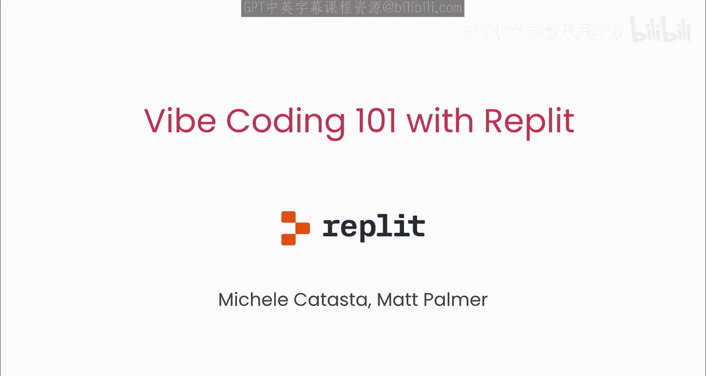
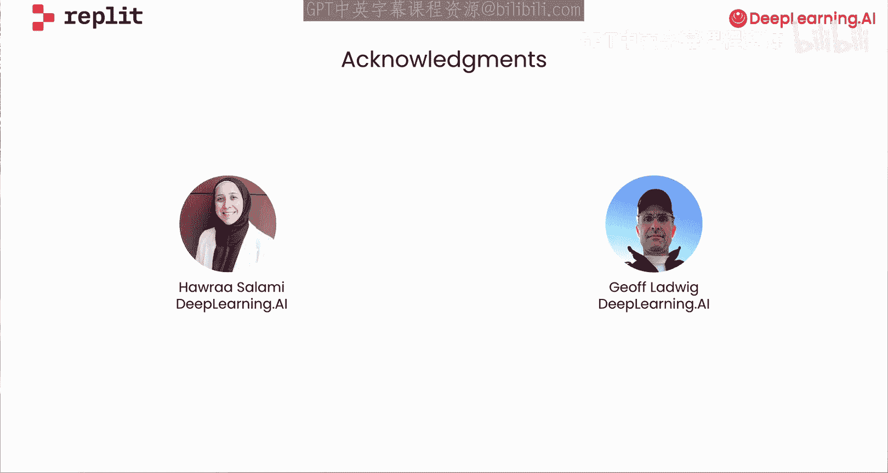

# 吴恩达《用Replit进行氛围编码｜Vibe Coding 101 with Replit》中英字幕（deepseek-R1 - P1：1.intro.zh_en - GPT中英字幕课程资源 - BV13CZgYqER1

Welcome to Vive Coding 101 with Replelet， built in partnership with Repleit。In this course。

 you learn how to code with an AI agent using Rapi。

 Reit provides a cloud environment that allows you to build， host and share apps。

 and Res recently added a very popular coding agent that makes generating and hosting web based applications fast。

Coding agents are changing how we write code。 I still do fair amount of software development myself。

 but now find it I count on Lms to write mostly of the code for me。

 to take a problem and partition it into manageable blocks and then spend time creating a prompt describing what I want and use a model to produce a code one module at a time。

 and this type of process is making me hang many others much more and certainly much faster developers。

😊，I do want to note that as rep is a cloud hosted environments we're unable to present the course on our usual platform and so this is a video only course。

 if you watch only the videos you learn the key concepts behind using coding agents as was the process of using alarm to write code。

 sometimes with view barely looking at the code itself， which some now call vibe coding。

If outside of watching videos， you want to use Repl， you have to create a user account there。

 I'm delighted that instructorors for this course are Michaela Catasta， who president of Replet。

 as well as Matt Palmer， whos head ofDevelop relationslation。😊，Thanks， Andrew。

 we're really excited to present this course so Michaela。Tell me。

 how have you seen development change for the rise of AI coding agents？Well。

 RaI terms many of the barriers that prevent users from building and deploying applications。

 First of all， RaI provides a powerful code editor and a universal package manager。

 so you don't need to struggle with installation of Python and JavaScript packages。

Source control is powered by Git， but we made it as slim as as possible for our users。

 and also rapid offers 15 K stores， databases and deployment solutions。But now with rapid agent。

 every person with no coding experience can create appss and depart them in public。

 He will take you only for minutes to start。 even if you do not know many of the terms I just used。

 you can still build an application。 Matt will show exactly how to do it in this course。

So a popular term today is5 coding， where you lean into letting the coding agent do most of the heavy lifting。

 We'll maximize the capabilities of the agent， but we'll also show how some planning can improve your results along the way。

 you'll learn some tips and tricks to get the best results possible from our agent。

 We'll start by building a search engine optimization or Seo analyzer。

 This is a basic app that will get us started and introduce some key concepts。

 Then you'll build a head to head voting app， which will showcase data extraction and storage throughout the course。

 we'll learn the basic building blocks of web apps。

 I think you're going to be surprised at just how much you can build， I know I certainly have been。

To your intuition on how to USA a coding agent， Michaela will also share some of the details behind how rapidpi is built。

 I hope some of these lessons that they learned building Re。

 which is itself a sophisticated agentic workflow， will also convey useful insights for how you might approach building other agentic AI applications。

 Yes， we learned quite a meeting the last year， and I'm very happy to share it。

 Many people have worth to trade the course。 Id like to thank from De Blalinda AI。

 Harra Salami and Jeff Laway。😊。

All right， let's get started with the first lesson in the next video。

