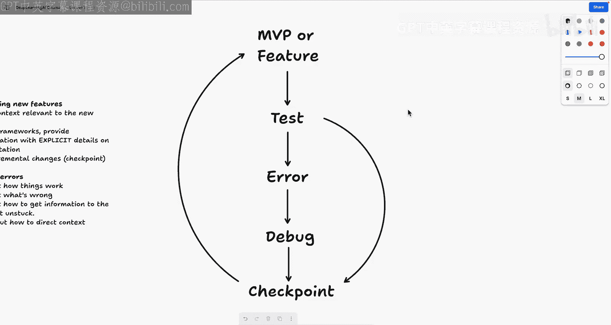
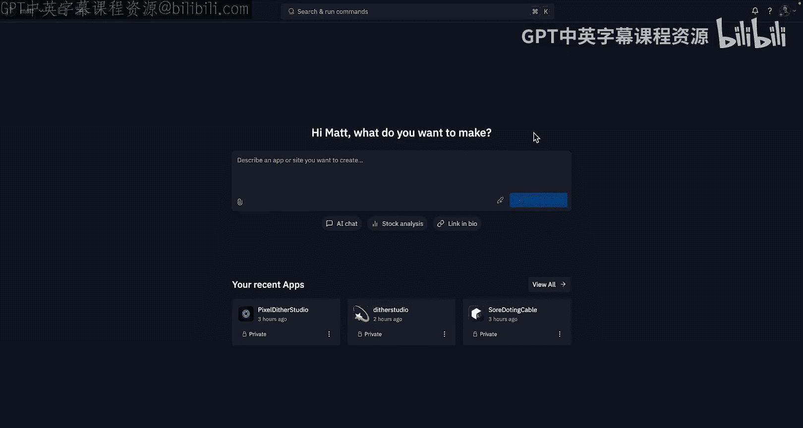

# 吴恩达《用Replit进行氛围编码｜Vibe Coding 101 with Replit》中英字幕（deepseek-R1 - P2：2.principles-of-agentic-code-development.zh_en - GPT中英字幕课程资源 - BV13CZgYqER1

Before we start， I want to share with you a few tips on how to become a successful app creator with Reage。

 so first of all， be precise， make sure to give repag one task at a time if you have a complex task in mind break it down into smaller pieces。

 otherwise you will soon find out that ending multiple complex task at once can be really challenging for today's coding agents。

On a similar note， maker prompts specific and detailed。Much like human developers。

 codingig agentss work best when they receive clear and unambiguous instructions。Next。

 be well organized。I want you to keep your project as steady as possible。 Add features step by step。

 test thoroughly after each edition and don't hesitate to roll back when something breaks。

Then you always want to start with a fresh session for each new feature in this way。

 it will be easier to go back to what was working well before。

A last panel list do not hesitate to return to your last working version。

 if you keep patting up unstable coding features， most likely you will end up with a mess that will hinder you from making steady progress。

And now the most important recommendation， be patient。Even if you are not technical。

 do your best to build an understanding of the app and its components as you go。

Replication explains in detail the rationale behind each action it takes。

 describing both the thought process and the changes it makes on the code。

By reading carefully the output or rep agent， you will quickly learn everything about the app that you' are creating。

So as a natural follow up， take a moment to review the suggestions before accepting them。On one end。

Question things that don't make sense。 but on the other end。

 trusted rep might often surprisese you with an effective solution to the issue that you're facing。

And I can stress this one enough， be patient while debugging。

 It's part of the process when developing complex features。

Even the best software developers spend most of their time debugging。

Reputage is getting better on a daily basis， but is still not perfect。

 So allowing it the time to debug with different strategies will make you more successful than you might expect。

 And now I'll hand it over to Matt so you can start billing with reputationput agent。In this lesson。

 we'll explore the Re platform and its AR powered tools that accelerate development。

 You'll learn the fundamental concepts behind effective AI collaboration and key strategies I use when building applications with AI assistance。

 We'll also familiarize ourselves with Replelate and walk through getting set up first。

 a bit about me。I'm Matt， I head upDevelop Re at Rplet， you can find me on social。

 on X or on YouTube at these QR codes。And really， we're just going to jump right into getting started。

 so。First， it's important to talk about really what vibeco is and what it is today。

 And so when we talk about vibeco， it's typically leaning into our AI agents。

 our AI tools to rely on writing the code rather than write it ourselves。

 What that means is that there's a large jump in productivity And a lot of people have seen that they're able to build applications they never were able to create before。

 And that means it can take you from an idea that lives in your head to a real application deployed on the web。

 That's something that Replepl helps out with quite a bit。

 But fundamentally what we've seen is that vibe coding is limited by the developer experience。

 And if you haven't heard the term developer experience before or if you're not a professional software developer。

 Don't worry， it just means the experience of developing applications or the tools。

 the techniques and the environments that developers use to build things。

 And so those tools can be intimidating。 which is what we're gonna to cover today。

 how to make the most of those tools get started building applications and again。

 create the best apps possible。 But more importantly， vibeco has。

It's gotcha and those are things we're going to cover today。

 we're going to cover ways of planning and thinking logically to get around some of those limitations and fundamentally produce better results so in this course。

We're going to use AI to build real deployed apps。 We're going to learn why tooling is important and how to make the most of the tools that we're using。

 We're also going to learn how to communicate with AI because there are some fundamental skills that can help you again。

 make the most of this tooling。 and it is just that。 It's a tool。

 but it requires some knowledge and there can be a bit of a learning curve to understand how to communicate with with AI。

 And finally， we're going gain skills for effective building that you're going to be able to take from this course and apply to every area of your life。

 You're going to be able to。Autommate things that you don't want to do or create things that you didn't think were possible or make your job more efficient or make your life more efficient。

 I've seen those things in my own life。 And that's why I'm really excited to share them。

 That's why I'm really grateful for what I get to do for a living。 But first。

 we're going to talk a bit about what Replelet is and how AI tools fit into our platform。

 So you can think about Replelet as the environment。 And then on top of Replepl， we have agent。

 which is our automated developer and assistant， which is our tool for rapid edits and chat。😊。

So Replt is a unique environment。' it's different from other tools that you've probably used in the past。

 So if you've ever had to write code or install a code editor。

 you know that there's a lot of setup that's required。

 You have to download this thing installed on your computer。

 and that doesn't even include installing packages， configuring languages。

 configuring your environment。 It can be a real headache。 So Replet has no installation。

 It runs entirely in your browser and one tab。And it includes AI tools for every step of the way。

 but more than just handling packages and languages and being zero set up。

 it also has everything you need to build full stack applications。 That includes databases。

 objectject storage， authentication， whole host of other tools and services。 And so from there。

 you can deploy those apps in just a few clicks， which is what we're going to see today。

 And so the reason that rep is really powerful is because you don't have to spend time worrying about setup。

 That's going to allow us to move really quickly in this course。 I hope you think so too。Now。

 on top of Repllet， we've built agent or Repllet agent and that's our automated developer。

 it allows you to build and configure an entire project from scratch with just your voice。

 generate and build a plan for your project， as we'll see today and make complex multistep changes to your code。

Now， I'd be remiss if I didn't mention Repllet assistant。

 which is our more lightweight tool for chat and Quick edits。 So with assistant。

 you can chat with AI about any topic， request quick one- off edits to code and ask questions about your project。

 So what we'll see today is a pretty common pattern is using agent to kind of scaffold out a project。

 get things to an MVP state， get things working and then flipping to assistant to really dial in that functionality and build out the rest of your project。

 And so one more thing to call out before we jump into our whiteboarding session and talk about some basics of prompting and vibe coding。

 which is going to follow largely from what Michaelela has already discussed。

 one important piece to mention is that Repllet has a free tier and we'll be able to use the free tier for most。

 if not all of this course。 you'll be able to register for free on Relet your first project you have up to three free projects on Repllet。

 which fits into the free tier。 and you get a number of credits and checkpoints to use agent and assistant without having to pay More than that。

 all concepts in this course are completely applicable not only to Ret， but any situation。

fin yourself building with AI and building with these newer tools。

 and so there's plenty to learn plenty to take away and I think you're gonna to get a lot out of this course and now we'll jump into a whiteboarding session and I'm going to break down some concepts in building that I think are particularly useful for AI and replicate it generally。

 So now we're going to walk through five skills in vibe coding that I've thought a lot about and have really helped me take my apps the next level those are thinking frameworks。

 checkpoints， debugging and context we're going to keep these short。 we're gonna keep them straight。

But what I want you to do is keep these in the back of your head as we start to build out these projects and start to notice some of these patterns and notice some of these concepts so that in the future you can really dial in your apps。

 I think building with AI vibe coding is a brand new concept and so the best way to learn it is by doing it and by taking courses like these and by experimenting on your own。

So now we're gonna talk a bit about thinking。 And hopefully this is something you've been doing for most of your life。

 I know there are periods where I don't think much， but I've been trying to work on that。

 and we can break down thinking into a bit of a hierarchy。 Now， logical thinking is really important。

 We're going compare this to a game of chess。 Now， thinking logically that might be like asking questions what is the game of chess or actually playing the game that gets a bit more into analytical thinking And most of you are probably familiar with analytical thinking。

 breaking down games， learning how to play them well。

 breaking down problems and learning how to solve them。

 But the two types of thinking I want to introduce when we talk about building with AI are computational thinking and procedural thinking。

 an example of computational thinking might be what are the patterns behind the game of chess。

 and that might lead you to do something like program a computer to enforce the rules of chess。

 When we build AI applications， We're not just thinking logically。

 we're actually thinking creatively or thinking computationally about how。😊。

We can fit a set of logic， which is actually an application into a complicated problem。

A higher level of thinking is procedural thinking， which might be programming a computer to play competitive chess。

 And that requires us not just to understand the rules of chess and how to program a computer to enforce those rules。

 but how to program a computer to play something competitively at a high level And so it really requires us to ask。

 how do I excel at the game， What are the boundaries of the game and sort of the edge cases that I need to account for in order to build this thing。

 And then finally， how do I take those things and translate them into code or translate them into natural language for AI to then implement。

So next， I want to talk a bit about frameworks。 If you don't understand frameworks at a high level。

 be it languages or packages， don't worry， because this is more conceptual。

 So the important thing is to start thinking about how your app works。

 That follows from what we just talked about in thinking。Start thinking through how your app works。

 how we're implementing solutions to these problems。

 and then think about the solutions that already exist， because people have written a lot of code。

 and the reason AI can write code for you is because it understands the code that people have written So if you can understand a problem space and start to think through the things that you don't know。

 maybe that means asking AI， hey， what are common solutions to this problem or asking AI， hey。

 what are some really good packages to help me solve this problem。

Then you can understand how to do the thing that you want to or kind of orient yourself in the problem space。

 And so that might mean asking AI questions like what frameworks allow me to do that thing。 So。

 for example， if you wanted to implement a drag and drop interface into one of your applications。

 you could say， help me come up with react frameworks for implementing drag and drop into this application and then implement one。

Interacting with AI in this way is not only a great way to learn how frameworks work and how these things fit into languages。

 packages and all of these other structures， but it's also a really great way to get things done faster。

 And this has been how I've learned frontend development entirely through AI。

 I just ask a lot of questions。 I try to understand the things that it's building with。

 and really at the core， I tried to understand what I don't know。

 And that involves a feedback process of asking AI questions and iterating。So next。

 let's talk a little bit about checkpoints。 An unfortunate fact in building is that things break。

 That's a fact with or without AI。 And it's more common when we're building with AI。

 as a matter of fact。 So it's pretty likely things are going to break in this course。

 but one really important concept is called version control。

 and every project in Ret has version control by default。 You don't have to set it up。

 You don't have to worry about it。Because of this， we'll have checkpoints when we're building with AI。

 and we're going to chunk up what we're building。 We're going to break it down into logical steps。

 and then we're going to move quickly in short sprints and utilize these checkpoints if anything breaks。

 And that means that even if we want to experiment with a new feature。

 even if we want to prompt AI and learn or try new things out。

 something doesn't quite work in our app， we can go back to the old state and pick up from where we left off。

A larger point is that this is a really great way to build and develop， utilizing checkpoints。

 testing what you're building， and then if that works continuing， and if it doesn't。

 going back and trying again。Okay， so there are just a couple more concepts to talk about here。

 and then we're gonna to jump into building。 First， debugging。 As I mentioned， things tend to break。

 The process of debugging is the process of figuring out why things broke。

 Now this might seem a little too straightforward， but I promise that it's worth going over。

 So if you have a lamp that doesn't work， you might first ask， well。

 is the lamp plugged in and if it's not， you'd plug in the lamp。

If that doesn't turn out to be the problem， you might ask， well， hey is the bulb burned out。

 if it is， Well， you replace the bulb。 And if it's not。

 you need to continue debugging or find another way to repair the lamp。

 And this is exactly the same process that we're going to walk through when we're building applications。

 Now， you might say， hey， that's actually a little boring。But you can really make anything fun。

 And to me， debugging is really fun when I'm building something that makes me excited or that I know is going to produce a really cool outcome。

 And so the best debugging is methodical。 It's thorough。 And it starts from first principles。

 So the goals in debugging are to first understand how our app works。

 I can understand where the error is。 And then ask us ourselves the questions。 Hey。

 how can we get to the root of this problem。😊，A final step， and this is kind of a jump， right。

 is how can we tell the LLM what's wrong so that it fixes our problem。

 How can we tell the agent what's wrong so that it understands the problem。

 And that's kind of where context comes into play。So if you've been building with AI。

 if you've been building with LM， you've probably heard the term context window or context。

 And what do we mean when we say context。 Well， the context window is the amount of tokens。

 an LLM can process at a given time。 Think about that。

 just like the number of words or the amount of information that you can give to our agent or our model and it can think about in any kind of one。

Chat instance， I like to think about it kind of like multitasking。 right As a human。

 If you're asking me to do a bunch of stuff， I might start to lose track of some of the things that you ask me。

 I might start to forget。 And so when we chat with L Ms。

 a consistent theme is going to be that we need to make sure context。

Is relevant to what we're trying to do Now， context can be the prompt we provide to the LLM。

 It can also be images， right， that might be documentation that you provide。

 We're going go over some examples of this。 It could be errors or details about your app environment or preferences。

 And right， that's what we just talked about in debugging。 When we run into errors。

 we're going have to try and get those errors into the context of our communication with the LLM so that we can get past those problems。

 so we can understand what the issue is and move on or we can get the LLM to fix the work that that it was doing。

 And a really important point is because these AI models。

 The underlying models that power Reple agent might have outdated training data。

 or they might have been built， you know， months or years ago。

We might need to provide additional context， especially if we're doing something new or novel that hasn't been done before。

 or if we're working with a package or a library or a framework that the model is not an expert on。

So tying that all together。 What does that mean for getting to an MVP when we're building with AI。

 Well， we're going to give AI only the information。

 We're going to have agent only the information that's relevant to the MVP。

 We're going to start small。 Like Mackalay mentioned。

 and work our way up to something that's full featured。

 and we're going to provide foundational context in important details when we're crafting that first prompt From there。

 we're going to start implementing new features。 We'll provide context relevant to the new feature。

 We're going to mention frameworks， provide documentation with explicit detail on implementation to really make sure that。

 you know， agent understands what we're trying to do。 And we're going to make incremental changes。

 Hi those checkpoints and then roll them back if anything goes wrong or anything happens。

As we're debugging errors， as little speed bumps come up， we're going to figure out how things work。

 We're going to figure out what's wrong， We're going to figure out how to get information to the LLM to get unstuck and figure out how to direct that context to solve our problems。

 remember， they're not errors。 They're just happy little accidents。

 if I can be known as the Bob Ross of vibecoing， I'd be totally fine with that。 And so。

This is the last thing I have before we get into building。

 I promise we can think about our minimal viable product or MVP or adding new features to that MVP when we're building。

 we'll start by prompting AI。 And then we're going to test our application。

 We might try and break it。 We might get an error。And have to debug that app。

 But once we do and have a working version， we'll get to a checkpoint。 Maybe we don't get any error。

 and we can just go straight from testing to our checkpoint。

But the next step is to do this all over again。 So it looks like we prompt to get our MVPR feature。

 then we test that out， we hit an error， debug it， fix it， or we don't。

 and then we move on to our next MVPR feature。 and this sort of feedback loop。

 this sort of cycle is largely the pattern that I follow when I'm building with AI。

 So now let's jump right into it。 we'll give a quick walkthrough of Replelet and start with our first project。

So before we jump into our application， I just want to quickly walk through how to get to this screen and in order to see this page。

 this homepage， all you have to do is create an account on replic。 co。 you can use your Gmail。

 you can use another account， you can use your email and password very simple and you'll land right here。

 and this is our homepage is our overview page。You can see it's very chat first。

 So this is where we'll type our prompts to interact with agent that any time you want to manage your applications。

 we have a side pane where you can see all the apps you've made， the apps you've deployed。

 you can look at your usage， edit your settings or otherwise manage your account， but。

Let's get started building。

