# 吴恩达《用Replit进行氛围编码｜Vibe Coding 101 with Replit》中英字幕（deepseek-R1 - P3：3.planning-and-building-an-seo-analyzer.zh_en - GPT中英字幕课程资源 - BV13CZgYqER1

In this lesson， we'll build a website performance analyzer youll learn how to examine HTML content and understand website structure that is understanding the concepts that willll be automating。

 We'll create a product requirements document or PRD and wire frame before leveraging Reple's agent to build our first prototype。

 So as we just covered， we're going to build an Seo analyzer where you can enter any website URL and view the site's load times and tax。

 We'll also cover exactly what these things are。And exactly why they're important。

That allows us to check if the website's properly implemented and get insights on Seo best practices。

 So when we talk about building a PRD or building a wire frame， this is what we're talking about。

 And so we're going to walk through exactly what I have in front of me。

 This is using an online whiteboarding tool。 and why I think it's important。

 It's an interactive tool that allows you to enter a website URL view a visual representation of the site's load times and tags to make sure what we're building is properly configured and check if the site is properly implemented as a stretch goal。

 we might store recently analyze sites in a database and the skills involved here prompting processing and analyzing HTMLml content and creating intuitive data visualizations。

 It also involves handling errors and edge cases as well as storage。 So on the left。

 I took some time to sketch up a mock of what we're going to build。

The main entry point that users will engage with is a simple text box where you can enter a URL from entering that URL。

 we want our app to return recommendations on the website that we enter。 for example， hey。

 you didn't give a title to your website or you didn't give a description to your website。

 And that's gonna to make it hard for Google to find your website are hard for people to know what your websites about。

 And these meta tags are embedded on every website。

 And so when you're building websites or when you're deploying apps。

 it's actually important to consider these things。 It's important to consider the preview of how your website shows up when people search for it。

 And that's what our app is going to allow us to do。

 it's going to allow us to analyze any website and access this information。

So when we talk about vibe coding or just going with the flow。

 it can often be more helpful to go through this exercise and break down exactly what we want。

 conceptualize it， visualize it so that we're not going into a tool without really any concept of what we're doing。

 or we understand at least a little bit better what we're trying to get to。

So let's talk about how this flows into an initial prompt for Re agent。

 So my prompt here is help me create an interactive app that displays the Seo or meta tags for any website。

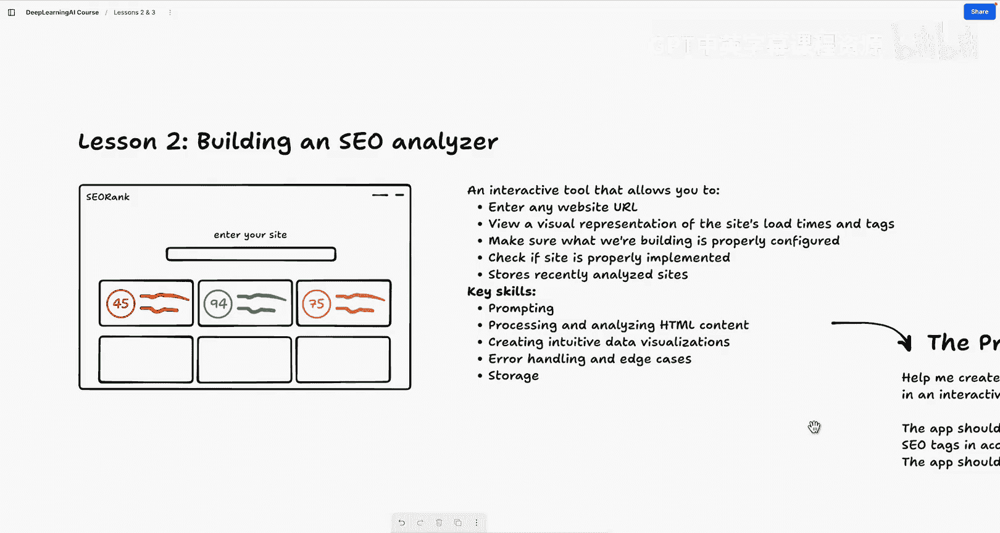

In an interactive and visual way to check that they're properly implemented。

 Note in this first sentence that this is domain specific knowledge。

 You might not know what Se O tags are。 You might not know what meta tags are。 AI does。

 And by using those terms by kind of understanding the framework or understanding what we might not know about this domain。

 we're able to target and direct Re agent into what it's building。The next part of our prompt。

 the app should fetch the HTML firstight， then provide feedback on SEOo tags in accordance with best practices for SEO optimization。

The app should give Google and social media previews。Now， that last point， I think。

 is just important because I've done some work with Seo optimization。

 I mean that's something I wanted to visualize specifically because it can be very visual。

 but note that we're asking the app to fetch the HTML for the site。

 That's essentially scraping websites。 So what we're doing is for any website we're gonna scrape it and then we're gonna to get the contents of this thing。

 And we want our app to return feedback right we want actionable insights on the thing that we're doing。

 And so we're thinking through the language and the phrasing that we can provide agent to get those results。

 It's important to note right that I know Se tags are embedded in the HTML of a site。

 Anyone can access them。 And that's how I know that this app has a high likelihood of working and succeeding。

 And just as a very clear visual representation of what we're building。

 when we search deep learning on Google， the result that we're returning is actually the Se title of the website。

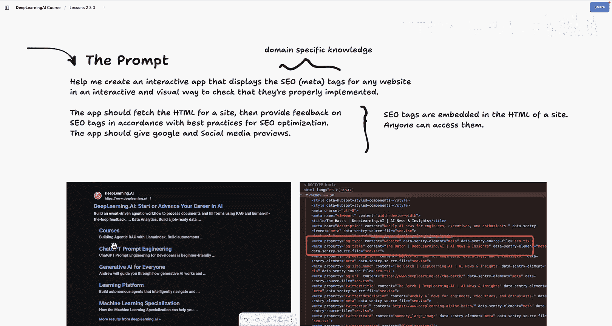

And the description is listed below， and so we can see this in the console or the actual underlying HTML of the page。

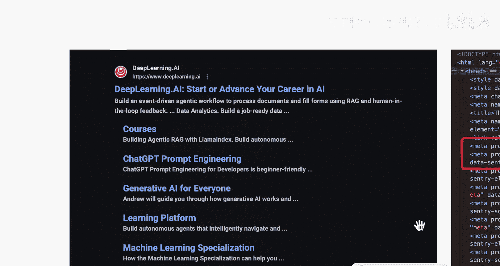

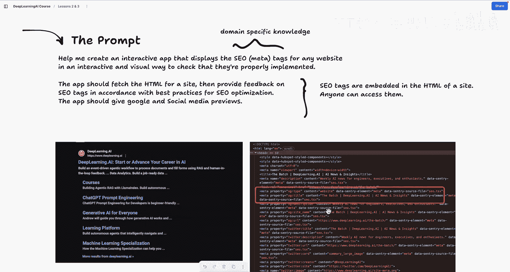

And so if I click into the page and then I right click and click In。

 we're going to get what's known as a browser console。

 And this actually lets us do some pretty cool stuff or rather dev tools。

 So if I click into the page right click there and inspect， I'm going to access our dev tools。

 And this might look a little scary。 This is just the underlying HTML for the website。

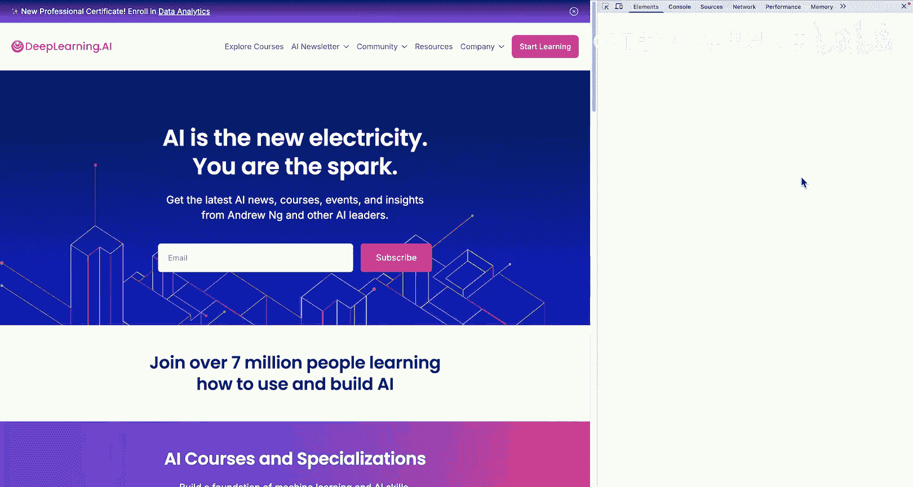

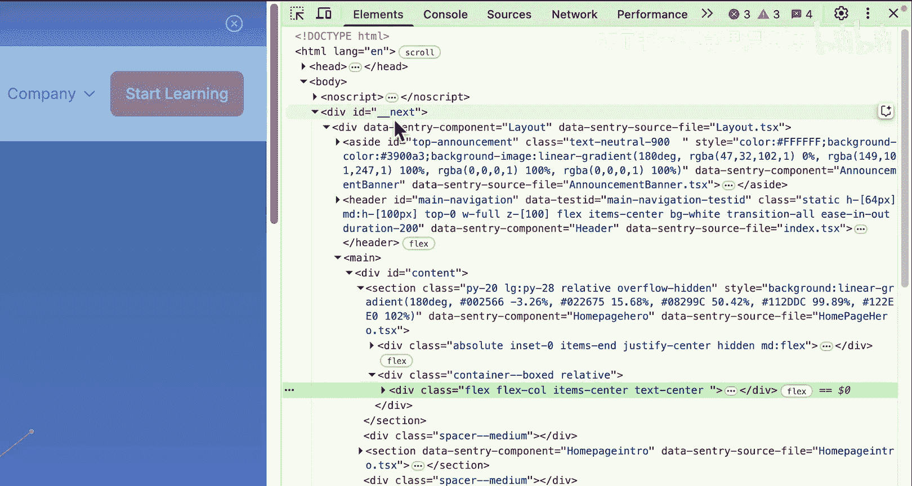

Now， if you go into the HTML head section， you're going to see a whole bunch of stuff。

Youre can see actually things called meta tags， and one of those is the title，De on AI。

 Start or Adv your career in AI， as well as the description。

Join over 7 million people learning how to use and build AI through our online courses。

 These are the tags that we're going to extract to understand if our website is properly implemented。

 So we've talked about our prompt。 We've gone over our wireframe and our P D。

 We're going type in our prompt and just click start building on Relet。

Now we're going to see some things start happening。

 I'm going to walk through this because it's our first course and discuss how agent builds these applications。

 Fundamentally， agents different from other types of vibe coding apps because agent produces a plan。

The plan is going to help us understand what we're building and confirm that we're taking the right actions or we're moving kind of closer to what we actually want。

 So agent is going to analyze that prompt and present a plan to us to it's going to build the initial prototype and ask if it wants。

 if we want any follow up features in the initial prototype。

 It'll also mention if it's using any frameworks or integrations。

I'm going to approve this plan and start and then talk a little bit more about that。

 So it's important to mention that agent does come with a ton of integration。 So if you said。

 for example， build me an app that uses the anthropic API or build me an app that has straighte payments。

 We support those integrations natively and agent should mention that in the app plan。 Now。

 what's happening on the right is that in real time， agent is designing a visual preview of our app。

 And the goal there is to get you something that you can use as fast as possible or something that you can visualize rather as fast as possible。

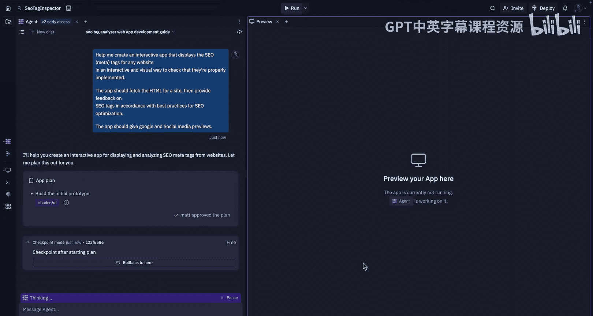

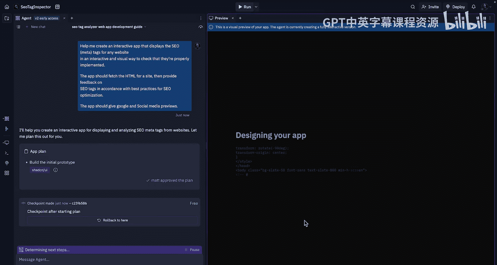

It's important to note this is not the actual application。 And so we can see， you know。

 kind of closer to our wire frame。 Okay the main entry point is just this website URL。

 And from there we're gonna to be able to analyze it。 Now。

 once the agent is done with that visual preview it actually is mentioning to us up here。

 it's creating a fully interactive version of our app。 And so underneath the hood。

 agent is scaffolding this project installing packages configuring your environment。

 this is what we talked about the beginning Repl is more than just agent and assistant。

 It's actually an entire environment an entire workspace。 So while we're getting this setup up。

 I'm going to walk through the workspace。 If you go over here up in the top left。

 you can take a look at the files that exist in the workspace And as agent continues building。

 these are going to be populated with the folders and the directories that the project contains right And so it's important really again to drive home that this is an entire interactive workspace in the cloud。

 at any time if you're familiar with programming concepts。 If you want to open something like。😊。

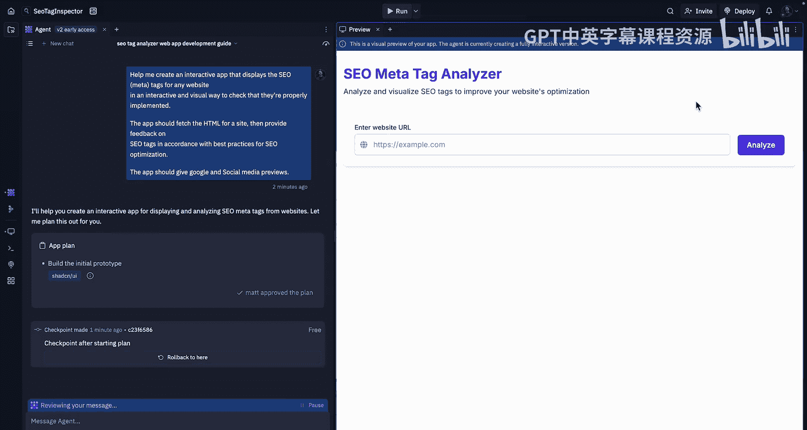

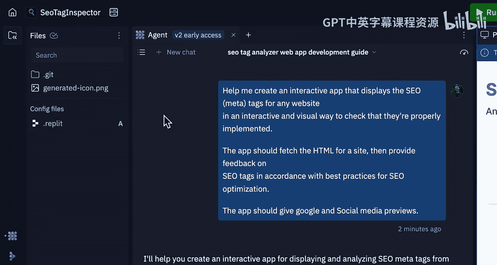

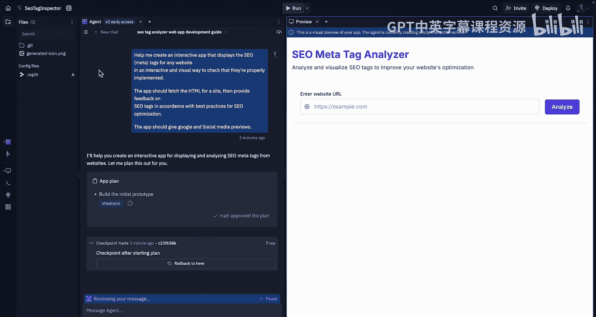

A shell or a console。 you can do that。 And we have access to that。 Now。

 you also don't have to do these things if you're not familiar with programming。

 we're going to build entirely using natural language。

 but it is important to mention that through this new tab interface up top or the all tools section on the left hand side。

 you can access all of the services and tools available in the workspace， which include things like。

Integrating git， installing dependencies， viewing our output will go over exactly what that is。

 storing secrets。 Secrs are basically a very secure way to store environment variables that require no configuration and many more things。

 But going back to our app agent is still working on the fully functional version。

 which might take5 to 10 minutes。 And so that's another important thing to call out as we're building this application。

 The way agent is designed is to build these apps from sort of start to MVP。

 And that's why we stayed high level。 And we're keeping the prompts simple。

 These runs could take two minutes。 It could take5 or 10 minutes。

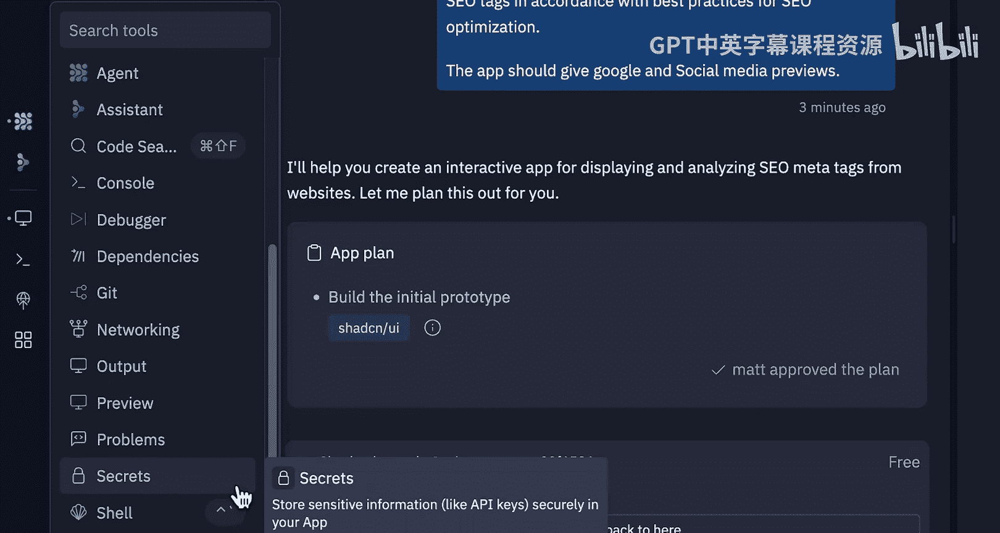

But for the first implementation， you can expect a fully featured app。

 As you can see on the left there， agent just created a client。

 a server and a whole host of other configuration files。

 Now we see that agent is actually writing and creating files in this interactive paying here。

 And part of the reason that we do this is because we want to get you to an MVP as fast as possible。

 And so there's less back and forth required with Re agent， but along the way。

 agent is going to show you exactly what it's doing。

 So we can see that its writing this file server routes。

 it already wrote our client index and some other things。

 Now it's not important to dig into how all of these things work。

 But what might be useful is to start to pay attention to how agent creates these apps and start to reverse engineer how the applications work because it can teach you a lot about programming。

 it can teach you a lot about build it。 For example， I see that there are folders here。

 Cl server and shared。 It you're unfamiliar， a client is typically a front end。😊。

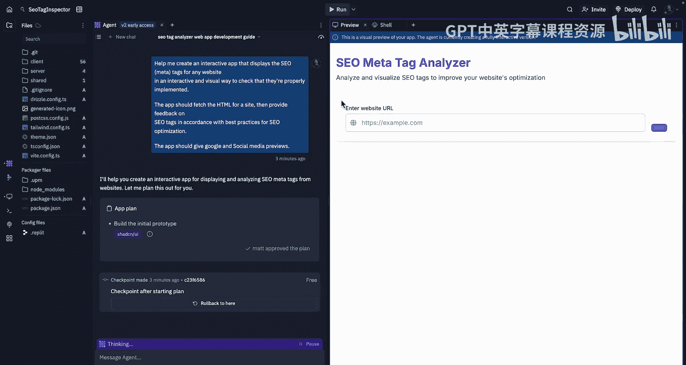

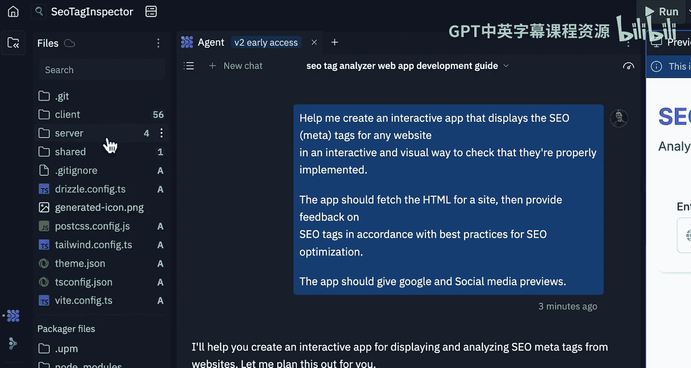

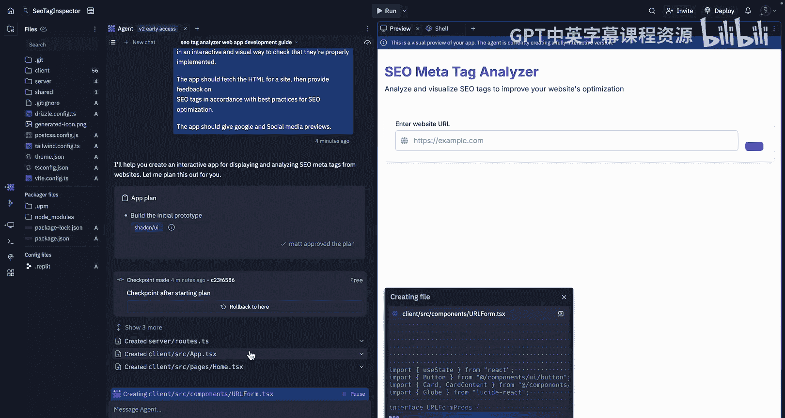

And a server is typically a backend。 So it makes sense that clicking to the server exposes things like。

Roouts， if you're not familiar with APIs， this is a way programmatic way for applications to communicate。

 and that happens in our backend。 But in the client。

 we might see this source file notice there's like an index HTML file。

 things like app do TsX that might be a main sort of entry point for our app or index do CSsS CSS defines how the app is style and so。

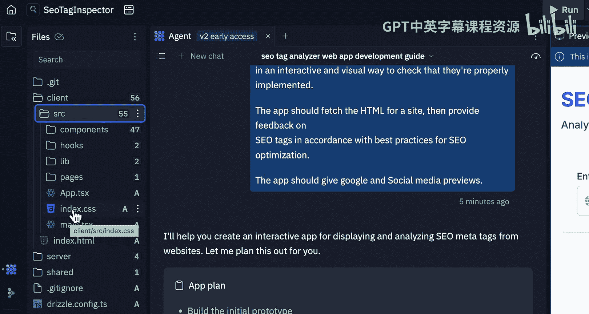

What I'm trying to drive home here is that you really don't need to look at any of this。 you know。

 like if this is intimidating for you， just close that and don't look at it。 And， you know， like。

 we'll just keep vbe coding。 But if you're trying to learn and follow along as you're building these things。

 you can start to poke around。 start to pay attention。 Oh， hey， agent is defining this thing。

 This component called social media preview。 I bet if we go into our components folder and we look at the stuff that's in here。

The Google preview probably defines something that would show us a preview of what it might look like on Google。

 so again。Agent is going to on the first run， create this app from scratch。

 is going to implement the front end and the back end。 this is a lot of talking yes。

 but what we're going to have when agent is done running is an MVP that we can start iterating on。

 it does that in order to deliver you something that just works and that we can kind of keep punching through or we can keep iterating on once our application is stood up。

And so that's been our workspace overview。 We're going to let the agent keep building。

 you'll be able to see all of the things that it does。

 and then we'll come back once we have our MVP and start iterating。

 This is often how I develop my first prototypes when I'm building with Reple agent。

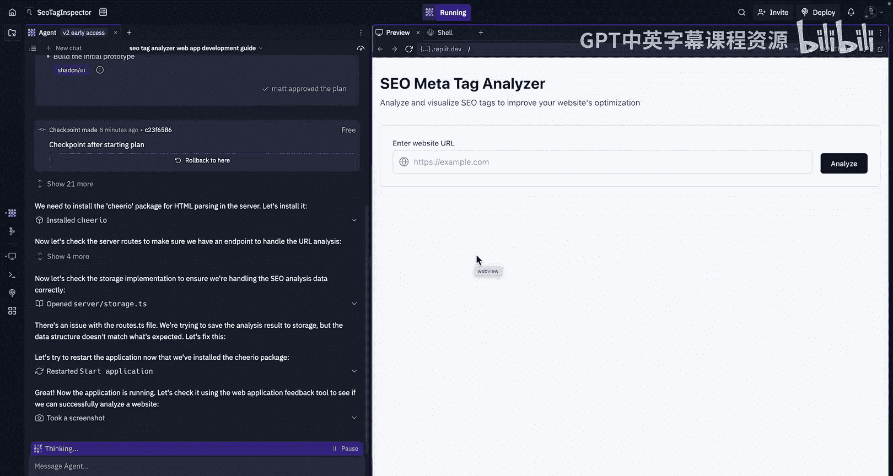

Cool， so what you'll notice on the right is that we have a implemented version of our app。

 and I want to dig in for a second to the agent sort of history Chad history here to see what was happening。

So as you saw when we were writing the application， there are a bunch of file edits that happened。

 anytime you can dig into these and you can even click the drop down to see exactly what was created or exactly what changed。

 Then agent went along and actually installed the dependencies that we needed for our application。

 as well as some insllary dependencies that I might have missed on the first pass。

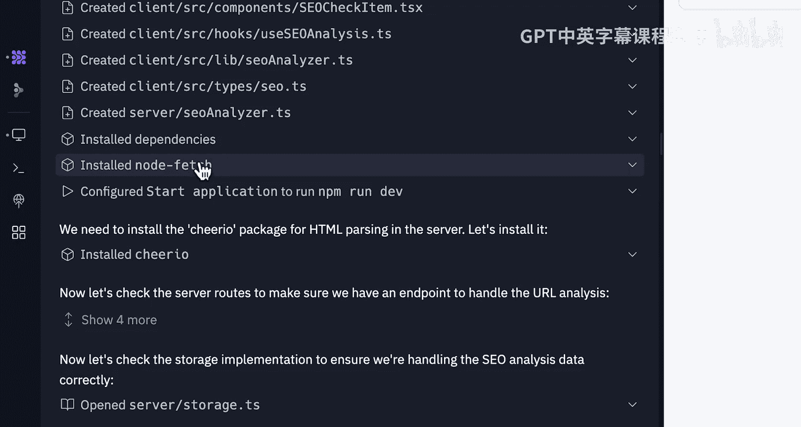

Then it configure the run button up top here to execute our app and cycle through and actually recognize。

 hey， we missed a package like this thing's not gonna to work unless we install it。

 Then it did some final checks， made an edit to our storage implementation。

 Not an issue restarted the application and fix that issue。

 And so one of the great things about building with Re building with agent is that you don't have to worry about like some of these like hasselles and getting started。

 you can let agent take the reins and kind of implement some of this functionality from there。

 it confirmed exactly what it did and exactly what it created。 Now。

 this is another good way to learn about what we're building。 Hey。

 we created a complete data model for storing and analyzing these tags。

 we built back in API endpoints we implement our front end with a URL input results overview and visualization。

 And we did a bunch of other stuff。 So now we can see if it works。 we can start debugging。

 We can start testing our app。 We have our web view on the right。

 which is gonna to show us a preview over app。 Now。

 what's important to note if you've ever written code， if you've ever built with another tool。😊。

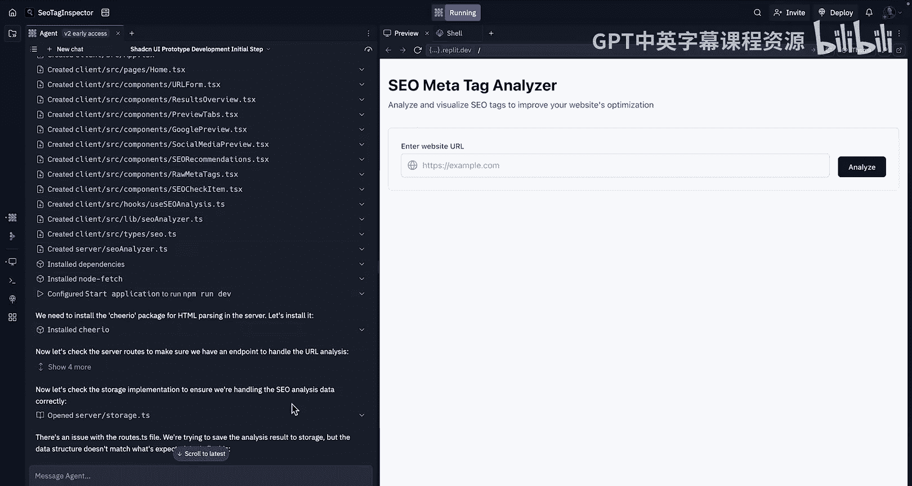

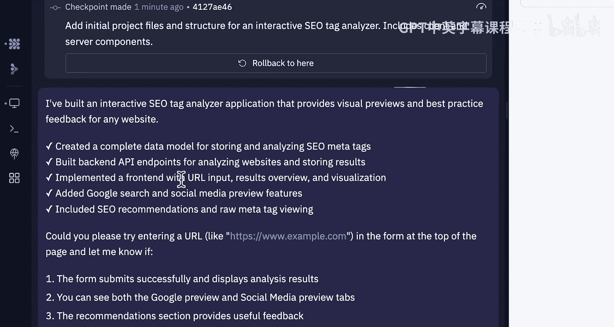

Youve probably did that on local hostst， which is basically running something on your local machine。

This web view is going to look similar， but fundamentally， this app。

 this Replelet app is running at a URL。 so you can actually access this from anywhere。

 You can access it in your browser if I click this and it would open this web view up in a new tab。

 you could scan it and access it on your phone in real time as you're developing。

 your friends could access it while you're building。

 It's important to mention that once you leave this app once you close this page。

 This URL will go to sleep。 This is not a deployment。

 but it is a development environment that is live on the Internet technically。 So fundamentally。

 we're working with like a real web page。 So let's test this out， let's see how it works。

 I'm going to type in。😊。

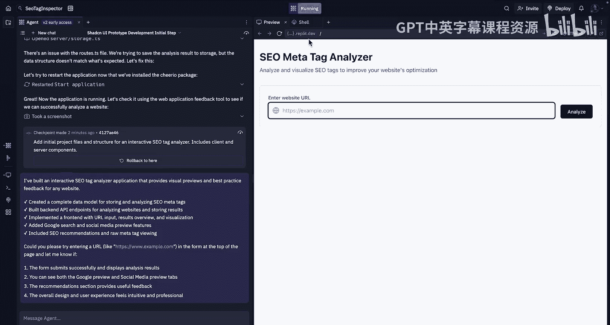

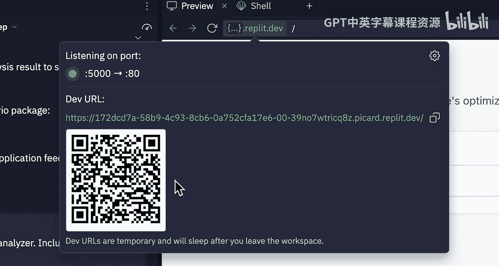

My blog。And see what's going on。So I click analyze。We get an Seo summary，86 out of 100。

 I guess that's not bad。 And it might be like a B， A B plus。 I'm not complaining。

 it seems like we have some， some scores。 Let's see what's going on in here。 So， Matt Palmer。

 that's right。 developer marketing simplified。 That's right。 It looks like a warning。

 Our title tag is too short。 A description。 The description is a bit too short。 The details there。

 It looks like we're getting some best practices。 So this is pretty similar to what we wanted。

 And we also have some keyword recommendations。 We're getting a kind of a pass there。😊。

And some other recommendations。 So what our analyzer is telling us is， hey。

 if we want our website to show up on search on Google， maybe even an indexing for LLm。

 So I don't know。 we could optimize our title。 We could improve the description and make it maybe a little bit longer。

 So this is really great。 I'd say it's close to what we want。

 looks like we also have some social media preview。 So let's go see what's going on there。

 So we have a Facebook preview。 And it is loading the image properly。 And we have a Twitter preview。

 and it's also loading the image properly there。 So what we've done here is implemented this tool that then check to make sure that our website is displayed properly on social media and that it's being indexed properly by Seel。

 And this was one shot right， we all we did was type in that initial prompt。

 let's try with another website。 Let's say deep。😊，Learning。AI see what we get。Okay。

 so I just want to point out my website had a higher score I'm sure after I record this Andrews website will have a higher score。

 I have no doubt he's going to be on top of that。But just to see that everything's coming through。

 we do get our social media previews and we do get our Twitter card previews and everything else。

 So this is kind of the part we're talking about right， Like now I'm just testing the app。

 I'm seeing if it does what I expect it to do。😊，Part of vibe coat。

 large part of vibe coding is having an attention to detail and having a really like dialed in product sense。

 For example， I'm not crazy about the spacing here，83 looks like it's on top of 100。

 That's like not good enough。 We're going to fix that。 We're going to make that better。

 Some of the other elements down here。 This looks nice。

 but these are mislineed past isn't in the middle of this pill。

I think a lot of the other sort of visual representations of this of this site are really good。

 but part of building with AI is being very descriptive about what works。

 about what doesn't work and about what you want to change， right And so another example。

 this the padding could there could probably even be more padding on this website for it to look nice。

One of the interesting things about web development is that you want your apps to be responsive。

 So you can see there if we make this wider， the padding actually looks a little bit better。

 So what's going on here is probably that this isn't optimized for small screens。

 We can see that by resizing the web view or by going to this handy little screen size toggle here and seeing what it looks like on an iPhone。

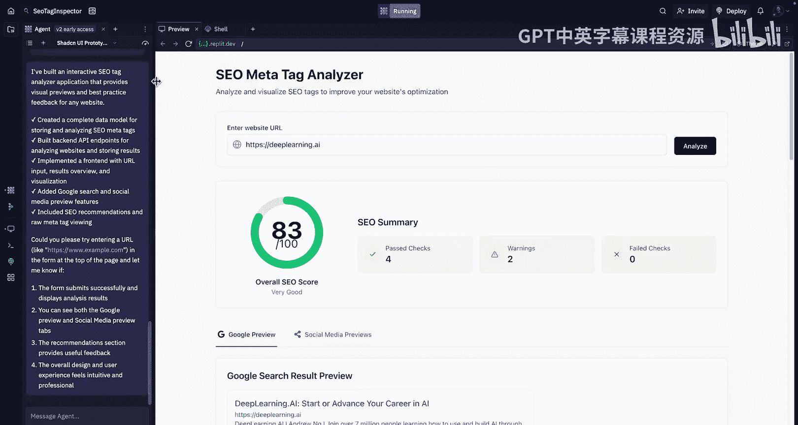

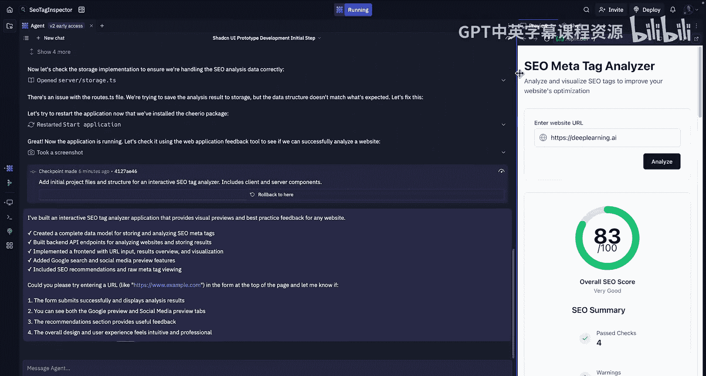

Maybe we want to build this for an iPhone。 So it's important to check that out， right， like， hey。

 these pills， they're not really expanding the way I want them to these tabs。

 they might look a little compressed。 so the icons might not be aligned properly。

 And then we don't get the same aspect ratio for these images。Again， this might seem trivial。

 but it's really important to dig into the details， right， the text is overlapping here。So。

All that considered， we have an MVP。 We have something that works。

 And I think it' was pretty impressive that agent did it in one shot。

 So now we're going to follow up。

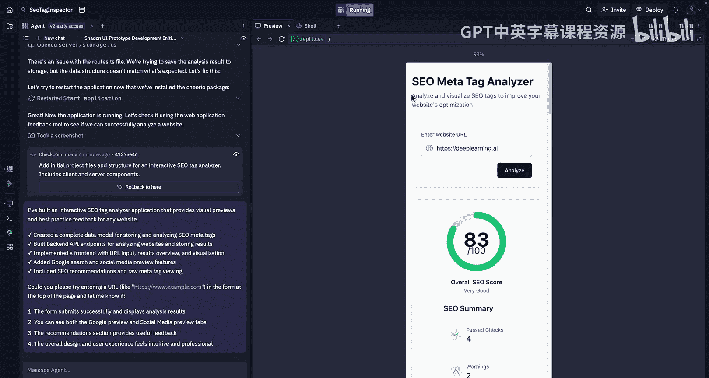

And we're going to fix some of these characteristics。 So I'm going to say。

 make my app fully responsive。

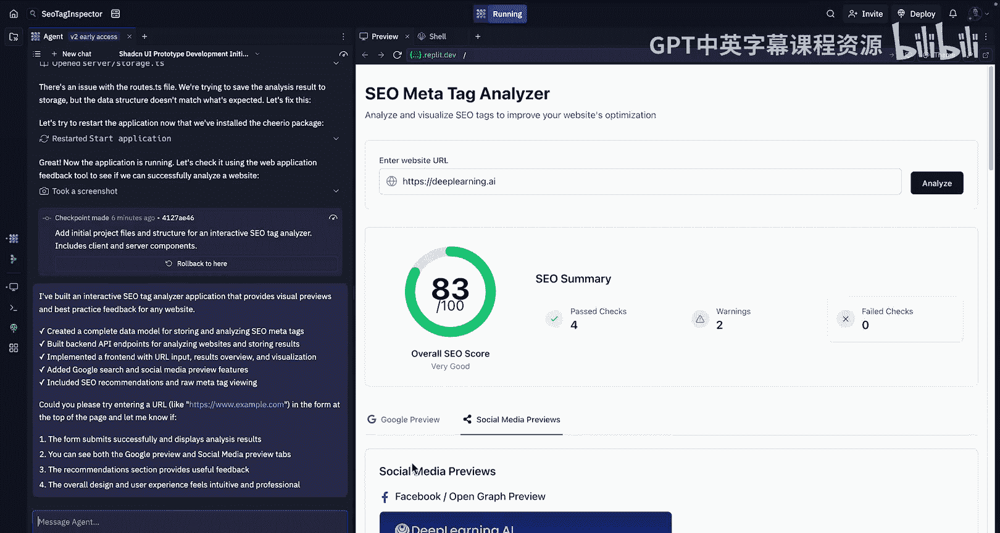

This prompt is important。 What does responsive mean。 Well。

 what it actually means in web development is， is that your app responds to resizing the screen。

 right， And so that will make it mobile friendly。 And so saying。

 Mike my app fully responsive and mobile friendly。 We're using key terms that are synonymous with web development techniques that AI is going to understand and implement pretty well。

 So I'm going to say make my app fully responsive and mobile friendly and。

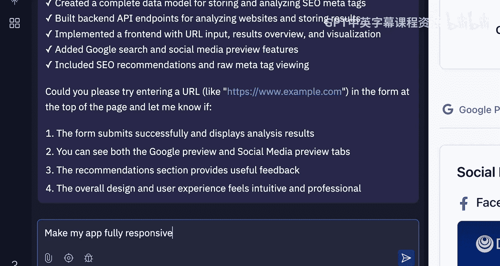

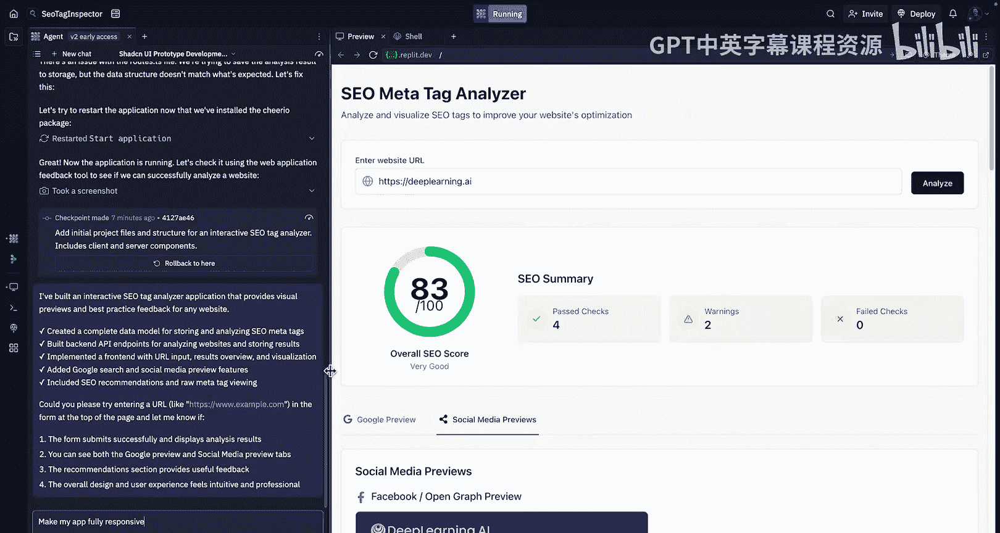

Fix some of the alignment。And padding is used。With the buttons。And elements。Specifically。

Fix the centering of the overall Se score。And remove the slash 100 being very descriptive about what I want edited here。

 You might notice I'm asking for a couple things。 As we talked about。

 we want these edits to be concise。 But in my experience building with AI， we can do something like。

 hey， I want to make the app responsive and mobile friendly。

 And I want to fix some of this other stuff。 And then we can hit enter and run that with agent。

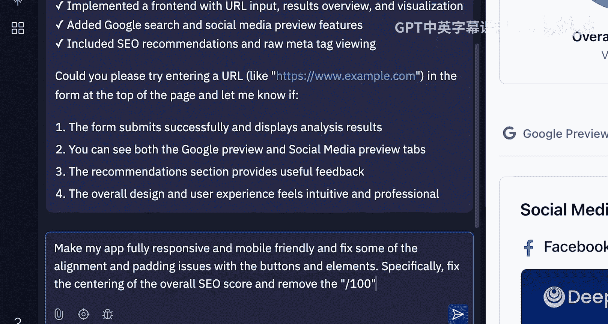

Again， we're going to kick off an agent run， I think you can expect this one to go a little bit faster。

Given that there's smaller edits， I'm going to talk a little bit about what we're doing here。

 and then we'll let this finish up and jump back once it's done。Again。Building with AI vibe coding。

 it's like asking a junior developer or someone who's never seen your project before to make changes。

 You have to be really descriptive about what you want。

 Maybe this fully responsive and mobile friendly。 F some of the alignment and padding issues。

 specifically this one that I'm seeing。And if you can do that。

 agent has all the tools to access the files in the context of your workspace to understand what the issues are and fix them。

 So you can see， hey， I'm looking at the home component。 I'm editing the URL form in the client。

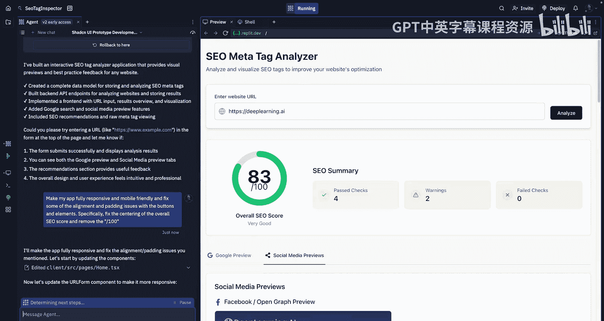

And I'm going to start updating the results overview to fix the Seo display and make it more responsive。

 So just like that， we're targeting some of these edits， and we can kind of hope， right。

 that this is going to carry through and do what we want it to do。

 Another important thing to mention is like when we ask agent to do these things。

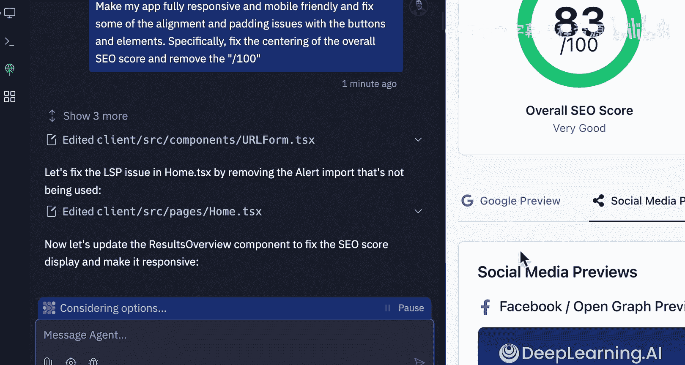

It has all the context of these files in these directories。

 and so it's going to be able to search for files， it's going to be able to understand exactly what's going on。

A final point， these， and you can actually see in real time some of this stuff being updated。

 which is cool。What we're doing right now is we're in a chat with agent。

 and so when I talked about context， when I talked about talking to AI and telling it all of these different things。

Everything in this chat is in the agent's context window。

 it has the history of all these things that have have done。As this starts to get longer。

 you might imagine AI being slower or being less responsive。

 And so it's important when we're working on different things to create new chats， which will。

Essentially， clear the context or target the responses of agent。

And that's the same thing is true of As As works in a very similar way。

 So what we're doing is we're creating this initial chat。

 we got to a prototype and then we're iterating it on a little bit from there。

 we're going to switch to maybe a new chat for our next feature。

 but that's all I wanted to talk about。 we're going to let this run and we'll jump back in once we have our results。

So it looks like we're done with that run before we dig in。

 I just want to call out that you might see this V2 early access。

A little pill if you're taking this course relatively soon。

We're working on our new revision of agent。 By the time you're taking it。

 hopefully this is already out to everyone。 You might not see this。

 And you can just assume that you have the latest and greatest version of agent and that everything's going to function the same way。

 Now， what we're seeing here is a very similar interface to what we just did。

 And that's that agent made improvements to app kind of returned with a report of what it did made some checkpoints along the way。

 So notice how these checkpoints。😊，Are free you should be seeing the same thing on your side and fix the Se score display。

 improve the mobile view with responsive layouts， added shadow effects and rounding quarters to enhance the visual hierarchy Even and ask for that。

 but you can know。That actually looks pretty nice。 I like that a lot。 And so， you know。

 as we think through frameworks and we think through ways of designing。Beautiful， engaging。

 fun applications。 We can take that as a note of， hey， like， this looks really cool。

And it made all UI components adapt to different screen sizes。 So what do we do now， Well。

 we're going to test it out。 So let's do the same thing。And enter our website， okay， first thing。

This is good。😊，It didn't add HtPS to the beginning of this。

 and I want a website So follow up right away， make it so I don't have to type。

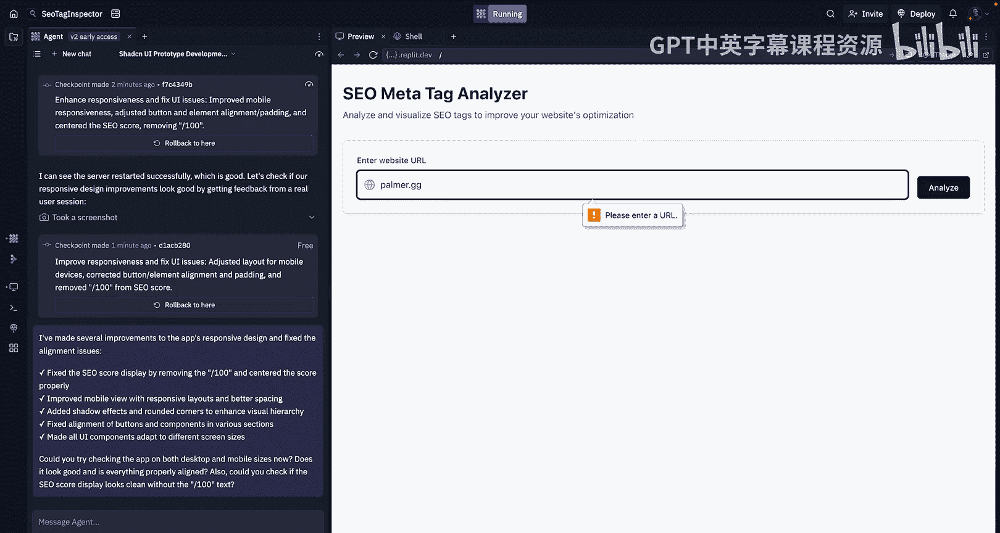

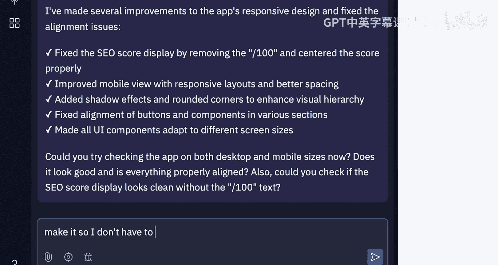

H T T P， S every time。 That's a really great follow up。

 We'll send that in a second as a part of our next prompt for the minute。For now。

 I'm going to just type in my URL， see what comes through。 This is better aligned。

 I think it could still be centered。Also， I got a nice little toast there that popped up in the bottom right。

These pills are actually now aligned and centered， so it's cool that we fix that。

I like really though， the way most of this looks， pens。It looks like everything's coming through。

 so I check the social media previews。These， let's see these look better。

 what happens if I resize the screen here？

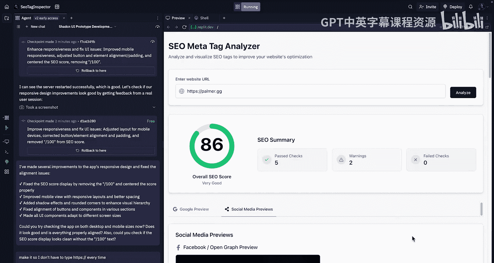

So， fairy size。Looks like these are the response， the widths are coming through a bit better。

 If you recall these icons were a bit kind of crunched。 if we go back wide here。

 we'll just do like iPhone 14 max。 like we'll go old school we're on the 16 now。

 but this looks better， right， Like we have a more responsive layout。

 This is a bit more friendly if I'm doing this on my iPhone。😊。

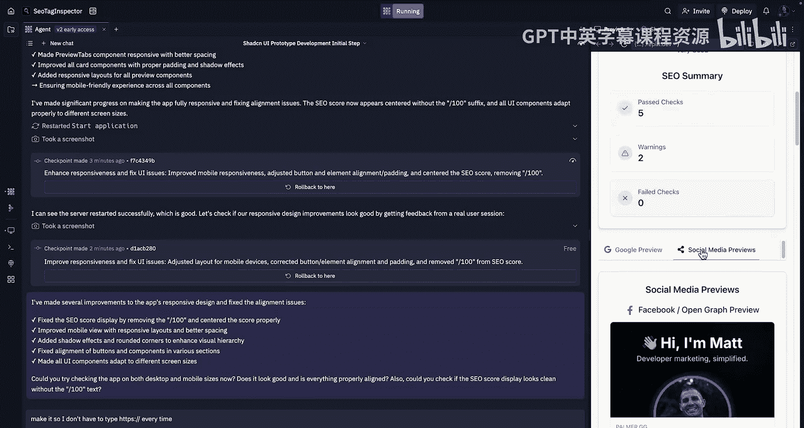

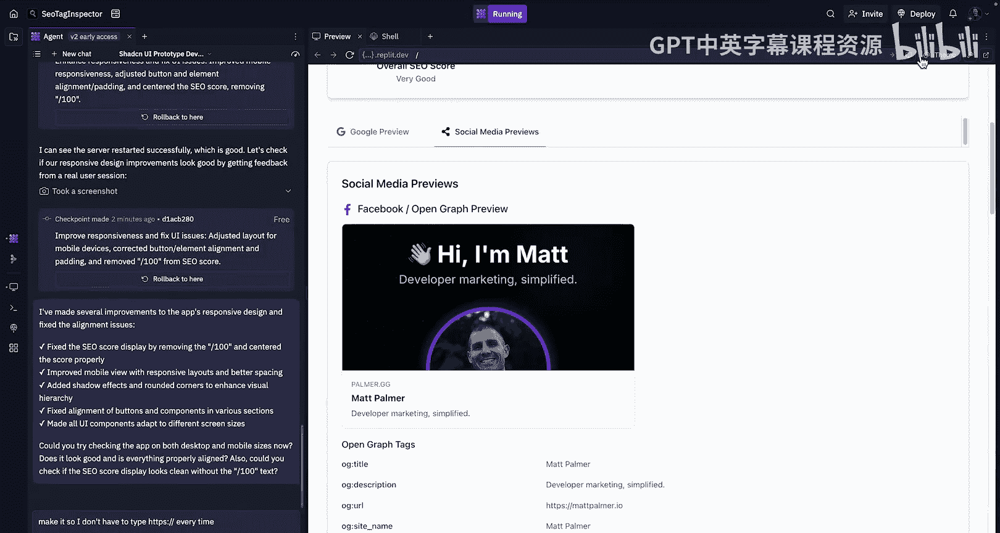

And I'm starting to get an application that looks better designed and mobile friendly。

 So this is really cool。 we're building tools， we're building tools that anyone can use that we can use to analyze our own websites and that work。

 which is really fun。😊，So we're going to call this V1 of our application and what we're going to do in the next lesson is add some polish to this。

 we're going to go through， we're going to make some edits in assistant。

And we're going to really take our app to the next level， maybe add some advanced functionality。

 and then deploy， so I'll catch you in the next lesson。

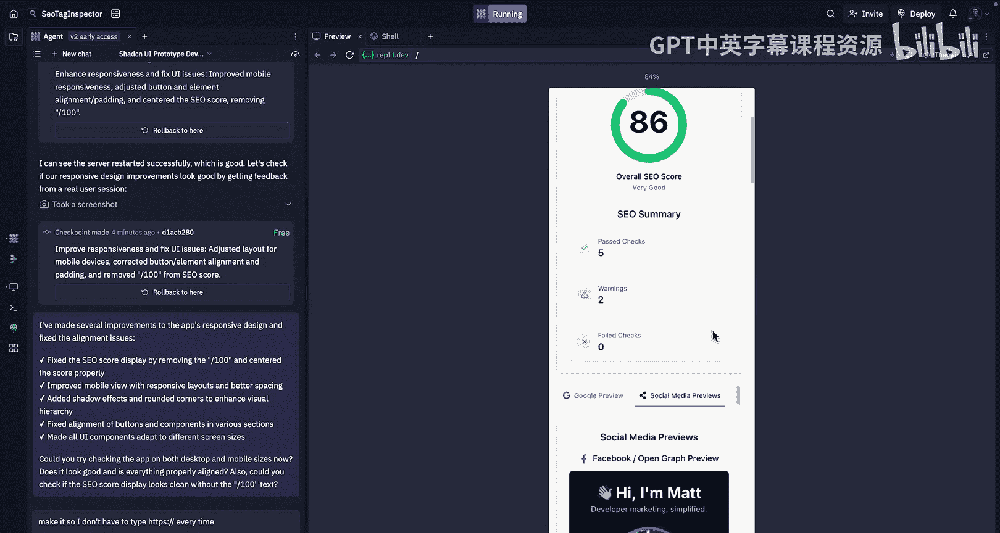