# 吴恩达《用Replit进行氛围编码｜Vibe Coding 101 with Replit》中英字幕（deepseek-R1 - P4：4.implementing-seo-analysis-features.zh_en - GPT中英字幕课程资源 - BV13CZgYqER1

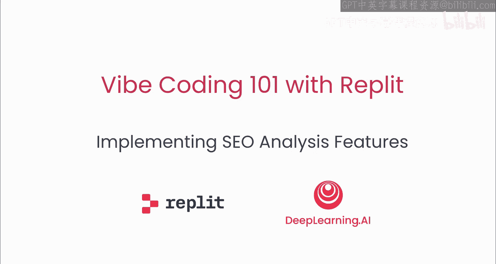

And now we'll enhance our search engine optimization or Seo analyzer prototype。

 We'll use agent to add core functionality then switch to assistant for customization and feature expansion。

 Finally， we'll deploy our application so others can access it online。 Now， let's get back to it。

So in this lesson， we're going to enhance the functionality of our application and start adding a lot of Po to exactly what we've built。

 So I'm going to go ahead to the top and create a new chat with agent to clear out the context like we discuss and start off by saying that we want to make a more visually appealing and visually representative app。

 we have all this data about our website about the tags that we've built but the only real visual summary that we're getting is an overall Se score So I'm wondering if we could get something that more better captures the entirety of these tags。

 maybe something that tells us if our images， a summary of our images。

 a summary of our titles and descriptions as well as this kind of highlevel information So what we're going to do is we're going to consolidate that into a prompt and ask agent we're also going to ask again for a little bit more polish on the UI So what I'm gonna to say here is make the application more visual。

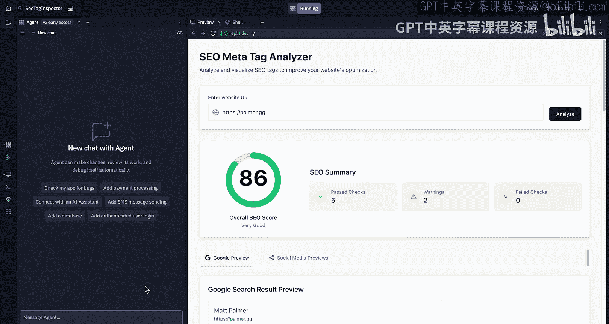

So I'm starting high level， and then I'm going to drill down with just some quick bullet points for agent that are all kind of feeding into the same functionality。

 Again， we're keeping these very targeted。 We're not getting too crazy with what we're doing in one prompt。

 So create summaries。For each category。Of metatag。That you will display visually to the user。

 similar to the overall。Overall score。 if you remember from our wire frame， right。

 I had in mind this concept of multiple scores that we could inspect each kind of category in our website。

 and it's okay that， you know， our MVP， what we're building here。

 doesn't look exactly like my wire frame。 The wire frame is really more just to guide what we're building and keep that in the front of my mind。

But I am in the drill down here and tried to tune those things in a little bit more。

Make the app overall， more visual。And allow me to get a summary of。The SEO results。At a glance。

 So we'll add one more point。Which is exactly that。 And you know。

 a lot of times I see when people are building with AI， they'll come to me and say， hey， Matt。

 I'm trying to get AI to do this thing because X， Y。

 Z and I want ABC outcome right And I'm like just tell the model that So exactly what I just told you we're going to tell to agent。

😊，Help。Overall。Let's。Make the app more visual。And user friendly。For folks that might be new to SEO。

 so we can get a high level。View of how well our page is implemented。Now。It's kind of like， you know。

 giving wishes to a genie。 You know， if， if you're not very explicit。

 the genie might just do some crazy stuff， right， So what we have to do here if we're asking for simplicity is follow up that we want all the functionality that our app has right now。

 We don't want you to take anything away。 So that's a very important thing that I've noticed does wonders。

Do not remove any functionality。Just。Make it easier to see a high level summary。

Or drill down into the details。

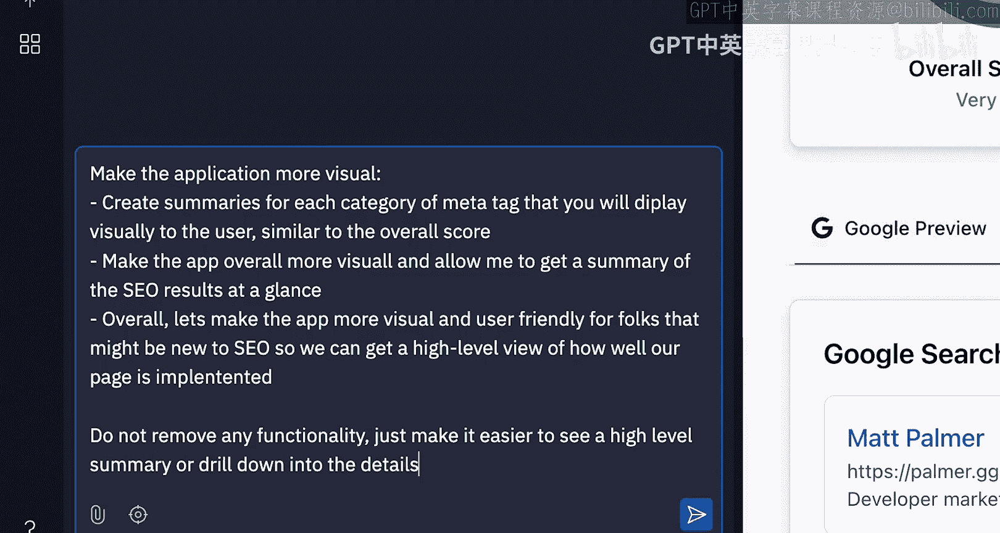

And I think we kind of know with a drill by now， so we're just going to let this one run。

 we'll come back once agent is done implementing these features and we'll talk about what it did。

Okay， so we're through that round of edits， let's see what we've gotten here。

 we're just going to go back with our old example， we're going to analyze that。

And now looks like we get a bit more of a visual representation of our checks， there appears to be。

 let's see what's going on here。Much better overview so we're generating kind of key findings and what's good meta keywords。

 it's good these are present， what needs attention， as well as some priority recommendations。

 so optimizing the title tag and improving the description。We also get some category breakdowns。

 so SEOo and social media optimization， so it looks like there are some checks going on there。

It's checking both for titles and the way that things are going to show up on social media。

 we're checking how robots index our site， what's known as a robot TxT typically determines how websites can be scraped。

On social media， we also have open graph tags and Twitter card checks。 Now。

 we can still drill down into technical details and actually get a Google search preview。

 which is nice。So you can see like this is maybe a little too simple for Google。

Well as are social media previews， and this is a bit more clean， nicer display。

 both for Facebook and Twitter。And then if we want to drop down into our Seo recommendations。

 we get a much more descriptive view here。 We can still see our raw tags。

 There's also something like nice hover effects。So， you know， this is like three or four prompts。

 But what I want to point out is that more than anything。

 we had attention to detail and we had attention to exactly what we wanted changed。

 And so we drilled into our app。 There's still some things that aren't perfect， right。

 Like this is not ideal to spacing here。 we could really kind of like nerd out with getting this to look the way we wanted to。

 But overall， we have something that's fundamentally more polished。

 Now there were still a couple points。 So we're gonna open up assistant here to make some like finer grain changes to what we just built when you open up assistant。

 you might notice that your app restart， you might notice that there's a refresh。

 And that's because we're kind of like leaving agent mode， so to speak。😊。

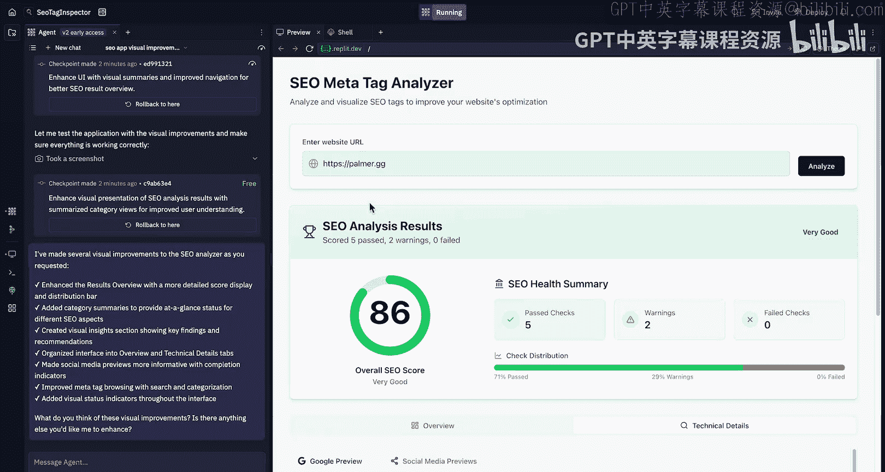

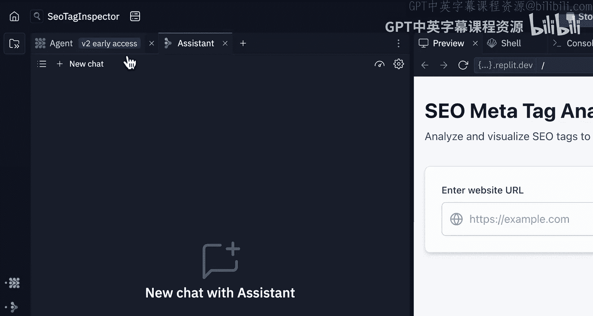

And if you'll remember， I didn't really like that I couldn't type in that I had to type in H T TPS。

 So I'm going to say to assistant， because it actually has a lot of the same context right into our application that agent has。

 I'm gonna to say， can you make the website。

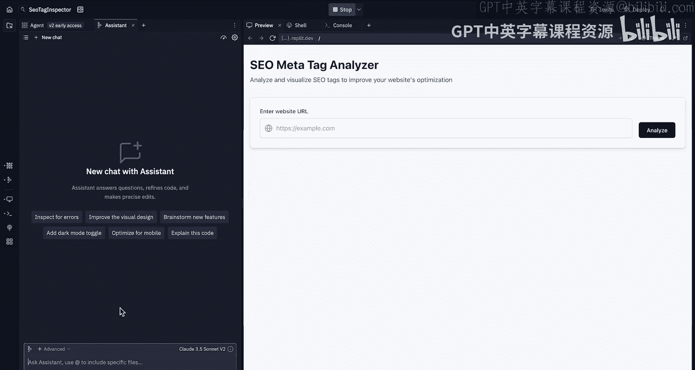

Entry form such that H T TPS。Is automatically。Populated。

And the user doesn't have to enter any other info。

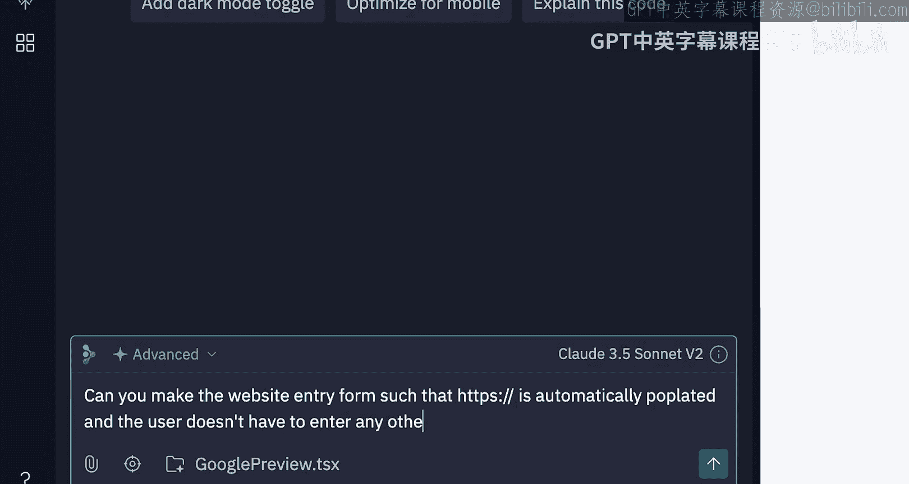

And because this is a quicker tool， assistant is more lightweight tool。

 you're going to notice that the responses are much quicker and so Asant is going to read the relevant files。

 This is our first kind of intro assistant， it's behaving a lot like agent， but in a similar manner。

 it's going to make the change。

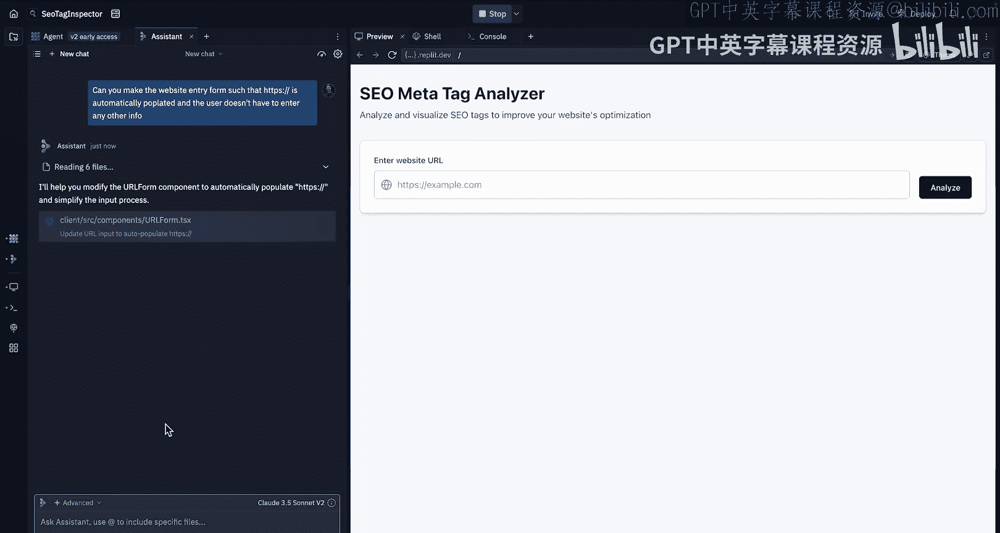

And then it's going to make a checkpoint， so we made a checkpoint， HGTPS is prefixed theoretically。

 or we'll do deep learning let's time deep learning。

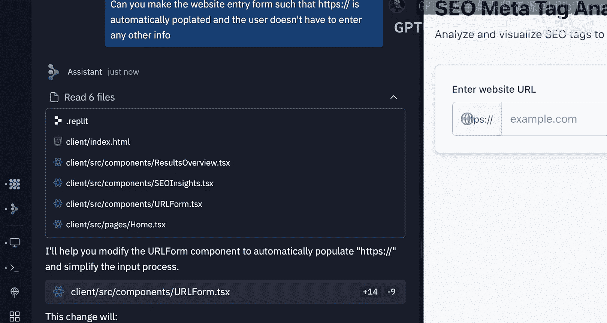

We can just type in deep learning AI。 we get our result。

 So what you might notice is that our sort of globe element is on top of the HttPS to provide context for assistant。

 I'm going to actually open up our screenshot tool here this is just using Mac OSOS so if you're on Windows might be different。

 I'm going to copy this to my clipboard and then I'm going to paste that screenshot in and say。

 now the globebe icon overlaps with HttPS can you fix it。

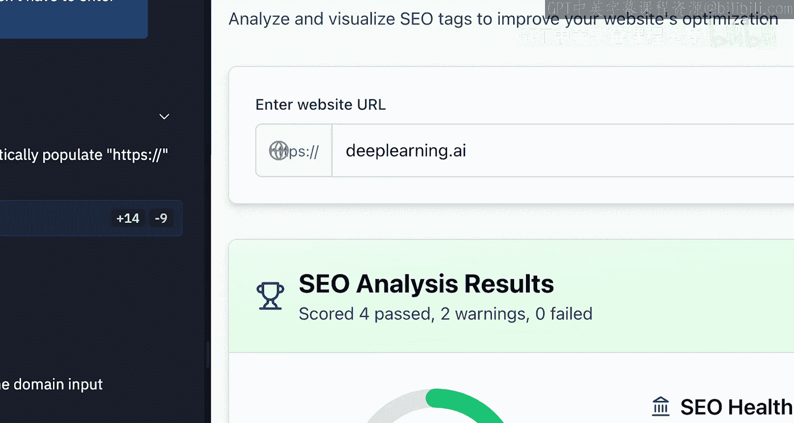

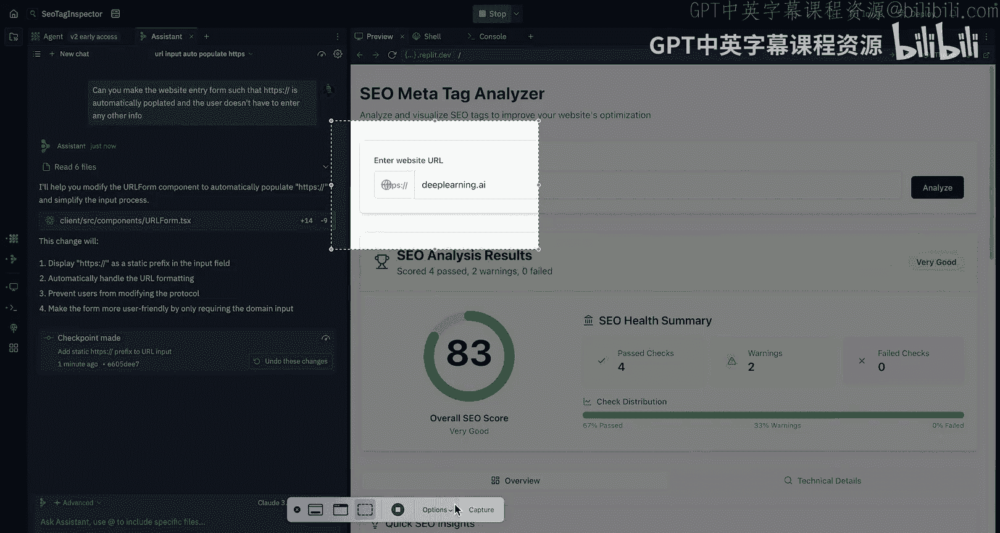

When we talked about context， right， we talked about providing additional details to AI。

 giving it the information it needs to fix errors。 And that's what we're doing here。 Hey。

 now assistant can see the overlapping problem and it's going to present us with a solution and ask if we want to apply those changes。

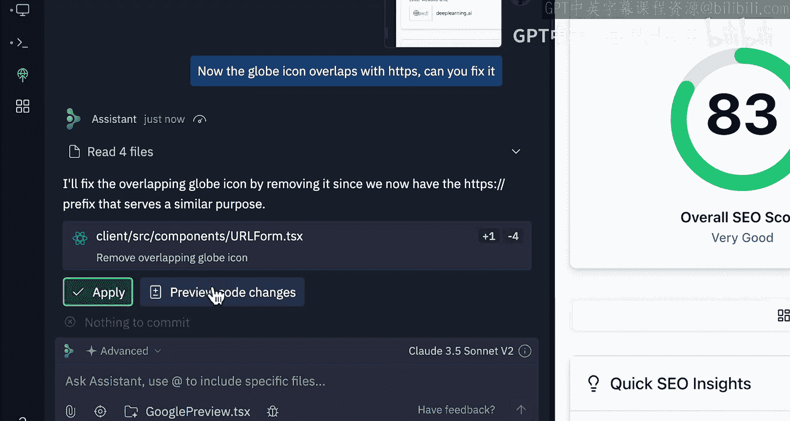

Looks like we're getting a bit of an error here。 let's preview and see what's happening。

It's actually just removing， it looks like removing the the globe here。

 but the commit didn't quite work。 That's okay。 We're actually just， you know。

 sometimes stuff like that happens。 You might get similar errors。

 I'm just going to really paste this in。I'm to copy this。I'm going to run it again。

 let's see what happens。

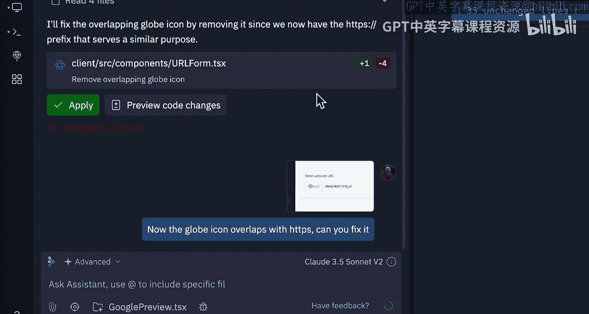

There， so it looks like it just took another command really quick to run through it actually looks like the original changes were applied。

 we just might have gotten a a bit of a rerun。

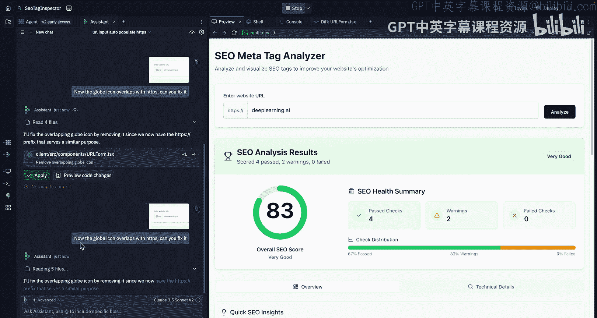

Getting a little error there， it's all good。

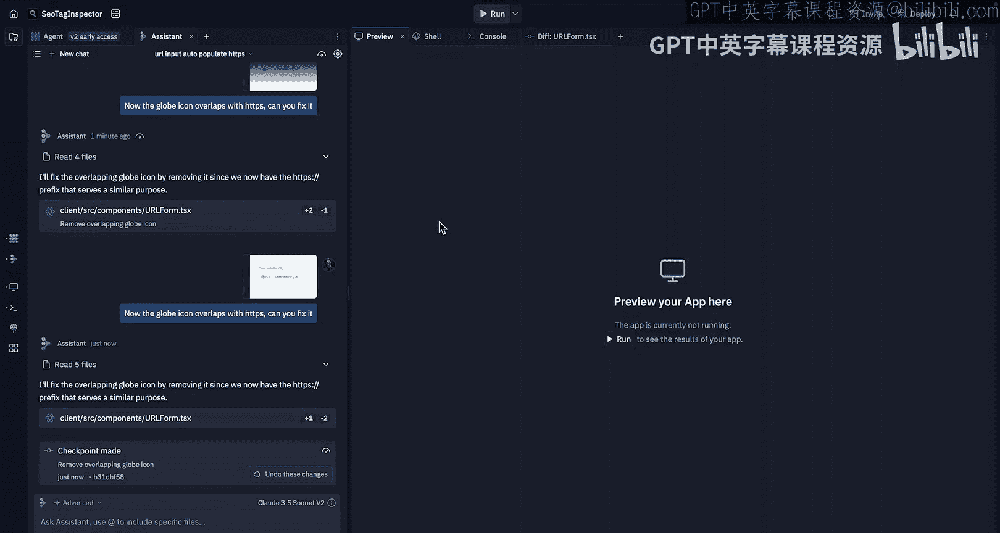

And when a system makes a new checkpoint， it's going to restart our app。 So now we have our app。

 we have the Htt B。 I can just type in deep learning AI and click analyze。 But just like that。

 we flipped over to assistant。 We made some more lightweight details。

 This is kind of like what we wanted to build for our application。

So we're going walk through the deploy pattern， This is something we'll do for both of our applications note that deployments are limited to replicatelic core users。

 so you might not see this experience， but at any time if you want to subscribe or upgrade you can deploy that way clicking deploy。

 we're actually just going configure the build for you。

 you don't really need to worry about these details。

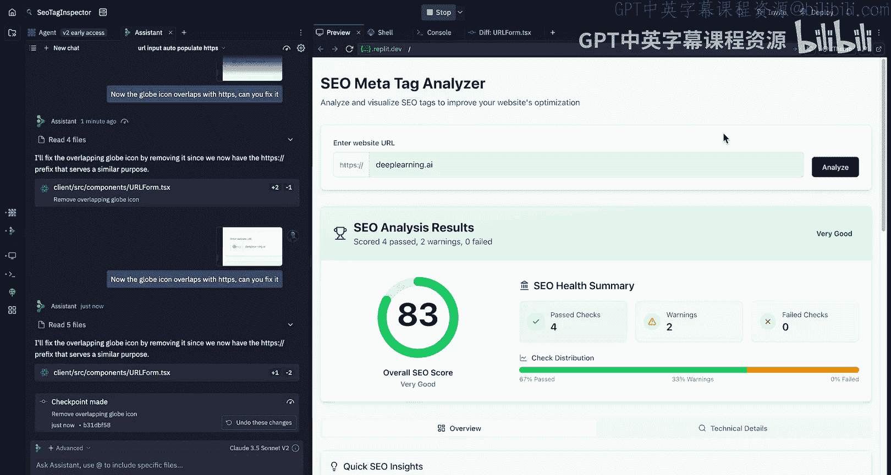

Or really even what auto scale means， we're going to improve and configure the settings and then we're going to come up with a name per app。

 so I'm going to call mine an SEO tag inspector。Note that we're configuring the build command and the run command。

 I don't really need to worry about any of this Age's going to take care of it for me。

I click to play。 And， you know， it's important to mention what's going on。

 This typically takes two or three minutes。 We're taking this application。 We're bundling it up。

 We're taking this entire environment that we've built with agent。

 And then we're just putting that on the cloud。 Basically。

 You don't really have to worry about the technical complexity of what's going on。

 You don't have to worry about any of the nuance or details。

 What you do have to know is that everything that you just built。

We'll look the same on the web page that we're deploying。Now。

 if you went back and made more changes this application。They will not automatically flow through。

 you'd have to go through and click redeploy。So we're going a little bit slower in this lesson。

 but that's because we want to cover all the basics and understand how things work。

 So when we build our application， when we click deploy。

 we're taking a snapshot of everything that we just built with agent with assistant。

 all these features that we added and then promoting them to their own web page。

 which we just defined if at any time you want to learn more about the different types of deployments that we have or how deployments work or any of the technical details。

 you can learn more in our documentation or check out some videos on YouTube that I built that have some really。

In depth content， but at a high level， we're going to select the right deployment type for you。

And we can be very confident that that's the right type to deploy。 So in the meantime。

 you can watch this cool loading screen， All deployments also come with logs so you can see exactly what's happening in your deployment。

They come with analytics， so you'll be able to see who's visiting your deployment。

 how many users you have， as well as some other settings that you can drill into。

 Those will be visible once our deployment is done。 In the meantime， we're going to sit back。

 I'll join you once this this is done to point。So we're back。

 you can see the deployment took about two minutes， which is great。

And we're going to give you the domain you just deploy to。 So if I go to this URL。

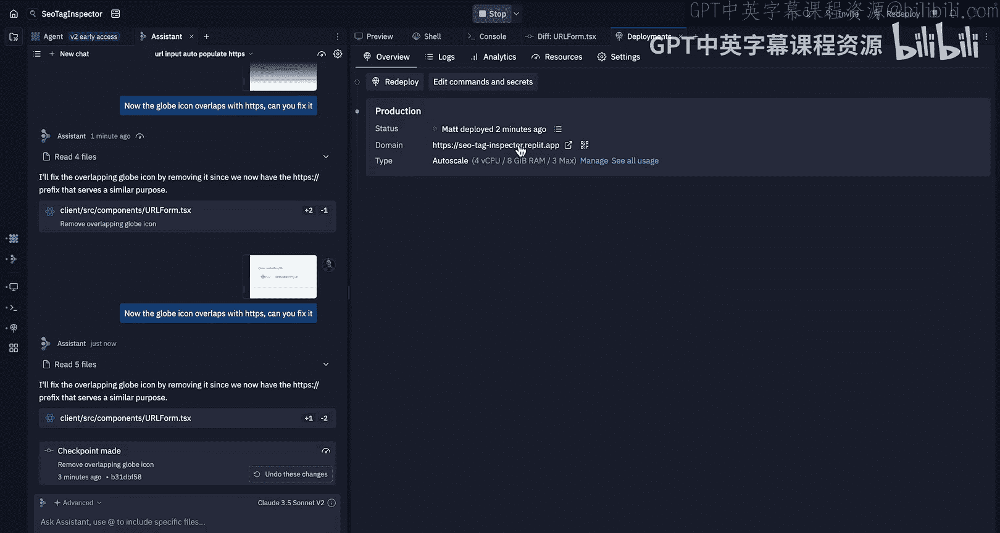

We're going to get the same app。 This is now deployed on the Internet note。 It's at its own URL。

 You could visit the site if you want。 I actually just entered a site， and it had H T Tps。

 and the form automatically removed that for me。 So that's really nice。 Can click analyze。

 It's gonna to work exactly the same as what we had before。😊，So these are the basics we just built。

End to end an application with agent with assistant that scrapes web pages。

 performs an analysis on that web page to tell us if there's anything that we can improve or。

Maybe optimize for Seo， Google results or social posts， and then deployed it。

 We built a tool completely that other people can use that you can use。And that's how simple it is。

This lesson was really more about polishing， flipping over to assistant。 in the next lesson。

 we'll be able to speed through a bit more of the basics since we've already covered those and get into more of a complex topic。

 So I'm really excited for that one。 I'll catch you in the next lesson。

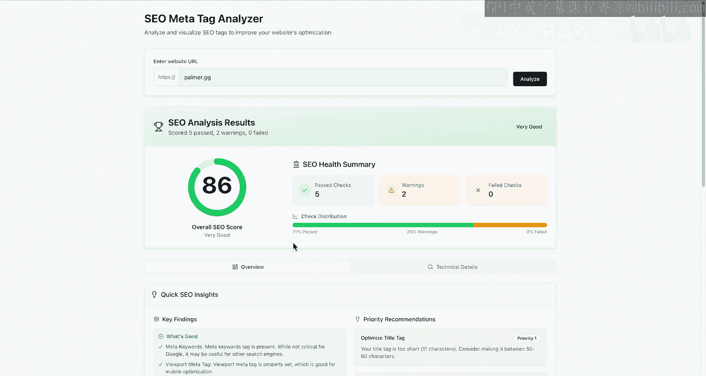