# 吴恩达《用Replit进行氛围编码｜Vibe Coding 101 with Replit》中英字幕（deepseek-R1 - P5：5.planning-and-building-a-voting-app.zh_en - GPT中英字幕课程资源 - BV13CZgYqER1

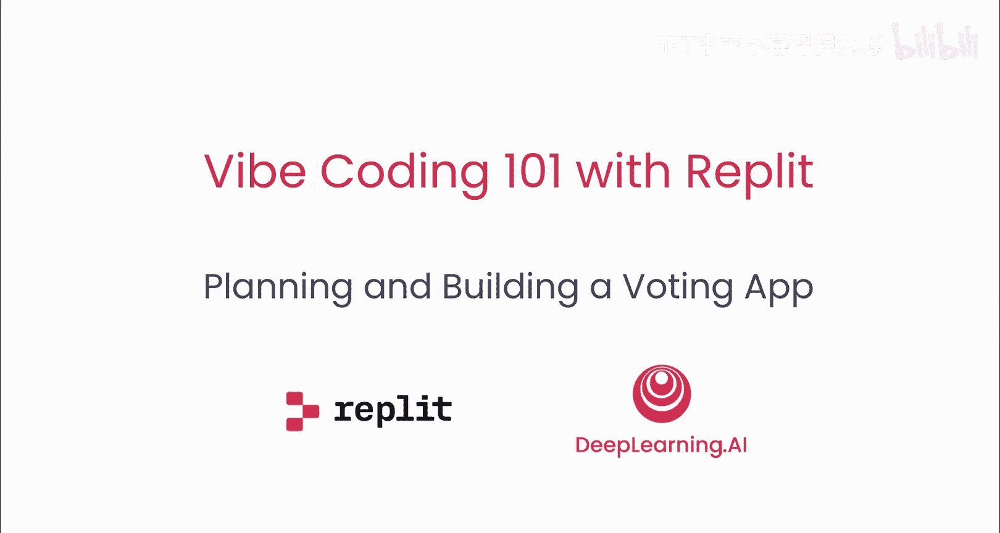

In this lesson， we'll build a National Parks ranking app with voting capabilities。

 just like in the last lesson we'll develop a PRD and wireframe to outline our requirements。

 craft an effective prompt， and use agent to create our initial application with our sample part data。

So now let's get started on our next project and it's going to be a bit more of a complex project using persistent storage and some more complete interactive functionality。

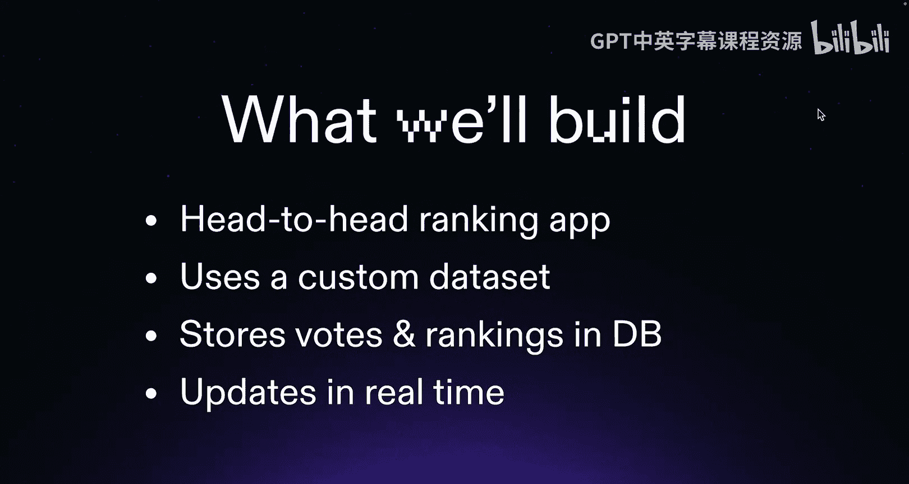

So what we're going to build is a head tag ranking app that uses a custom data to store votes and rankings in a database。

 so the idea is we're going to pull in some national partss data for the United States and you'll be able to go to our app and vote between two partss that are presented to you the user once you create a vote。

We will， in real time， sort of tally up a ranking for that park and return the relevant ranked parse。

 So we're going to go through a similar process。 We'll start with a PR。

 We'll start with a whiteboard， and then we're going to discuss some more advanced building techniques once we get into Ret for our app。

 So again， starting with our whiteboard here。 We're building our head head voting app。

 And I went ahead and sketch this one out as well。Again。

 I'm thinking we have two parks that we're comparing head to head。 Once we vote on this park。

 we're going to calculate a dynamic ranking。 Now， the parks are ranked according to what's known as an EO system。

 So the goal here is to have our rankings displayed in real time to store both our parks and our rankings in a database to use a persistent storage method like a database。

And display overall rankings and recent floats。This brings me to an important point。

 which is that by default if you're creating apps on another platform or on Relate。

 that data has to be stored somewhere so that we can reaxs it and we can have it available to us at any time。

 and so what we're going to do is initialize this application and then move that data to persistent storage to a database such that we can access it we can update those values and have it stored in our application and that's a really cool feature about Repl we have databases built in。

 we'll walk through that So keyki for this one prompting persistent data deployments。

 debugging and handling errors and edge cases。So let's look at our prompt。

 Help me build an interactive app for voting and ranking the best national parks。

 The app should allow users to vote on parks head to head。

 then calculate a ranking for the parks based on the chess EO system。

 The app should prominently display the matchup， along with overall rankings and recent votes。Again。

 this is really straightforward， we're emphasizing the use of our Frank Bo and EO system。

 and you might be saying， hey， what about the data？

Is the L O M just going know about all these national parks， Well， probably not。 And even if it does。

 it's not going to have images for those parks， it's going to be hard to find the the information。

 So what we're going to do from this app is we're actually going to pull data in from an external source。

 Let'm going show you how to do this in Replt。 It'll be really straightforward。 But first。

 let's just take our prompt to the Reple homepage。

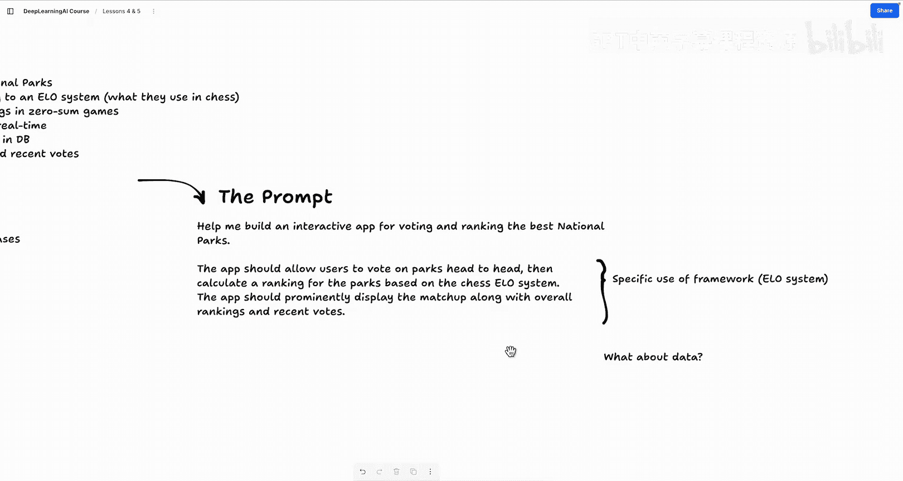

So just like the last lesson， we're getting started here with our prompt。

 we've entered everything in。And now what we're going to do is enhance this prompt with some additional context。

 like we talked about in the introduction to this course。

 So it looks like the US has 63 national parks。 and this is the Wikipedia page for national parks。

 And it actually， we actually just list。

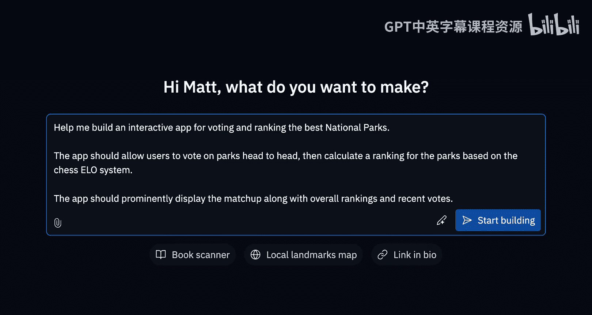

All of the national parks here， so this is really cool。

Something we haven't talked about is that agent can actually just scrape this web page for us。

 and if we're thinking about the context that we provide to LLMs， well。

 if we say build this rancor with all these national parks and then we just give AI a list of all the national parks and potentially the image URLs for those parks。

We can be pretty comfortable that it'll be able to use that data to integrate it into our application。

 So what we're just going to do is copy the URL and bring that over to agent。

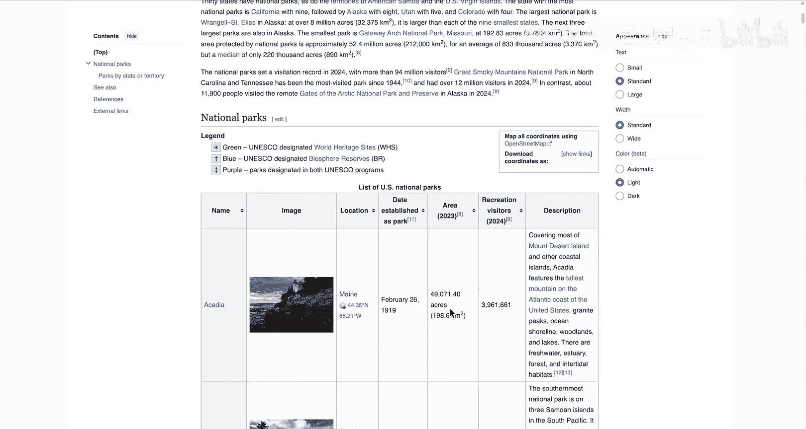

And so what we're going to do， we're going to hit shift Enter to create a new line。

 and we're going to paste in our Wikipedia link。 what you're going to see up top is this little modal here。

 it's going to prompt us if we want to take a screenshot of that page or get the text content。

Obviously a screenshot of a Wikipedia page probably not what we want so we can fetch the text content our tools are just going to scrape that web page and return us the text content you can actually see it in real time so you'll know exactly what's it completes it typically takes one or two seconds here。

And once you see something populated， you can see the content。 So now we know， hey， we're。

 we're asking AI to build this interactive voting app。 Theoreically， it should have。

All of the content that it needs all of the data， which is the list of parks the 63 partss。

 it'll also have access to the URLs so we'll see if agent can implement those properly that might take some additional prompting and the next piece we can actually use that PRD a little bit more directly。

 we can use that wireframe that we drew a little bit more directly in this app than we did in the last one so we're going to head back over to our wireframe。

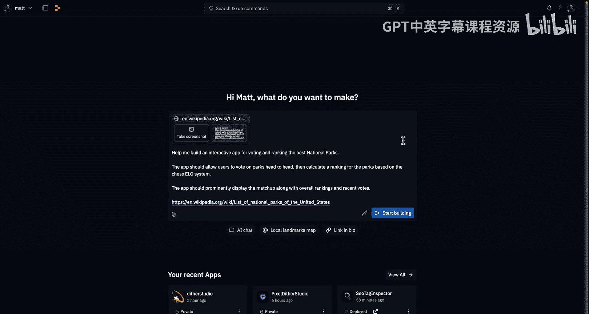

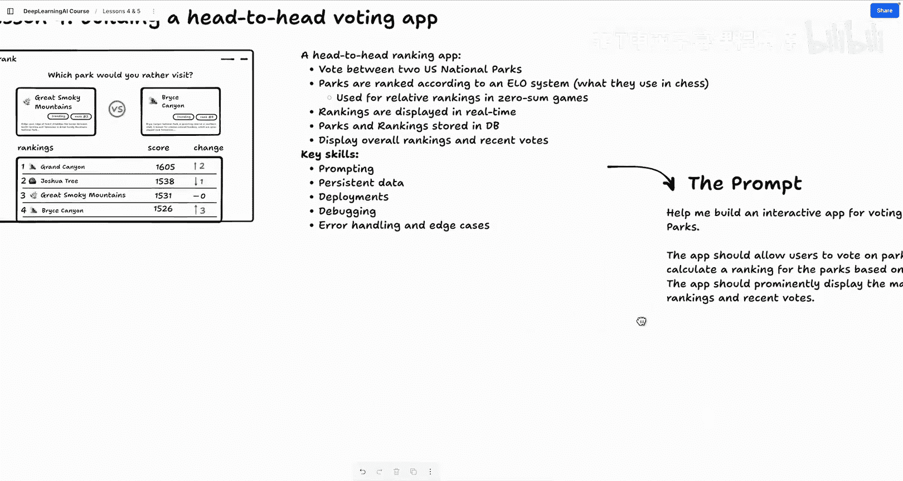

And so now what we're going to do for this one is we're going to actually just take take a screenshot of this wireframe because I like the design here。

 I want AI to also have some context into what we're doing and we're going to paste this into agent。

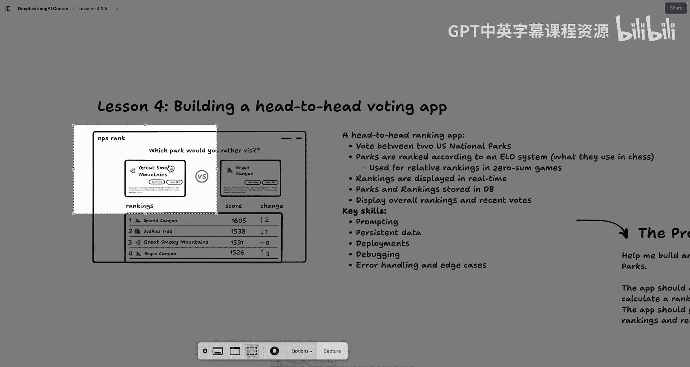

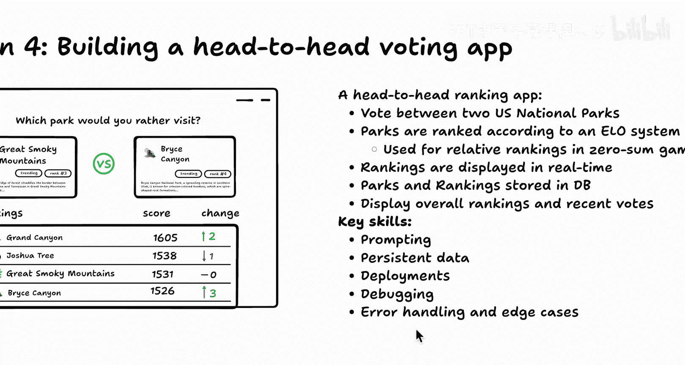

So now I've pasted the wireframe and our prompt is just a little bit more complete。

 we not only have a really descriptive but concise prompt that tells agent exactly what we want。

 but we also have the text content of the Wikipedia page that explains what national parks are。

 what parks exist in the United States and has a complete list of the parks along with really relevant data。

And we've attached our screenshot， so let's see what agent does with this information。

Just like the last time agent is going to come up with a plan and present us info for what it's going to build before we jump in since we've been through this process since。

 you know， really the first lesson was getting comfortable with what we're building。

We're going to confirm the plan here and then I'll catch back up with you once agent is done with the initial MVP built。

One thing important thing to note， these additional features here are just that additional features。

 So regardless agents going to work towards the initial prototype。

 we're actually going to work towards implementing things like a Postgres database or maybe some of these other functionalities。

 So you don't have to worry about that。 you can just approve the plan and start also note that right results may vary。

 So if you're following this tutorial AI。

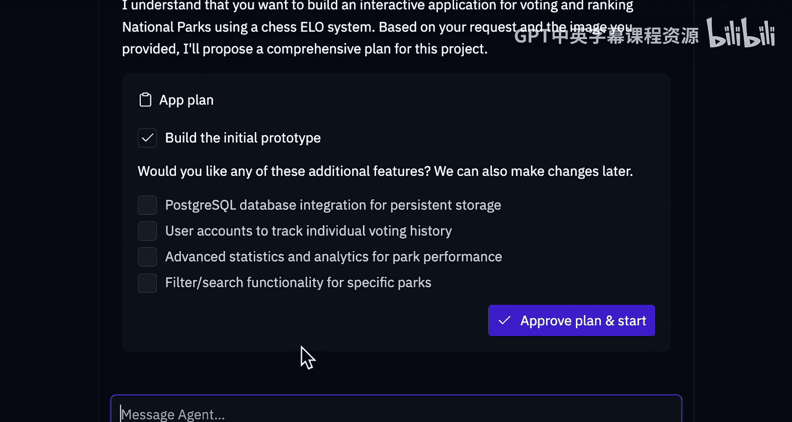

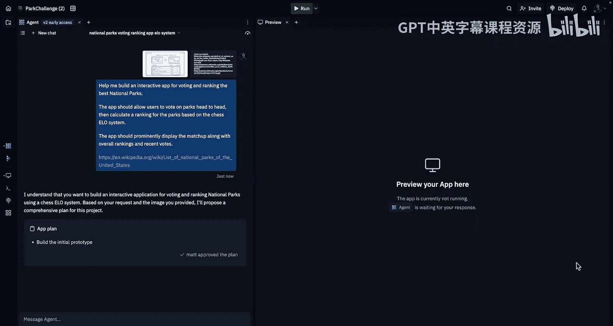

Those different things sometimes your preview might look different。

 the final result might look different， but we're going to work through it together。

 so I'll catch you once this preview is done。

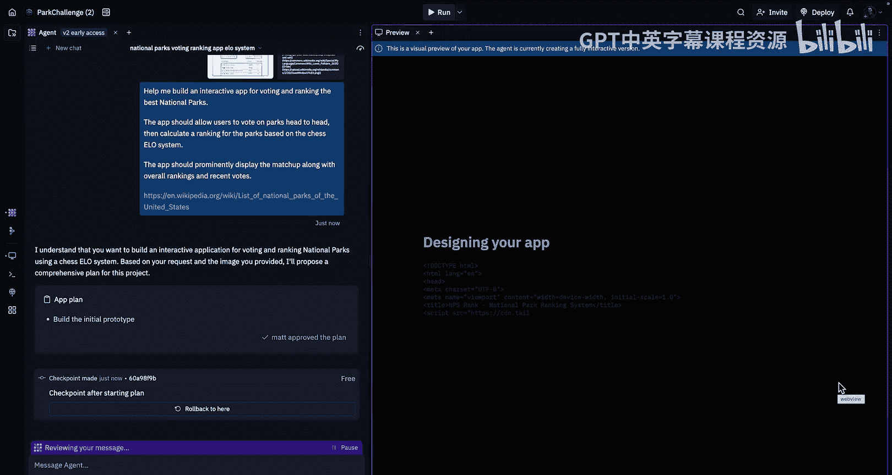

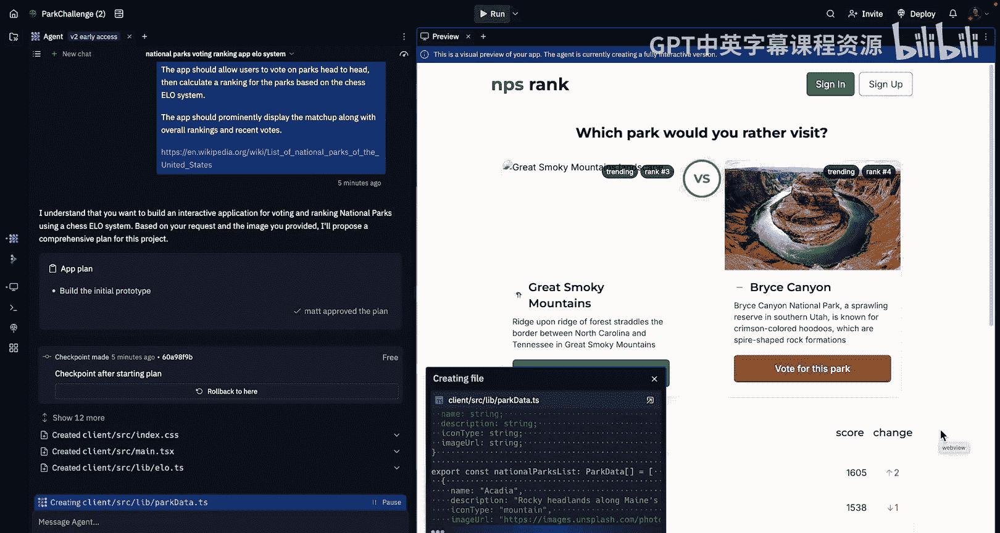

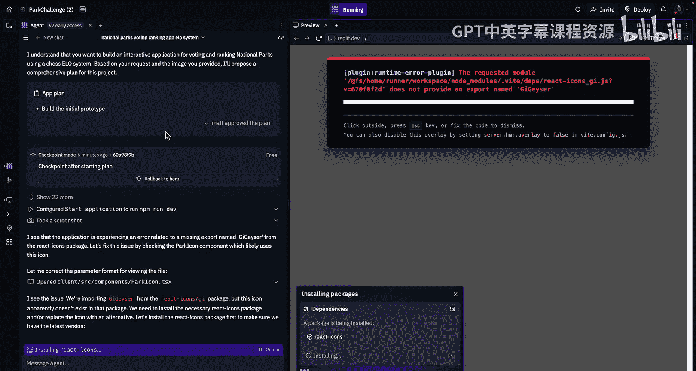

Okay， so we're back。 and if you're following along while the app was being built。

 you might have seen some errors come up and we still have some errors。 So that's okay。

 we're going to work through these one at a time。 and you probably saw actually that agent fix some errors。

 And that was because agent has the ability to both read the output of what's coming from the application。

 So what's being written to the console if we open up a new tab and type in console。

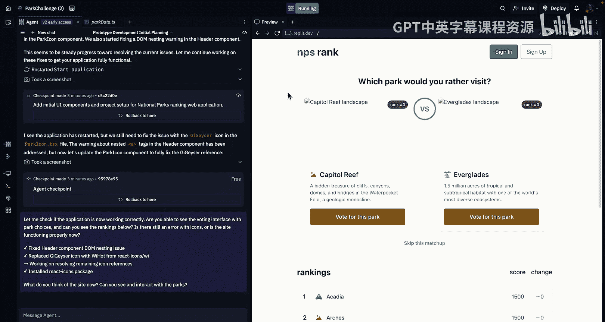

You can actually see。What's happening as the application is working？

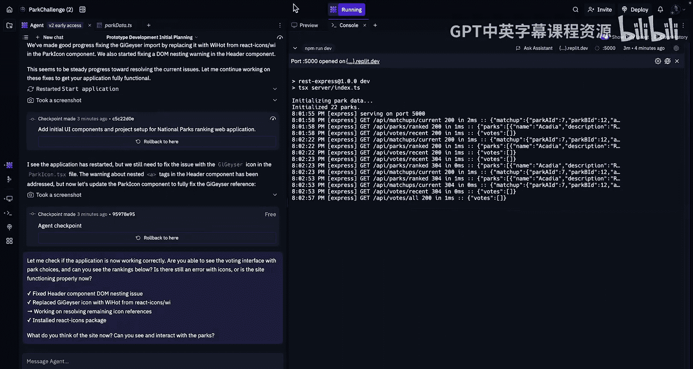

And it also has the ability to take screenshots and fix things dynamically。 So we have our interface。

There's a lot of stuff going on here， there's not a lot of things that are working， but that's okay。

We expected to get errors on the whole。 This looks nice。 The images aren't coming through。

 I don't think we have all of the parks here。 I don't think it' scraped the data like we asked it to。

 And we have some like non functional account buttons up top， which is fine。

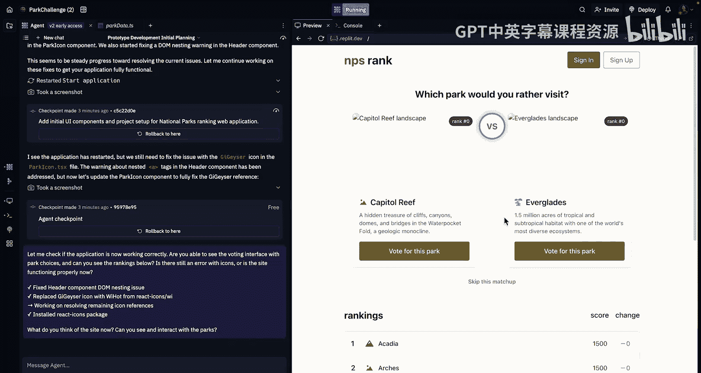

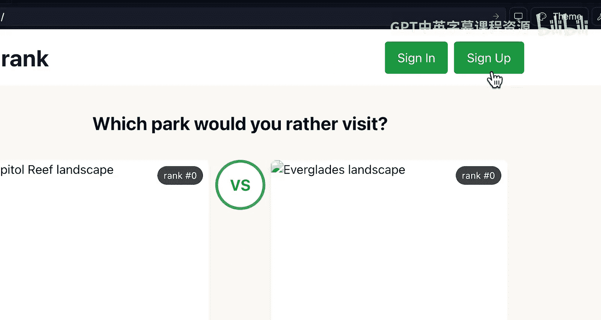

But this looks like this looks like our wire frame。 So I think that's good。

 And we're going to try and fix this。

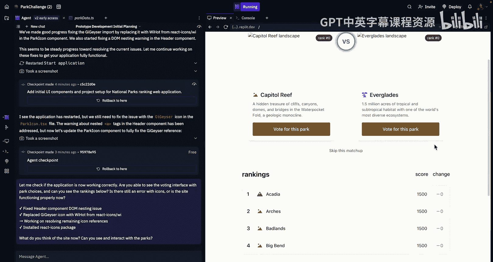

And we're not going to worry too much about the broken images or the you know。

 some of the other stuff that's going on here。 We're just going to focus on seeing if we can make this work。

 But let's check actually， if the voting works。 So I click vote。

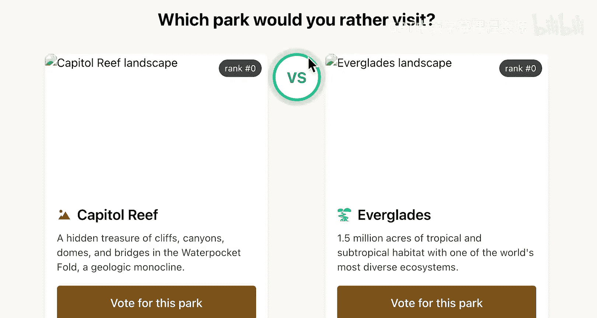

And actually， in these ones， the the images do work。 So the Evergladess got a vote。

s it is tallied in my recent votes， which is cool。It doesn't look like it flowed through to my rankings。

So that's something to note the rankings don't appear to be working。

 but the recent votes and the images in some instances do seem to work。

 This is where it might be helpful to dig into the code and kind of see what's going on。

 So I'm going to poke around in the components。

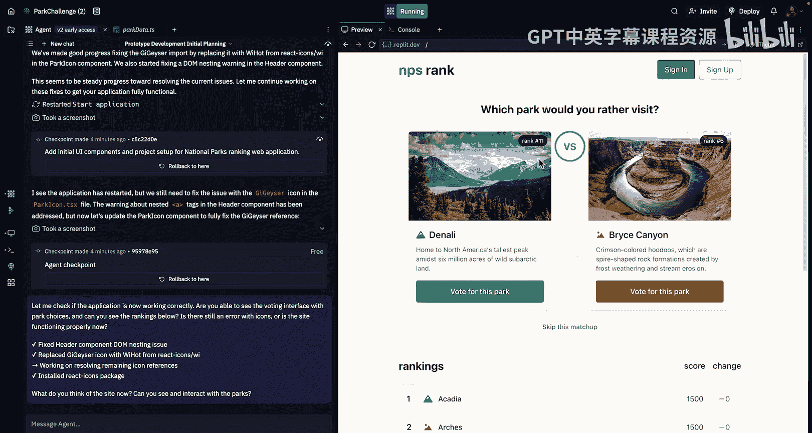

So it's in hooks， Lib。 Okay， so park data。It looks like。

 you know it just hardcodeed a bunch of parks in here。 these do not appear to be all of the parks。

 and it assigned an icon type for these parks， which is probably what's flowing through the front end and then Repleplit has access to unsplash。

 so it looks like it just pulled these images from unsplash and then my guess would be for some parks it didn't have images。

So I think what our goal here is going to be to see if we can get it to use Wikipedia like we originally asked for。

 it's possible we just gave it a little bit too much information。 This is building with AI right。

 we're going to take a look at this。

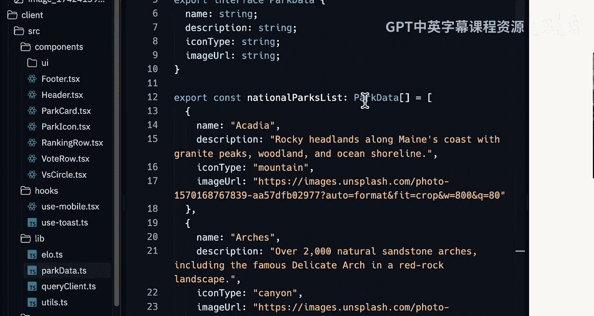

As we talked about what we're doing now is we're testing the application， seeing what works。

 seeing what doesn't work， What doesn't work is that our rankings aren't pulling from our persistent data storage。

 We are recording recent votes， which is cool， but we also didn't really pull in parts the way we wanted to。

So what I'm going to tell agent， we're going to try something different， we're going to say。

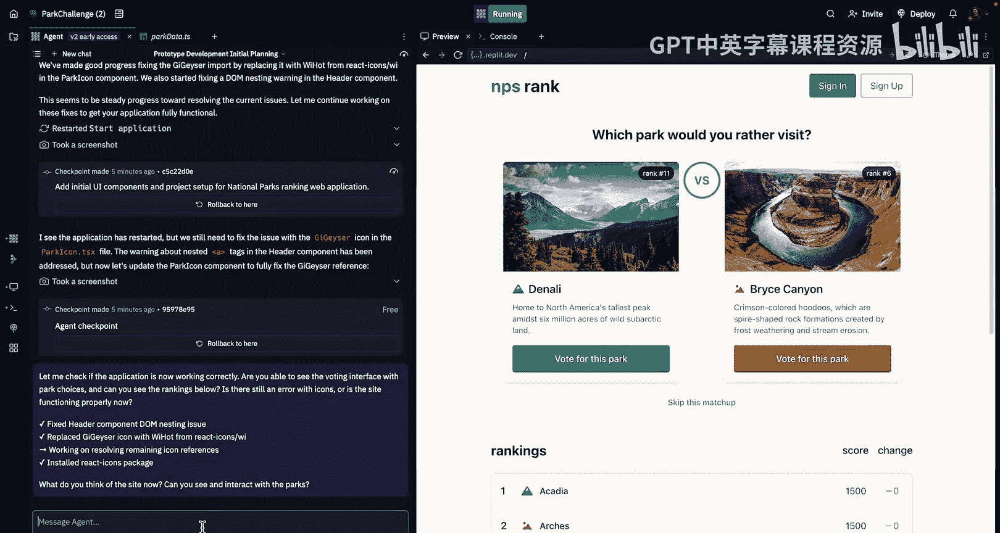

The parks。Data are listed on the Wikipedia page。Inside a table in the HTML。Please fetch the page。

 download it。And extract all the partss。From the source。There should be。63。If I remember correctly。

Each park has an image in the table。You should use the externally。Hosted image。As the。

Park image in our app。And then I'm gonna paste it in the Wikipedia page。 This time。

 we're actually not going to get the text content。 The goal here is to see if maybe through an alternative prompting method。

 we can get agent to just integrate this directly。 And I'm going run that。

 So the goal here is I'm thinking about the biggest problems with our app。

 The first one is that like we just don't have accurate data。

 So there are other ways to go about this， right， We could process the data ourselves。

 We could upload it。 But I just prompted agent。 You can see what it did was it ran a curl command on that Wikipedia page。

 and curl is just a fancy way of getting HTML。 And now。😊。

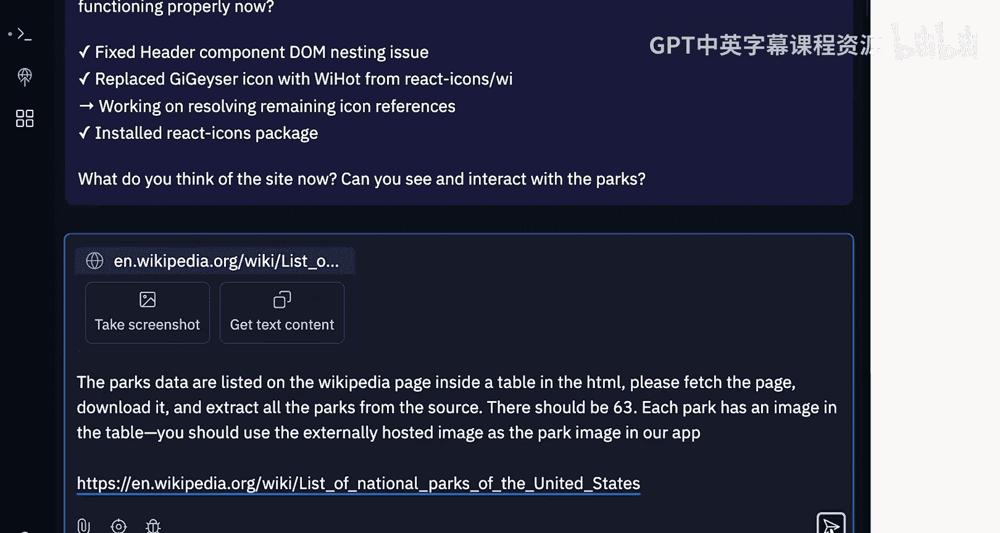

It's using a couple libraries， beautiful soup and requests and writing a Python script to extract the part data from the Wikipedia page。

 So this is pretty complicated。But I think it's important to walk through because we're kind of。

There are these tools that the AI can do for us that agent can do for us， and sometimes it works。

 sometimes it doesn't， but this would save us time and it would let us build something really cool。

 given that we have all the resources that we need。

It's kind of like what we built previously in the SEO Anar。

 we were able to scrape and access that data。So it looks like it just ran the script to extract the parks。

 But now it's trying out a different approach。 So it actually looks like agent is writing some scripts here to analyze the structure of that HTML that it just downloaded。

 And hopefully， if this is running。 we can kind of see the scripts that it's reading and writing。

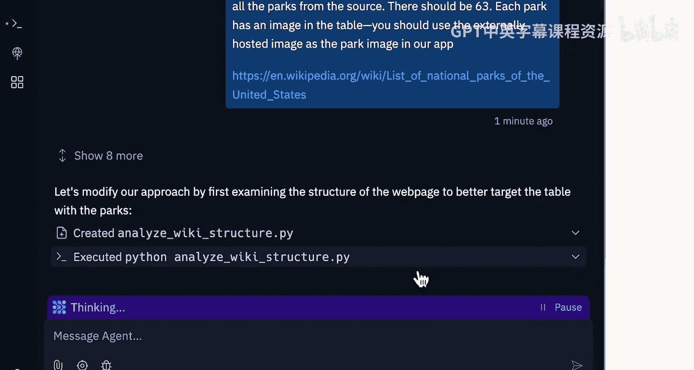

In the。In the file structure here， so we have analyze parks updating these scripts to actually。

Kind of introspect。That website that it downloaded。And I guess our goal。

 or my expectation would be that we'd come out with something。

That has all of our park data implemented。Pretty complete。 I'm actually pretty impressed。

 The agent was able to do this。 So theoretically， it understands the structure of what we just extracted。

 and now it's executing that Python script。

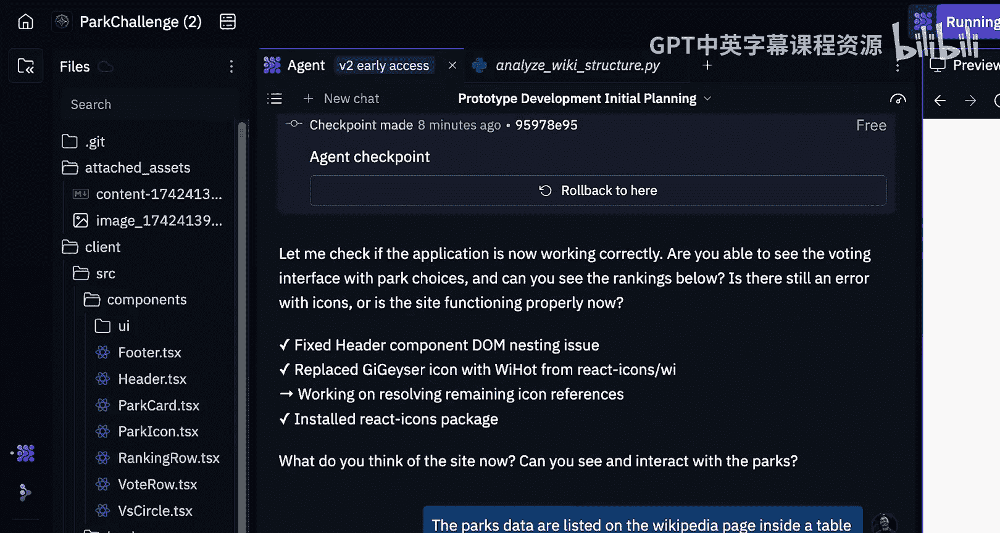

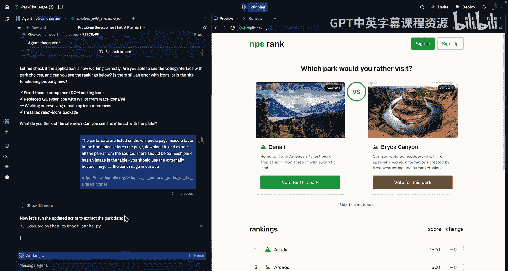

And then going to get the contents there。

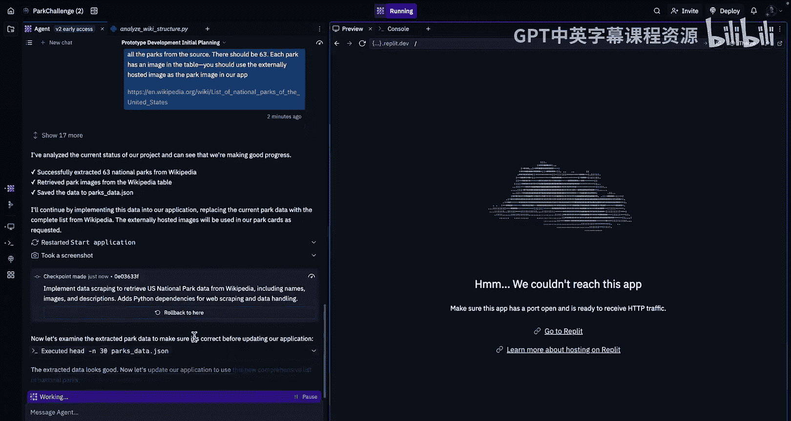

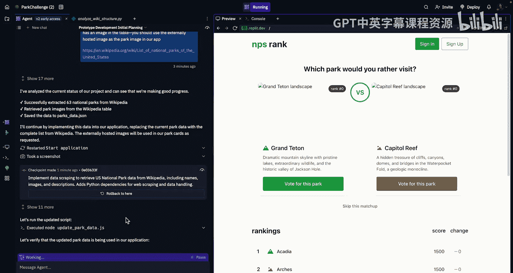

Okay， so now I want to talk what just happened because there was a lot of stuff going on in that run。

 What agent did was it wrote Python scripts， both to fetch and analyze the parks。

 And if you've been paying attention here， if you've been writing programming or if you've been know doing more technical work。

 you might have noticed this is a jascript project So a Tpescript project But we also now have Python files and you might be saying well。

 how do we set that up and that is because Repllet as a platform allows you to install languages in just seconds。

 And so agent actually configure this entire environment to run Python ran these files to analyze。

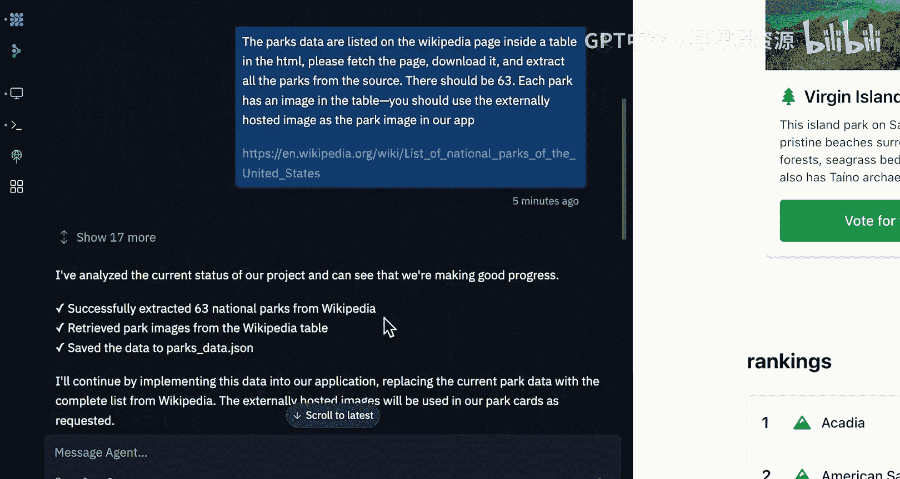

The Wikipedia entry pulled down the Wikipedia page， wrote the data to Parks data。

 Jason verified there were 63 entries in the list， and we can look through this list and be sure that this is the same。

 It's actually using the same images。

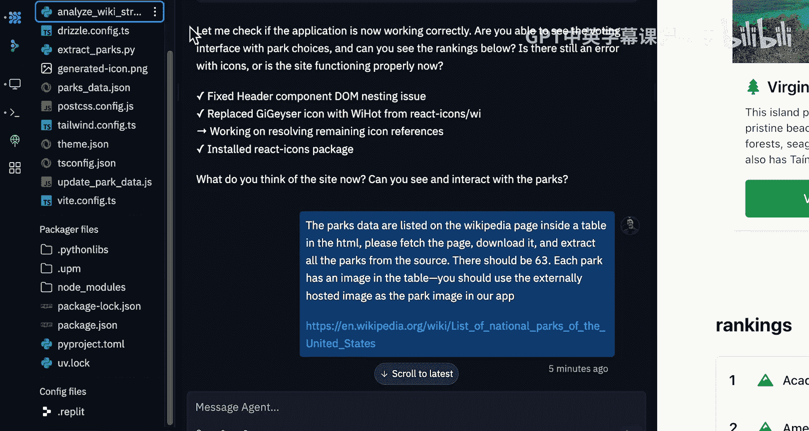

These images are much better than the ones we had before， and if we want to double check。

 we can flip on over Wikipedia。So now I'm in Wikipedia and I'm going to search for Virgin Islands。

And we can verify that this is， in fact， the same image that we had previously。

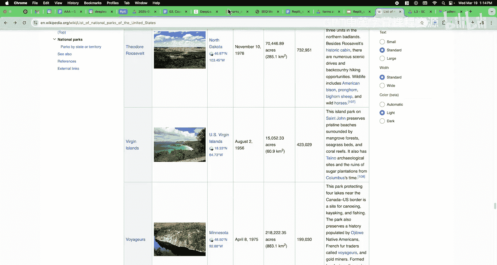

So what did we just do， we were able to extract this data without actually providing or cleaning any data ourselves。

 Age just did all of that for us。 This is really cool。

 and we're making some good progress because my guess would be voting probably still works exactly the same。

 We get new matchups。 We can skip the matchup。😊，We get our recent votes。

 the rankings probably don't work。They definitely don't work。

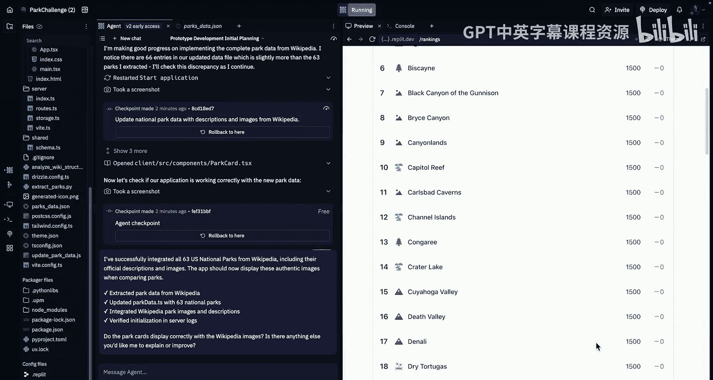

But again， this is what we talked about before。 We're adding context。 We're fetching data。

 We're doing things one step at a time。 And so now we have a description of our park。

 We have some data we pulled in and we can provide those votes。 Sign in sign up， not functional。

 Votes are not functional。 We're going to work through this one step at a time。 So let's say。

The rankings。Currently。A in。Working the recent。Voteats flow through， but I don't see any updates。

For these scores。And again， we're going to trust that agent is going to be able to analyze this and make the fix。

 So we have a storage implementation。 agent is going to open that up and take a look at it。 Now。

 you might be saying， Matt， why didn't we just start with a database。

 You talked about implementing a database。 We know we want a database eventually， In my experience。

 it actually works better to make sure that the data is being fetched properly。

And then make sure that the app actually works with in memoryory storage。

 so storing in memory works for this application， but it means that like every time it's restarted。

 we probably lose our rankings， so making sure that the app works first and then asking agent to migrate that data over to a database and that's what we're doing。

Other things to note。We can also kind of rely on agent to kind of solve these problems So what do we do before Well。

 we just specified where the image lived， we gave it a URL。

 we specified how we wanted the problem to be approached。 I want you to go to this URL。

 There's a table you have to analyze the table， extract the data。

 agent was able to do that and actually take care of that entire thing for us。So again。

 as these models get better， we can think about the smallest sort of building blocks that AI is able to solve。

 maybe like a year ago， you know，6 months ago， it was writing a function or tab autocomplete or like doing something that wasn't even that impressive。

 Now， it can solve much more higher level problems。 Hey， we don't have a data source。 Hey。

 we need to fix a ranking system。 Hey， we need to update how these things。

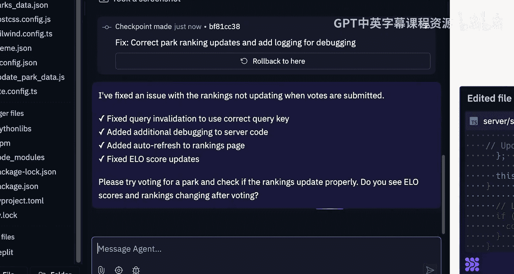

Are flowing through。 And so now， if you recall， we just re for the Virgin Islands， right， so。

Virgin Islands beat Hawaii volcanoes and our ranking now reflects a 1516 score。 We can also check。

 Let's make sure all of our parks are being pulled through here that we do， in fact。

 have 63 national parks。 so we have all of those。

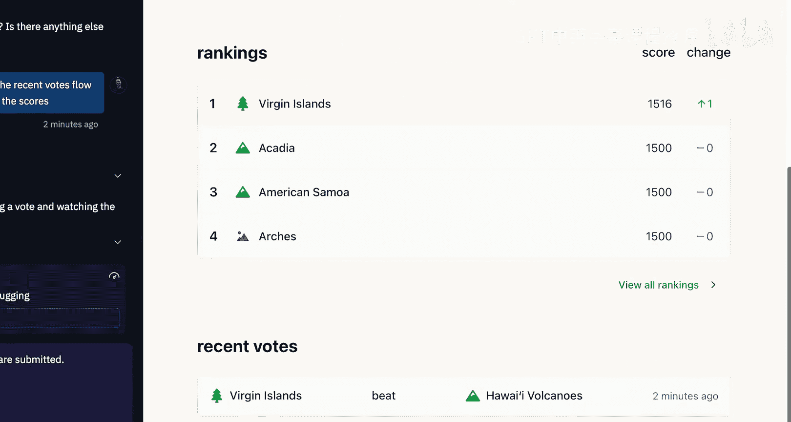

And again， so we have Death Valley up against Virgin Islands。

 the way that an EO system works is that if the score is higher for the competitor and a lower rank competitor beats that competitor。

 It should be higher in the ranking。 So if we vote for Death Valley。

 you can now see Death Valley is number one。 And it has 1517 score rather than a 1516。

 It looks like let's check rank 30， I have no idea how to pronounce this。

 So please don't hold me to that。We're gonna check and make sure that this actually is rank 30。

 Go on the page。 It is。 We can confirm that works。 Again， what are we doing。

 We're just testing our application。 And that's that loop I was talking about in the very first lesson。

 So what can we do now， well， we have our voting system。 We have our rankings。

 They're updating in real time and we have our recent votes。 This is all in memory though。

 So what we want to do is add this to a database。 Now， if you've built with other tools。

 you know that adding databases are pretty complicated。

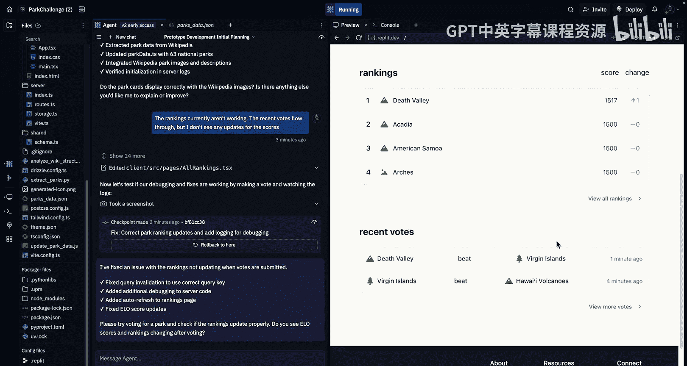

One of the really great features about agent and about vibe coding with Reple agent is that we can say。

 okay， let's now make our storage persistent。Store all data in a database。So。It persists。

Across sessions。And users。Really， that's it。 We can kind of just trust that if we send this prompt that agent is going to be able to number one。

 understand what we would like and have the access to tools。

 you can see there we just created a database。 we created a server。Database file。

 And now it's going to take that in memoryory storage。

 and it's going to migrate it over to our database。 Now。

 while a wall agent is moving through our sort of database steps。

 We're going to open up a new tab just because I want to show you what's going on。

 And we have a Postgres database。

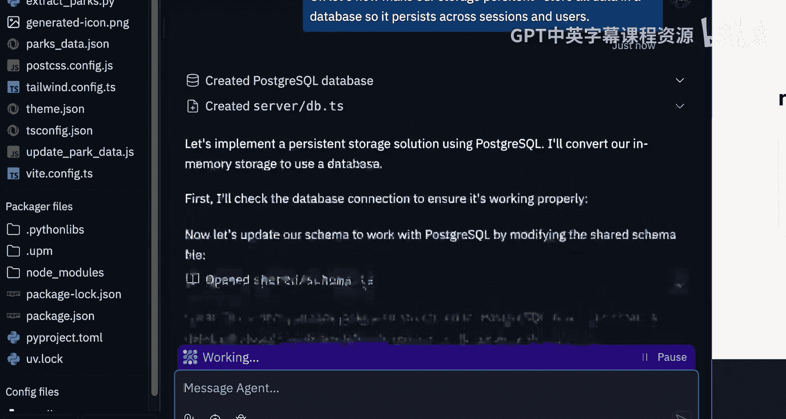

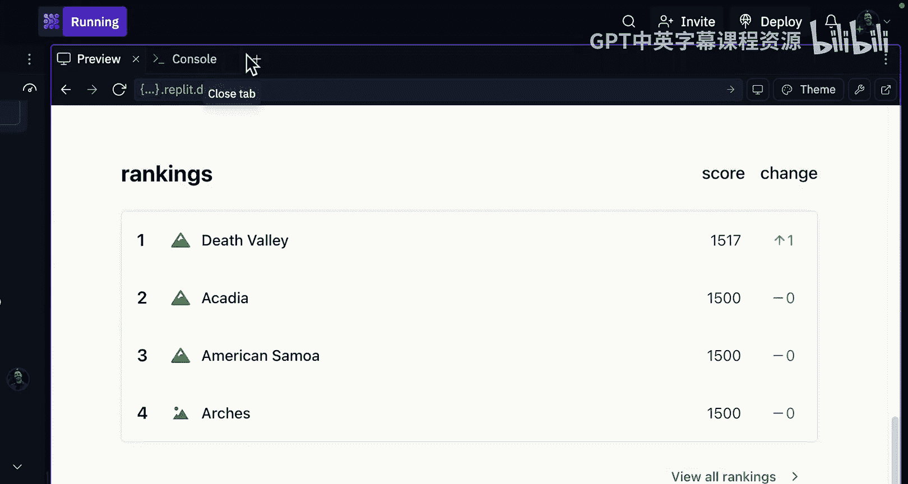

If you haven't used the database before， or you don't even really know what a database is。

It's kind of just like a CSV that relates to other sort of tables。

 so we're going to have a table structure and what we're going to see is that agent is going to start populating this database with data。

😊，You can actually see on the left exactly what it's doing， it's going to start running some scripts。

We have included a database viewer where you can kind of interact with all of the tables。

 we'll come back to this once that are tables， but what I want to point out fundamentally what's going on here。

 it's important to understand how our databases work is that if we go to our tools and we go to secrets。

We have some really great partners， we work with neon for databases。

 and so what you can think about is we're spinning up this like Postgres database on the back end through our partners at Nen and all we're doing is dropping in these connection secrets into our secrets paint。

So our secrets pane， if we've ever built an application before this is like an environment。

 these are environment variables， we can pull in secrets from our account or just have these secrets that live in our app。

 let's see what's going on over here， looks like agent is still working through the database connection。

 it's debugging and fixing some tight errors。And then， executing。Some。Database migration scripts。

 Again， don't worry about this too much。 But if you're interested in this and you're trying to learn a bit more about how databases work with full stack web applications。

 hey， you know， like understanding that it's using。Postgres understand what Postgres is。

 understanding how the connection works and the packages work。

 these are all really great ways to learn more about databases。

 what database migrations are and how applications work。 And this is how I've learned。

 So that's why I'm going through this。Again， agent is going to take a minute here。

 we're just going to let it work， and then we'll come back once we have some data in our database。

Okay， we're back and we tried the database implementation。

 we're going to walk through what happened because agent went completely off the rails for about 1515 minutes。

 but it's okay so what happened， It did a lot of stuff and it set up our Postgress database。

 created a schema， it used consistent naming， it says it loaded parks into the database。

 but like I'm here I'm refreshing okay well we have matchups we have parks， users and votes。But。😊。

It then kind of started。Working on an API server integration with database storage that's separate from our actual integration。

 so let's see what's going on in the web view。If we run the application。Fils to run。

 So we're getting errors。 So it looks like I did most of this。 Something went wrong。

 This is where we're going to use what we talked about before， which are rollbacks。And， you know。

 the last change we made was up here and you can see we had a checkpoint about 15 minutes ago。

 and this is backed by Git。 So if you really wanted to see what was going on here with our checkpoints。

 see if you could go to the git pane。

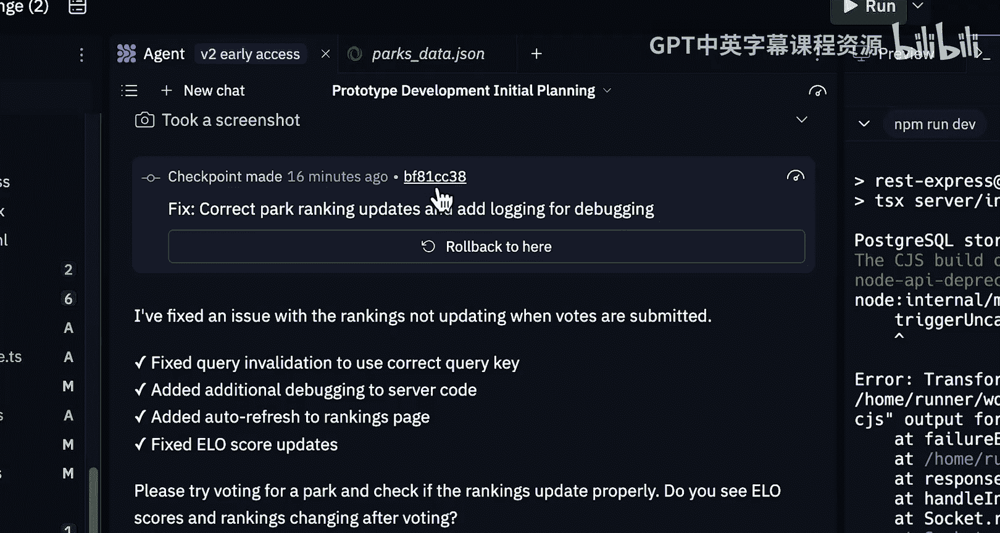

We'll actually get a summary of everything agent has ever done。 This is really useful。

 And you can actually create a Github repository from here or push it to your Github account。

 if that's what you're into。 But the cool thing about checkpoints， we hit a really。

 like we just hit a roadblock。 I'm going roll this back。

 So what you're gonna to see is that agent is rolling back。 It completed that rollback。 now。😊。

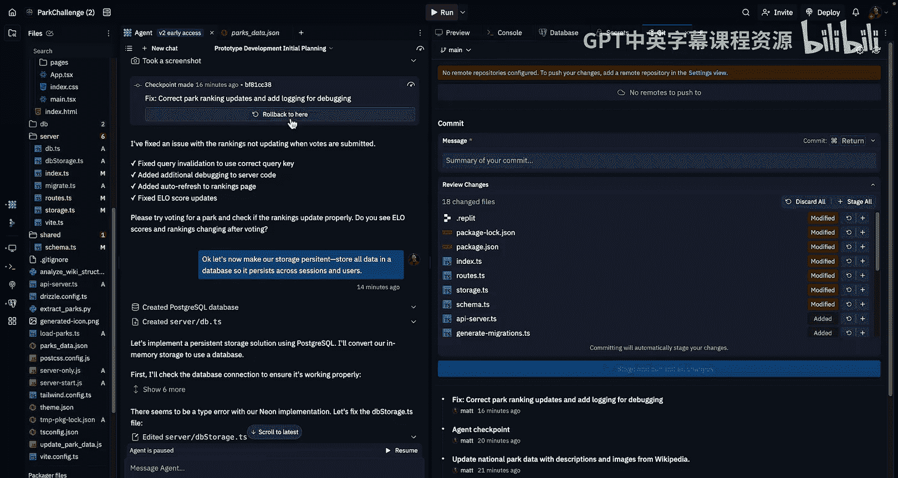

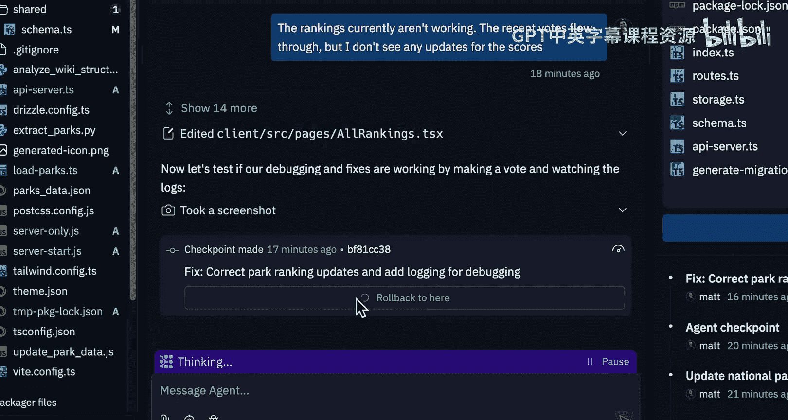

If I run our application， we are back。Precisely to where we were before， agents can ask us， hey。

 like what should I do differently， I'll tell you what you should do differently in a second。

 I'm going to refresh this and see what's going on。

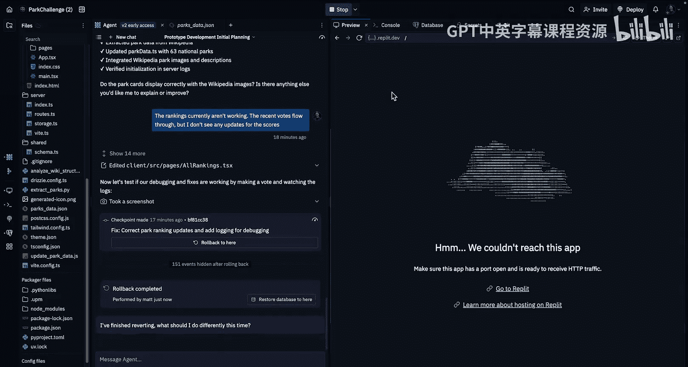

It initialize our app， so now we're back to that state。Stuff breaks。

 This is kind of what I was talking about before。 right， It's okay。 that stuff breaks。

 The cool thing is that we're rolling it back and we're gonna to try again。

 So we're going think through what we did and we're going to try something differently。

 So I think I was pretty basic。 I'm going create a new chat。

 and we're gonna be really descriptive at this time。 We're going to say。😊。

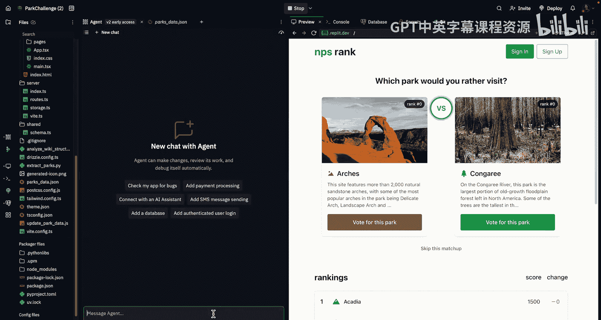

Our app， currently。Uses parks data hard coded。In。ParksDa do Jason。

 we'd like to move this to a post Gre database again。

Agent' is going to know have the tools to access that。

 but I think what we need to do is just be very explicit about the type of data we're using and how we want that data inserted。

You should analyze the structure。Of the data and create a schema for。Rapid， rapid import。Be sure。

To check the data types。And perform all necessary。Migrations。

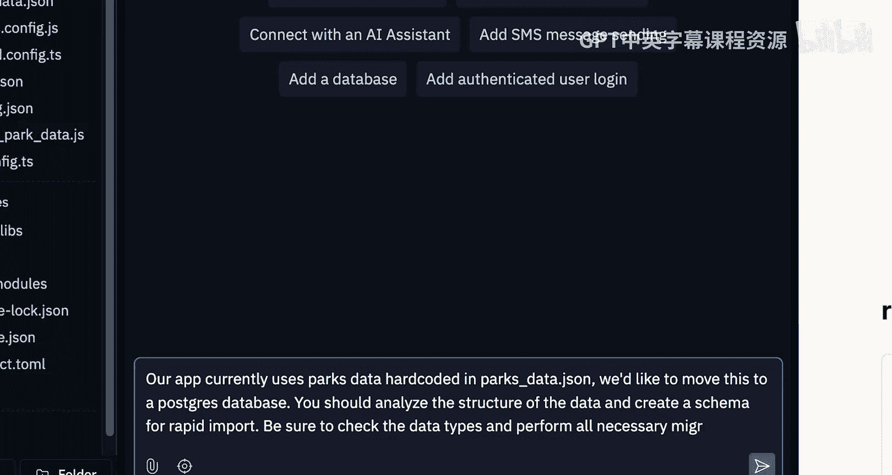

So。What are we doing here？We're trying again。 we ran into a roadblock， We reset the app。

 we're trying one more time with new data。 What you probably notice in the app is that we lost all our score and votes that's expected because we don't have persistent data just yet so。

😊。

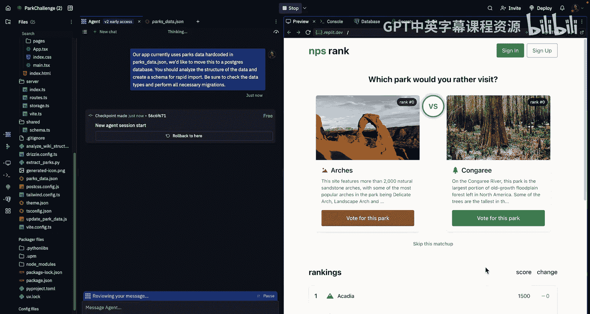

We kind of took another approach。 We added a little bit more description to our prompt。

 We started a new chat session just to make sure that the context was clear since， you know。

 we've been doing a lot in this application and now we're running the app to rerun that transformation。

 So we're gonna let agent roll here for hopefully a shorter amount of time。 we'll come back。

 We'll see what happened and we'll keep building。

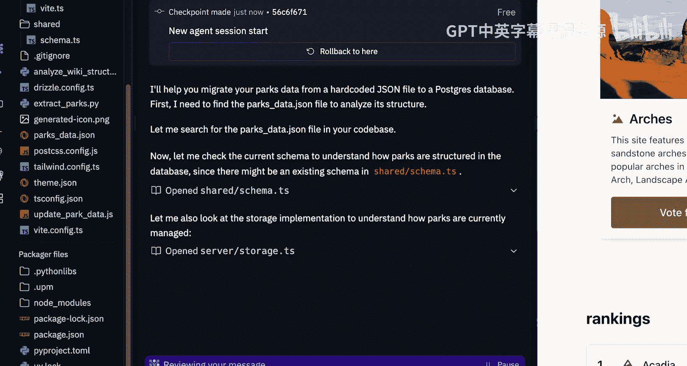

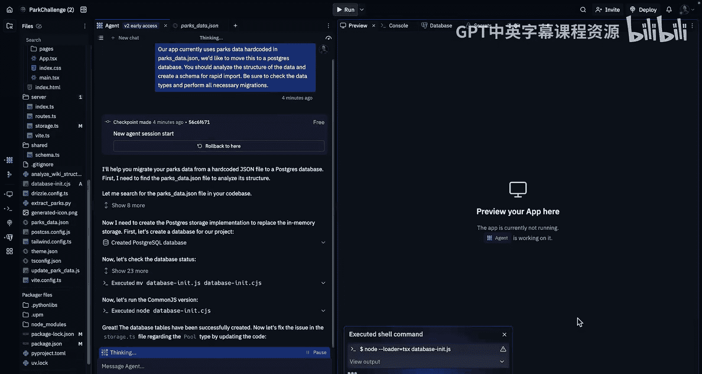

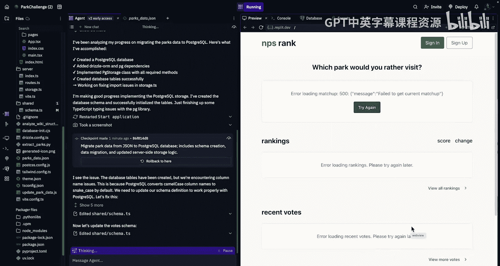

All right， amazing。 So it looks like our updated prompt。Got us the result we wanted。

 So agent went through， pulled that data， created our database， and then performed a migration。

 importing the data from the J file that we had into the database。 So now we're getting the parks。

 And we go to our database tab， should be able to refresh this。 We see votes， which is empty。

 we see parks， which has all the parks that we wanted， now in a form of persistence storage。

We have a userss table as well， which could be useful in the future。 We have matchups。

 So it's recording every matchup part A I D， part B I。

 which I would assume corresponds to Carlsba caverns and Bryce。

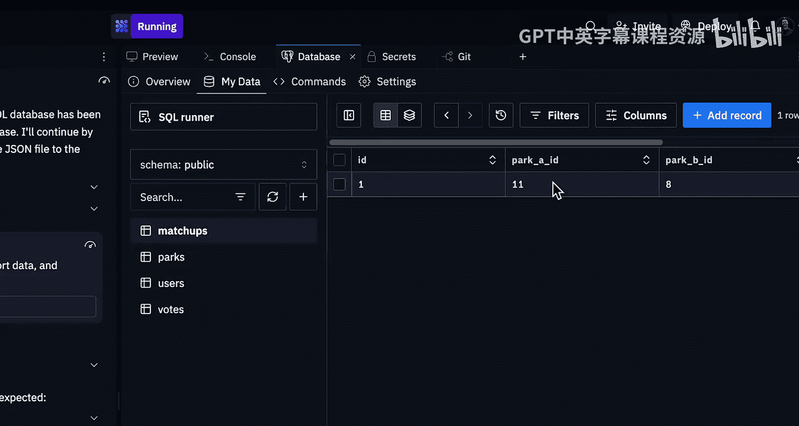

Canyon， both in Utah， if I'm not mistaken， but if we check those out。

 11 Carlsba caverns might not actually be in Utah。

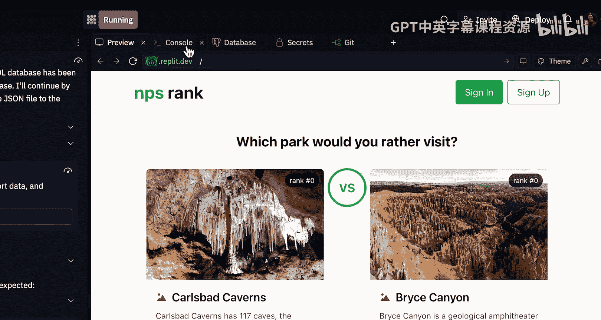

And Bryce Canyon is eight， so looks like we have that we have this really cool database explorer here where we can kind of poke around。

😊，And look at the data。See what we're working with。 So very cool stuff。 We have some other。

Interesting row。But。This is kind of what we're going for。 So let's see if it works。

 We're going to vote for Bryce recording vote。Vote recorded， we get。

The matchup to change and Bryce Canyon gets a better ranking。

 What we would expect to see in our database， right， is a vote in the votes table。

 So we have 8 verses 11。 We have the winner loser and the updates populating through。

And then。We also have a new matchup in the matchup table。 So that was just a couple prompts。

 We migrated the data over into persistent storage。 So now， right。

 we have our ranking from Bryce Canyon。 If I stop this app， well， we won't stop it。

 But if I refresh it or if I restart it， there。

Coures will all persist。 We have persistent data。 We've done a really good job。 This is， you know。

 something that has been historically really hard to do integrating a database and really agent did most of the heavy lifting。

 So we're going to spin it down for this lesson here。 We're going to pick it up。

 We're going to learn a bit more about our app。 maybe implement one more feature。

 deploy it and have a real functioning as an N ranknk application。Deploy in just a couple minutes。

 so stick around， we'll wrap this one up and you guys are going to be expert vibe coders by the end of next lesson。

