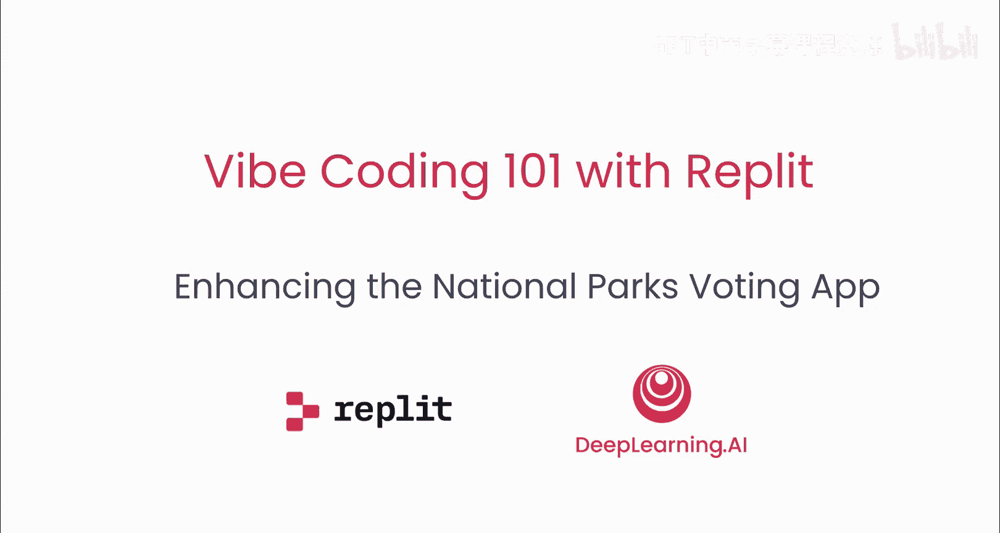
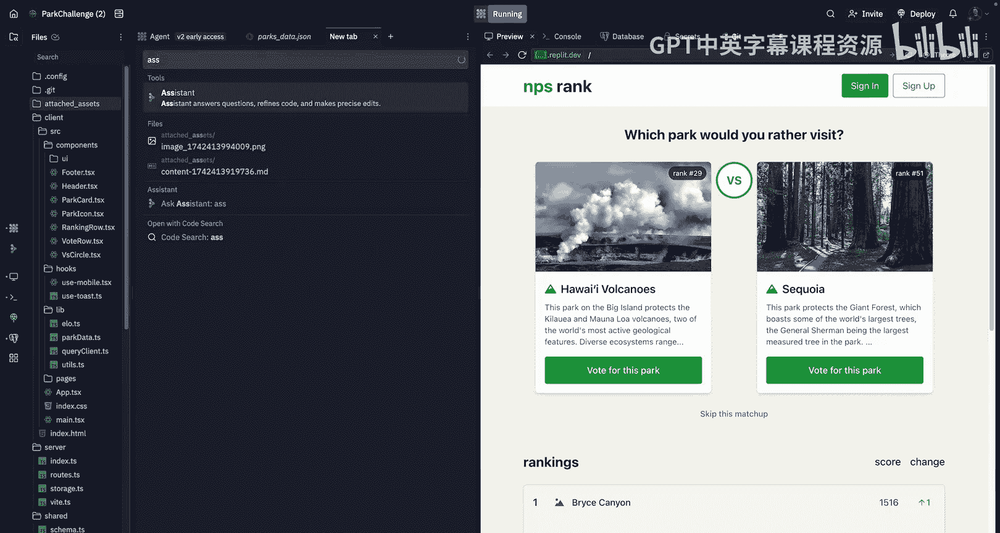
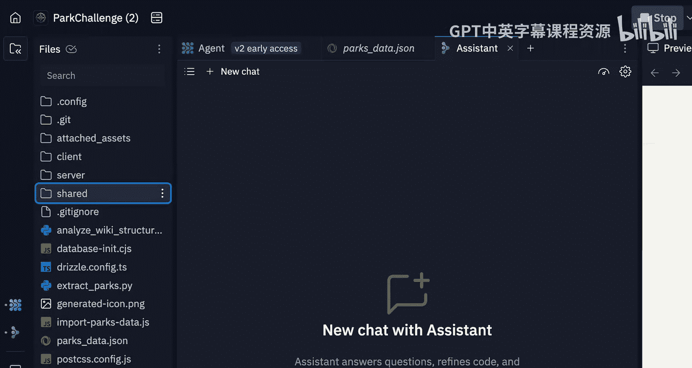
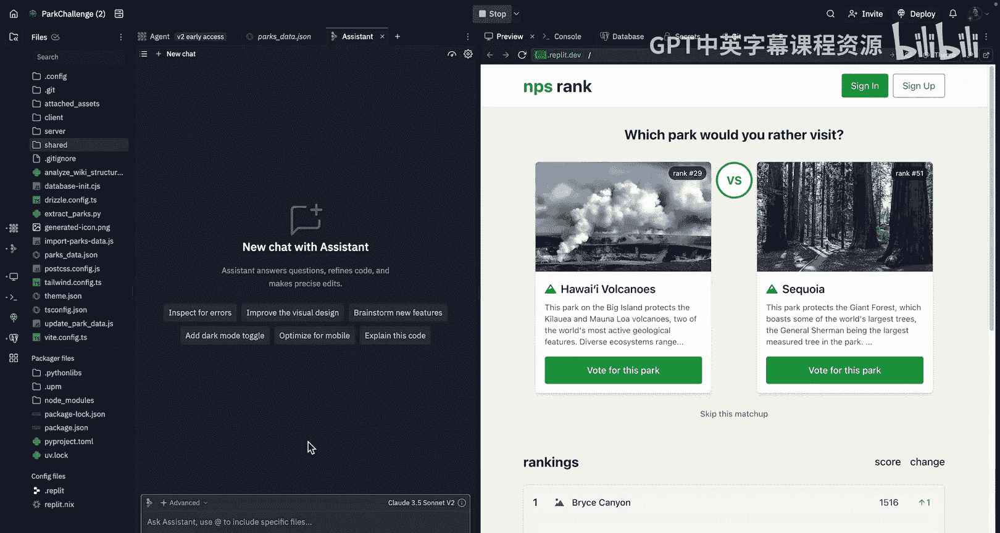
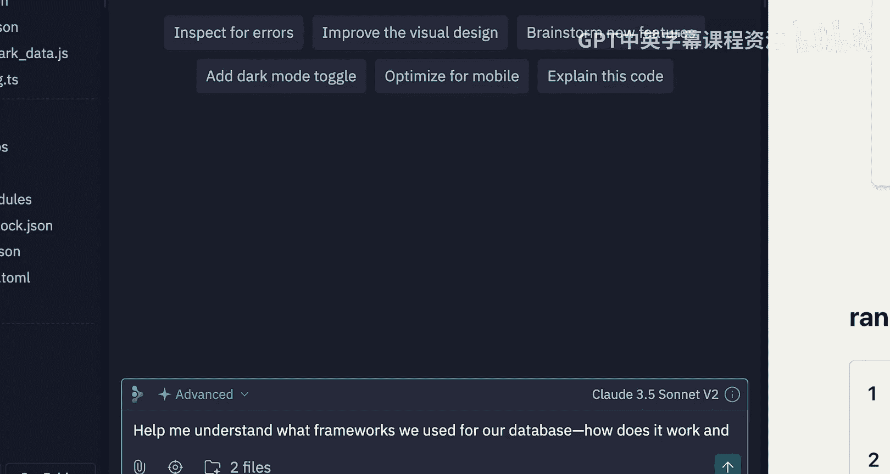
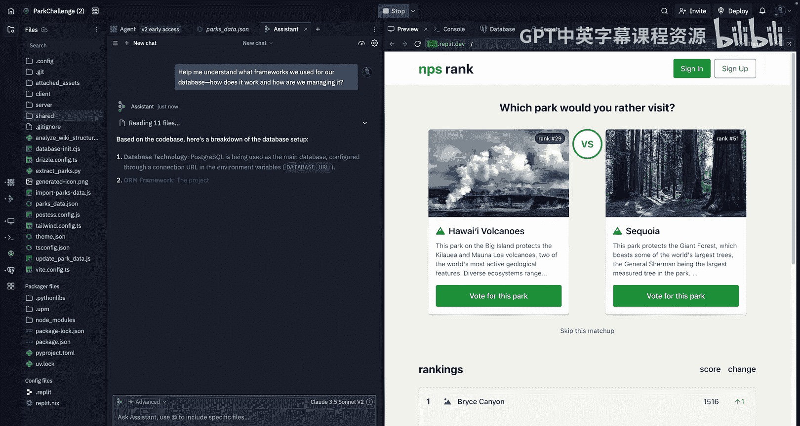
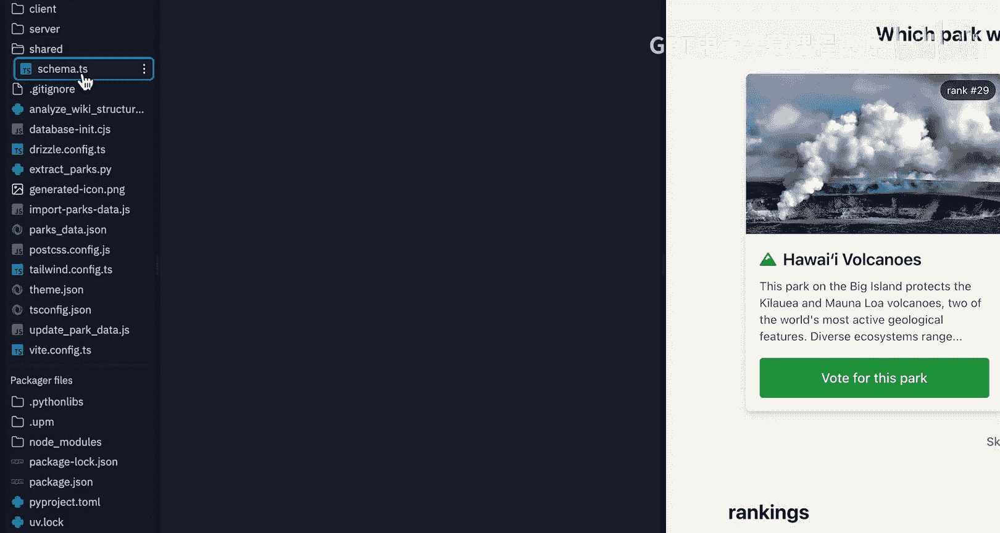
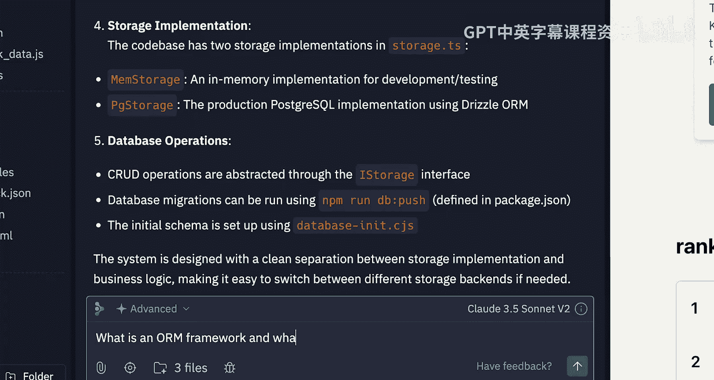
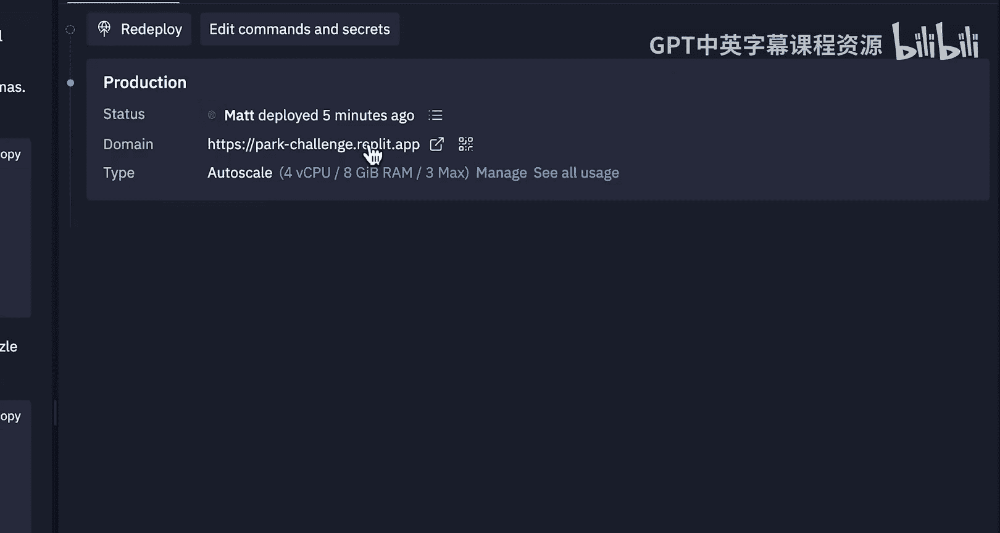
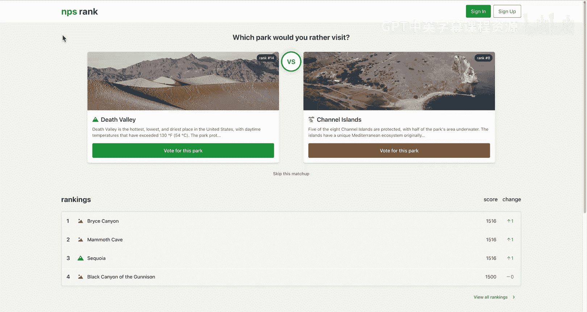

# 吴恩达《用Replit进行氛围编码｜Vibe Coding 101 with Replit》中英字幕（deepseek-R1 - P6：6.enhancing-the-national-parks-voting-app.zh_en - GPT中英字幕课程资源 - BV13CZgYqER1

In this lesson， we'll refine our National parks voting app by integrating our complete dataset。

 We'll also add final features with agent and assistant to ensure everything works correctly。

 then we'll deploy the application for public use When the last lesson we built out our park ranking head head voting app here。

 We got all the functionality implemented。 we have our parks being stored in a database。

 We kind of got this nice little ranking table here along with our recent votes that are being stored in Postgres。

 Now we're going to add some additional functionality。

 we're going to understand how this works and then deploy our app。

 but on that last agent Ron and9lia， I kind of zoned out。 and so I kind of missed。

I missed exactly how things were being implemented。

 So what I'm going to do now is I'm going to head to assistant。

 and I'm just gonna ask it to help me understand how my project's working。 Again。

 you're gonna see the the preview refresh as we switch to assistant mode。 But I see client。

 I see server and shared。 but like， I don't know much about databases or how we implement our database。

 So I'm just gonna to ask assistant help me understand。😊。

What frameworks。We used for our database。How does it work。And how are we managing it？

And again， I think frameworks are important， something I've been emphasizing throughout this course and understanding what we're building is important because as we get into these debugging issues。

You need to understand how to solve these problems and how things work in order to solve those problems。

Assistant basically just gave me a recap of everything agent just built。 We're using Postgres。

 which is a main database， configured through a connection URL in our environment variables。

 which we talked about。 Co。 We're using an O RM framework called drizzle O RM。

 which is a Tscript first O R M。 I have no idea what that means。

 We're going dig into that in a second。😊，We're also doing some schema management。

 so we're defining that I can actually look through here shared schema。

Okay， cool。 like this is。Defining the parks table and all of the columns there is defining a vote table need。

Actually walking through our tables and the code base has two storage implementations and in memory implementation。

 So this was like our old dev implementation。 We could clean that up if we wanted to。

 So a good call out。And explains how these things work。 Now， what was that to just walk this through。

 I don't really know what an O R for M framework is。 So I'm going to say what is an O RM framework。

And why would I use drizzle。

All right。This is exactly how I've learned to code how to build with AI and basically everything that I'm showing you today。

 I just ask a bunch of questions and， you know， assistant uses the latest models we're just asking questions and understanding kind of what's going on。

 So assistance is going to actually tell us here。Exactly what our RO orRM is。

 Ob relational mapping is a framework that lets you interact with your database using programming languages as objects instead of writing raw SQL queries okay。

 so we're using objects instead of writing SQL or SQL。

 which is a language for interacting with databases。So it's actually telling us some of the benefits。

 types Ay， schema management， query building， schema validation。 Okay。

 maybe I don't know exactly what these things are， but I could keep digging into them。 So really。

 the goal here is just to help you understand。Hey， I don't actually know what this thing is。

 I don't really know what's going on， but I can learn， and I can ask AI。

 and I can use that as a way to kind of reinforce the things that I'm building and to keep iterated。

 So just like that， assistant helped us understand how our application worked and maybe even learn a few things about drizzle about Postgres and some of the tools that we're building with。

 But I've been really impressed。 I like how this works。 We have an application。😊。

Where we can vote for parks， the parks are recorded in our database and we get our ranking system。

This is exactly what I wanted。 and it's really cool T interactive。

 We actually pulled the data and these images from Wikipedia。

 So pretty complicated app here of some data manipulation， visualization。😊。

Kind of extract transform load type stuff。 So now we're going to go ahead。

 we're going to deploy this。 just like last time we're gonna to use autoscale。

 we're going to approve those settings。 And this time you'll notice that we have secrets for our database right So if we're going to deploy with APIs or external services。

 we' pull those secrets through as well。 We'll call this one park challenge。

 I think that's available。Ends we're going to go down， we're going to pull it。

And just like last time。Rebelit is going to build this deployment。

It's going to configure everything and promote that to our production environment。

 there's really not much we need to worry about。Since we built the entire thing out。

And typically in development， it's really hard not only to recreate your environment in the cloud。

 but then to add in those external services to add in databases and manage those databases in a separate environment or do a bunch of other stuff。

 right， And so what we have here is a database that's directly integrated into the environment。

 as we talked about before， our app kind of installed a bunch of stuff for us that ran some Python scripts import data。

You know， agent configured this database that embedded into our application and we didn't have to go anywhere。

 We didn't have to go to another tab。 We didn't have to set up another account or input an API key。

 We just did it all from writing in Relet。 And so the power of building with agent。

 the power of building with assistant is that we're able to make these applications。

 these full stack applications that have databases that have front ends， and they have backends。

And really build complex tooling from one pane。 That is vibe coding right We did a lot of planning。

 We did a lot of discussion about tools and frameworks。 But for the most part。

 this looks a lot different from coding or or building otherwise。 There's a lot of vibes。

 We're just kind of going by field with the debugging and we're going by field with like how we manage context。

 So I'm gonna to let this deployment wrap up。 We'll come back。 We'll finish it up。

 make sure our application works and we'll move on from there。😊，Cool， so we deployed our application。

 we get a URL and it's deployed as an auto scale deployment again。

 if you want to learn more about that， you can check out our videos or the documentation。

Opening the app we get exactly what we had before， I can vote on Mammoth cave and actually it's important to note that the same scores pulled through from before。

That's because we're using the same database， so we have our voting system。

 we have some recent votes and we have our rankings that are being stored persistently in our database as I kind of talked about。

 this is the power of uplet we just deployed this live on the internet for anybody to access if you want to share with your family or friends。

 you can do just that。And yeah， you know， end to end， full stack application， persistent storage。

 vibe coded all the way。 So in our next lesson， we're gonna talk about next steps。

 We're gonna talk about where you go from here。 But thanks for joining along。

 Thanks for building some cool apps。 Let's， let's wrap it up。😊。

