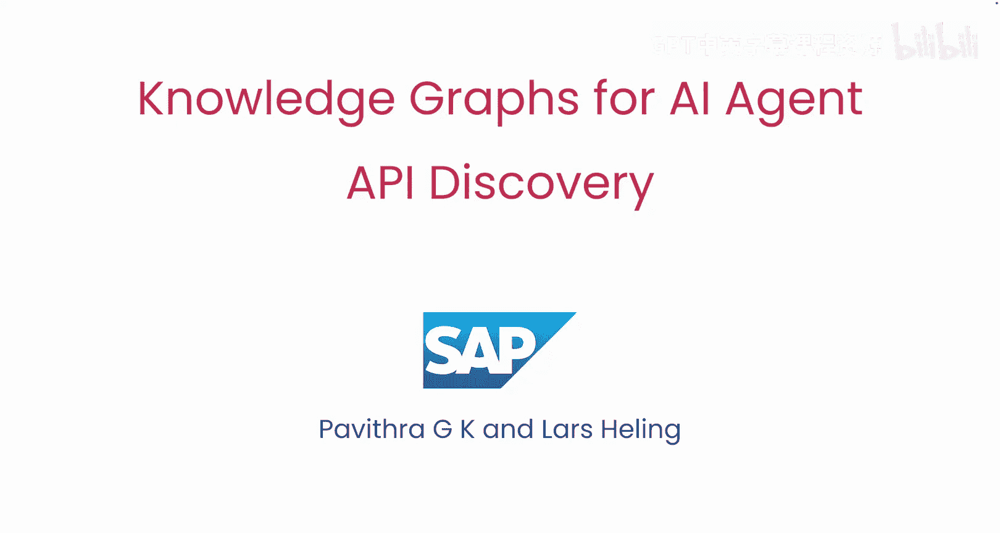
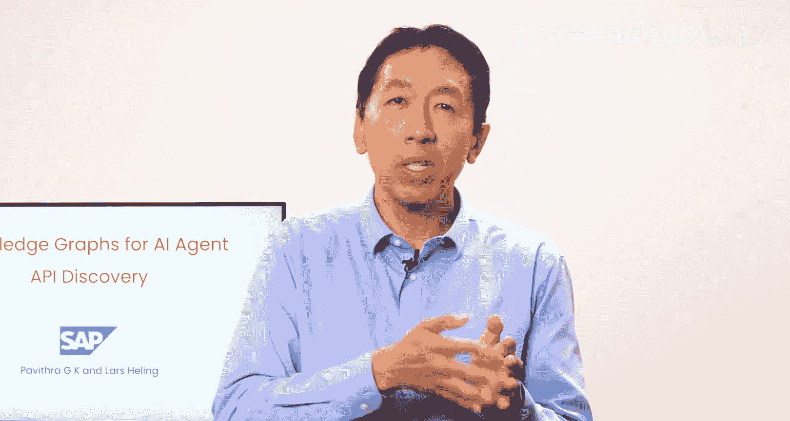
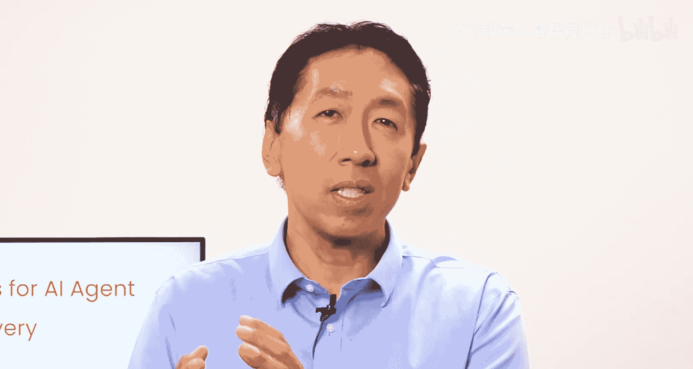
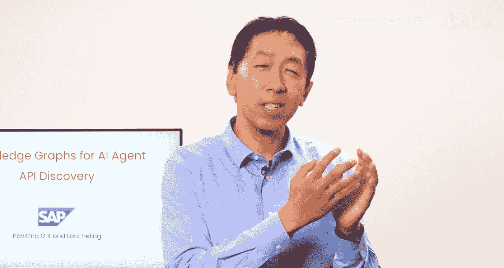
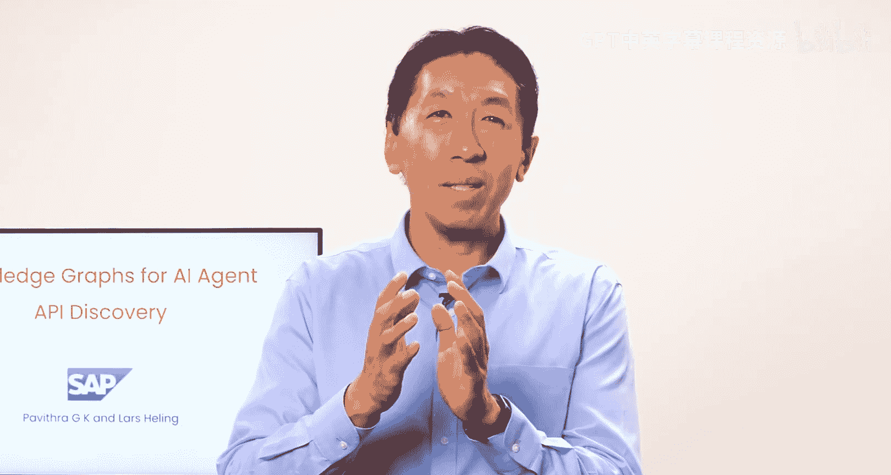
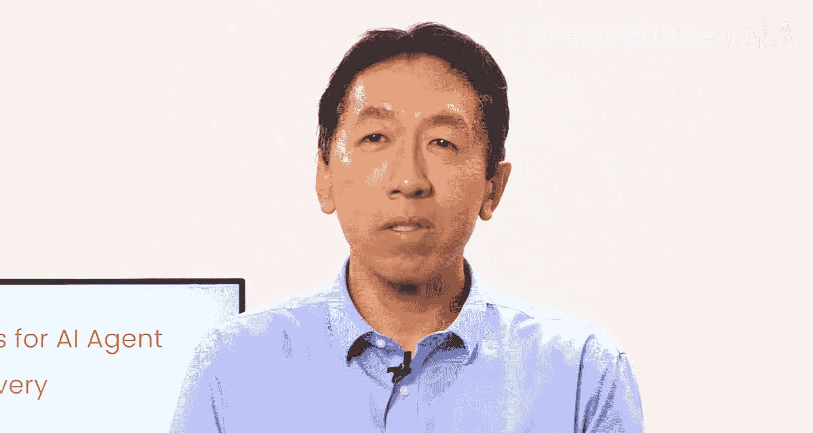
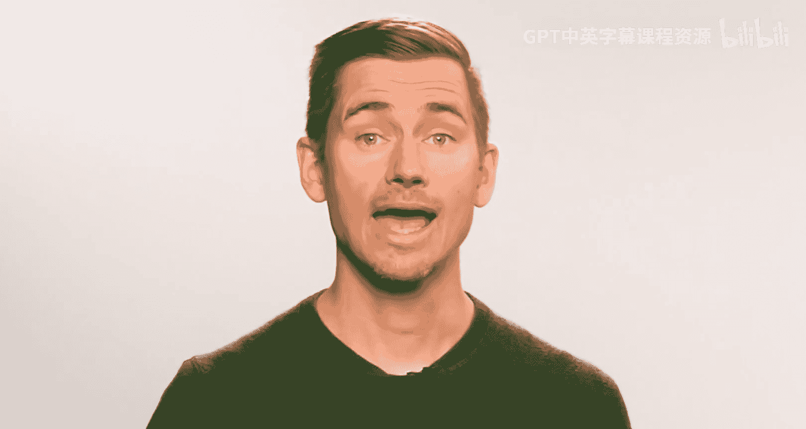
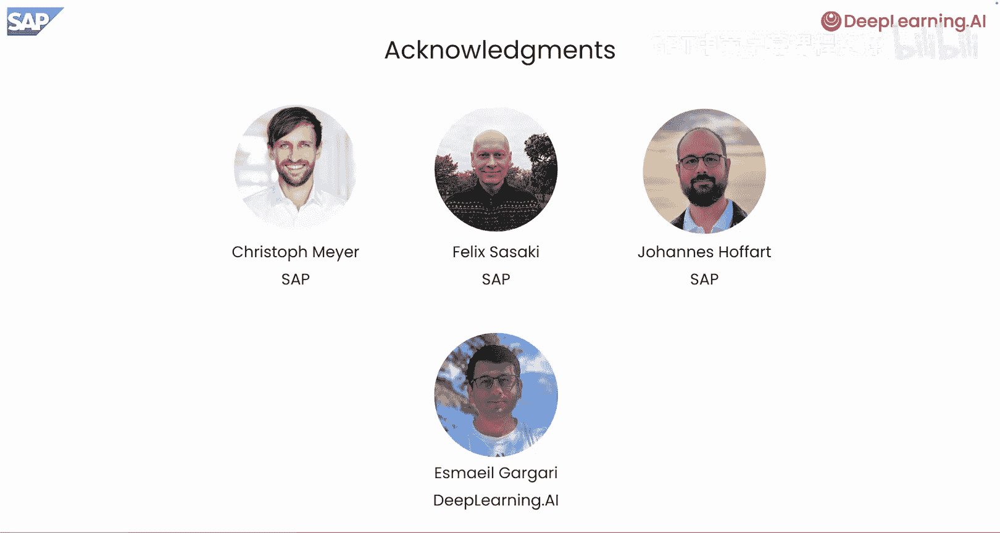
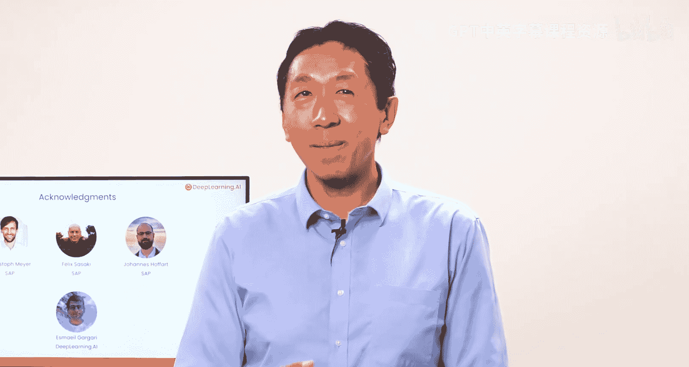

# 吴恩达《用于 AI 智能体 API 发现的知识图谱｜Knowledge Graphs for AI Agent API Discovery》中英字幕 - P1：1.introduction.zh_en - GPT中英字幕课程资源 - BV1ixpUzuEJK

Welcome to Knowledge Drs for AI Age API Discovery taught by Perfka GK。

 who is Head of Business knowledgeledge Ds and La Healing。

 who is Se knowledgeledge engineer at SAP Business AI。

Lch businesses may have thousands of APIs that have been made available by many different teams to enable other teams to carry out many possible tasks across the business for example。

 APIs are help buy or return an item or request travel approval or request IT approval for accessing data and so on。

I think it's great that people are building so many APIs for AI agents。

 but this actually makes it hard for AI agents to figure out which APIs to use and in what sequence to carry out a complex business process。

In this course， you learn how to solve this problem using knowledge draws。

To help an agent use APIs you bring raw API specifications into a knowledge draft This gives a structured view of all the APIs。

 Additionally， you add information to the draft to tell what is the right order in which you should call the APIs Take the example of an agent giving the task of purchasing an item it might search for and find the purchase order API as the most relevant API and maybe want to call that API to place the order but here at the agent might be unaware that in a big company it first needs to call another API to create a purchase request which is then to be approved by the IT department before finally it places the actual order this process information that the steps needed are to first generate a purchase request then get IT approval and then finally call a purchase order API this information may not be available in the definition of the APIs and without this type of information your knowledge draft and your agent's ability to。

Understand this important business process workflow executed will be incomplete。That's right， Andrew。

 to capture this， you will extend the knowledge graph with process data。

 This turns your graph into not just a list of APIs。

 but a network of how they are connected in real processes。

The agent is now aware that the purchasease request API needs to be called first before calling the API to create an order to give the right APIs to the agent to perform a given task。

 you will start with the semantic retrieval。 you will embed all the APIs and their specifications。

 and use similarity search to find the best matches。 For example。

 if the agent wants to create a purchase order， it will retrieve semantically related APIs like the purchase order API calling this API directly will not be the right action as the business process might require the purchase request API to be called first for the approval of the purchase by a manager。

To solve this， you will extend the search on the knowledge graph to find and include related APIs that the business process requires。

 This will give the agent all the necessary APIs and the order in which they should be called in the last lesson。

 you will put all of this together to build an AI agent that can carry out real tasks while following the correct process sequence Many people have worked to create this course。

 Id like to thank Tristph Meyer， Felix Sasaki and Johannes Hoofffat from the SAP team from Deep Blalinda AI。

 Eshma Gvari also contributed to this course。😊。

Businesses have complex and important processes to get work done。

Implementing a gen workforce to carry out these processes is a huge part of the work that lies ahead for the AI community。

 and giving this right is an important problem。The first lesson will be an introduction to knowledge drafts。

 what they are and how to use them to help agents understand and follow complex multis processes。

 so let's go to the next video and get started。

