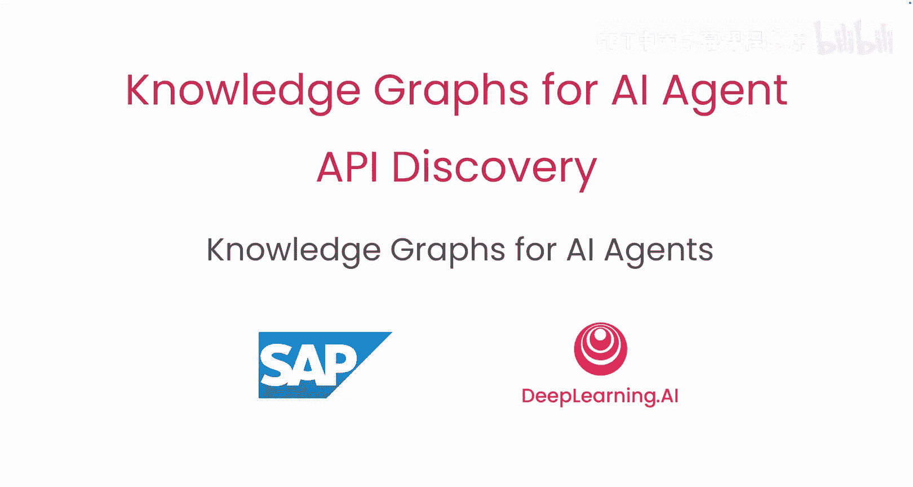
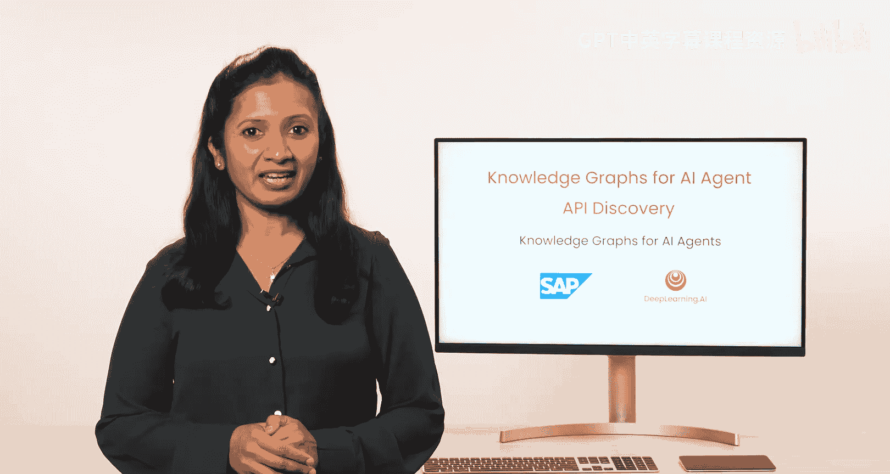
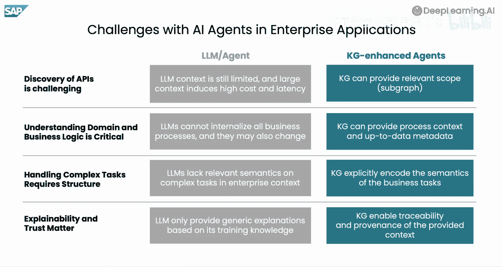
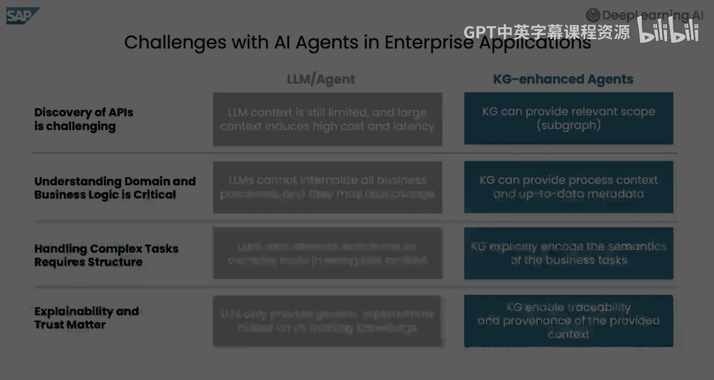

# 吴恩达《用于 AI 智能体 API 发现的知识图谱｜Knowledge Graphs for AI Agent API Discovery》中英字幕 - P2：2.knowledge-graphs-for-ai-agents.zh_en - GPT中英字幕课程资源 - BV1ixpUzuEJK

In this lesson， you will learn what knowledge graphs are。

 various methods to construct them and how they enable AI agents with better API discovery and execution in the context of enterprise applications。

 Let's dive in in order to see how knowledge graphs are used in practice。

 Let's do a quick web search。 Let's search for S A P。😊。

What do you see as part of the result。Besides a list of matching websites。

You will see a comprehensive overview of this entity S A P drawn from a knowledge graph。

 Here you will see properties such as the description linked to a website Also relations to other entities such as the headquarters being Walorf。

 clicking on Walorf leads you to the corresponding knowledge graph entry for Walorf。 where again。

 you will see a list of properties such as description and relations to other entities， for example。

 the region that is related to Carl through it。 Now that you have seen how knowledge graphs are used in practice。

 Let's dive a bit deeper to understand their technical foundations。

 A knowledge graph represents structured information in the form of a graph where node represent entities and edges represent relationships between these entities。

 There are two main components of knowledge graphs。 First， the schema or ontology。

 which defines the types of entities。 their attributes and relationships between the entities which。

Occur in the knowledge graph。 Second， the instance data。

 which are the instances that form the graph and follow the definitions of the schema。 In general。

 there are two main approaches to represent knowledge graphs。

 labelbel property graphs and the resource description framework or RDF。

 While both of them model entities and relationships。

 They differ in their structure expressiveness and intended use cases。 In this course。

 we will use Rdf as a graph based data model to represent knowledge graphs。

 The resource description framework is a graph based data model standardized by the world web consortium and short the W3 C。

 Rdf does not enforce a schema which makes it flexible and easy to integrate data from heterogeneous data sources。

 Spkle is the standard query language for RDF with well defined semantics similar to SQL for the relational data model。

 theomic building block of RDF are triples。 A triple consists。Of a subject。

 a predicate and an object， Each triple can be represented as labeled directed edges in an RDF graph。

 For instance， the shown edges represent the fact that SAP is located in Waldorf。

 Now that you understand the fundamental elements of RDF graphs。

 Let's take a look at an example knowledge graph similar to the one which was shown in our Web search experiment previously。

We first start with a node that represents SAP in Rdf。

 unique resource identifiers or yours are used to uniquely identify resources in the graph。

 We can add attributes to the Sap instance， such as the year when it was founded。

 It name and state that it a company。 attributetri values in Rdf are so called literal values。

 We can further expand the graph and link Sap to other nodes in the graph。

 such as Christian Klein as the CEO and Walorf as a city of its headquarters location。

 One advantage of knowledge graphs is the ability to infer facts which are not explicitly stated in the data that can be derived from the definitions in the ontology。

 For instance， by defining located in as a transitive relationship。

 we can then infer that Sap is located in Germany。 Rdf graphs are usually serialized in a machine readable format such as ens or total files。

Shown here， an example triple in this file indicates that Sap CEO is Kristen Klein。

There are various methods to construct knowledge graphs。

 You can use structured sources here you have a fixed schema where entities of the same type or class are described in the same attributes as in the case of relational databases here you will use mapping rules such as R2 RMl you can also use semistructured sources here you will have a flexible schema where entities of the same type or class may be described differently like Xl documents here again。

 we use mapping rules to construct knowledge graphs。Of course。

 you could use unstructured sources in the knowledge graph here。

 You do not have a fixed scheme at all。 For example， natural language text or images。

 N LP techniques may be used to construct knowledge graphs from such data sources。 In this course。

 you will work with structured sources to construct a sample knowledge graph。

Here's a high level overview on the knowledge graph construction process。 In step 0。

 you define the use case， the scope and the business questions that are needed to be answered by the graph。

 which triggers what metadata to extract what to model and so on。 In step 1。

 you begin by gathering data from across your enterprise ecosystem。

 which forms the foundation of the knowledge graph。

 The foundation stages where you connect various systems and extract their valuable business data。

 Each source system speaks its own language and organizes data differently。 For example， Cs3， Ximl。

 Json and others。 In step 2， you analyze and standardize your data to ensure its knowledge graph ready。

 Think of it as translating different dialects into a common language， I duplicate information。

 Resolving itsconsistencies and validating data quality。

 all to ensure that knowledge graph is built on a solid foundation of trustworthy information。

In step 3， data modeling is where the magic happens Here you convert the clean data into standardized RDF triples。

 Each piece of business information is represented as subject predicate object statements that directly mirror the relationships in the relevant underlying systems。

 and finally in step 4 is where you leverage the connected nature of knowledge crafts to deliver value。

 these unjust representations of the source systems， their new connections。

 analysis and insights derive from source metadata as an interconnected whole。

Now that you know what a knowledge graph is and various methods to construct it。

 let's look at an example on how you can use knowledge graphs with AI agents in an enterprise context。

 Suppose you have a user request to create a purchase order for five pencils in purchasing Group 0。

02 and purchasing organization 3000 and want an AI agent to fulfill this request without any context。

 this is not a trivial task for the agent since the enterprise system landscape can be very complex with several thousand different APIs that might be relevant。

Hence， we construct a knowledge graph of the APIs in the system landscape and enrich it with business process information to provide the right context to the agent to  fulfill the user request。

In large enterprise environments with complex evolving APIs， AI agents face several challenges。

 N one， LLMs often spend a lot of time in tokens just trying to discover the right API。

 It's a trial and error processes that can slow things down significantly。

 knowledge graphs help by organizing APIs around business processes and objects。

 This narrows down the search space makes planning more efficient， reduces unnecessary replanning。

 a speeds up execution overall， number two， While LLMs and retrievalbased systems like rag are great at pulling relevant content。

 they often miss the deeper structure and context， especially when it comes to domainspec logic or API metadata。

 knowledge graphs bring that missing context。 because they are structured and semantically rich。

 they reflect the relationships between APIs business processes and data models。

 This makes them especially helpful for grounding responses and avoiding hallucinations。

 particularly in dyn。Or customized business environments。 number3， for simple read operations。

 LMs usually cope well。 but when tasks get more complex like executing a series of API calls in the right order or understanding allowed fixed values They start to struggle knowledgeledge graphs offer a built in structure that maps these dependencies and sequences guiding the agents step by step and reducing the chance of error。

 number 4， AI agents typically generate answers based on learn patterns or retrieve snippets。

 but they rarely provide visibility into how they got there that makes it hard to explain results or trace them back to source logic。

 especially when the same query returns different results。

 knowledgege graphs change that by making reasoning transparent。

 you can trace exactly which APIs were used with what filters what the system return。

 What was the source system and so on。 These are capabilities in enterprise settings where。Trust。

 auditability and reproducibility are non negotiable。

