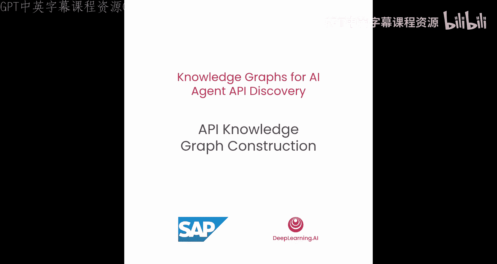
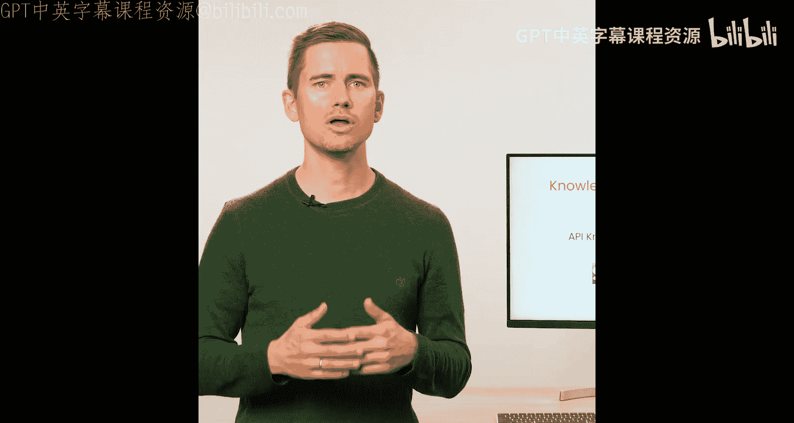
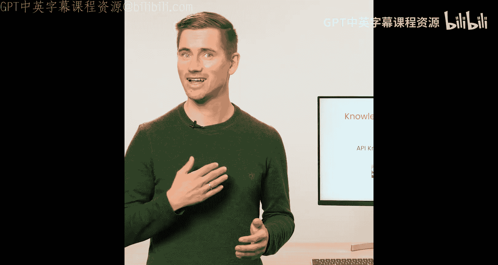
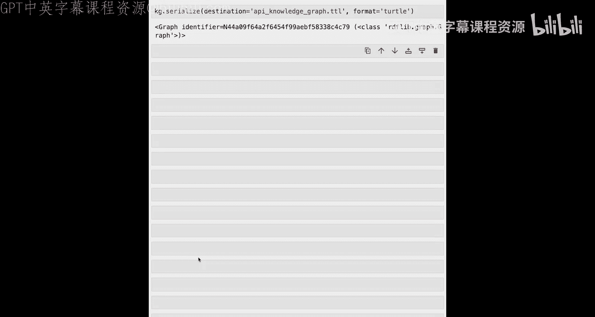

# 吴恩达《用于 AI 智能体 API 发现的知识图谱｜Knowledge Graphs for AI Agent API Discovery》中英字幕 - P3：3.api-knowledge-graph-construction.zh_en - GPT中英字幕课程资源 - BV1ixpUzuEJK

In this lesson， you will learn how to construct a knowledge graph from an example data set on API services and their endpoints。

Specifically， you will learn about a declarative approach for knowledge graph construction。

All right， let's go。

In this notebook， you will construct your first knowledge graph and visualize it。

 Here are two plots that represent parts of the knowledge graphs that you will create during this lesson。

To construct our knowledge graph first， we will see what the input data looks like。

 Then you will learn how to model this data in the knowledge graph。 That is。

 we introduced the knowledge graph schema。 Finally。

 you will learn about a declarative approach to map the input data to the knowledge graph following the schema。

 In this course， you will use O data APIpis and their EDMX specifications。 However。

 the methodology is not limited to O data and can be applied to other API specifications as well。

 Let's jump in a notebook and build our first knowledge graph。In this notebook。

 we start by importing all necessary packages。 we use pandas to read the C3 files。

 RDF Li to construct the knowledge graph， network X and mudplotlib for visualizing the knowledge graph and some helper functions to transform an RDF graph into a network X knowledge graph。

Let's start by reading the input data from these CV files and see what information we have about each concept about these APIs。

First， we read the services from the CV file。 We define that it's a comma separated file。

 We can specify the data type for the version column， which should be a string。 and finally。

 we also define how to handle null values in the data。

 So let's take a look at what the data looks like that we just read。

 We take a look at the first row of the CV file。 We see that we have a name of the API service。

 We have a version and we have a description here we have the purchase order API in version 4。0。

 and it says that it's an O data service for purchase order。

Let's continue with the other input files。 Next， let's take a look at the entity types。

 We again read from a CV file。 It's a commerce separated file。

 and we handle null values for the entity types， there is a name and a service that this entity type belongs to。

 In this case， we have the purchase requisition item type。

 which belongs to the purchase requisition API。 Next。

 let's take a look at the properties that provide more information about these entity types。 Again。

 we read the Cv file， comma separated file， and we handle null values for the properties。

 we have the service， that the property belongs to。

 we have the entity type to which this property belongs a name of the property in this case。

 the cash discount， we have a label， which is usually more descriptive。

 which is the cash discount percentage。 we have the type of the property which is a decimal type。

 we have the。Maximum length， whether it's a key of the entity type and whether it's a selectable property by UI applications。

 Next， let's load the navigations。 We again read the C3 file。 and in this case。

 we want to take a look at the first two rows of the file in order to understand the types of navigations that they are。

 Let's take a look at the first two rows of the navigations。 Navigs are defined for a service。

 they have a name。 the entity type they navigate from and the entity type they navigate to。 Finally。

 they have a multiplicity。 and in this example， you can see that when we navigate from purchase order item to a purchase order。

 this multiplicity is one。 This indicates that a purchase order item belongs to exactly one purchase order。

 While in the second navigation here。 we see that we navigate from a purchase order to a purchase order item。

 which is a one to many relationship indicated。By the star in the multiplicity。

 that means a purchase order can hold multiple purchase order items。Finally。

 let's take a look at the entity sets and load them again， we load the C3 file。

 and we take a look at the first row of the entity sets。

 Enity sets are logical containers for entities of a certain entity type。

 Each entity type belongs to exactly one entity set Here we have the name of the entity set。

 the service they belong to and the entity type that it belongs to This concludes all input files。

 So now let's take a brief look at the statistics of the data that we just imported。

 here we set up a simple dictionary that maps the types that we just loaded to the number of rows within each of the corresponding data frames that were generated by loading these files。

 and we then show how many concepts we have per type。

 Here you can see we have 39 services with a total of 101 entity sets and corresponding entity types。

 There are 120。6 navigations and more than 2000 property types defined for these 101 entity types。

 Now， let's take a look how we can represent these concepts and their relationships in our knowledge graph schema。

After getting an understanding of the input data， the next step is to define a schema or ontology for our knowledge graph。

 A knowledge graph schema defines the structure and relationships within this graph。

 It specifies the types of entities， notes and the types of relationships。

 the edges that can exist in the graph。 The schema acts as a blueprint providing a formal representation of the domain knowledge being modeled。

 and it enables efficient querying， reasoning and inference over the knowledge graph。

 All data apis are described using the entity data model from which we derive our knowledge graph schema。

 So let's take a look at the schema。 The main entry point are service。

 The service advertise its concrete data model in a machine readable form allowing generic clients to interact with the service in a welldefin way。

 For example， a service to retrieve and modify purchase order。

 within a service that can be multiple entity types。 entity type。

A the fundamental building block for describing the structure of the data provided by endpoints of the API service。

 The purchase order API service may have an entity type for the purchase order header。

 which defines general information about the purchase orders。

 as well as an entity type for the purchase order items that belong to the purchase order。

 Pro define the shaped and characteristics of data that an entity type instance will contain。

 Among others， properties have a data type， a maximum length and indicate whether they are key of the entity type。

 as we just saw in the notebook。 For example， a purchase order header may have properties for the creator。

 the creation date and the currency of the order。 a navigation or navigation property。

 is an optional property on an entity type that allows for navigating from one end of an association to the other end。

 This allows， for example， to link the purchase order header to the purchase order items。

Where an item belongs to exactly one header and the header may contain multiple items。

 Each entity type is linked to exactly one entity set。

 The entity set are logical containers for instances of an entity type。 As the next steps。

 you need to define mappings that will transform the input data to a knowledge graph using this schema In this course。

 you will use sparkle the standard query language for RF to define these mappings。

If you're not familiar with Sparkle， let's have a quick introduction。

 Sparkle is the standard query language for Rf。 You can think about it as the SQL for Rf。

 and you may recognize some syntactical similarities。 Let's take a look at an example。 Sple query。

 The main part of the query is the where clause。 which defines the graph pattern that should be matched in the Rf graph。

 The core component of such graph patterns are triple patterns。 triple patterns are like RF triples。

 but also allow for using variables which should be matched in the graph。

 variables are indicated with the leading question mark In this example query。

 we want to match all nodes that our services and their names。 In addition。

 we want to match the entity types of the services and their names as well。

 We can also visualize this graph pattern as a graph template。

 The query aims to match this template against the graph and retrieve all solution mappings。

 That is mappings from。to RDF terms such that by replacing the variables with the terms。

 the templates yields a subgraph of the Rdf graph。 Moreover， Sparle supports various query forms。

 This example uses a select query form to just retrieve the solution mappings。 similar to SQL。

 The results of a select query can be represented as a table where the columns correspond to the variables in the query。

 and the rows to the solutions。 They are also insert queries for updating the graph by inserting additional triples。

 In this lesson， you will use to construct query form to construct the graph。

 Let's take a look at it。In a construct spark query。

 you can use the triple patterns to define the shape of the graph to be constructed in the construct clause。

 In this example， we create a service entity and add a description， a version and a name to it。

 Moreoverover， we can use a bind statement in the where clause of the query to create a unique identifier。

 the UI of the entity to be added to the graph。Shown below the query text is the graph pattern that is defined in the query。

 Let's see now how we map the input data to this graph pattern。In our mapping function。

 the variables in a graph pattern are replaced by the values of the columns from the Cs V file。

 That is per row in the CsV file。 We get one instantsiation which is added to our knowledge graph here。

 This is shown for a single row， which defines the purchase order API service that we just saw in the notebook with the name。

 the version and a description。Now， let's go back to the notebook and do this in practice。

 We can now set up the first construct query that we just saw to generate the RdF triples for the services data。

 This corresponds to the query that you just saw。 We have the service。

 We add a description to the service a version and the name。 Now。

 let's take a look at the transform function， which takes the input data frame and the query as input and generates RdF triples for these inputs。

 This transform function， takes the data frame， as input， as well as the construct query。

 In addition， we can also specify whether we want to just construct the graph for the first row of the input data。

 First， we set up a query graph and the result graph and the result graph will hold the constructed data。

 We first pass the query。We then get all the headers from the data frame。

 and then we iterate over each row in the data frame。 First， for the row。

 we construct a mapping from the variable or the column name to the value in this row。

 We then replace the variable by the values in the query using the init bindings provided by RD Flip。

 We execute the query， and for each result of the query。

 we add the corresponding triple to the result graph。 Once finished。

 we return the complete result graph after we processed all rows in the input data frame。

 Let's execute the function for just the first row of the services data frame and print the results。

 You see the resulting triples that are created using the tutle serialization。

 We created a service for purchase order。 We added the triple of the description。

A triple for the name， as well as a triple for the version。 Next。

 we process the entire data frame and add the constructed triples to our knowledge graph Kg。

 which we just defined before。 here we call the transform function for the services data frame and the corresponding construct query and we add the triples constructed to the knowledge graph。

 Next， we also print the number of triples that we just added to the knowledge graph。

 and by processing the entire data frame for the services we created a knowledge graph of 156 triples。

 Let's continue the process with the remaining data frames。

Here we specify the construct query for the entity sets。

 We again call the transform function and print the size of the knowledge graph after adding the entity sets to the knowledge graph。

 As you can see， the size of the knowledge graph increases。 We now have more than 400 triples。

Similarly， we will process the entity types again， we specify the construct query。

 We run the transform function and add to the knowledge graph that we already have in print its size。

We end up with a bigger knowledge graph。 We already have more than 700 triples。

 Now we do the same thing for the properties。 and let's see what the results are。 Now。

 we have more than 14000 triples in the graph。 This is because we had more than 2000 properties。

 and they add a substantial number of triples to the graph。

 We repeat the same thing for the navigations and end up with even more triples in the graph。 Now。

 you successfully constructed the knowledge graph of business Apis。

 Our AI agent could already leverage it to interact with individual apis。 However。

 it still lacks the context of how these apis are used in business processes。

 Consider the entity sets for purchase requisition and purchase order。

 which have a dependency relationship in the process of procurement of direct materials。

 Let's visualize this disconnectedness by plotting the subgraphs induced by these two entity sets。

First， we use a Sple query to retrieve the entity set nodes from the graph for purchase order and purchase requisition here we define a Sple query template where we can filter by the name。

 We first run this and filter for the purchase order entity set to get the P node。

 the purchase order node， and then we also run this for the purchase requisition entity set。

 which we will store as the PR node purchase requisition node Let's run this， and we see the UI。

 the unique identifier for the purchase order entity set and the UI for the purchase requisition entity set。

 Next， we construct the subgraph from the knowledge graph induced by these two nodes。

Here we first transform the IDF graph into a networks graph in order to visualize it。

 we then construct the subgraph induced by the purchase odor node which we just retrieved from the graph。

 we then also construct the subgraphra for the purchase requisition node。

 and then we just combine them into a single graph for the purpose of visualization。

To visualize the graph， we use the net graph library， which well import here。

We now set up the visualization。 We define the colors of the nodes。 We use different。

 no shapes to better distinguish the nodes in the graph。

 and we also use different sizes just for the ease of understanding the visualization。 And finally。

 we set up the graph using net graph and show the resulting plot。In this visualization。

 you see blue notes that correspond to the purchase requisition API and gray notes that correspond to the purchase order API。

 You also see different shapes of notes。 For example。

 this circle node here in the center corresponds to the actual API service。

 It is connected to the different entity types indicated as square node。

 And for each of those entity types， you see a variety of properties that are indicated with this upward triangle。

 In addition， you see this larger downward triangle that connects different entity types。

 and this corresponds to the navigations between the different entity types。

 As you can see the purchase requisition APIs are not connected to the purchase order apis in the knowledge graph。

 I encourage you to try out searching for other entity sets in the knowledge graph and plotting them to see how they are structurally represented in。

K knowledgeledge graph。 Let's zoom out and take a look at the entire knowledge graph that you will end up by the end of the next lesson。

 which also includes disconnect connectededness using the business processes。

 So let's take a look at a sample of 1000 edges of this knowledge graph。

Now you can see the sample of the entire knowledge graph， which has a very connected core。

 which corresponds to connections of the business processes that you will add in the next lesson。

As of now， the knowledge graph is an RDF lip graph。

 which is held in memory for sharing and reusing the knowledge graph。

 you can materialize it on disk using any RdF serialization here。

 we serialize the knowledge graph using the turtle format which you already saw in the previous lesson。

 and we specify the destination So the file that we want to create for this knowledge graph。

 The resulting knowledge graph will be stored to disk and we can use it in the next lesson。

In this lesson， you constructed a knowledge graph for the API data。

 and you saw how it is disconnected and the APIs are not connected In the next lesson。

 you will learn how to integrate business process data in order to connect these API services according to their usage in business processes。

