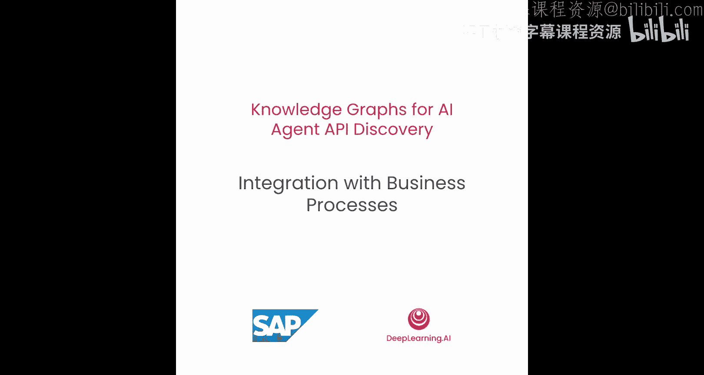
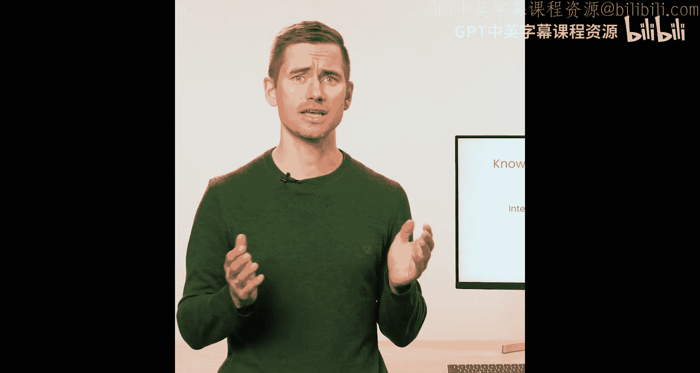
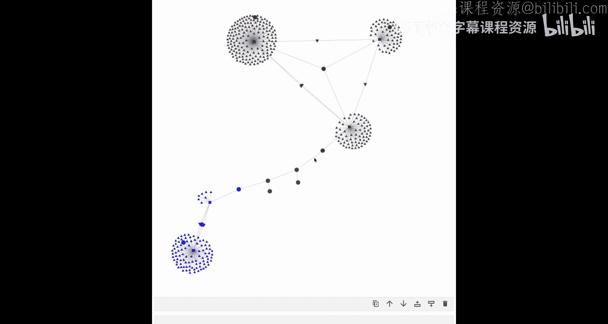
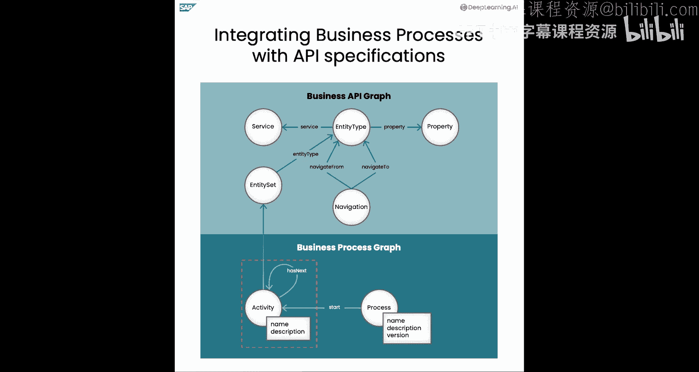
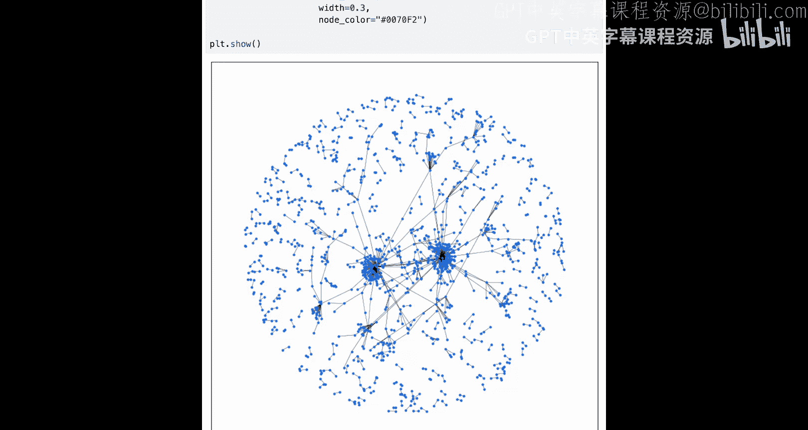
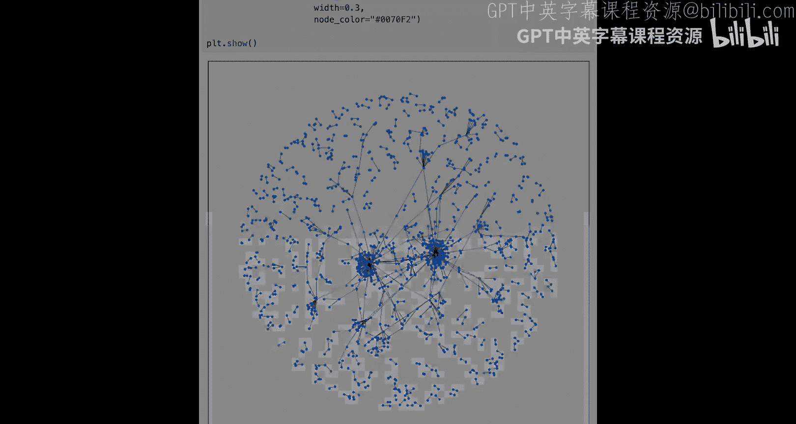

# 吴恩达《用于 AI 智能体 API 发现的知识图谱｜Knowledge Graphs for AI Agent API Discovery》中英字幕 - P4：4.integration-with-business-processes.zh_en - GPT中英字幕课程资源 - BV1ixpUzuEJK

In this lesson， you will extend the knowledge graph with business process data to better connect API services and provide context about the dependencies in the processes。

All right， let's dive in in this notebook， we will include process data into our knowledge graph to connect the APIs。

 As you remember from the previous lesson， the two Apis were disconnected。

 and by the end of the notebook， you will have added these red notes to the graph that will connect the As by the business process information in the simplified business process schema。

 They are two main concepts。 processes and activities。

 A process defines a collection of activities which are executed in a specific order to complete the process。

 A process has a name， description and a version。 A process links to the start activity of that process。

 Each activity has a name and a description and it links to the next activity in the process。

 to link the process graph data to the APIpis。 We can link activities to entity sets wherever applicable。

 For example， the activity create purchase requisition can be linked to the purchase requisition entity set for simplicity。

 we omit。😊。

ways and merely focus on simple processes which are sequences in this lesson。

Now， let's take a look at an example。 Consider a simple process for the procurement of direct materials。

 This process is typically executed by a purchaser。 First。

 a purchase requisition is created after it is approved a new purchase order is created from this requisition。

 Finally， after some potential intermediate steps， the purchase order is closed。

 The process steps to create a purchase requisition and order can be linked to the corresponding entity sets in the knowledge graph from this connection。

 an agent can derive that the purchase order entity set depends on the purchase requisition in the context of this specific process。

 Now， let's jump into the notebook and see how we can integrate this process data with the API data and the knowledge graph we created in the previous lesson。

😊，Again， we start with importing the necessary packages。

 and these packages correspond to the same packages that we used in the previous lesson。

Now that you want to link the process data to your business API knowledge graph from the business lesson。

 you can start by importing this knowledge graph from the previous lesson。

Here we first set up an empty graph called the API Knowge graph。

 we then read the file that we materialized in the previous lesson and parse it。

 and finally we print the number of triples that are in this graph。The result is over 14000 triples。

 This number should correspond to the size of the knowledge graph in the previous lesson。

For this lesson， we already extracted some processes from BPM N diagrams and converted them into RDF。

 BpM N or the business process model notation is a standard for defining business processes。

 Let's also load this process graph from a turtle file。 similar to the previous step。

 We create an empty process knowledge graph。 We parse the business process from a turtle file。

 and then we print the size of the business process graph。

 Our business process graph as around 150 triples。 So let's take a look at the processes in that graph。

Here， we use a sparkle query to retrieve the processes from the business process graph in this query。

 we select any process and the name of the process。 Finally， we just project the name of the process。

 We run this query over the process knowledge graph and print the processes by iterating over all results and just printing the name of the process。

 So let's take a look at what processes are in the knowledge graph。 Here， you see the result。

 The processes include a process for the procurement of direct materials， cell from stock。

 external transportation planning and so on and so forth。

 This corresponds to processes that you would find in most of the companies。

Now that we've seen some of the processes， we can simply add the business process graph to the business API graph from the previous lesson to get a combined knowledge graph to do so。

 we again set up an empty graph， and then we just combine the two graphs。

 the API knowledge graph and the process knowledge graph into a single graph。

 and we print the size of the graph to see whether everything worked as expected。

 As you can see the resulting knowledge graph is exactly the size of the individual knowledge graph。

 the API knowledge graph and the process knowledge graph。Similar to the previous lesson。

 you can serialize the knowledge graph in total syntax and write the file to disk。

 After combining the graphs， we can query the knowledge graph and find connections between processes and Apis in the process graph activities can refer to the corresponding API entity sets if applicable here。

 you see a sparkle query to retrieve the activities of the procurement of direct materials。

 and the activities that are linked to the entity sets。

 We first retrieve the process of procurement of direct materials We find the start activity of that process。

 and then we use a property path query to get all next activities of that start activity。

 We then see if that activities is linked to an entity set。 And if so。

 we retrieve the name of that entity set as well as the name of the service the entity set is belonging to。

 Again， we run the query over the combined graph and just print the results to see the activities。😊。

Entity set they are connected to as well as the service of that entity set Here we see the activity create purchase order requisition is connected to the entity set purchase requisition in the service purchase requisition The activity create purchase order is connected to the entity set purchase order in the purchase order API。

Let's take another look at the disconnected graph that we saw in the previous lesson。

 as you can see the APIs were disconnected， theres no connection between the purchase requisition API information and the purchase order API information。

Now you will see how these services are connected via the processes， just like in a previous lesson。

 you first get the nodes from the knowledge graph now， however。

 you only need either the purchase order node or the purchase requisition node as the starting entity set。

 This is because the entity sets are now reachable from each other via this process information。

So again， like in the previous lesson， we retrieve the entity sets as a starting point。 In this case。

 we only look for the purchase order entity set。 Here's the result of the query。 We retrieve the UI。

 the unique identifier of the purchase order entity set from the knowledge graph。 Now。

 you can plot the connected graph just by taking the purchase order entity set UI as the seatd note for the graph。

 similar to the previous lesson again， we convert the RF graph to a network X graph to be visualized。

 We then construct the subgraph induced by the purchase order node that we just retrieve from the knowledge graph。

Again， we want to print and visualize the graph。 We first define different note colors for the different types of notes。

 again， also different shapes and the sizes of the notes should be differently just in order to be more distinguishable by each other。

Now you can see the resulting graph which is connected again in blue is the API information about the purchase requisition API in gray。

 the API information about the purchase order API， and shown in red here are the notes the activities from the business processes that allow us to connect the entity sets for the purchase order and the purchase requisition。

Finally， after creating the knowledge graph， combining API information and business process information and seeing how they are connected via the process activities。

 let's take a look at the entire knowledge graph。 While the model or the schema is rather simple and only consists of the few concepts。

 The resulting knowledge graph with instance data。 So the actual API definitions and processes is much larger and complex。

 So we only will visualize a subset of the graph with a00 randomly chosen edges。

 This sparkle query retrieves any edge from the graph orders them randomly and selects just 1000 of those edges。

 and we add the resulting edges to an edge list。 just like before we use network X to plot the graph。

 We add the edges we sampled from the knowledge graph and showed the graph。

 This figure illustrates the size and complexity of the knowledge graph。

 and it even only shows 1 thousand00 edges， which corresponds to only 6% of the whole graph。You see。

 the entire knowledge graph is too large and complex。

 making it infeasible to be provided as context to an agent in its entirety。 In the next lesson。

 you will learn how to discover only relevant As from the knowledge graph using semantic embeddings。

