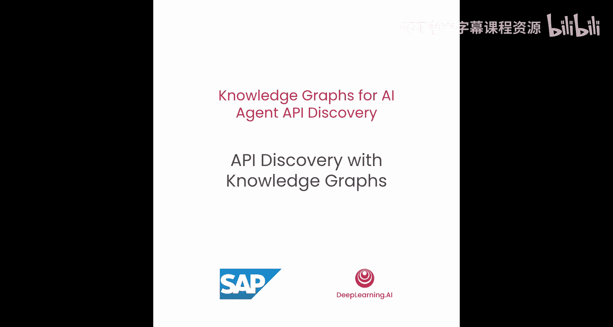
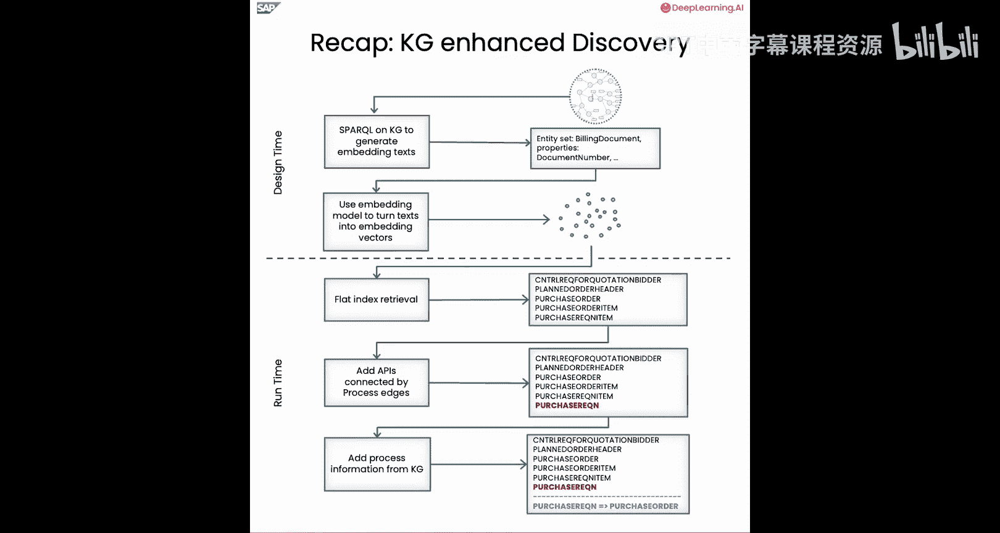
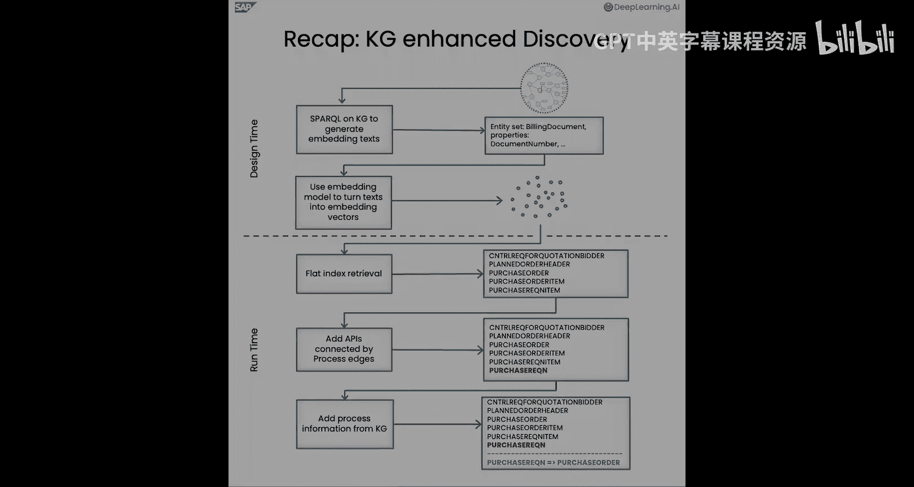

# 吴恩达《用于 AI 智能体 API 发现的知识图谱｜Knowledge Graphs for AI Agent API Discovery》中英字幕 - P5：5.api-discovery-with-knowledge-graphs.zh_en - GPT中英字幕课程资源 - BV1ixpUzuEJK

In previous lessons， you constructed a knowledge graph that integrates APIs with additional information about business processes that involve those APIs。

In this lesson， you will learn how knowledge graphs can be used for API discovery for AI agents。

 Let's dive in。😊。

Here's what you will do in this lesson。 During design time。

 you will do initial preparation for retrieval， and at run time you receive and process user queries。

 So at design time， you retrieve entity sets， they labels and properties from the knowledge graph。

 you will then use embedding model to turn retrieve texts into embedding vectors。 And at run time。

 you will start with the flat index retrieval based on embedding texts。

 you will then add APIpis connected by business process edges。

 Finally we enrich the retrieval based on the business process information from the knowledge graph。

😊，With this background， let's dive into this notebook。 as in the previous lessons。

 let's import all the necessary packages First， we also have some new packages as part of this notebook。

 For example， we import F index classes for performing semantic similarities search on entity sets。

 we also import T QDm， a utility to show progress powers for loops。

 We then import open AI power text embeddings via La chain。 and just as in previous lessons。

 we have a helper function for parameterizing sparkle queries。 All right。

 let's now set up our data frames to be displayed nicely。

Let's begin by setting up a Lin embedding model using Open AI's textt embedding 3 large model。Next。

 we load the knowledge graph we constructed in the previous lessons in real world business scenarios。

 we often work with thousands of APIpis， Preing all of these options to a large language model is typically neither efficient tu to token limitations and latency。

 nor is it practical in most cases。 Therefore， we need to reduce the API selection space to a small and relevant subset for the agent for a given user query。

 Do a flat retrieval reduces the number of Apis to some extent。 but poses some problems。 Number one。

 false negatives。 These are relevant Apis that are not semantically close enough to the user query。

 So the retrieval step misses them。 But enhancing that retrieval with a second step。

 using business process edges from the knowledge graph。 Those Apis can still be reached。

 We complete the business processes that are touched by the true positives with the help of the process information from the knowledge graph。

 number2。False positivesAdding the business process information on top of just the flat list of retrieved API endpoints helps the agent to disregard the false positives。

Before you construct embedding text for entity sets， let's first recall that for each entity set。

 you store all its properties in the knowledge graph。

 The first step is to prepare a sparkle query to retrieve all the properties for our example。

 entities set related to purchase order。 So let's briefly review what we created here。

 The variable Q underscore APIpi underscoreco properties stores the prepared sparkle query。

 These define the short prefixes for Rf XD and auditor name spaces。

 Here you select distinct pairs of entity set and property labels And in the where clause。

 we bind the entity set U to the purchase order entity set。

 Further the triple ensures that the bound U is explicitly declared as an entity set。

 and this retrieves the name of the entity set， which is， in our case， the purchase order。 Finally。

 this triple retrieves the name。😊，Of the entity set to its entity type and defines the structure and properties。

In the end for every entity type you get all the properties and their labels。

 the first step is to prepare a sparkle query to retrieve all properties for our example entity set related to purchase order The variable Q underscore API underscore Discco properties stores the prepared Sple query here you select distinct pairs of entity set and property label in the first part of the where clause。

 you retrieve entity set for purchase order and its corresponding entity type In the second part。

 you retrieve all the properties of that entity type。

 Let's now execute this prepared sparkle query on our knowledge graph。

 The results of this query are stored in a dictionary with two keys entity set and property label Now let's display the first few rows of this dictionary to see how this looks As you can see for the entity set purchase order we retrieved a few properties and their labels for example。

 address number in。😊，Terms， purchasing organization， quotation date and so on。Next。

 we prepare a sparkle query to retrieve and concatenate the name of an entity set and names of its properties。

 The result of this query will then be used to construct text embeddings here。

 the variable Q and Disc score embedding and Disc string stores the prepared Sple query Here we fetch and concatenate each entity set with the names of its properties。

 Let's take an example， to see how such an embedding text looks like here， for example。

 you'll see for the entity set billing document， you get several properties。

 such as document number posting status value days， billing date and so on Now。

 this is just a glimpse of the flexibility that knowledge graphs offer from each entity set。

 you could go further into the graph and include， for example。

 more information about each property like its data type， max length and so on。

 or you could include additional business process information that is also stored in the graph。😊。

Let's now generate text embeddings for each of the entity sets。

Here we loop over the text that our Q underscore embedding string returned and run them through the text embedding model that we initialized earlier。

 Okay， now that we have the embeddings for the entity sets， let's index them for similarity search。

 We're using files to index embeddings here for simplicity。 But really any vector database works。

 Let's now save the files index and the corresponding entity set U eyes to disk with pickle。😊。

Let's take a look at what you did so far。 We first query the knowledge graph to retrieve a subgraph per entity set。

 which includes its label and the labels of its properties。

 The retrieved labels are concatenated and the resulting string is embedded。

 The embeddings are indexed and associated with the corresponding entity set U。

 Now that you've created the index。 You can use it to find the nearest neighbors of a given query embedding。

 So let's define a function to do just that This function takes a natural language query convers it into a vector using the embedding model and searches the P index for the top K。

 most matching similar entities sets and returns them。 Let's try this with an example query。😊，Here。

 the query we have at hand is the one we started with to create a purchase order for five pencils in purchasing Group 0。

0，2 and purchasing organization 3000。 Let's execute that。

 You see that a lot of purchase order related entity sets are among the top five matching entity sets。

 which is what we would expect。 We could add an additional reran step here， But for now we skip that。

 An important thing to note hear is that the retreat will step miss the purchase requisition header。

 although you see purchase requisition item here。 and purchase requisition header is an important prerequisite to create a purchase order。

 So the agent would not know about it if we stopped here。 So let's continue。😊。

Let's review what you did so far。 You retrieved entities sets their labels and properties from the knowledge graph。

 You then used embedding model to turn the retrieved texts into embedding vectors。

 You created a flat index retrieval based on embedding text and performed sample queries。 Now。

 you will add Apis connected by business process edges。 And finally。

 you will enrich the retrieval based on business process information from the knowledge graph。 Okay。

 let's see this in action。 We want to get all the process edges that are connected to the entity sets we retrieved earlier。

 Here， the variable stores the prepared sparkle query。 The select statement here。

 retrieveves unique pairs of entity set A， which is the source entity set entity set B。

 the target entity set and their names。 This query looks for process dependencies using the PR has next property。

😊，And then performs a union to combine the results from both the directions。 Now。

 let's look at what this results in after executing this against our knowledge graph。

Let's now define a function to execute Sple query on our knowledge graph This function get process dependencies。

 takes a list of entities sets specified by their Us。

 executes this Sple query on the graph that we loaded earlier to retrieve all the process dependencies from the graph that either lead to or originate from one of the entities sets。

Now lets test this on the entity sets that we retrieved for our example query。

 a query being creating a purchase auto for five pencils in purchasing Group 002 and purchasing Organization 3000。

😊，As you can see， we get a list of your eyes and names of the entity sets for purchase acquisitionquisition and purchase order。

 and you can recollect that the purchase acquisitionquisition header entity set was missing in the previous step。

 but now with this step， we have the purchase acquisitionquisition header also added to the list。

 This is due to the process information added in the graph。 Okay。

 now that we have all the necessary building blocks。

 let's put them together and finalize our knowledgecraft enhanced API discovery process in this function。

 we combine the embedding based retrieval along with the business process dependencies。 This stakes。

 a user input query and returns the most relevant entity sets along with their business process information。

😊，Let's try it out with our same sample query we used earlier。 And with that。

 we get a list of matching entity sets related to purchase order。 and most importantly。

 the entity set related to purchase requisition header。

 which was missing when we ran only an embedding based retrieval。 This。

 along with the business process information that purchase order depends on purchase requisition。😊。

Now， let's recap what you learned in this lesson at design time。

 you ran spark and queries on the knowledge graph to turn properties of entity sets into text representations from these textual representations。

 you computed embeddings with an embedding model At runtime。

 the discovery starts with the flat index retrieval which gives us a list of entities sets but may miss some relevant ones。

 Then you add those Apis that are connected to our retrieved APIpis via business processes In our example。

 we were able to add purchase acquisition in this way。 and finally。

 you added business process information to the Disc entity sets。

 In the next lesson you will apply what you just built to discover and execute Apis with AI agents。😊。

