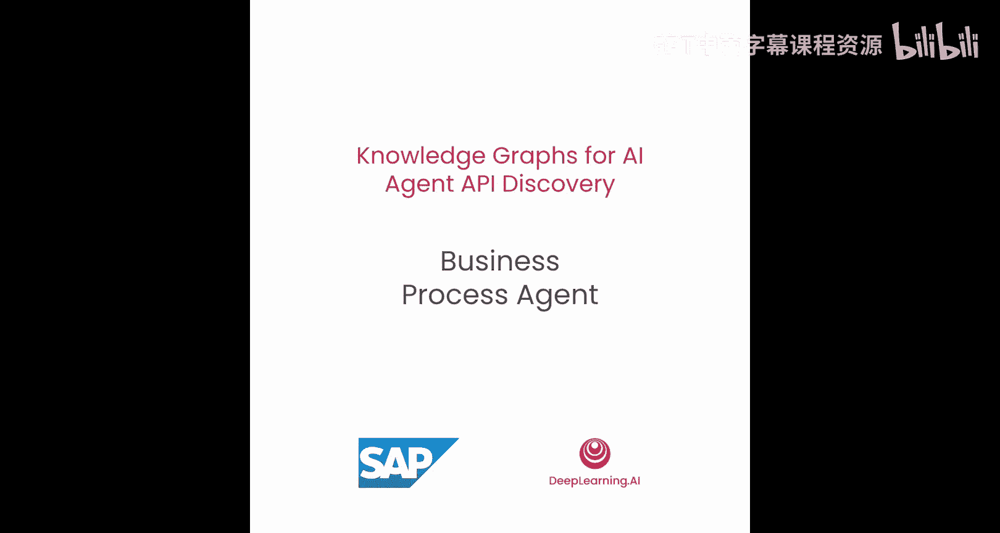
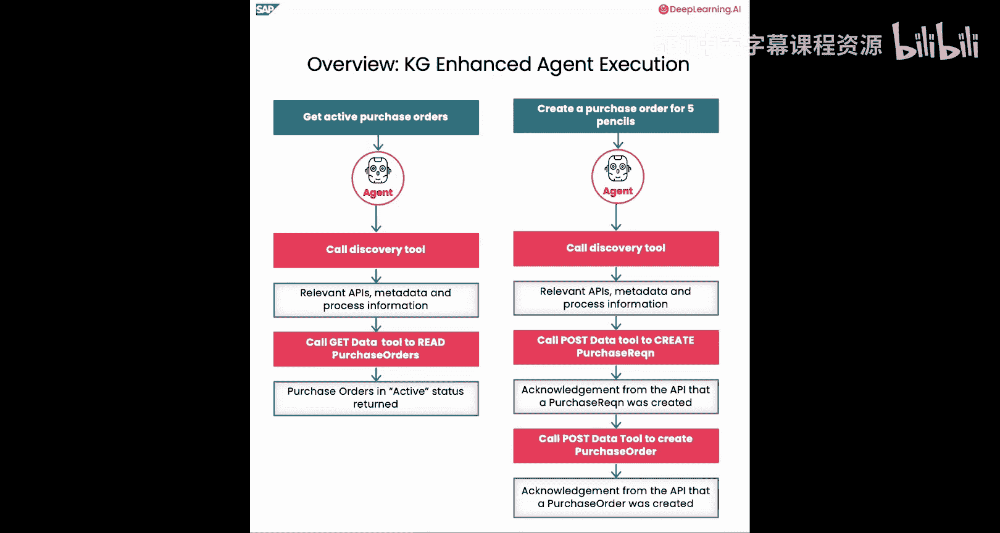
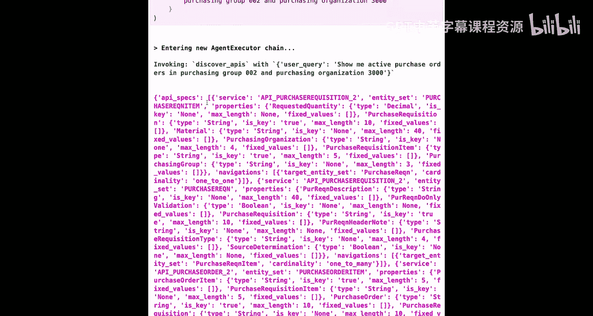
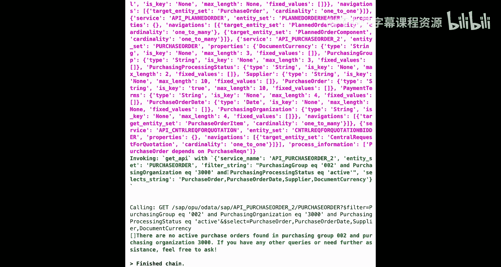
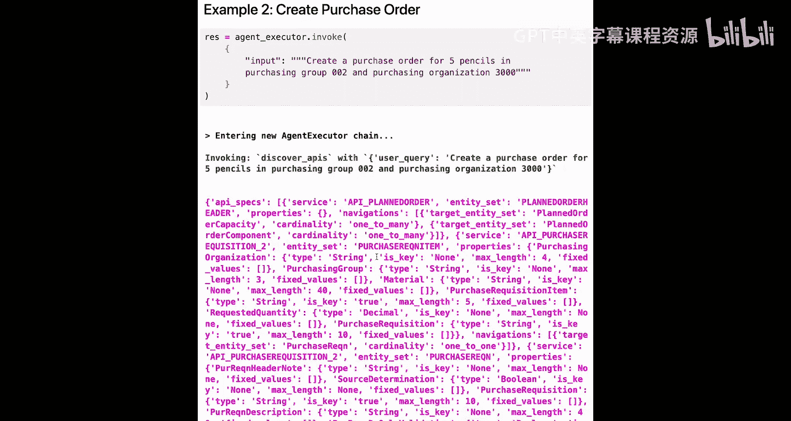
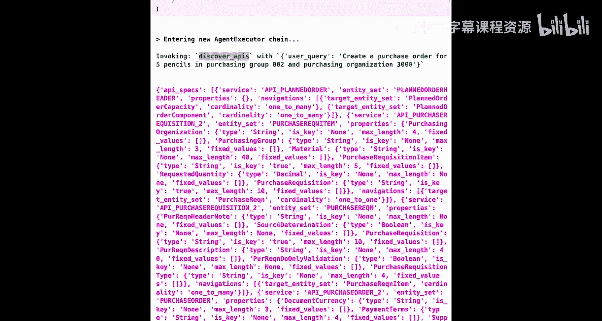
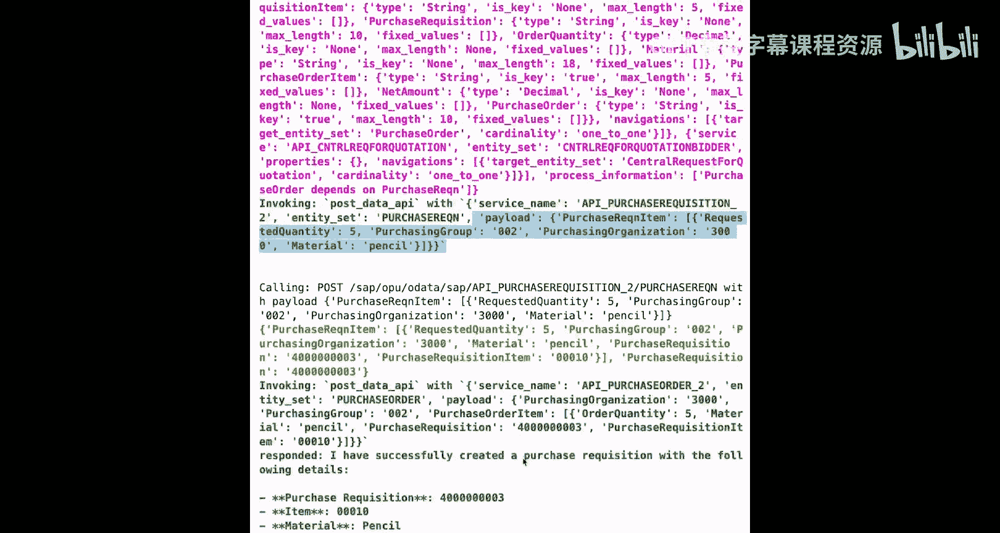
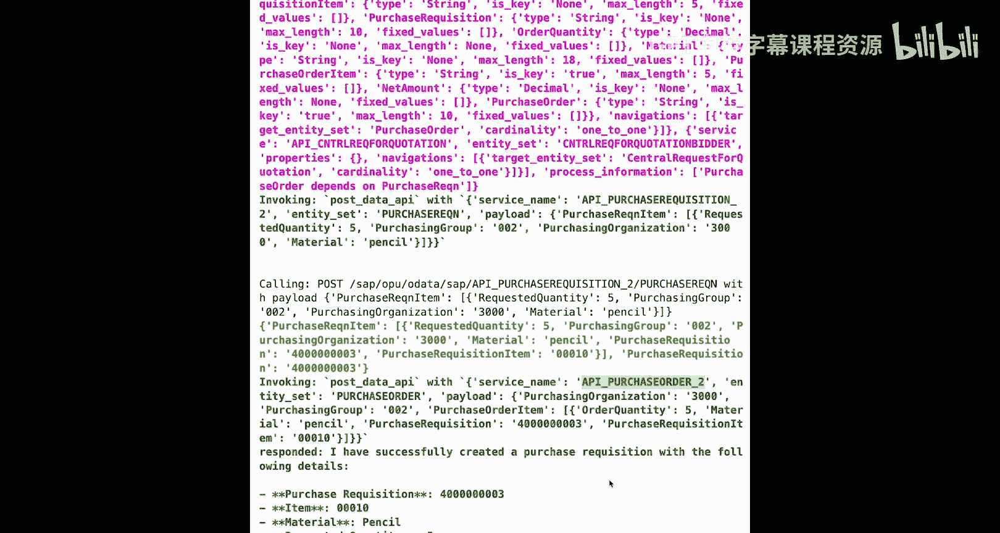
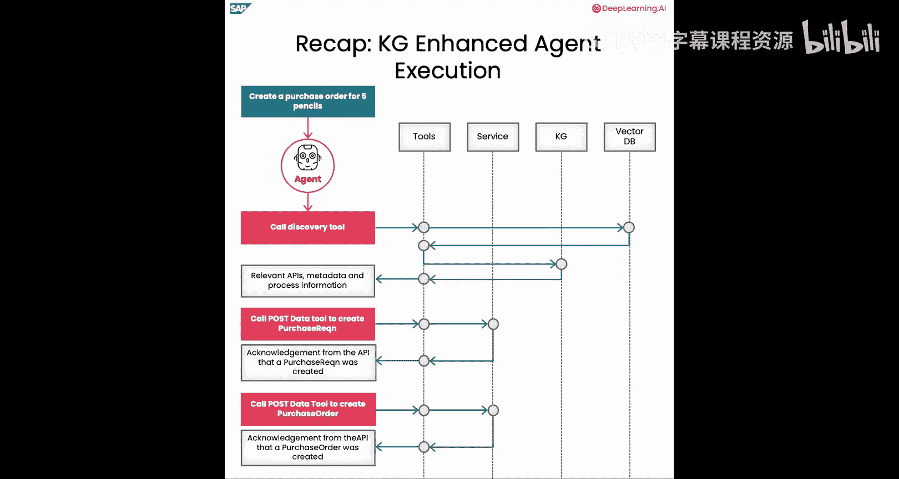

# 吴恩达《用于 AI 智能体 API 发现的知识图谱｜Knowledge Graphs for AI Agent API Discovery》中英字幕 - P6：6.business-process-agent.zh_en - GPT中英字幕课程资源 - BV1ixpUzuEJK

In the previous lesson， you built a functionality to discover relevant APIs from your knowledge graph based on their sematictic embeddings and their business process relations。

😊。

In this lesson， you will use this to enable an agent to discover and execute these APIs to fulfill user queries。

 Let's go。😊。

Here's what you will do in this lesson。 You'll create an agent that executes user queries for get purchase orders and create purchase order。

 You will define three tools for this agent。 The discovery tool。

 the get data tool and the post data tool。 The discovery tool retrieves API metadata such as properties。

 navigations and business process information。 The get data tool is used for get purchase order related queries。

 The post data tool enables creation of a purchase requisition and a purchase order based on business process information from the knowledge graph。

 Let's now get started with the notebook。 First， let's import all the necessary packages。

 As in the last lessons， we import custom help function to paratriized sparkle queries and one for fetching Open API key。

 Next， we set up La models for the LLM and the embedding model we using Next。

 they load the knowledge graph we created in the previous lessons。😊。

Now let's fetch API specifications to include properties of entity sets and navigation links of the entity sets for defining the discovery tool。

 we need to fetch properties and navigation links of entity sets。

 This helper function fetches and combines them both Let's now try this with an example query here we fetch entity specification for the purchase order entity set and in the results you will see that there is a service for purchase order。

 the corresponding name of the entity set along with its properties such as purchasing processing status。

 purchasing group and so on。 you'll also see that purchasech order number is the key for this particular entity set and we also retrieve the navigations for this particular entity set which is related to purchase order item with a cardinality of one to many implying that a purchase order can have one to many items。

Now， you have all the necessary elements to define our discovery tool in order to do this。

 let's first load the index on the entity set embeddings that you created in the last lesson。

 Let's also import the helper function to discover APIs and process defined earlier。

 recall that Discover APIpis and process returns a list of Disc entities sets along with their business process information。

 Let's try this out with an example query。Here Im looking for APIs and process information for the query show me Act purchasechase orders and in the list you can see that we have the matching list of entities sets which include purchase order purchase order item along with purchase acquisitionqui and purchase acquisition item besides which we also retrieve the process information that purchase order depends on purchase acquisition That looks good。

 You now have all the key elements required for the tool discovery。Now。

 you are ready to define this as a tool to the agent which we can use later here we use the tool decorator to convert our function。

 discovery and the APIs into the discovery tool。 This function of the tool takes a natural language input from the user identifies the relevant entities sets and returns their API specs。

 including the business process information。Now that we have our discovery tool。

 let's prepare for API execution with mocked services。

 We import helper functions that get post and display our mock data services。

 let's take a look at the content of a mock database。 First purchase acquisitionition。

 Here you will see that there are two purchase acquisitionquisition one ending with number one and the other ending with two While the first purchase acquisition has a single item for ruler the second one has two items。

 items 10 and 20 for pencil and pen。 Now let's look at how a purchase orders data set looks like here we have three purchase orders those ending with one。

2 and3 and each of them correspond to unique items， ruler pencil and pen for certain quantities。

 and the thing to note here is that each of the item in the purchase order refers to a corresponding item in the purchase acquisitionquisition。

 So in this case purchase。Order1， item 10 refers to purchase acquisitionquisition 1 item 10。

 which we saw above。 and in a similar way， we have purchase order2 item 10 refers to purchase requisition2 item 10。

 As in the case above for pencil。 Let's draw a mock service for post data。

 You see that for the service related to purchase order and entity set related to purchase order。

 This particular function makes a single call to purchase order API along with the materials that are requested at the item level and executes this call and returns the newly created purchase order。

 which is， in this case， the purchase order ending with4 in comparison to the previous results。

 we now have a new purchase order along with two new items for mouse and keyboard that were requested in the call。

Next let us call get data Mo function to retrieve our first purchase order that matches the criteria purchasing group 005 and purchasing organization 3000 as you can see this function displays the O datata call to the service matching the filter criteria of interest and returns the matching purchase order in this case the first purchase order with purchasing group and purchasing organization as requested。

Now that you know what these two mock functions do， let's define tools for the agent Here again。

 we use the tool decorator to wrap our mock functions， for get API and post data API。

And convert them into tools。We now have all the necessary building blocks。

 Let's proceed to create the agent and to create the agent will use a predefined agent loop from Lcha and now all you need to do is to provide tools that you previously defined along with the prompt in the prompt。

 we tell the agent to discover APIpis and business process information based on the user query and then call the APIpis according to the business process。

 We also have to tell the agent how to use navigations to create header and item level objects in a single call。

Let's now bring everything together。 We provide the tools we defined earlier。

 along with the prompt we just prepared。Let's now try this with some example queries。

 The first queries related to fetching active purchase orders。 As you can see， the agent first calls。

 discover and Disc APIpis with the query， fetches a list of matching APIs， entities sets。

 along with their properties， navigation links， and then also finalizes the process information。

It then calls Gett API tool with the service name related to purchasease order and passes the filter string as it is in the user query in this particular case it is looking for purchase orders in the processing status active and then says that there are no active purchase orders in this particular purchasing group and purchasing organization。

So here the model use the literal value active instead of a corresponding technical code。

 and that is why it is not able to fetch active purchase orders。

 Now we could flexibly add what we call as fixed value helps that maps the status code to the status description。

 Let's now add this to the knowledge graph。Here we add a bunch of related status codes， for example。

0，1， meaning in process 0，2， meaning active and so on。

2 are purchase order entities set and added finally to the graph。

 And now let's try to run the same query again with the agent。Now in this case。

 the agent then actually maps the purchasing processing status to 02 instead of active as it did in the past and is now able to correctly find two matching purchase orders in active status this is a flexibility that knowledge graphs offer that it can dynamically extend the graph with corresponding business entries and also map them to the agent use cases。

Now， let's take a look at another example， this time。

 a bit more complex one related to creating purchase order here。

 the agent has to determine that a purchase requisition has to be created first and then a purchase order to be created。

 which refers the purchase requisition。As you can see， the agent first does the discovery。

 fetches the right APIs， along with their specifications in terms of properties。

 navigations and business process information， and this time it recognizes that it should use the business process information that states that purchase requisition should be first created before creating a purchase order。

 and so it invokes the post data tool with the name of the service being purchase requisition in a single payload creates the purchase requisition first and uses that as a reference to call post data API with purchase order API。

 and it creates a new purchase order ending with five referring the newly created purchase requisition Ref3。

Let's take a look at our mock database to see how this changed after the last call here you can see that there is a new purchase requisition ending with3 item 10。

And now let's look at a purchase order mocked database and there is a new purchase order here ending with five and importantly it refers to the purchase acquisitionquisition ending with three that was just created basically demonstrating that the agent adhered to the business process rule that a purchase Requisition should be first created before creating a purchase order Now let's summarize the agent's flow with our last example related to create purchase order it starts with the user input being passed to the agent which then decides to call the discovery tool to find APIs and process information relevant for the given user input the discovery tool in turn calls the vector database in our case just a local inmemory index to retrieve relevant entity sets Next the tool queries the knowledge graph for business process information an additional relevant entities。

Seets as well as their metadata。 All of these are then returned to the agent。

 Then the agent has all the relevant information to decide that it first needs to make a post API call to create a purchase acquisition。

Which then calls the corresponding post API tool， executes the API and returns the newly created purchase requisition to the agent。

 Finally， the agent executes a post API again to create a purchase order with reference to the newly created purchase requisition and returns this back to the agent。

😊。

