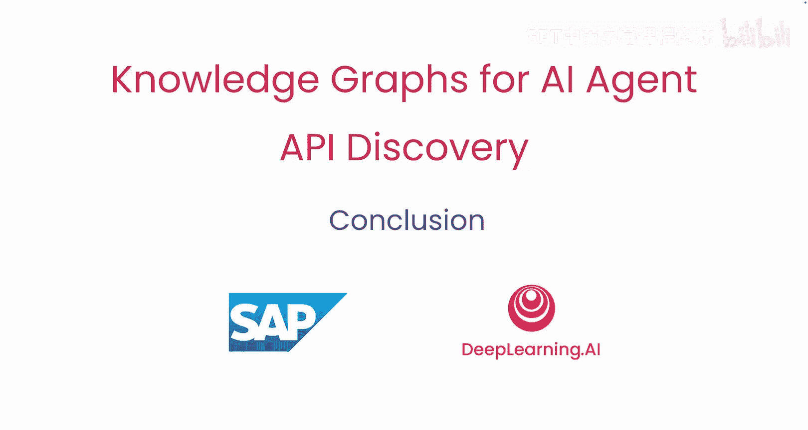

# 吴恩达《用于 AI 智能体 API 发现的知识图谱｜Knowledge Graphs for AI Agent API Discovery》中英字幕 - P7：7.conclusion.zh_en - GPT中英字幕课程资源 - BV1ixpUzuEJK

Congratulations on completing the course。 you learned how knowledge graphs bring structure and meaning to enterprise data。

 connecting APIs and business processes to give AI agents relevant business context。 Exactly。

 you learned how to use knowledge graphs to help agents discover and work with APIs more intelligently and take actions。

 Now， you've got a solid foundation to build AI agents that can work in real enterprise environments。

From here， try applyinging this to your own data， Test things out and explore how knowledge graphs can help your AI applications。

 Thanks again for joining us。 We're excited to see what you build next。😊。

