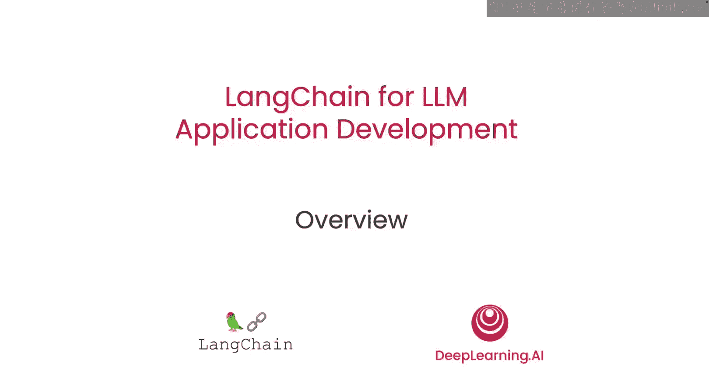
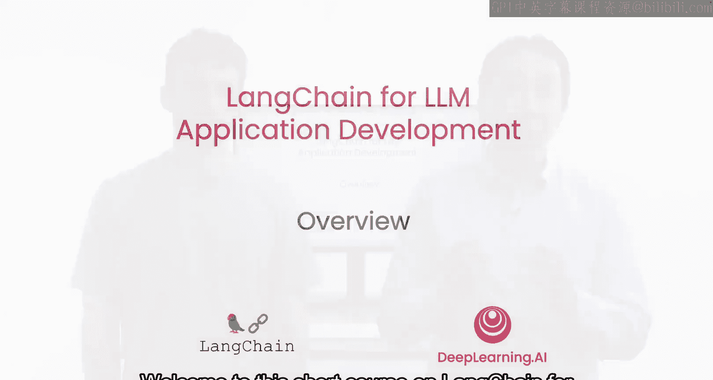
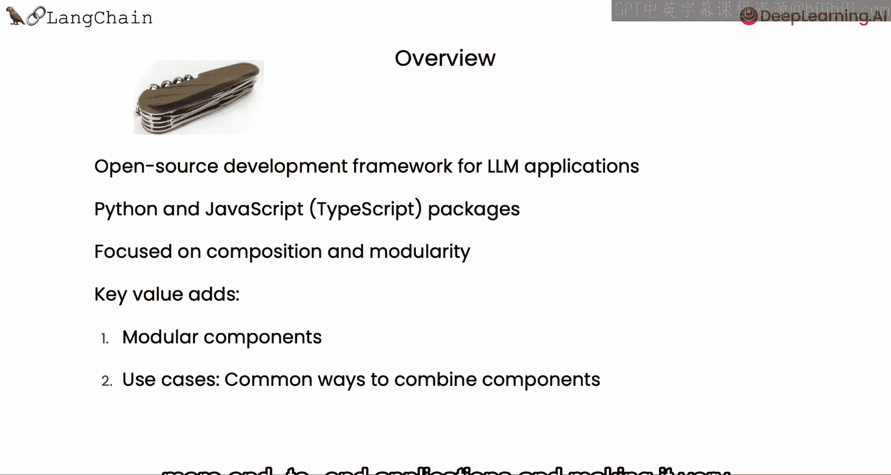
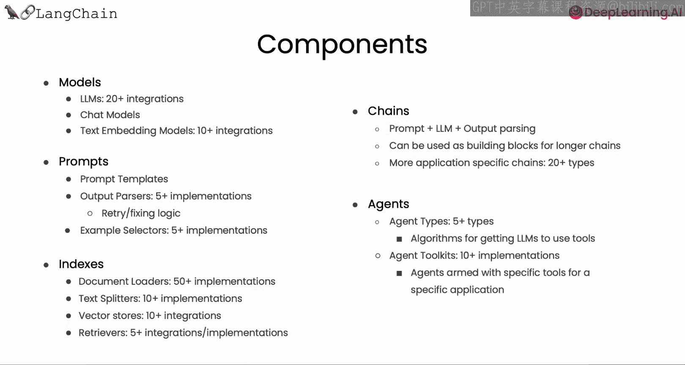
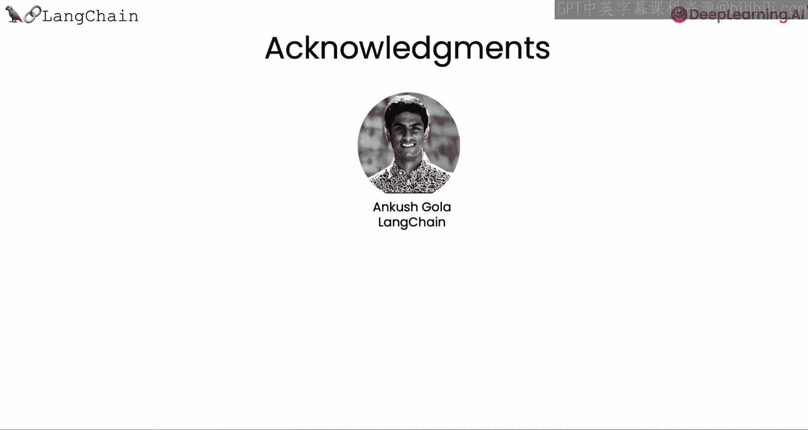
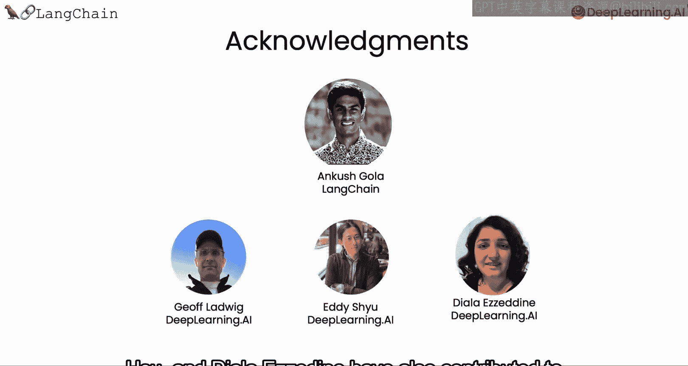
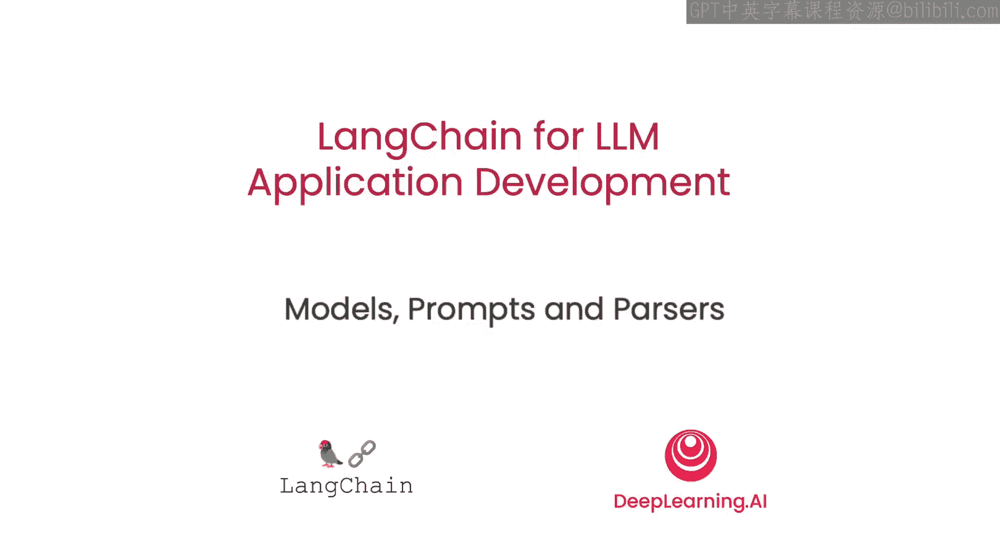

# 吴恩达《用于LLM应用程序开发的LangChain》｜langchain-for-llm-application-development｜中英字幕 - P1：1_LangChain_Intro_v02.zh_en - GPT中英字幕课程资源 - BV1zu4y1Z7mc

Welcome to this short course on Lachain for La language model application development。

By prompting an LOM or large language model， it is now possible to develop AI applications much faster than ever before。

But an application can require prompting an LM multiple times and pausing as output。

 and so there's a lot of glue code that needs to be written。

Langchain created by Harrison Chase makes this development process much easier。

 I'm thrilled to have Harrison here who had built this short course in collaboration with deep learning AI to teach how to use this amazing tool thanks for having me I'm really excited to be here Langchain started as an open source framework for building all on applications It came about when I was talking to a bunch of folks in the field who were building more complex applications and saw some common abstractions in terms of how they were being developed and we've been really thrilled at the community adoption of L so far and so look forward to sharing it with everyone here and look forward to seeing what people build with it And in fact。

 as a sign of Lcha's momentum， not only does it have numerous uses。

 but there are also many hundreds of contributors to the open source and this has been instrumental with rapid rate of development。

 this team really ships code and features at an amazing pace。 So hopefully after this short。😊。

Of course you'd be able to quickly put together some really cool applications using Lachain and who knows。

 maybe you even decide to contribute back to the open source La chain effort。😊。

Langchain is an open source development framework for building LM applications。

 we have two different packages， a Python one and a JavaScript one they're focused on composition and modularity so they have a lot of individual components that can be used in conjunction with each other or by themselves and so that's one of the key value add and then the other key value add is a bunch of different use cases so chains of ways of combining these modular components into more endto end applications and making it very easy to get started with those use cases。

In this class we'll cover the common components of L chain so we'll talk about models。

 we'll talk about prompts which are how you get models to do useful and interesting things。

 we'll talk about indexes which are ways of ingesting data so that you can combine it with models and then we'll talk about chains which are more end-to end use cases along with agents。

 which are a very exciting type of end- to- end use case which uses the model as a reasoning engine。

We're also grateful to Ansh Goer， who is the co founder of Landnchin alongside Harrison Chase。

For also putting a lot of thought into these materials and helping with the creation of this short course and on the deep the AI side。

 Jeff Ladwig， Eddihu， and Dialla， Eadin have also contributed to these materials。

And so with that， let's go on to the next video where we'll learn about Bs， models， prompts。

 and pauses。

