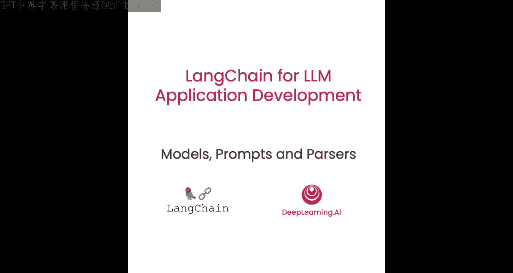
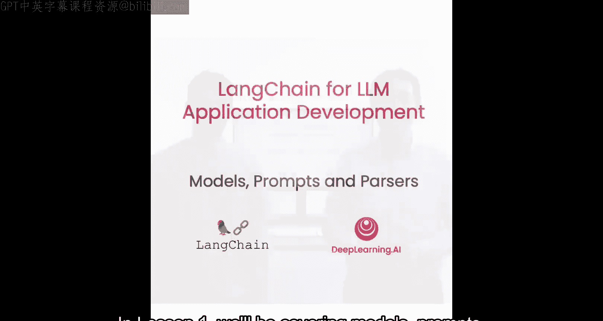
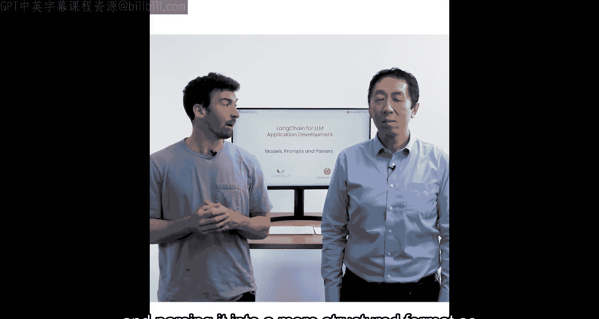
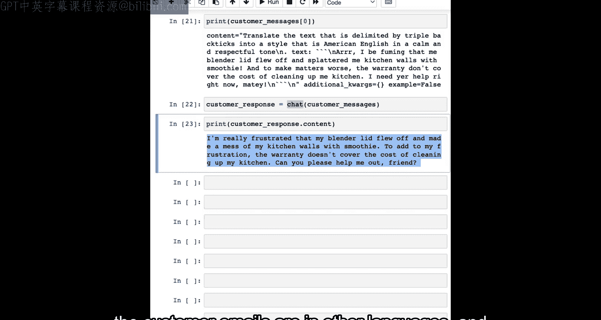
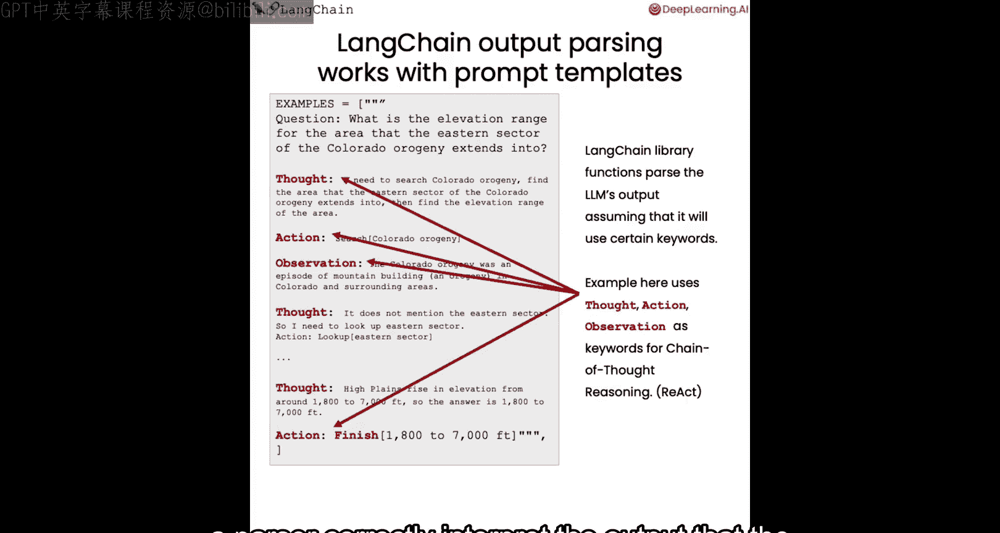
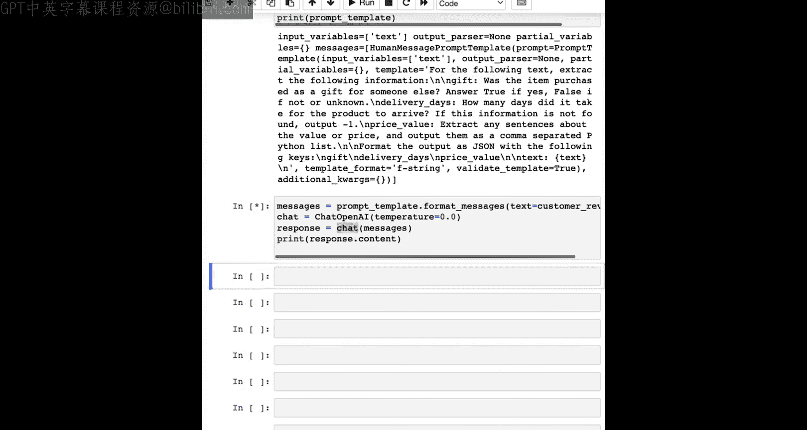
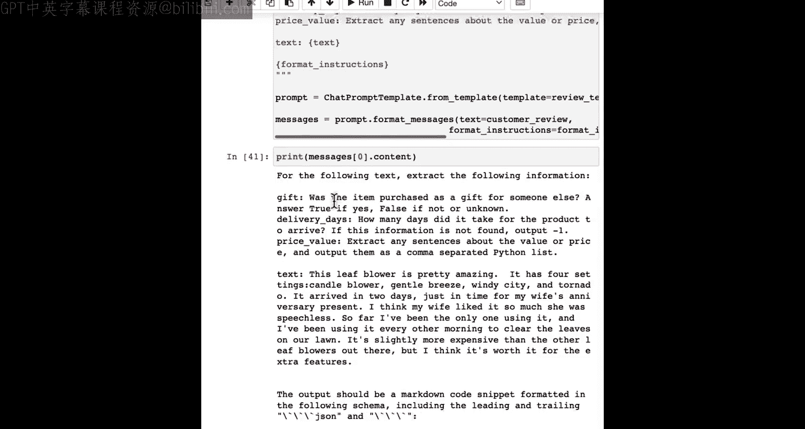
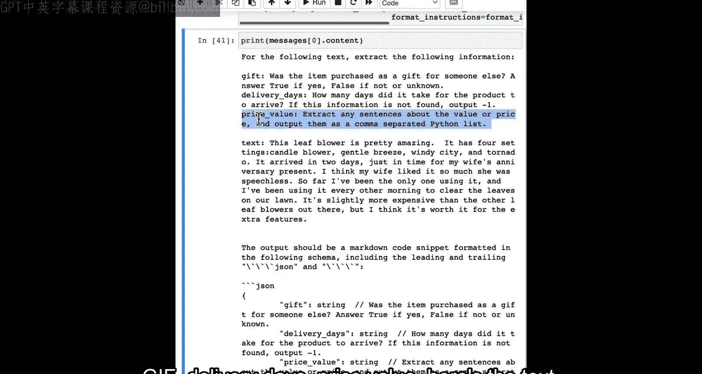
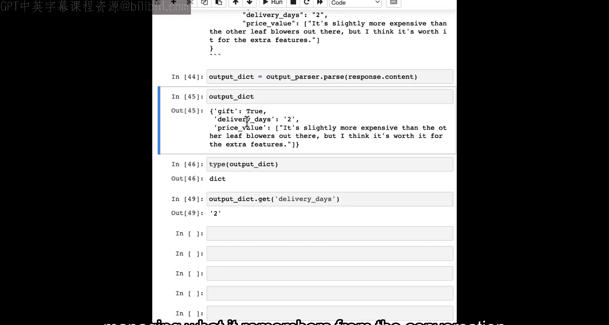

# 吴恩达《用于LLM应用程序开发的LangChain》｜langchain-for-llm-application-development｜中英字幕 - P2：2_LangChain_L1_v02.zh_en - GPT中英字幕课程资源 - BV1zu4y1Z7mc

In lesson one we'll be covering models prompts and parsers。

 so models refers to the language models underpinning a lot of it prompts refers to the style of creating inputs to pass into the models and then parsers is on the opposite end it involves taking the output of these models and parsing it into a more structured format so that you can do things downstream with it so when you build applications using an LM they'll often be reusable models we have repeatedly prompt and model pauses outputs and so La gives an easy set of abstracts to do this type of operation So that let's jump in and take look at models。

 prompts and pauses。

So to get started， here's a little bit of start code I'm going to import OS import Open AI and load my Open AI secret key the Open AI library is already installed in my Jupyter notebook environment if you're running this locally and you don't have open AI installed yet you might need to run that bank install Open AI。

 but I'm not going to do that here。And then here's a helper function。

 this is actually very similar to the Her function that you might have seen in the Ch GT Pro engineering forDevelop course that I offered together with Open eyes E forfeit and so with this helper function you can say get to completion on what is one plus one and this will call。

C G or technically the model GP 3。5 terrible to give you an answer back like this。

Now to motivate the line chain abstractions for model prompts and pauses。

 let's say you get an email from a customer in a language other than English。

In order to make sure this is accessible， the other language I'm going to use is the English pirate language。

 where the concernss are， I'd be fuming that me blend a lid through off and flattened my kitchen walls was smoothie。

😊，And to make matters worse， the warranty don't cover the cost of cleaning up me kitchen。

 I need your help right now， Mie。And so what we will do is ask this LOM to translate the text to American English in a calm and respectful tone。

 so I'm going to set style to American English in a calm and respectful tone。

And so in order to actually accomplish this， if you've seen a little bit of counting before。

I'm going to specify the prompt using an F string with the instructions。

 translate the text that is delimited by triple Bas into style that is style and then plugging these two styles。

 and so this generates。A prompt？That says translate the text and so on。

 I encourage you to pause the video and run a code and also try modifying the prompt to see if you can get a different output。

You can then。嗯。Prompt the large language model to get a response。

Let's see what the response is has translated the English pirate's message to this very polite。

 I'm really frustrated and my blenderlet flew off and made a mess of my kitchen walls was smoothie and so on。

😊，I could really use your help right now， my friend， that sounds very nice。😊。

So if you have different customers writing reviews in different languages。

 not just English pirates French， German， Japanese and so on。😊。

You can imagine having to generate a whole sequence of prompts to generate such translations。

Let's look at how we can do this in a more convenient way using Lang chain。I'm going to import。

Chat Open AI， This is Laching's abstraction for the chat GT API Endpoint。

And so if I then said chat equal chat open AI and look like chatters。

 it creates object as follows that uses the chat GPT model， which is also called GPT 3。5 Tbo。

When I'm building applications， one thing I will often do is set the temperature parameter to be equal to0。

 so the default temperature is 0。7， but let me actually redo that with temperature。Equals 0。

0 and now the temperature is set to zero to make his output a little bit less random。

And now let me define the template string as follows。

 translates the text delimited by tripleacts into style that is style and thenges to text。

And to repeatedly reuse this template， let's。Import Lands chat prompt template。And then。

Let me create the prompt template using that template string that we just rolled above。

From the prompt template， you can actually extract the originalrsen prompt and it realizes that this prompt has two input variables。

 the style and the text which where。Shall here with the curly braces。

And here is the original template as well that we had specified。And fact， I were to print this out。

It realizes it has two input variablesables， style and text。 Now， let's specify the style。

 This is a style that I want the customer message to be translated to。

 So I'm going to call this customer style。And。Here's my。Same customer email as before。And now。

If I create custom messages， this will generate the prompt。

And we'll pass this a large language more than a minute to respond。 So if you want to。

Look at the types， the custom message is actually a list。And if you look him。

The first element of the list。This is more or less that prompts that。

You would expect this to be creating。Lastly， US pass prompt to the LOM， so I'm going to call。Chat。

 which we had said earlier as a reference to the open AI chat G endpoint。And。😊。

If we print out the customer responses content， then it gives you back this。

Checks translated from English pirate to polite American English and of course you can imagine other use cases where the custom emails are in other languages and this too can be used to translate the messages for an English speaking to understand and reply to and encourage you to pause the video and render the code and also try modifying the prompt to see if you can get a different output。

Now， let's hope our customer service agent reply to the customer in their original language。

 So let's say。English speaking customer service agent Rs he says， hey there。

 customer warranty does not cover cleaning expenses for kitchen because it's your fault that you misuse your blender by f upon the lid。

 tough luck， see， not a very polite message， but let's say this is what a customer service agent wants。

We are going to specify it。That the service message is going to be translated to this p style。

 So we want it to be in a polite tone that speaks in。

English pirate and because we have previously created that prompt template。

 the cool thing is we can now reuse that prompt template and specify that the output style we want is this service style pirate and the text is this service replied。

And if we do that。That's the prompt。And if we prompt Ch GT， this is the response it gives us back。

Oh there Mti， I must kindly inform you that the warranty be not covering the expenses or cleaning your galley and so on I tell like Pho meharti。

 So you might be wondering why are we using prompt templates instead of just an F string the answer is that as you build sophisticated applications。

 prompts can be quite long and detailed and so prompt templates are a useful abstraction to help you reuse good prompts when you can。

 this is an example of a relatively long prompt to grade a student's submission for online learning application and a prompt like this can be quite long in which you can ask the LM to solve the problem and then have the output in a certain format and output in a certain format and wrapping this in a line chain prompt makes it easier to reuse a prompt like this。

😊，Also you see later that Lacha provides prompts for some common operations。

 such as summarization or question answering or connecting to SQL databases or connecting to different APIs。

 and so by using some of LaChas built in prompts you can quickly get an application working without needing to engineer your own prompts。

 one other aspect of LaCha's prompt libraries is that it also supports output pasing。

 which we'll get to in a minute， but when you're building a complex applications using an LOM。

You often instruct the LM to generate its output in a certain format such as using specific keywords。

 this example on the left illustrates using an LOM to carry out something called chain of thought reasoning using a framework called the react framework but don't worry about the technical details。

 But the keys of that is that the thought is what the LOM is thinking because by giving an LM space to think it can often get a more accurate conclusions。

 Then action as a keyword to carry the specific action and then observation to show what it learned from that action and so on。

 and。If you have a prompt that instructs the LOM to use these specific keywords， thought。

 action and observation， then this prompt can be coupled with a parer to extract out the text that has been tagged with these specific keywords and so that together gives a very nice abstraction。

To specify the input to an LOM and then also have a parer correctly interpret the output that the LOM gives。

And so with that， let's return to see an example of an output parser using line chain。

In this example， let's take a look at how you can have an LM output JN and use line chain to pause that output and the one example toll use will be to extract information from a product review and format that output in adjacent J format。

 So here's the example of how you would like the output to be formatted technically this is a Python dictionary。

Where whether or not the product is a gift maps the falls， the number of days took the deliver was 5。

 and the price value was pretty affordable。So this is one example of a desired output。

Here is an example of。Customer review as well as a template to try to get to that JSN output。

So here's a customer review it says this lead blur is pretty amazing and has four settings。

 candle blower， gender breezeze， windyity and tornado。

It arrived in two days just in time for my wife anniversary present I think my wife liked it so much she was speechless so far I've been the only one using it and so on and here's a review template for the following types extract the following the information specify was this a gift so in this case it would be yes because this is a gift and also delivery days how long did it take to deliver looks like in this case it arrived in two days and what the value you know slightly more expensive other lead blowers and so on。

😊，So the review template asked the LOM。To take as input a customer review and extract these three fields and then format the output as Jason with the following keys。

All right。So here's how you can wrap this in line， let's import the chat prompt template。

 we've actually imported this already earlier， so technically this lines redundant but I'll just import it again and then have the prompt template created from the review template。

Up on top。 and so here's the prompt template。And now。

 similar to our earlier usage of a prompt template， this create the。

Messages to pass to the open the eye endpoint。Treat the open air endpoints。

Call that endpoint and then let's print out the response。

I encourage you to pause the video and run a cold。

And there it is。 It says give is through delivery days is 2。

 and the price value also looks pretty accurate。 But note that if we。Check the type。

Of the response this is actually a string so it looks like Jason and looks like has key value pair。

 but it's actually not to dictionary。 This is just one long string So what I really like to do is go to the response content and get the value from the gift key which should be true but I run does this should generate an error because well this is actually a string this is now the Python dictionary。

😊，So let's see how we would use Lanching's parser in order to do this。I'm going to import。

Response schema and structured output P from La chain。

And I'm going to tell it what I wanted to pause by specifying these response schemas。

 So the gift schema is named gift， and here's the description。

 was the item purchase is a gift for someone else。On true of yes falls if not so unknown and so on。

 so have a gift schemechema， delivery day schema， price value schemechema。

 and then let's put all three of them into a list as follows now that I specified the schema for these launching can actually give you the prompt itself by。

Having the output rep tell you what instructions it wants you to send to the RM server I where to print。

Formats， instructions。She has a pretty precise instructions for the LLM that a de generate outputs that the output parser can process。

So here's a new review template。And the review template includes the format main instructions that Lang chain。

Genrated。And sub can create a prompt。From the review template to， and then create the。

Messages that will pass。To the open E eye endpoint。If you want。

 you can take a look at the actual prompts。

Which gets the instructions to extract。The fees， gift， delivery days， price value。

Here's the text， and then here are the formatting instructions。Finally， if we。Call the open eye。

And point。Let's take a look at what response we got。It is now this。

And now if we use the output pause that we created。Earlier。

You can then pause this into an output dictionary。Reion if I print looks like this and notice that。

This is。Of type dictionary， not the string。Which is why I can。

Now extract the value associated with a key gift and get true or the value associated with delivery days and get two。

 or you can also extract the value associated with price value。

So this is a nifty way to take your LM output and parse it。

Into a Python dictionary to make the output easier to use in downstream processing。

 I encourage you to pause a video and run a code。And so that's it for models。

 prompt and parss with these tools， hopefully you'll be able to reuse your own prompt templates easily。

 share prompt templates with others that you're collaborating with。

 even use Las builtin prompt template， which as you just saw can often be coupled with an output parser。

 so that the input prompt to output in a specific format and in a parser。

 pauses that output to store the data in a Python dictionary or some other data structure that makes it easy for downstream processing。

I hope you find this useful in many of your applications and with that let's go to the next video where we'll see how Lankcha can help you build better chatbots or have an LM have more effective chats by better managing what it remembers from the conversation you've had so far。

