# 吴恩达《用于LLM应用程序开发的LangChain》｜langchain-for-llm-application-development｜中英字幕 - P3：3_LangChain_L2_v02.zh_en - GPT中英字幕课程资源 - BV1zu4y1Z7mc

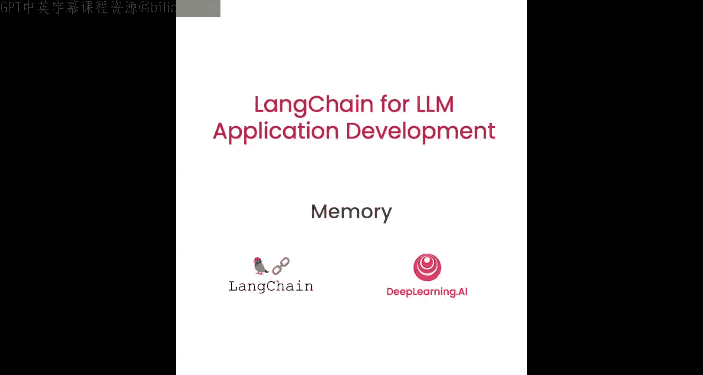

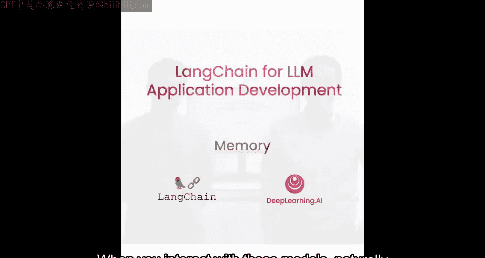

When you interact with these models naturally they don't remember what you say before or any of the previous conversation。

 which is an issue when you're building some applications like ChaA and you want to have a conversation with them and so in this section will'll cover memory。

 which is basically how do you remember previous parts of the conversation and feed that into the language model so that they can have this conversational flow as you're interacting with them？

So L chain offers multiple sophisticated options for managing these memories。

 let's jump in and take a look。

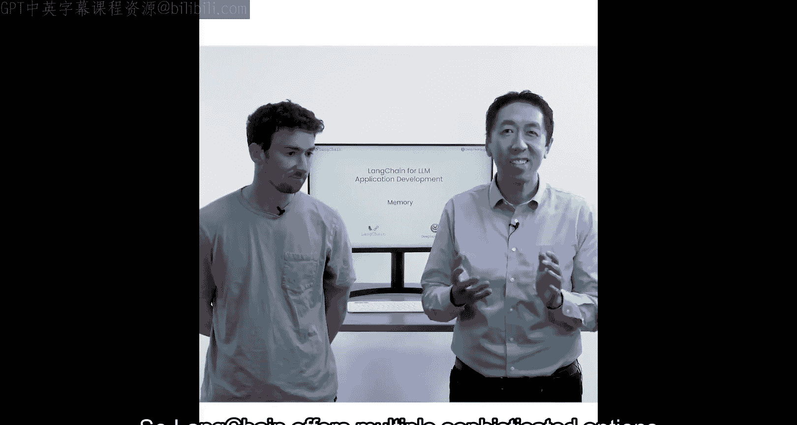

So let me start off by importing my Open air API key and then let me import a few tools that I need。

Let's use as the motivating example for memory using La to manage a chat or a chat bot conversation。

 So to do that， I'm going to set to OM as a chat interface of open AI with T equal0 and。

I'm going to use。The memory as a conversation buffer memory。 And you see later what this means。

And I'm going to build a conversation chain again later in this short course。

 Harrison will dive much more deeply into what exactly is a chain and land chain。

 so don't worry too much about the details of the syntax panel。

But this builds an LIM and if I start to have a conversation， conversation dot predict。

 give the input， hi my name is Andrew。Let's see what it says。 Hello， and just nice to meet you。

 right， and so on。 And then let's say I ask it。😊，What is one plus one。

Well one plus is two and then ask it again， you know， what's my name？Your name is Andrew。

 as you mentioned earlier， slow enough trace of sarcasm there， notsha。 And so if you want。

 you can change this ver variable to true。To see what lounge chain is actually doing。

When you run predict how my name was Andrew， this is the prompt the Lcha is generating。

 It says the following of friendly conversation between human and an AI is talkative and so on。

 So this is a prompt that L has generated to have the system have a hopeful and friendly conversation and it has to save the conversation and hear's a response and when you。

Execute this on the。Second， the third part of the conversation is it keeps the prompt as follows and notice is that。

By the time I'm uttering， well is my name， thiss a third turn， that's my third input。

It has slowed the current conversation。As follows， Harmony Alex was one plus one and so on。

 And so this memory or this history of the conversation gets longer and longer。😊，In fact， up on top。

 I had used the memory variable to store the memory。 so I to print memory dot buffer， it has stored。

The conversation so far， you can also print this out memory thought load memory variabless。

The curly braces here is actually an empty dictionary。

 There's some advanced features that you can use with a more sophisticated input。

 but we won't talk about them in this short course so don't worry about why does an empty curly braces here。

 but this is what Lacha has remembered in the memory of the conversation so far is just everything that the AI or that the human has said I encourage you to pause the video and run the code So the way that Lacha is thing the conversation is with this conversation buffer。

Memory。If I were to use the conversation path for memory to specify a couple of inputs and outputs。

 this is how you add new things to the memory if you wish to do so explicitly。

 memory without save context says， hi， what's up？I know this is not the most exciting conversation。

 but I wanted to have a short example。And with that， this is。What the status of the memory is。

 And once again， let me actually show the。Memory variables。Now， if you want to add additional。

Data to the memory。 you can keep on saving additional contact。 So conversation goes on。

 Not much just hang， cool。And if you print out the memory， you know， there's now more stuff in it。

So we use a large language model for a chat conversation。😊。

The large language model itself is actually stateless。

 the language model itself does not remember the conversation you've had so far and each transaction。

 each call to the API endpoint is independent。And chatbot is a period of memory only because there's usually rep code that provides the full conversation that's been had so far as context of the LLM and so the memory can store explicitly the turns or the utterances so far。

 how many names is Andrew， other nice meet you and so on。

 and this memory store which is used as input or additional context of the LLM so that it can generate an output as if it's just having the N。

Converational turn， knowing what's been said before。And。As the conversation becomes long。

 the amounts of memory needed becomes really， really long and thus the cost of sending a lot of tokens to the LM。

 which usually charges based on the number of tokens in ease the process。

 will also become more expensive， So chain provides several convenient kinds of memory to store and accumulate the conversation。

So far we've been looking at the conversation buffer memory。

 let's look at a different type of memory。I'm going to import the conversation buffer window。Mrry。

That only keeps a window of memory if I set memory to conversational buffer window memory with K equals 1。

 The variable K equals 1 specifies that I wanted to remember just one conversational exchange。

 That is one utter from me and one utterance from the chat bot。 So now if I were to have it。

 Sa context。 how was up。 Nor much just hang。😊，If I were to look at memory do load variables。

 it only remembers the most recent utterance。 Not is dropped high what's up， is's just saying。

Human says not much， just hanging and the AI says cool， so that's because K was equal to1。

So this is a nice feature because it lets you keep track of just the most recent few conversation alternative terms in practice you probably won't use this with k equals 1。

 you use this with K set a larger number but still this prevents the memory from growing without limit as a conversation goes longer and so if I were to rerun the conversation that we had just now。

You say hi， my name is Andrew。What is one plus one？And now I ask it， what is my name？

Because k equals 1， it only remembers the loss exchange which is1 is 1 plus 1。

 the answer is 1 plus equals 2， and has forgotten this early exchange， which is now says。

 sorry don't have access to that information。嗯。One thing I hope you will do is pause the video。

 change this to true in the code on the left and rerun this conversation with verbo equals true。

 and then you will see the prompts actually used to generate this and hopefully youll see that the memory。

When you're calling the LM on what is my name， that the memory has dropped this exchange where I learned what is my name。

 which is why it now says it doesn't know what is my name。With the conversational token。Buff memory。

The memory will limit the。Number of tokens saved and because a lot of LOM pricing is based on tokens。

 this maps more directly to the cost of the LOM calls。

So if I were to say the max token limit is equal to 50。 and actually， let me inject a few comments。

 So let's say the conversation is， AI is what amazing。😊。

Back Pros what beautiful chapels are what charming。

 I use ABC as the first letter of all of these conversational termss who can keep track of what was sent when。

And are runs of high token limit。It has almost the whole conversation。

 If I increase the token limit to。100。It now has the whole conversation。

 sign of AI is what if I decrease it？Then， you know。

 it chops off the earlypo this conversation to retain the number of tokens corresponding to the most recent exchanges。

 but subject to not exceeding the token limit。And in case you're wondering why we needed to specify an OOM is because different LOMs use different ways of counting tokens。

 so this tells it to use the way of counting tokens that the chat Open theIOOM uses。

 I encourage you to pause the video and render the code and also try modifying the prompt to see if you can get a different output。

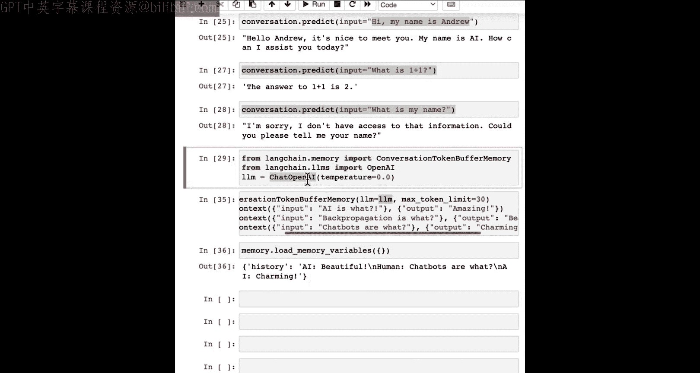

Finally， there's one last type of memory I want to illustrate here。

 which is the conversation summary。Bffer。Memory。And the idea is instead of limiting the memory to fixed number of tokens based on the most recent utterances or a fixed number of conversational exchanges。

Let's use an LOM to write a summary of the conversation so far and let that be the memory。

So here's the example where I'm going to create a long string with someone's schedule。

 you know theres media A with your product team， you need your PowerPoint presentation and so on and so on。

 So there's a long string saying what's your schedule。

 you maybe ending with a noon lunch at the Italian restaurant with a customer bring your laptop。

 show the latest OM demo。And so， let me use a。Conversation。

 summary buffer memory with a max token limit of 400 in this case， pretty high token limit。

And I'm going to。Iner in。A few conversational terms in which we start with Hulow was up no much just hang。

啊。Cool， and then。What is on the schedule today and the response is that long schedule。So this。Memory。

Now has quite a lot of text in it。 in fact， let's take a look。At the memory variables。

 it contains that entire piece of text。Because40 tokens was sufficient to slow。All this text。But now。

 if I were to reduce the max token limit， say to 100 tokens。Remember。

 this storess the entire conversational history if I reduce the number of tokens to 100。Then。

The conversation summary buffer memory has actually used an LLM。

 the open AI endpoint in this case because that's where we are set the LLM to to actually generate a summary of the conversation so far。

 so the summary is human AI engaged in small talkub before disability schedule。

 A inform human and morning meeting， blah， blah， blah。

 lunch meeting with customer interests the AI in latest AI developments。

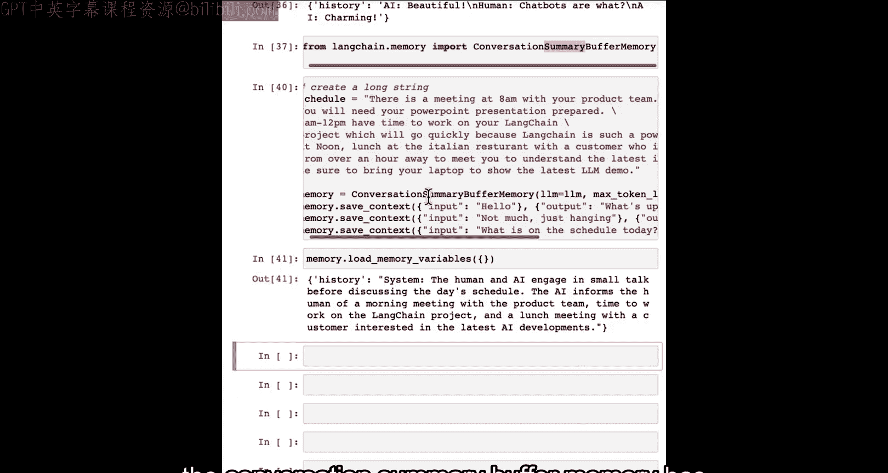

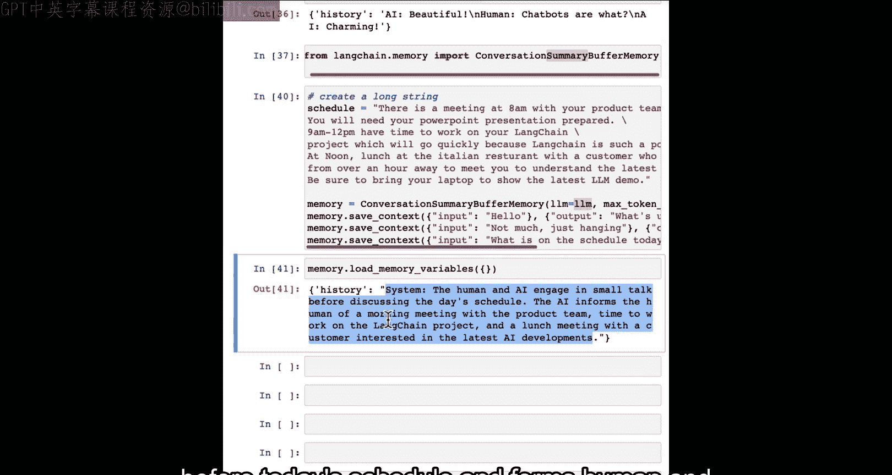

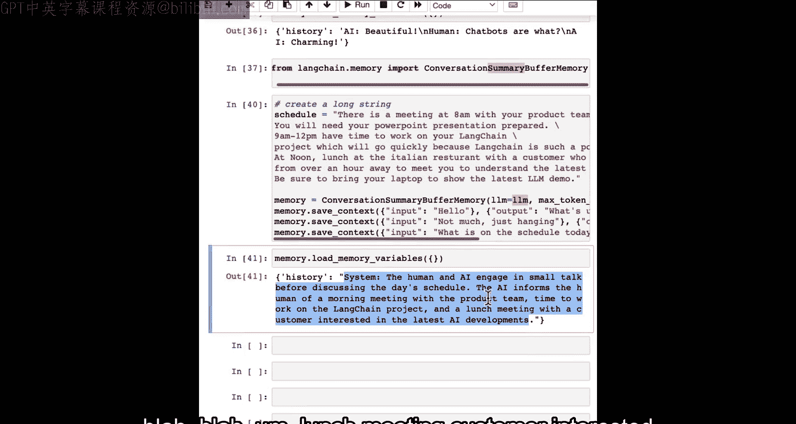

And so if we were to have a conversation。Using this OM。

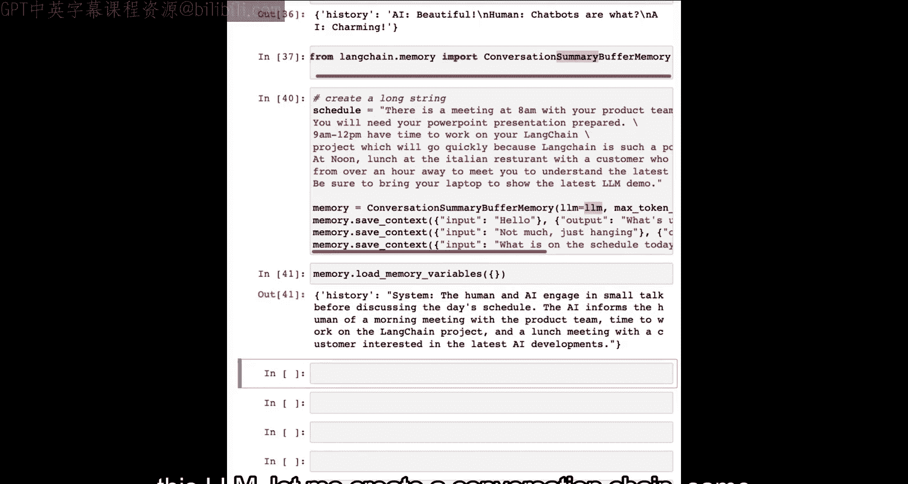

Let me create a conversation chain。Same as before。And。Let's say that we were to ask。

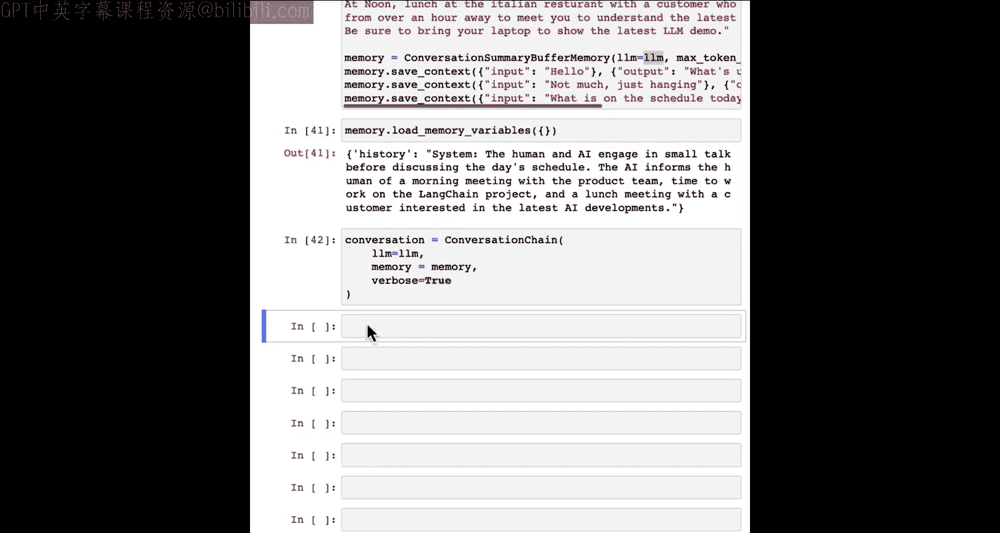

You know， input what would be a good demo to show I sent verbo he goes true， so here's the prompt。

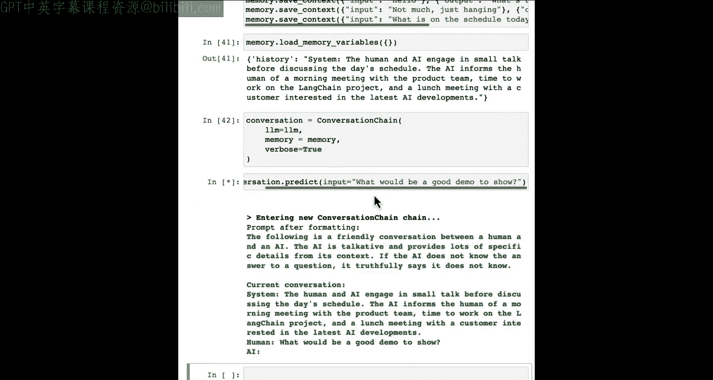

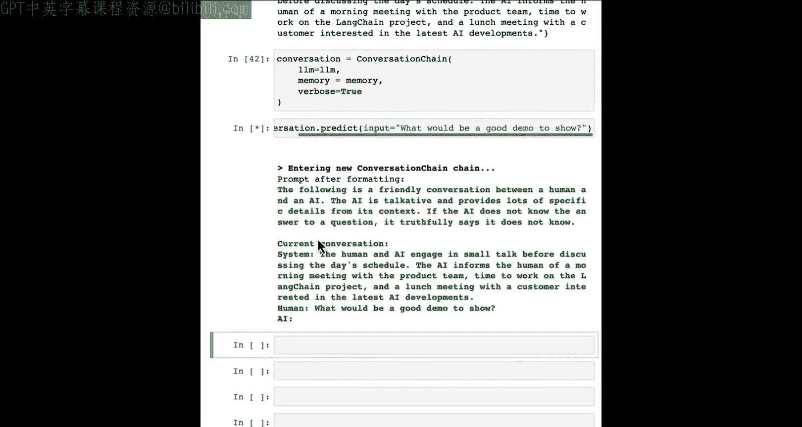

The LM thinks the current conversation。Has had。This discussion， so far。

Because that's the summary of the conversation。And。

Just one note if you're familiar with the Open AI chat API Endpoint。

There is a specific system message In this example。

 this is not using the official open AI system message。

 It's just including it as part of the protier， but it nonetheless works pretty well。

 And given this prompt， you know， the outputs basic conencies in our developments are suggest showcasing our latest NRP capabilities。

 other it does go。

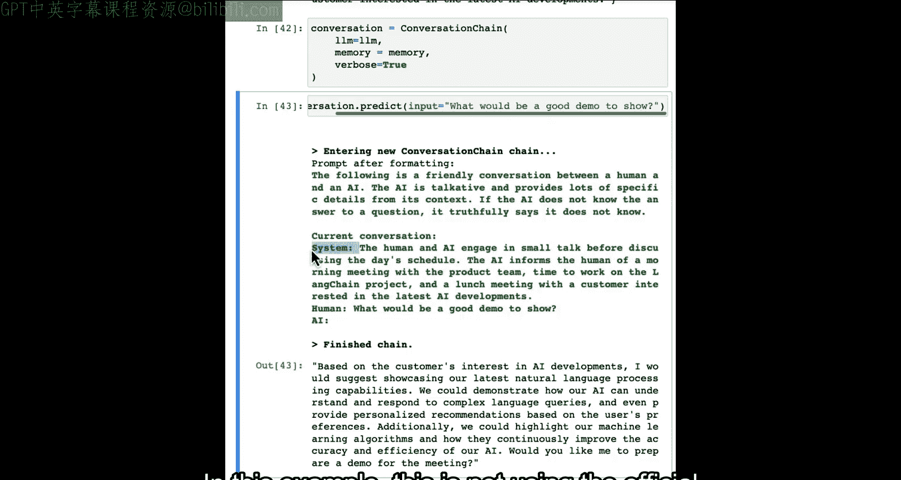

嗯。Well， is you know， making some suggestions to the cool demos and makes you think if I was meeting a customer。

 I would say， boyoy， if only there were open source framework available to help me build cool NLP applications using LOMs。

Good things is laing。😊，Oh。And the interesting thing is if you now look at what has happened to the memory。

So notice that here it has incorporated the most recent AI system output。

 whereas my utterance asking it won't be a good demo to show has been incorporated into the system message know the overall summary of the conversation so far with the conversation summary buffer memory what it tries to do is keep the explicit storage of the messages。

Up to the number of tokens we have specified as a limit。 So you know this part。

 the explicit storage or try to cap at 100 tokens because that's what we' would asked for。

 And then anything beyond that， it will use the LM to generate a summary。

 which is what is seen up here。And even though I've illustrated these different memories using a chat as a running example。

These memories are useful for other applications too where you might keep on getting new snippets of text or keep on getting new information。

 such as the your repeatedly goes online to search for facts。

 but you want to keep the total memory used to store this growing list of facts as your cat and not growing arbitrarily long I encourage you topose the video and render code。

In this video you saw a few types of memory including often memories that limits based on number of conversation exchanges or tokens or a memory that can summarize tokens above a certain limit Lacha actually supports additional memory types as well one of the most powerful is vector data memory if you're familiar with word embeddings and text embeddings the vector database actually store session embeddings if you don't know what that means don't worry about it。

 Harrison will explain it later。And it can then retrieve the most relevant blocks of text using this type of a vector database for its memory。

And Langchin also supports entity memories， which is applicable when you wanted to remember details about specific people。

 or specific other entities， such as if you talk about a specific friend， you can have Laang。

 remember facts about that friend， which should be。

An entity in an explicit way when you're implementing applications using Langcha。

 you can also use multiple types of memories， such as using one of the types of conversation memory that you saw in this video plus additionally entity memory to recall individuals So this way you can remember maybe a summary of the conversation plus an explicit way of storing important facts about important people in the conversation and of course。

 in addition to using these memory types is also not uncommon for developers to store the entire conversation in the conventional database。

 some sort of keyvalue store or SQL database you could refer back to the whole conversation for auditing or for improving the system further and so that's memory types。

 I hope you find it useful building your own applications and now let's go on to the next video to learn about the key building block of Langcha namely the chain。

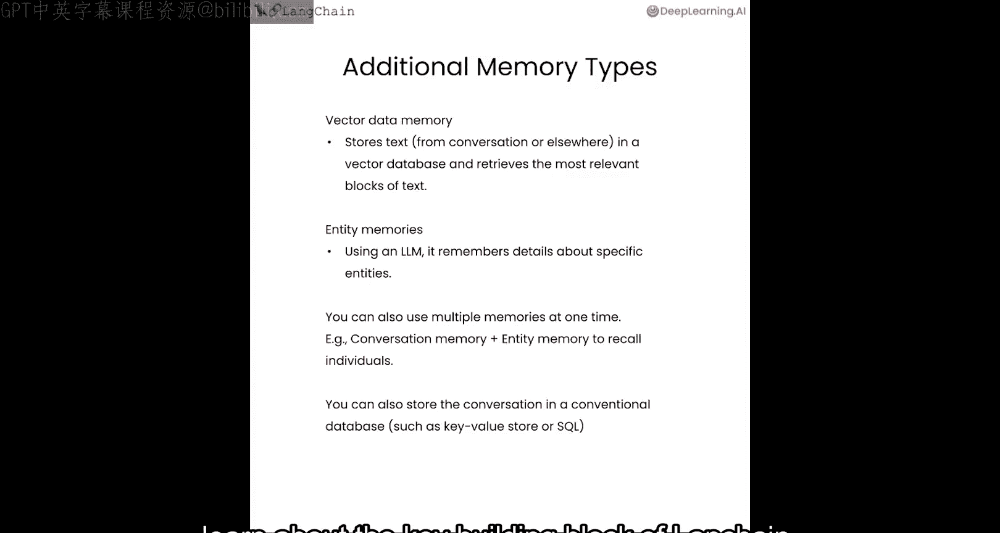