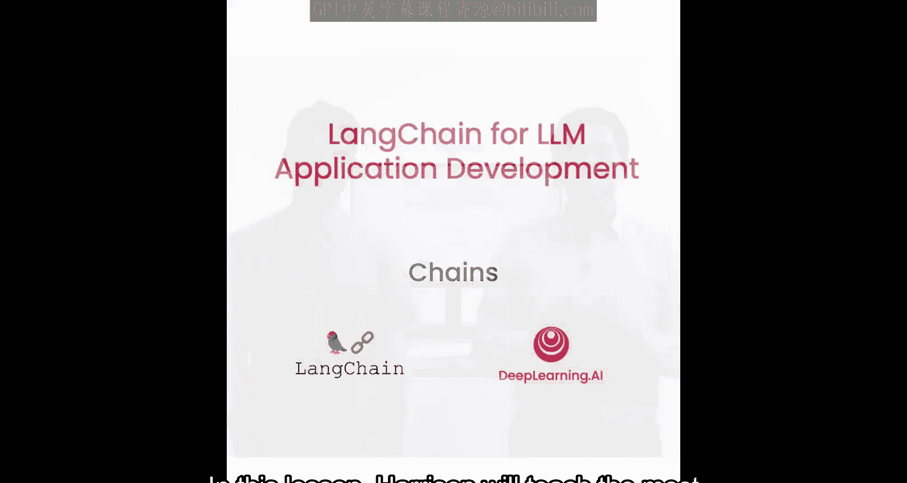
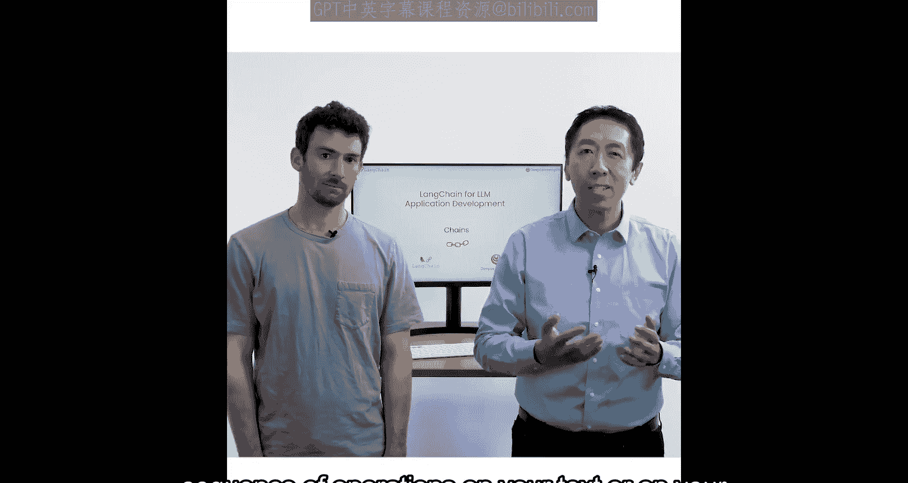
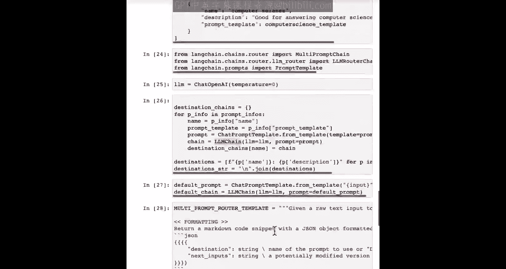
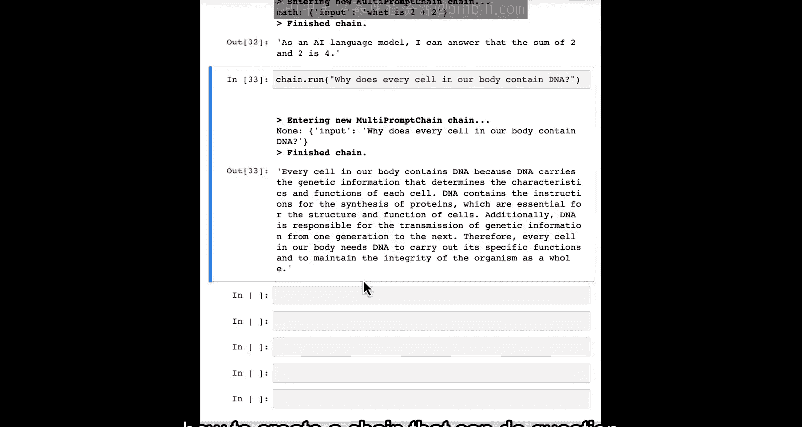

# 吴恩达《用于LLM应用程序开发的LangChain》｜langchain-for-llm-application-development｜中英字幕 - P4：4_LangChain_L3_v02.zh_en - GPT中英字幕课程资源 - BV1zu4y1Z7mc

In this lesson， Harrison will teach the most important key building block of land chain。

 namely the chain。

The chain usually combines an LM large language model together with a prompt and with this building block。

 you can also put a bunch of these building blocks together to carry out a sequence of operations on your text or on your other data。

 I'm excited to dive into it All right to start we're going to load the environment variables as we have before and then we're also going to load some data that we're going to use So part of the power of these chains is that you can run them over many inputs at a time here we're going to load a panda's data frame a panda's data frame is just a data structure that contains a bunch of different elements of data if you're not familiar with pandas。

 don't worry about it， the main the main point here is that we're loading some data that we can then use later on And so if we look inside this panda's data frame we can see that there is a product column and then a review column and each of these rows is a different data point that we can start passing through our chains。

😊。

So the first chain we're going to cover is the LLM chain and this is a simple but really powerful chain that underpins a lot of the chains that will go over in the future and so we're going to import three different things we're going to import the open AI model so the LLM we're going to import the chat prompt template and so this is the prompt and then we're going to import the LLM chain。

And so first， what we're going to do is we're going to initialize the language model that we want to use。

 so we're going to initialize the chat open AI with a temperature with a high temperature so that we can get some fun descriptions。

Now we're going to initialize a prompt and this prompt is going to take in a variable called product。

 it's going to ask of the LLM to generate what the best name is to describe a company that makes that product。

And then finally， we're going to combine these two things into a chain。

And so this is what we call an LLM chain， and it's quite simple it's just the combination of the LLM and the prompt。

But now this chain will let us run through the prompt and into the LOM in a sequential manner。

 and so if we have a product called queen sizeize sheet set。

 we can run this through the chain by using chain dot run and what this will do is it will format the prompt under the hood and then it will pass the whole prompt into the LOM and so we can see that we get back the name of this hypothetical company called Royal beddings。

And so here would be a good time to pause and you can input any product descriptions that you would want and you can see what the chain will output as a result。

So the LLM chain is the most basic type of chain and that's going to be used a lot in the future and so we can see how this will be used in the next type of chain which will be sequential chains and so sequential chains run a sequence of chains one after another so to start you're going to import the simple sequential chain and this works well when we have subchains that expect only one input and return only one output。

And so here we're going to first create one chain which uses an LLM and a prompt。

 and this prompt is going to take in。The product and will return the best name to describe that company。

 so that will be the first chain。Then we're going to create a second chain。

 and this second chain will take in the company name and then output a 20 word description of that company。

And so you can imagine how these chains might want to be run one after another。

 where the output of the first chain， the company name is then passed into the second chain。

We can easily do this by creating a simple sequential chain where we have the two chains described there。

 and we'll call this overall simple chain。Now what you can do。

Is run this chain over any product description。And so if we use it with the product above the queen size sheet set。

 we can run it over and we can see that it first outputs royal bedding and then then it passes it into the second chain and it comes up with this description of what that company could be about。

The simple sequential chain works well when there's only a single input in a single output。

 but what about when there are multiple inputs or multiple outputs。

 and so we can do this by using just the regular sequential chain。

So let's import that and then you're going to create a bunch of chains that we're going to use one after another。

 we're going to be using the data from above which has a review and so the first chain we're going to take the review and translate it into English。

With a second chain， we're going to create a summary of that review in one sentence。

And this will use the previously generated English review。

The third chain is going to detect what the language of the review was in the first place。

 and so if you notice this is using the review variable that is coming from the original review。

And finally， the fourth chain will take in multiple inputs。

 so this will take in the summary variable， which we calculated with the second chain and the language variable which we calculated with the third chain and is going to ask for a follow up response to the summary in the specified language。

One important thing to note about all these subchains is that the input keys and output keys need to be pretty precise。

So here we're taking in review， this is a variable that will be passed in at the start。

We can see that we explicitly set the output key to English review。

This is then used in the next prompt down below， where we take in English review with that same variable name。

And we set the output key of that chain to summary， which we can see is used in the final chain。

The third prompt takes in review the original variable， and output language。

 which has again used in the final prompt。It's really important to get these variable names lined up exactly right because there's so many different inputs and outputs going on and if you get any key errors。

 you should definitely check that they are lined up so。

The simple sequential chain takes in multiple chains where each one has a single input and a single output。

To see a visual representation of this， we can look at the slide where it has one chain。

Feeding into the other chain one after another。Here we can see a visual description of the sequential chain。

 comparing it to the above chain， you can notice that any step in the chain can take in multiple input variables。

This is useful when you have more complicated downstream chains that need to be a composition of multiple previous chains。

Now that we have all these chains， we can easily combine them in the sequential chain。

 so you'll notice here that well pass in the four chains we created into the chains variable we'll create the inputs variable with the one human input which is the review。

 and then we want to return all the intermediate outputs so the English review the summary and then the follow up message。

Now we can run this over some of the data， so let's choose a review and pass it in through the overall chain。

We can see here that the original review looks like it was in French。

 we can see the English review as a translation， we can see a summary of that review。

 and then we can see a follow up message in the original language of French。

You should pause the video here and try putting in different inputs。So far。

 we've covered the LLM chain and then a sequential chain。

 But what if you want to do is something more complicated。

 a pretty common but basic operation is to route an input to a chain depending on what exactly that input is。

 a good way to imagine this is if you have multiple subchains。

 each of which specialized for a particular type of input， you could have a router chain。

 which first decides which subchain to pass it to and then passes it to that chain。

For a concrete example， let's look at where we are routing between different types of chains depending on the subject that seems to come in。

So we have here different prompts， one prompt is good for answering physics questions。

 the second prompt is good for answering math questions， the third for history。

 and then a fourth for computer science， let's define all these prompt templates。

After we have these prompt templates， we can then provide more information about them。

 we can give each one a name and then a description。

 this description for the physics one is good for answering questions about physics。

This information is going to be passed to the router chain so the router chain can decide when to use this subchain。

Let's now import the other types of chains that we need Here we need a multi prompt chain。

 This is a specific type of chain that is used when routing between multiple different prompt templates。

As you can see， all the options we have are prompt templates themselves。

 But this is just one type of thing that you can route between。

 You can route between any type of chain。 The other classes that we'll implement here are an LLM router chain。

 This uses a language model itself to route between the different subchains。

 This is where the description and the name provided above will be used。

We'll also import a router output parser。 This parses the LL output into a dictionary that can be used downstream to determine which chain to use and what the input to that chain should be。

Now we can get around to using it first， let's import and define the language model that we will use。

We now create the destination chains， these are the chains that will be called by the router chain。

 as you can see each destination chain itself is a language model chain， an LLM chain。

In addition to the destination chains， we also need a default chain。

 this is a chain that's called when the router can't decide which of the subchains to use。

 and the example above this might be called when the input question has nothing to do with physics。

 math， history or computer science。Now we define the template that is used by the LLM to route between the different chains。

This has instructions of the task to be done as well as the specific formatting that the output should be in。

Let's put a few of these pieces together to build the router chain。First。

 we create the full router template by formatting it with the destinations that we defined above。

 This template is flexible to a bunch of different types of destinations。

 One thing you can do here is pause and add different types of destinations。

 So up here rather than just physics， math， history and computer science。

 you could add a different subject like English or Latin。Next。

 we create the prompt template from this template， and then we create the router chain by passing in the LLM and the overall router prompt。

Note that here we have the router output parser。 This is important as it will help this chain decide which some chains to route between。

And finally， putting it all together， we can create the overall chain， this has a router chain。

 which is defined here， it has destination chains which we pass in here。

 and then we also pass in the default chain。We can now use this chain。

 so let's ask you some questions。If we ask it a question about physics。

 we should hopefully see that it is routed to the physics chain。With the input。

 what is black body radiation， and then that is passed into the chain down below and we can see that the response is very detailed with lots of physics details。

You should pause the video here and try putting in different inputs you can try with all the other types of special chains that we have defined above so for example。

 if we ask it a math question。

We should see that it's routed to the math chain and then passed into that。

We can also see what happens when we pass in a question that is not related to any of the subchas。

 so here we ask it a question about biology and we can see the chain that it chooses is none。

This means that it will be passed to the default chain。

 which itself is just a generic call to the language model。

 the language model luckily knows a lot about biology so it can help us out here。

Now that we've covered these basic building blocks types of chains we can start to put them together to create really interesting applications。

 for example， in the next section we're going to cover how to create a chain that can do question answering over your document。

😊。

