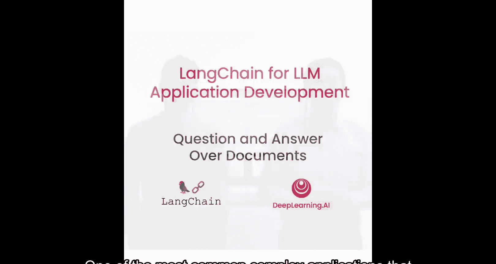
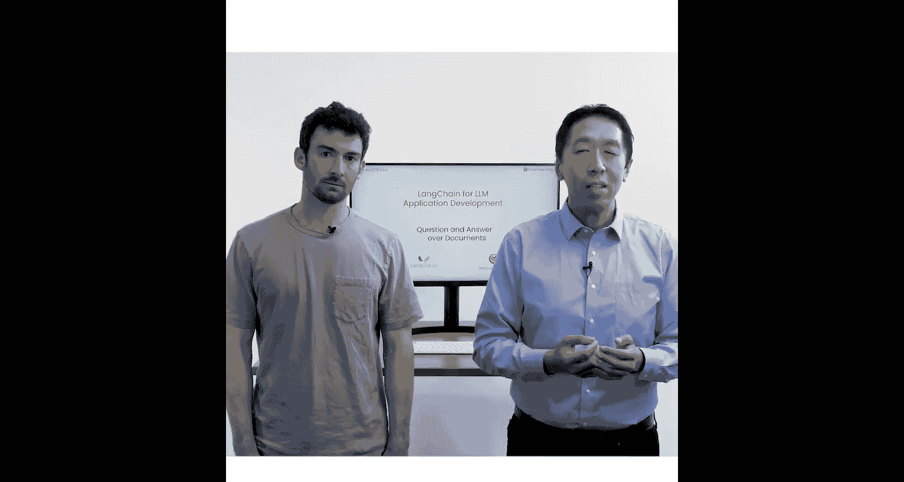
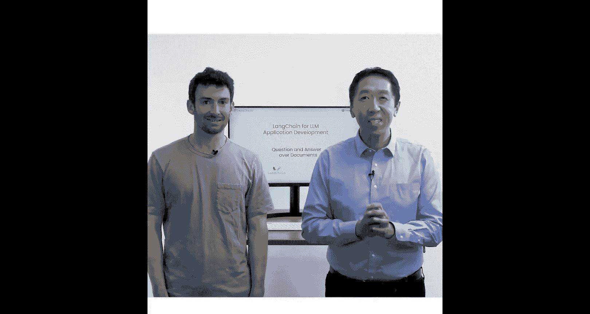
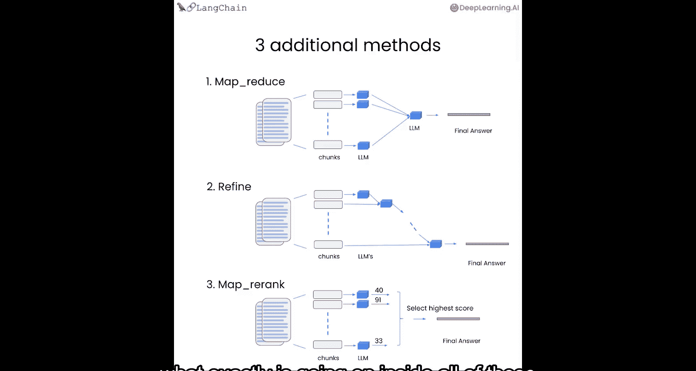

# 吴恩达《用于LLM应用程序开发的LangChain》｜langchain-for-llm-application-development｜中英字幕 - P5：5_LangChain_L4_v02.zh_en - GPT中英字幕课程资源 - BV1zu4y1Z7mc

One of the most common complex applications that people are building using an LOM is a system that can answer questions on top of or about a document So given the piece of text may be extracted from PDF file or from webpage or from some companies innet internal document collection can you use an LM to answer questions about the content of those documents the hope uses gain a deeper understanding and get access to the information that they need this is really powerful because it starts to combine these language models with data that they weren't originally trained on so it makes them much more flexible and adaptable to your use case It's also really exciting because we'll start to move beyond language models prompts and output parsers and start introducing some more of the key components of LCha such as embedding models in vector stores As Andrew mentioned this is one of the more popular trains that we've got so I hope you're excited。

In fact， embeddings and vector lawss are some of the most powerful modern techniques。

 so if you have not seen them yet， they are very much worth learning about so with that let's dive in。

 let's do it。😊。

So we're going to start by importing the environment variables as we always do。

Now we're going to import some things that will help us when building this chain。

 We're going import the retrieval Qa chain。 This will do retrieval over some documents。

 We're going to import our favorite chat openaiI language model。

 We're going import a document loader。 This is going to be used to load some proprietary data that we're going to combine with the language model。

 In this case， it's going to be in a CV。 So we're going import the CV loader。 Finally。

 we're going to import a vector store。 There are many different types of vector stores and we'll cover what exactly these are later on。

 but we're going to get started with a dock array in memoryory search vector store。

 This is really nice because it's an inmemory vector store。

 and it doesn't require connecting to an external database of any kind。

 So it makes it really easy to get started。😊，We're also going to import。

 display and Markdown to common utilities for displaying information in Jupyter notebooks。

We've provided a CSV of outdoor clothing that we're going to use to combine with the language model Here we're going to initialize a loader。

 the CSV loader with a path to this file。We're next going to import an index。

 the vector store index creator， this will help us create a vector store really easily。

As we can see below， itll only be a few lines of code。To create this。To create it。

 we're going to specify two things。 First， we're going to specify the vector store class。

 As mentioned before， we're going to use this vector store as it's a particularly easy one to get started with。

After it's been created， were then I can call from loaders。

 which takes in a list of document loaders， we've only got one loader that we really care about。

 so that's what we're passing in here。It's now been created and we can start to ask questions about it。

Below we'll cover what exactly happened under the hood， so let's not worry about that for now。

Here we'll start with a query， we'll then create a response using indexex query。

And pass in this query。Again， we'll cover what's going on under the hood down below for now。

 we'll just wait for it to respond。After it finishes。

 we can now take a look at what exactly it was returned。

 we've gotten back a table in markdown with names and descriptions for all shirts with sun protection。

We've also got a nice little summary that the language model has provided us。

So we've gone over how to do question answering over your documents。

 but what exactly is going on underneath the hood？First， let's think about the general idea。

 we want to use language models and combine it with a lot of our documents。But there's a key issue。

 language models can only inspect a few thousand words at a time。

 so if we have really large documents， how can we get the language model to answer questions about everything that's in there？

This is where embeddings and vector stores come into play。First， let's talk about embeddings。

Ebeddings create numerical representations for pieces of text。

This numerical representation captures the semantic meaning of the piece of text that it's been run over。

Pieces of text with similar content will have similar vectors。

This lets us compare pieces of text in the vector space， and the example below。

 we can see that we have three sentences。The first two are about pets。

 while the third is about a car。If we look at the representation in the numeric space。

 we can see that when we compare the two vectors on the pieces of text corresponding to the sentences about pets。

 they're very similar， well if we compare it to the one that talks about a car。

 they're not similar at all。This will let us easily figure out which pieces of text are like each other。

 which will be very useful as we think about which pieces of text we want to include when passing to the language model to answer a question。

The next component that we're going to cover is the vector database A vector database is a way to store these vector representations that we created in the previous step。

The way that we create this vector database is we populate it with chunks of text coming from incoming documents。

When we get a big incoming document， we're first going to break it up into smaller chunks。

This helps create pieces of text that are smaller than the original document。

 which is useful because we may not be able to pass the whole document to the language model。

 so we want to create these small chunks so we can only pass the most relevant ones to the language model。

 We then create an embedding for each of these chunks。 and then we store those in a vector database。

 That's what happens when we create the index。 Now that we've got this index。

 we can use it during runtime to find the pieces of text most relevant to an incoming query。

 When a query comes in， we first create an embedding for that query。

 We then compare it to all of the vectors in the vector database and we pick the n most similar。

These are then returned and we can pass those in the prompt to the language model to get back a final answer。

So above， we created this chain and only a few lines of code。

 that's great for getting started quickly， but let's now do it a bit more step by step and understand what exactly is going on under the hood。

The first step is similar to above， we're going to create a document loader load in from that CSV with all the descriptions of the products that we want to do question answering over。

We can then load documents from this document loader。If we look at the individual documents。

We can see that each document corresponds to one of the products in the CSV。Previously。

 we talked about creating chunks because these documents are already so small。

 we actually don't need to do any chunk in here， and so we can create embeddings directly。

To create embeddings， we're going to use Open AI's embedding class。

We can import it and initialize it here。If we want to see what these embeddings do。

 we can actually take a look at what happens when we embed a particular piece of text。

Let's use the embed query method on the embedding object to create an embeddings for a particular piece of text。

 in this case， the sentence high， my name is Harrison。If we take a look at this embedding。

 we can see that there are over  a thousand different elements。

Each of these elements is a different numerical value。Combined。

 this creates the overall numerical representation for this piece of text。

We want to create embeddings for all the pieces of text that we just loaded。

 and then we also want to store them in a vector store。We can do that。

By using the from documentscu method on the vector store。This method takes in a list of documents。

An embedding object。And then we'll create an overall vector store。

We can now use this vector store to find pieces of text similar to an incoming query。

So let's look at the query， please suggest a shirt with sun blocking。

If we use a similarity search method on the vector store and pass an a query。

 we will get back a list of documents。We can see that it returns four documents。

 and if we look at the first one。We can see that it is indeed a shirt about sun blocking。

So how do we use this to do question answering over our own documents？First。

 we need to create a retriever from this vector store。

A retriever is a generic interface that can be underpinned by any method that takes an a query and returns documents。

 Ve stores and embeddings are one such method to do so。

 although there are plenty of different methods， some less advanced， some more advanced。Next。

 because we want to do text generation and return a natural language response。

 we're going to import a language model and we're going to use chat Open AI。

If we were doing this by hand。What we would do。Is we would combine the documents into a single piece of text。

So we do something like this， where rejoin all the page content in the documents into a variable。

And then would pass this variable or a variant on the question。

 like please list all your searchs with some protection in a table with marked down and summarize each one into the language model。

And if we print out the response here。We can see that we get back。A table exactly has we asked for。

All those steps can be encapsulated with the lane chain chain。

 so here we can create a retrieval QA chain。This does retrieval and then does question answer in over the retrieve documents。

To create such a chain we'll pass in a few different things， first we'll pass in the language model。

This will be used for doing the text generation at the end。Next， we'll pass in the chain type。

 We're going to use stuff。 This is the simplest method as it just stuffs all the documents into context and makes one call to a language model。

 There are a few other methods that you can use to do question answering that I'll maybe be touch on at the end。

 but we're not going to look at in detail。 Third， we're going to pass in a retriever。

The retriever we created above is just an interface for fetching documents。

This will be used to fetch the documents and pass it to the language model， and then finally。

 we're going to set verbose equals to true。Now we can create a query and we can run the chain on this query。

When we get the response， we can again display it using the display and mark down utilities。

You can pause the video here and try it out with a bunch of different queries。

So that's how you do it in detail， but remember that we can still do it pretty easily with just the one line that we had up above。

So these two things equate to the same result and that's part of the interesting stuff about LinkIn。

 you can do it in one line or you can look at the individual things and break it down into five more detailed ones the five more detailed ones let you set more specifics about what exactly is going on。

 but the one line is easy to get started so up to you as to how you'd prefer to go forward。

We can also customize the index when we're creating it and so if you remember when we created it by hand。

 we specify an embedding and we can specify an embedding here as well。

 and so this will give us flexibility over how the embeddings themselves are created and we can also swap out the vector store here for a different type of vector store。

So there's the same level of customization that you did when you create it by hand that's also available when you create the index here。

We use the stuff method in this notebook。 The stuff method is really nice because it's pretty simple。

 You just put all of it into one prompt and send that to the language model and get back one response。

 So it's quite simple to understand what's going on。 it's quite cheap， and it works pretty well。

 But that doesn't always work okay。 So if you remember， when we fetch the documents in the notebook。

 We only got four documents back， and they were relatively small。

 But what if you wanted to do the same type of question answering over lots of different types of chunks。

 Then there are a few different methods that we can use。 The first is mapreduce。

 This basically takes all the chunks。 passes them along with the question to a language model gets back a response。

 and then uses another language model call to summarize all the individual responses into a final answer。

😊，This is really powerful because it can operate over any number of documents。

And it's also really powerful because you can do the individual questions in parallel。

But it does take a lot more calls， and it does treat all the documents as independent。

 which may not always be the most desired thing， refine， which is another method。

Is again used to loop over many documents， but it actually does it iteratively。

 It builds upon the answer from the previous document。

 So this is really good for combining information and building up an answer over time。

 it will generally lead to longer answers， and it's also not as fast because now the calls aren't independent。

 They depend on the result of previous calls。This means that it often takes a good while longer and takes just as many calls as mapRuce。

 basically。Map rerank is a pretty interesting and a bit more experimental one where you do a single call to the language model for each document and you also ask it to return a score。

 and then you select the highest score。 This relies on the language model to know what the score should be。

 so you often have to tell it， hey， it should be a high score if it's relevant to the document and really refine the instructions there。

  similar map reduceuce all the calls are independent so you can batch them and it's relatively fast but again。

 you're making a bunch of language model calls， so it will be a bit more expensive。

The most common of these methods is the stuff method。

 which we used in the notebook to combine it all into one document。

The second most common is the Mareduce method， which takes these chunks and sends them to the language model。

These methods here， stuff， mapreduce， refine and rein， can also be used for lots of other chains。

 besides just question answering。For example， a really common use case of the mapRduce chain is for summarization。

 where you have a really long document and you want to recursively summarize pieces of information in it。

That's it for question answering over documents as you may have noticed there's a lot going on in the different chains that we have here and so in the next section we'll cover ways to better understand what exactly is going on inside all of these chains。

