# 吴恩达《用于LLM应用程序开发的LangChain》｜langchain-for-llm-application-development｜中英字幕 - P7：7_LangChain_L6_v03.zh_en - GPT中英字幕课程资源 - BV1zu4y1Z7mc

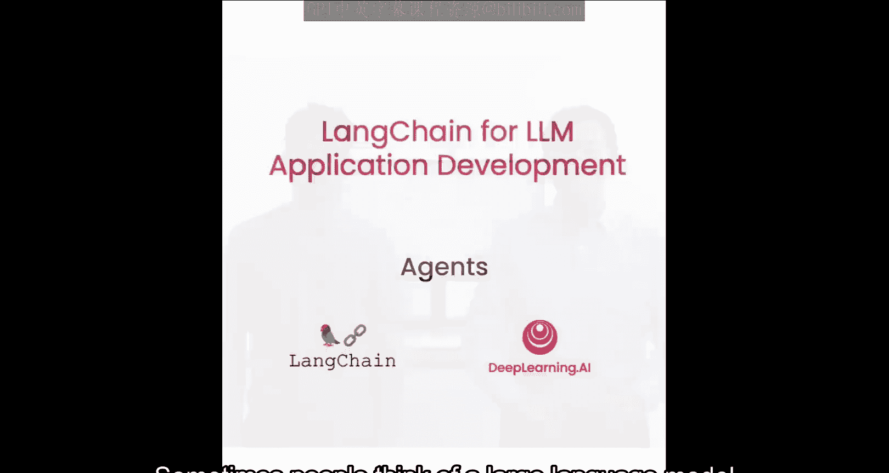

Sometimes people think of a large language model as a knowledge though as it is learn to memorize a lot of information。

 maybe off the internet， so when you ask the question， it can answer the question。

 but I think a even more useful way to think of a large language model is sometimes as a reasoning engine in which you can give it chunks of text or other sources of information and then the large language model or LOM well maybe use this background knowledge is learn off the internet but to use the new information you give it to help you answer questions or reason through content or decide even what to do next and that's what languagecha agents framework helps you to do。

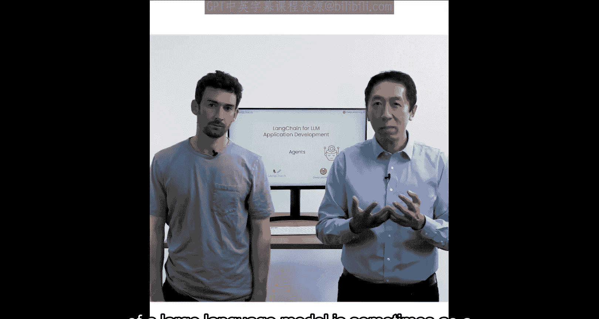

Agents are probably my favorite part of Lcha I think they're also one of the most powerful parts but they're also one of the newer parts。

 so we're seeing a lot of stuff emerge here that's really new to everyone in the field and so this should be a very exciting lesson as we dive into what agents are how to create and how to use agents how to equip them with different types of tools like search engines that come built into Langcha and then also how to create your own tools so that you can let agents interact with any data stores。

 any APIs， any functions that you might want them to so this is exciting cutting edge stuff but already with emerging important use cases some of that let's dive in。

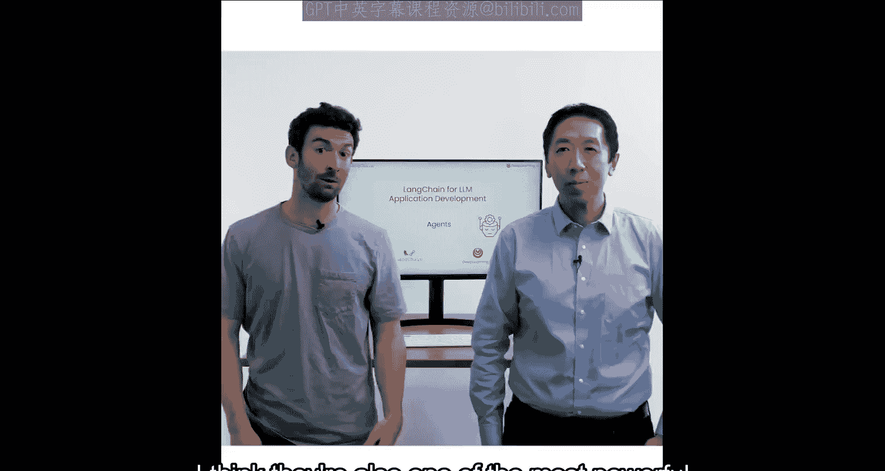

First， we're going to set the environment variables and import a bunch of stuff that we will use later on。

Next， we're going to initialize a language model， we're going to use chat Open AI。

 and importantly we're going to set the temperature equal to zero。

This is important because we're going to be using the language model as the reasoning engine of an agent where it's connecting to other sources of data and computation。

And so we want this reasoning engine to be as good and as precise as possible。

 and so we're going to set it to zero to get rid of any randomness that might arise。Next。

 we're going to load some tools。The two tools that we're going to load are the LLM math tool and the Wikipedia tool。

The LLM math tool is actually a chain itself。Which uses a language model in conjunction with a calculator to do math problems。

The Wikipedia tool is an API that connects to Wikipedia。

Allowing you to run search queries against Wikipedia and get back results。Next。

 we're going to initialize an agent， we're going to initialize the agent with the tools。

 the language model， and then an agent type。Here we're going to use chat zero shot React description。

The important things to note here are our first chat。

 this is an agent that has been optimized to work with chat models， and second， React。

 this is a prompting technique designed to get the best reasoning performance out of language models。

We're also going to pass in handle parsing errors equals true。

This is useful when the language model might output something that is not able to be parsed。

Into an action an action input， which is the desired output。When this happens。

 we'll actually pass the misforatted text back to the language model and ask it to correct itself。

And finally， we're going to pass in verbo equals true。

This is going to print out a bunch of steps that makes it really clear to us in the Jupyter notebook what's going on。

We'll also set debug equals true at the global level later on in the notebook so we can see in more detail what exactly is happening。

First we're going to ask the agent a math question， what is 25% of 300。

 this is a pretty simple question， but it will be good to understand what exactly is going on。

So we can see here that when it enters the agent executor chain that it first thinks about what it needs to do。

 so it has a thought。It then has an action， and this action is actually a JSON blob corresponding to two things。

 an action and an action input。The action corresponds to the tool to use， so here is as calculator。

The action input is the input to that tool， and here it's a string of 300 times 0。25。Next。

 we can see that there's observation with answer in a separate color。

This observation answer equals 75。0 is actually coming from the calculator tool itself。Next。

 we go back to the language model when the text turns to green。We have the answer to the question。

 final answer 75。0， and that's the output that we get。

This is a good time to pause and try out different math problems of your own。Next。

 we're going to go through an example using the Wikipedia API。

Here we're going to ask you a question about Tom Mitchell。

 and we can look at the intermediate steps to see what it does。

We can see once again that it thinks and it correctly realizes that it should use Wikipedia。

It says action equal to Wikipedia and action input equal to Tom M Mitchell。

The observation that comes back in yellow this time。

 and we use different colors to denote different tools。

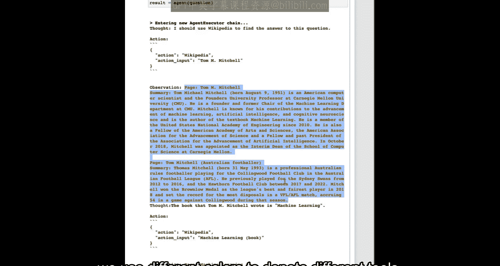

Is the Wikipedia summary result for the Tom and Mitchell page？

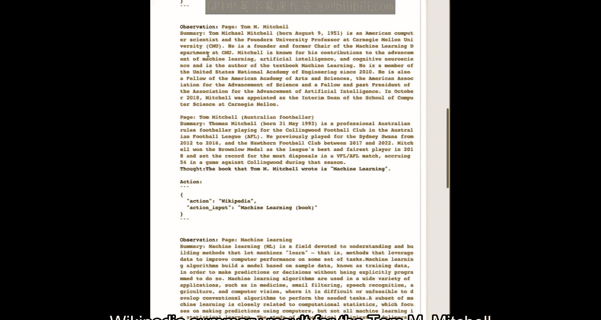

The observation that comes back from Wikipedia is actually two results。

 two pages as there's two different TM Mitchells， we can see the first one covers the computer scientist。

And the second one， it looks like it's an Australian footballer。

We can see that the information needed to answer this question。

 namely the name of the book that he wrote，Machine learning is present in the summary of the first Thomasma Mitchell。

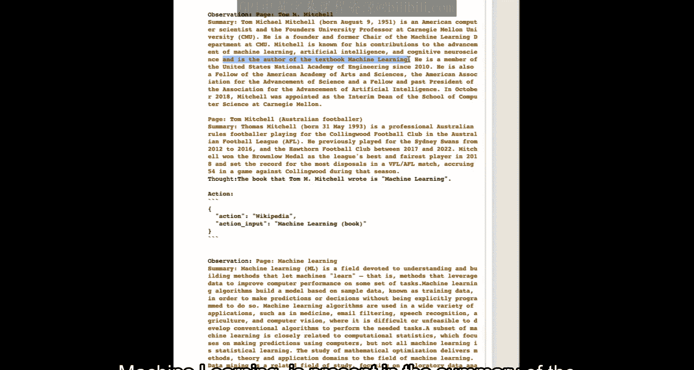

We can see next that the agent tries to look up more information about this book。

 so it looks up machine learning book in Wikipedia。This isn't strictly necessary。

 and it's an interesting example to show how agents aren't perfectly reliable yet。

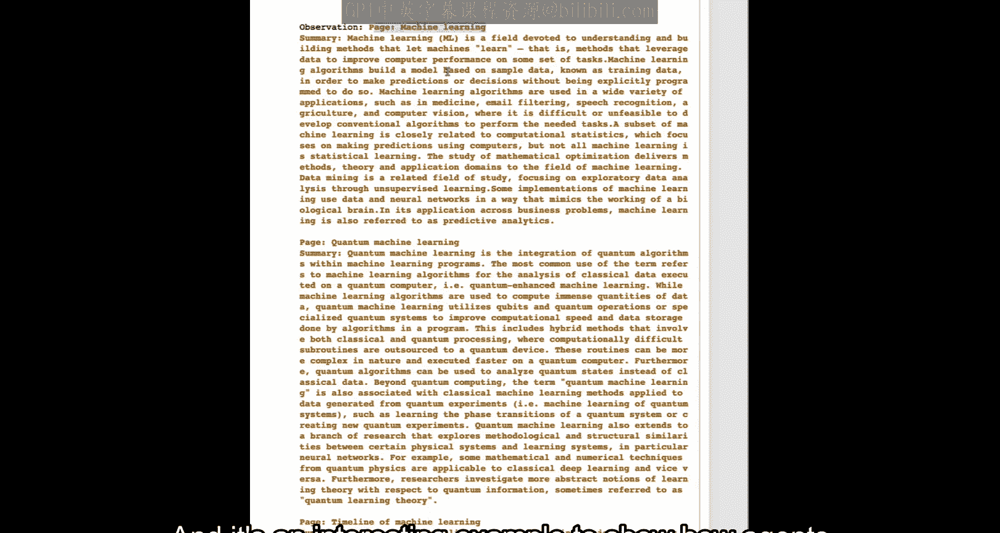

We can see that after this lookup， the agent recognizes that it has all the information it needs to answer and responds with the correct answer。

 machine learning。

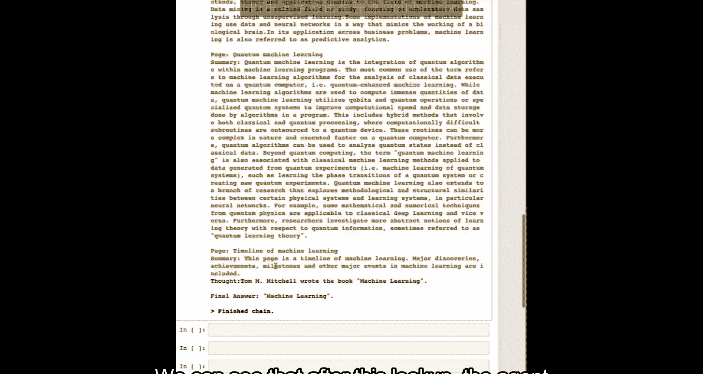

The next example we're going to go through is a really cool one if you've seen things like Copit or even chat GT with the code interpreter plugin enabled。

 one of the things they're doing is they're using the language model to write code and then executing that code and we can do the same exact thing here。

So we're going to create a Python agent。And we're going to use the same LLM as before。

And we're going to give it a tool， the Python Reple tool a Reple is basically a way to interact with code。

 you can think of it as a Jupiter notebook， so the agent can execute code with this repple。

 it will then run and then we' get back some results and those results will be passed back into the agent so it can decide what to do next。

The problem that we're going to have this agent solve is we're going to give it a list of names and then ask it to sort them。

So you can see here we have a list of names， Harrison Chase， Lane Chane， LLM， Jeff Fusion。

 Transformer， Gen AI， and we're going to ask the agent to first sort these names by last name and then first name and then print the output importantly we're asking it to print the output so that it can actually see what the result is。

These printed statements are what's going to be fed back into the language model later on。

 so it can reason about the output of the code that it just ran。Let's give this a try。

We can see that when we go into the agent executor chain。

It first realizes that it can use the sorted function to list the customers。

It's using a different agent type under the hood， which is why you can see that the action and action input is actually formatted slightly differently。

Here， the action that it takes is to use the Python Reple。

 and then the action input that you can see is code where it first writes out customers equals this list。

 it then sorts the customers， and then it goes through this list and print it。

You can see the agent thinks about what to do and realizes that it needs to write some code。

The format that it's using of action and action input is actually slightly different than before。

 it's using a different agent type under the hood。For the action。

 it's going to use the Python Reple and for the action input it's going to have a bunch of code and so if we look at what this code is doing。

 it's first creating a variable to list out these customer names。

 it's then sorting that and creating a new variable and it's then iterating through that new variable and printing out each line just like we asked it to。

We can see that we get the observation back， and this is a list of names。

 and then the agent realizes that it's done and it returns these names。

We can see from the stuff that's printed out the high level of what's going on。

 but let's dig a little bit deeper and run this with La chain debug set to true。As this prints out。

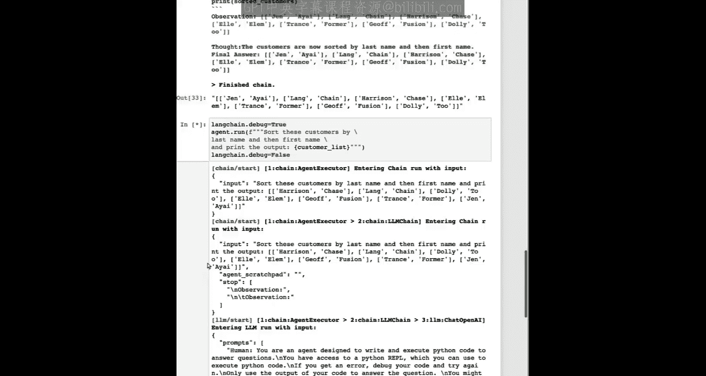

All the levels of all the different chains that are going on。

 let's go through them and see what exactly is happening。So first we start with the agent executor。

 this is the top level agent runner and we can see that we have here our input。

 sort these customers by last name and then first name and print the output。From here。

 we call an LLM chain。This is the LLM train that the agent is using。

So the LLM chain remembers a combination of prompt and an LLM。

 so at this point it's only got the input in agent Sct pad。

 we'll get back to that later and then some stop sequences to tell the language model when to stop doing its generations。

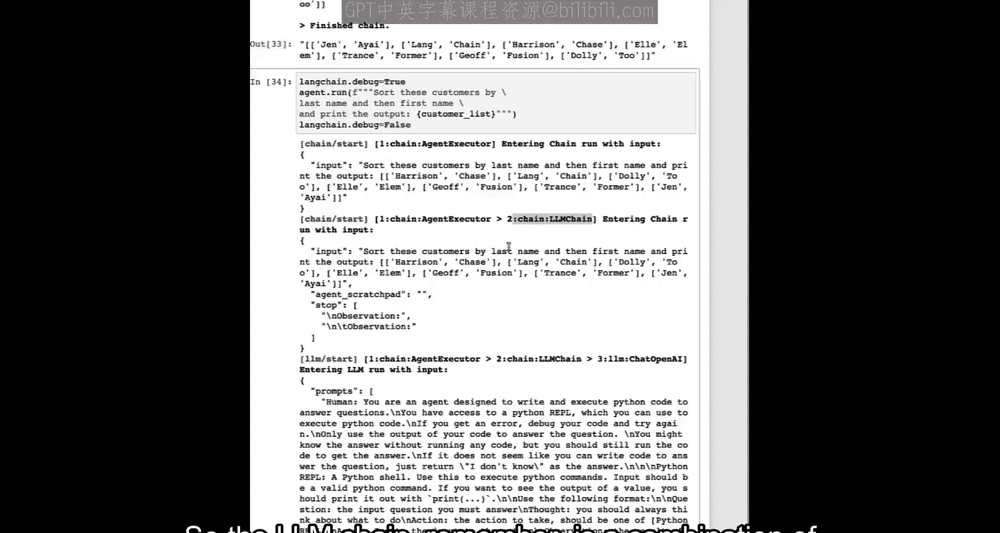

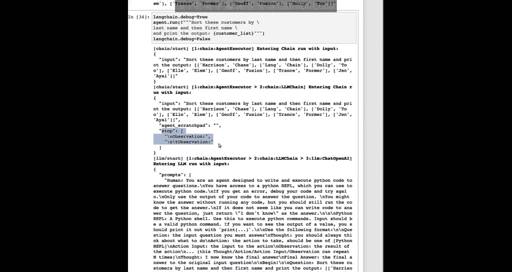

At the next level， we see the exact call to the language model。

 so we can see the fully formatted prompt， which includes instructions about what tools it has access to as well as how to format its output。

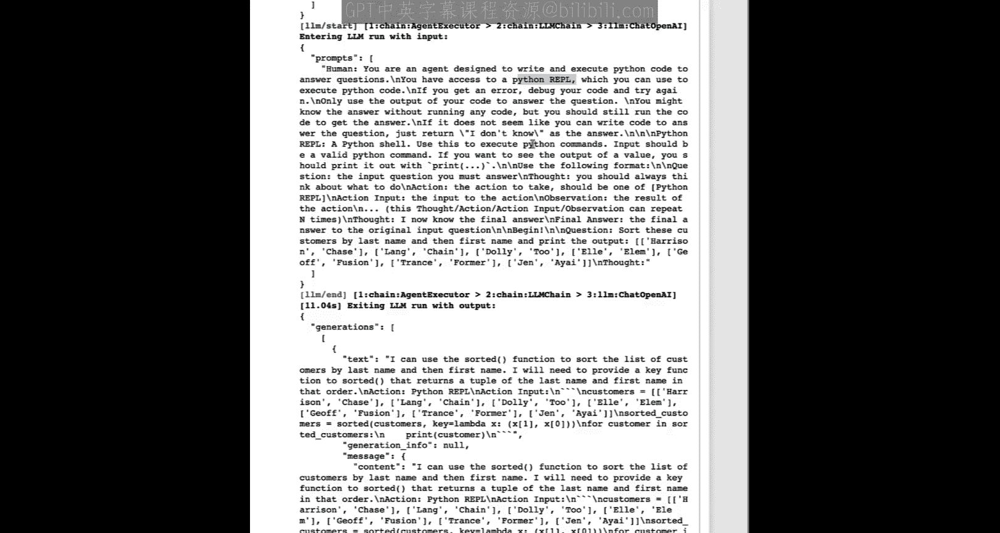

From there， we can then see the exact output of the language model so we can see the text key where it has the thought and the action and the action input put all in one string。

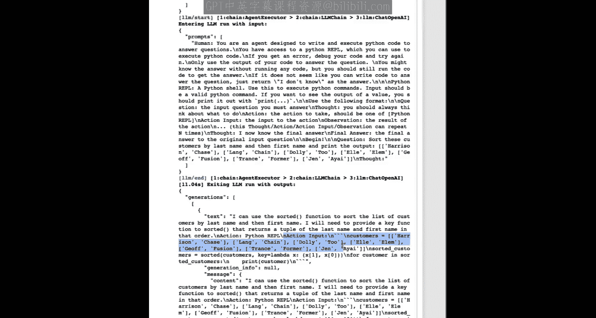

It then wraps up the LLM chain as it exits through there。

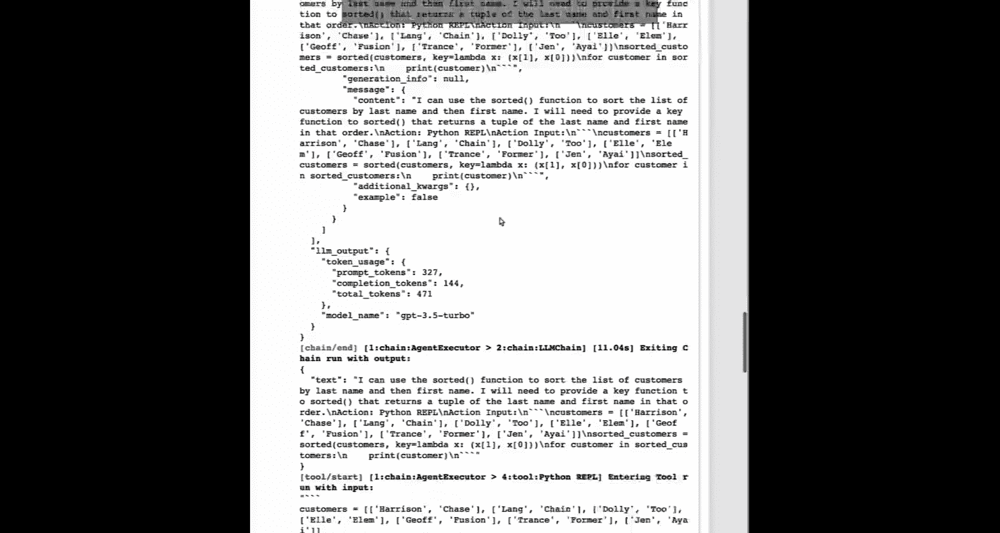

And the next thing that it calls is a tool and here we can see the exact input to the tool。

 we can also see the name of the tool Python Repple， and then we can see the input。

 which is this code。

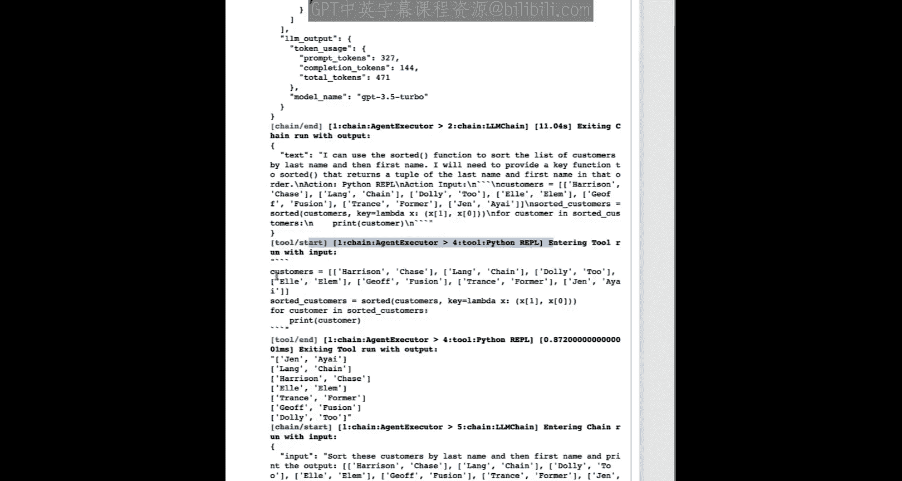

We can then see the output of this tool， which is this printed out string and again。

 this happens because we specifically ask the Python Reple to print out what is going on。

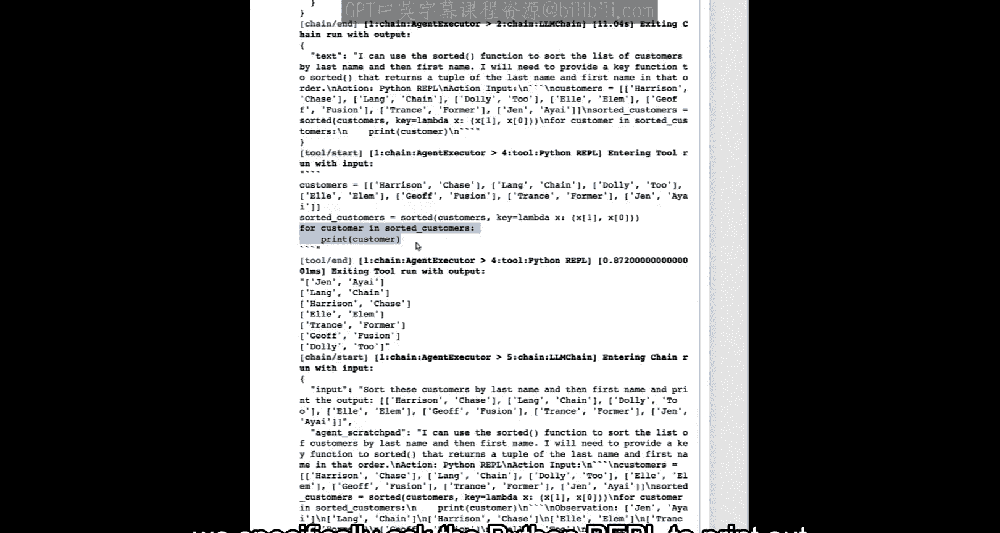

We can then see the next input to the LLM chain， which again， the LLM chain here is the agent。

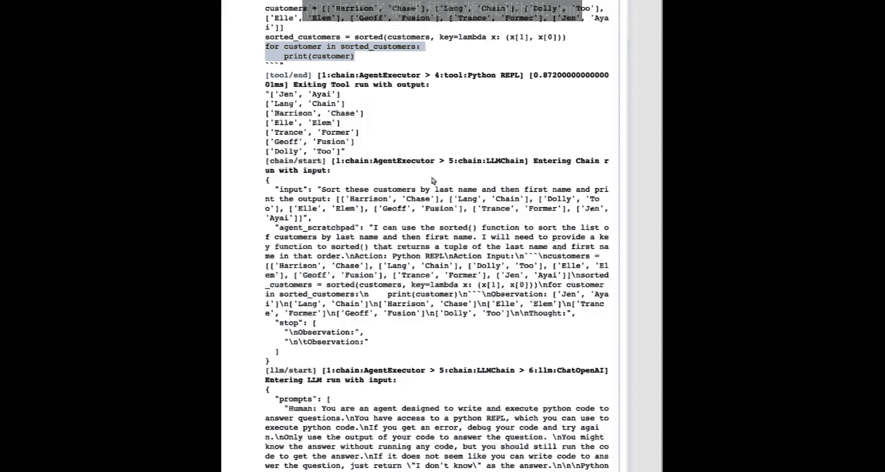

So here， if you look at the variables， there's the input， this is unchanged。

 this is the high level objective that we're asking。

 but now there's some new values for agent Sctpad。You can see here that this is actually a combination of the previous generation plus the tool output。

 and so we're passing this back in so that the language model can understand what happened previously and use that to reason about what to do next。

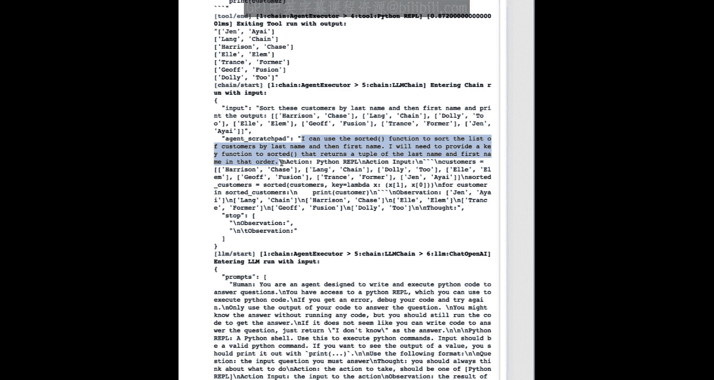

The next few print statements are covering what happens as the language model realizes that it is basically finished with its job。

 so we can see here the fully formatted prompt to the language model。

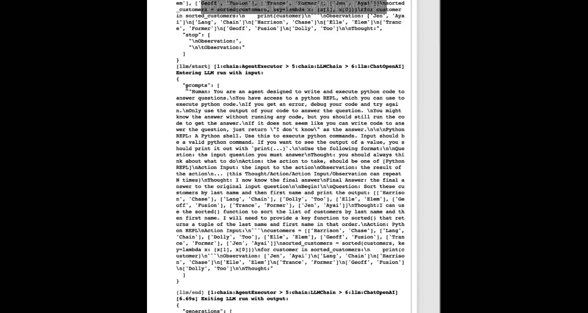

The response where it realizes that it is done and it says final answer。

 which here is the sequence that the agent uses to recognize that it's done with its job。

 we can then see it exiting the LLM chain and then exiting the agent executor。

This should hopefully give you a pretty good idea of what's going on under the hood inside these agents。

This should hopefully give you a pretty good idea of what's going on under the hood and is hopefully instructive as you pause and put your own objectives for this coding agent to try to accomplish。

This debug mode can also be used to highlight what's going wrong。

 as shown above in the Wikipedia example， sometimes agents act a little funny and so having all this information is really helpful for understanding what's going on。

So far， we've used tools that come defined find in LinkedIn already。

But a big power of agents is that you can connect it to your own sources of information。

 your own APIs， your own data， so here we're going to go over how you can create a custom tool so that you can connect it to whatever you want。

Let's make a tool that's going to tell us what the current data is。First。

 we're going to import this tool decorator， this can be applied to any function and it turns it into a tool that Ling chainin can use。

Next， we're going to write a function called time， which shakes in any text string。

 we're not really going to use that， and it's going to return today's date by calling date time。

In addition to the name of the function， we're also going to write a really detailed doctrine。

 that's because this is what the agent will use to know when it should call this tool and how it should call this tool。

For example， here we say that the input should always be an empty string。

 that's because we don't use it。If we have more stringent requirements on what the input should be。

 for example， if we have a function that should always take in a search query or a SQL statement。

 you'll want to make sure to mention that here。We're now going to create another agent。

 this time we're adding the time tool to the list of existing tools。And finally。

 let's call the agent and ask it what the date today is。

It recognizes that it needs to use the time tool， which it specifies here。

It has the action input as an empty string， this is great。

 this is what we told it to do and then it returns with an observation and then finally the language model takes that observation and responds to the user Today's date is 20230521 You should pause the video here and try putting in different inputs。

😊，This wraps up the lessons on agents， this is one of the newer and more exciting and more experimental pieces of L chain。

 so I hope you enjoy using it， hopefully it showed you how you can use a language model as a reasoning engine to take different actions and connect to other functions and data sources。

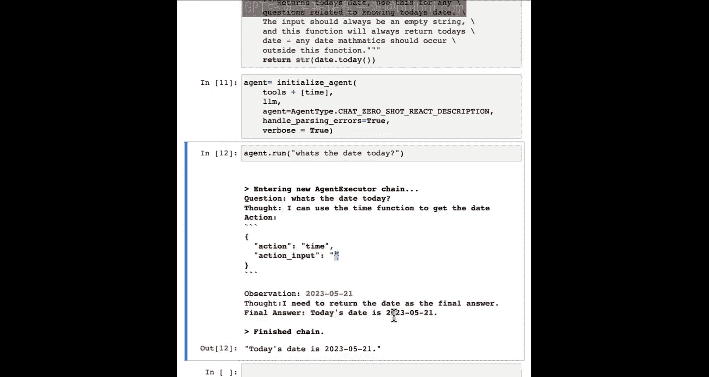