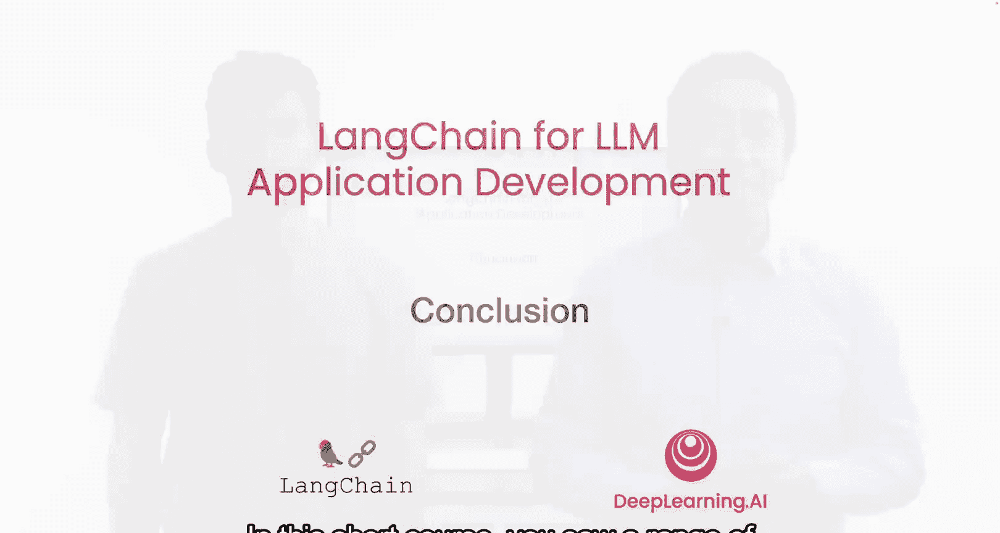
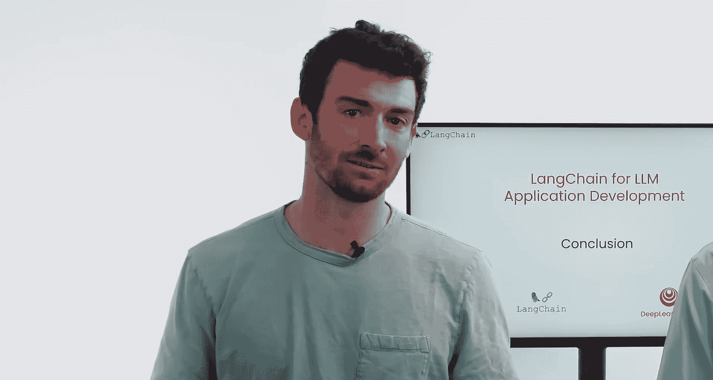

# 吴恩达《用于LLM应用程序开发的LangChain》｜langchain-for-llm-application-development｜中英字幕 - P8：8_LangChain_Conclusion_v02.zh_en - GPT中英字幕课程资源 - BV1zu4y1Z7mc

In this short course you saw a range of applications。

 including processing customer reviews and building an applications to answer questions over documents and even using an LOM to decide when to make a call to an external to like web search to answer complex questions if a week or two ago someone had asked you how much work would it be to build all of these applications I think a lot of people have thought boy this sounds like weeks you maybe even longer of work。

 but you saw in this short course how of just a pretty reasonable number of lines of code。

 you can use language to build all of these applications pretty efficiently as I hope you take these ideas。

 maybe you can take some code snippets that you saw on the Jupyter notebooks and use them in your own applications。

And these ideas are really just the start There's a lot of other applications that you can use language models for these models are so powerful because they're applicable to such a wide range of tasks。

 whether it be answering questions about CSVs， querying SQL databases interacting with APIs there's a lot of different examples of using chains and the combinations of prompts and output parsers and then more chains to do all these things in LCha。

 and most of that is due to the Lnk community so I want to also give a really big think out to everyone in the community who's contributed。

 whether it be improvements in the documentation making it easier for others to get started or new types of chains。

 opening up a whole new world of possibilities and so with that if you have not yet already done so I hope you go to your laptop or your desktop and run Pip install Lcha and then go use this too to go build some amazing applications。

